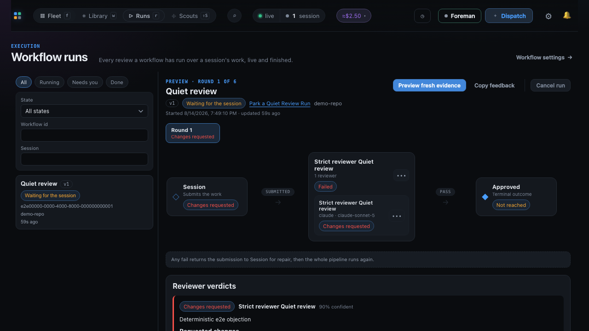
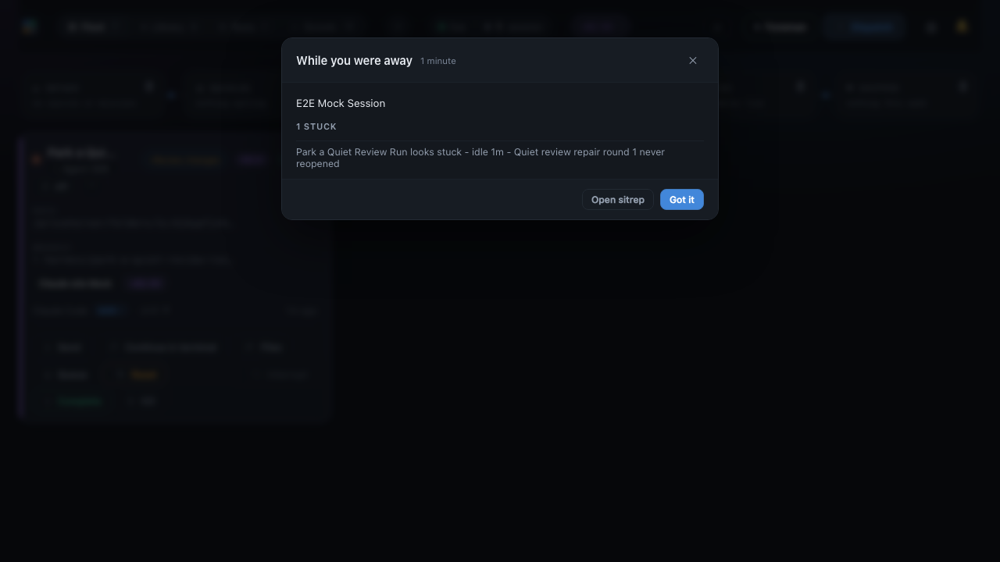
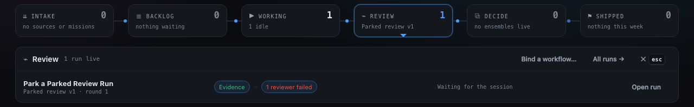
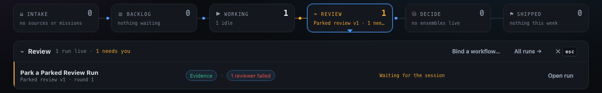
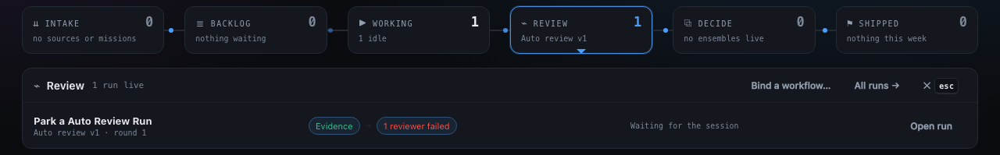

# Attention inbox (one place to drain what needs you)

The topbar's **to answer** count opens the **attention inbox**: one ordered queue holding
everything that is waiting on a person, so nothing depends on catching a toast or noticing a
card. Its sections are fixed and never interleave, because they are different kinds of
obligation:

1. **Decisions** - an ensemble run parked at `awaiting_decision`, with its progress dots and
   **Open dossier**. Nothing else in that run moves until it is answered.
2. **Questions from agents** - every pending [review](sessions.md#review-channel-mcp), grouped by the
   session that raised it and **answered right here**: the same card the per-session review
   modal draws, diff/plan/question and option menus included. A checkout path in a question links
   here exactly as it does in that modal: clicking it closes the inbox and opens the file in the
   session's Files tab, and the question stays pending. A member of an ensemble carries
   its run context on the header line - *Best of N "Fix the parser" - candidate 3 of 5* - so
   whoever answers can tell they are steering one competitor of a comparison.
3. **Session control requests** - with the preview enabled, each request shows who asked and why.
   **Accept** grants control from the desktop app. **Decline** answers the session from any dashboard.
4. **Parked on a menu** - a session sitting on a terminal
   [option menu](sessions.md#answer-a-sessions-menu-from-the-dashboard). Listed, not answered in the
   inbox: it deep-links to the session detail, while an ensemble member's live lane in the run
   detail also renders the verified pane dialog in place.
5. **Pipeline lifecycle** - a [Pipeline](pipelines.md) commission whose provider lifecycle needs
   you: a launch blocked on readiness, a failure, lifecycle evidence that conflicts with the task,
   a missing workspace, or a held Engineer. **Open Pipeline** opens the commission.
6. **Pipeline halts** - a [pipeline](pipelines.md) an external SDLC engine stopped and will not
   resume on its own. Each row names the feature, the [halt class](pipelines.md#a-halted-pipeline-in-the-inbox)
   and what the engine said stopped it, points at the provider's runbook section for that class,
   and links to the run's own detail. This is the only section with no session behind it: the
   engine stops dispatching at a halt, so the agent that hit the gate has usually exited by the
   time anybody looks. Nothing here clears a halt: that stays with the engine's own CLI. The
   row's **Dismiss** only takes it out of the inbox, and the pipeline stays halted.
7. **Waiting on you** - the backstop: a session the fleet paints amber that no section above
   already accounts for. It deep-links to the session detail, because the answer goes to the agent.
8. **Stuck** - with the `inbox` preview flag on, a session the daemon's
   [stuck rules](#stuck-sessions) flagged, with the fix on the row. See
   [Stuck rows](#stuck-rows). With the **Stalled section in Idle** preview on as well, idle stalls
   are drawn in Idle instead of here.
9. **Stuck finalizations** - a promotion that stopped on an error.
10. **Reports** - agent reports waiting to be read, with the **Reports and inbox upgrades** flag
   on. See [Agent reports](#agent-reports) below. They are read, not answered, so they are never
   in the **to answer** count.

The count is the obligations the inbox is showing you, not its rows: a session holding three
questions is one row and three. A row you dismissed is not in it, even while what it reports is
still unresolved, so the count can be lower than what is actually owed. It is a rendering of
state the dashboard already has - it subscribes to nothing, decides no severity, and is not a
second notifier; [Alerts and Away mode](#alerts--away-mode) still own
what interrupts you. Escape closes it, like every overlay. Per-session entry points are
unchanged: a session detail's review affordance and a board tile's flag still open that session's own
review modal.

Press <kbd>e</kbd> on the Board when **to answer** is visible to open the inbox. From an open
conversation, the same key scrolls to and focuses that session's first pending question in the
inbox. If that session has no question listed there, the inbox opens at the top in its usual order.

A question filed with [Ask without stopping](sessions.md#asking-without-stopping) is in the inbox
and the **to answer** count like any other while it is pending. Its session turns amber, reading
**waiting on your answer**, only once the agent has stopped with it still open; a resident keeps
its own colour and cadence. A merged pull request closes it unanswered with the reason `merged`,
which takes it out of the inbox.

Its card says which: **Still working** with the agent's own line on what it is doing meanwhile, or
**Stopped, waiting on this answer**, and how long ago it was asked. Within **Questions from
agents**, sessions that have stopped are listed first, then oldest question first; a session still
working past its questions follows every stopped one. A question waiting inside a call always
counts as stopped, so while the inbox holds only questions waiting inside a call, which is always
the case if the flag has never been on, the order is oldest first, as it was. Questions filed
while the flag was on stay answerable after it is turned off, and keep this stopped-first order
until they are settled. The row's own
**Dismiss** says the questions stay open and, like the cards, whether the agent keeps working or
has stopped on them, rather than that it keeps waiting.

A plan form filed with [File plan decisions](sessions.md#filed-plan-decisions) is a gate, not a
question its agent works past. Its session is amber, reading **to review**, and the form counts in
**to answer** from the moment it is filed, even while the agent is still finishing its turn. Its
card reads **Waiting on your decisions**, its row is listed with the stopped sessions, and the
"needs review" alert fires once, at filing. It offers no **Remind me later**. A merged pull
request closes it unanswered with the reason `merged`.

A plan the agent [revised](sessions.md#revising-a-filed-plan) replaces its earlier card rather
than joining it: the inbox holds one card, tagged **Revision 2** (then 3, and so on), and
**Earlier version** beside the tag shows the form it replaced, read-only.

### One name for an agent

With the **Reports and inbox upgrades** preview flag (`inbox`) on, one rule names an agent
wherever the inbox and its alerts name one: alert titles (the toast and the Away digest alike),
the inbox's row headers, a snoozed question's row, the review modal's header, and a line at the
head of each question card. The first of these that is set wins:

1. a call sign or a resident's reference name while voice is enabled;
2. a resident's profile name, drawn in its board colour;
3. the task title;
4. the session name;
5. "a session".

The attention inbox's row headers and its split list are the exception to rank 1. A call sign or
reference name there never replaces the title: the header prints the agent's resident profile name,
task title or session name, then the spoken name in quotes beside it, drawn by the board card's own
call sign badge (`CallSignMark`, its Trailing badge in a header and the Console rail's compact pill in
a list row, where the title is cut short before the pill is). A question card inside the inbox
leaves the name to its row header and draws no name line of its own. `agentNamePair` in
`src/shared/display-name.ts` splits the two names; with voice off there is no pill.

With the flag off every surface names an agent exactly as it did before: the inbox, the snoozed
row and the review modal print the session name, alert titles print the task title or else the
session name, and question cards print no name line. The tray shows counts only, so it has no
name to change.

The inbox's sections follow one fixed order, `INBOX_SECTION_ORDER` in
`src/web/lib/attention.ts`, whatever order the fold derives them in. Later sections are inserted at
fixed places in it rather than appended. **Reports** is its last entry, directly after **Stuck
finalizations**, so the inbox's own **Snoozed** heading always comes right after it.

### Answering questions by voice

With voice enabled, the foot of an open report or Stuck row lists the phrases for its
available controls. Plan forms show ordinal badges and option letters. Voice selections
stay in the draft until Submit, and an unanswered decision is marked when a spoken submit
is refused. See [answering questions](voice.md#answer-a-question-by-voice),
[filling plan forms](voice.md#fill-a-plan-form-by-voice), and
[spoken inbox actions](voice.md#act-on-an-inbox-card-by-voice).

### Agent reports

With the **Reports and inbox upgrades** flag (`inbox`) on, an agent can post a report with the
[`post_report`](sessions.md#agent-reports) tool when it has finished something you need to read in
order to act. The tool returns at once and the agent carries on: a report is not a question and
nothing waits on it.

- **Reports** in the inbox lists every report waiting to be read, one row per agent, agents in
  the order of their oldest report. A resident is one agent across all of its runs. Each report is
  collapsed to its title, the agent's name and its age; clicking the title opens it to show the
  body, the link and **Mark read**, and clicking it again closes it.
- The top bar shows a separate, neutral **to read** figure, which opens the inbox. It never counts
  toward **need you** or **to answer**, and a report never turns a session amber.
- A report with an attached document offers **Open report**, which shows the copy stored when it
  was posted, and **Publish as scout**, which saves that document to the scout archive only when
  you press it and then reads **Published** with **Open archive**. See
  [Agent reports](sessions.md#agent-reports).
- A report stays in **to read** until you press **Mark read**, reply to it, or start a follow-up
  task from it that is dispatched. Opening it, opening its document, publishing it, or opening
  the inbox does not clear it; Mission
  Control records only when you first opened it, with no visible count. A report row has no
  **Dismiss**: one of those is how it leaves.
- An agent that posts again with `replaces` set to its earlier report's id replaces it: the inbox
  shows only the latest, with a note such as **updated 2 times**, and it keeps the first report's
  place in the queue. Reports posted without `replaces` stack.
- A report outlives its session. An exited session, or one whose pull request merged, leaves its
  reports in **to read**, named as the agent was named when it posted.

#### Answering a report

An open report offers the answer its agent can take now, read from the live sessions and resident
runs:

- **The agent is running.** A reply box with **Send reply**. The reply is delivered through the
  session's outbox as your own message, exactly like one typed in the composer: queued behind a
  busy turn, echoed and captured the same way, and it counts toward the agent's Goal. It names the
  report it answers and restates it, then gives your words:
  "Reply to your report 'Build failure diagnosed' (r-42), posted 12 minutes ago", the report's
  title and body, then what you wrote. The outbox accepting it marks the report read. If the
  agent replaces the report while you are writing, the new version takes its place on screen
  and keeps your words; a reply to a version that was replaced or already read is refused. A
  session that cannot take the message refuses it, and the report stays in **to read**. A
  resident's reply goes to whichever run of that resident is up now.
- **A resident that is not running.** The card says "Steve isn't running" and that you can launch
  it again from the Residents drawer. That is text, not a control.
- **A standard session that has ended.** A box with **Start a follow-up task**, which stays
  disabled until you write what the follow-up should do: a follow-up task is never filed without
  your instructions. It files a new task in the repository the report recorded, with your words
  followed by the report as its
  intent, and dispatches it. When the report's own task can still be found, the follow-up keeps
  its harness and model, and its kind if that is a shipping kind (ship, bugfix or document;
  anything else becomes ship). A report from a session with no task, or whose task can no longer
  be found, gets the Dispatch defaults instead: a ship task on the default harness and model.
  Either way it takes your Workflow default for its kind. The old
  session is never resumed. The new task is recorded on the report as it is created, and the
  report is marked read only once the task has been dispatched. If the dispatch fails (a launch
  hold, say), the card reads "Follow-up task created but not started" with **Retry**, which
  dispatches that same task: a report has at most one follow-up task however often you press it.
  The report follows its task however the task is started or ended. A held follow-up you later
  start from the Backlog leaves **to read** as soon as it starts, without pressing **Retry**. A
  follow-up task you cancel answers nothing, so the report comes back to **to read** even if the
  follow-up had cleared it, and its card offers the instructions box again for a new follow-up.
  Deleting a follow-up task that was already dispatched leaves its report answered, since it may
  have done its work; deleting one that never started frees the report the same way a cancel
  does. **Retry** never files a task: a new follow-up never starts without your words.
  The route refuses a follow-up while the session has not ended: a running agent is replied to,
  never replaced by a second session. The dispatch runs its launch in the background, so if that
  launch then fails with no session (the task fails or returns to the Backlog), the report comes
  back to **to read** with **Retry**, which relaunches the same task.
- **A session that is still running but cannot take a message** (no pane to write to, or driven
  by a pipeline engine). A line says so. It has not ended, so no follow-up is offered either.
- **A report that recorded no repository.** A line saying a follow-up task cannot be started from
  here.

**Send reply**, **Start a follow-up task**, **Retry**, **Open report**, **Publish as scout** and
**Open archive** are declared inbox actions; **Retry** is the follow-up action under another
label, and **Open archive** is click-only navigation. A report's entry in its session's conversation says
whether it was read, replied to or followed up (see
[Agent reports](sessions.md#agent-reports)).

Reports never enter the review channel, so they raise no `pendingReviews`, hold no completion,
count toward no question limit, close on no merge, and Foreman never reads, answers or marks them.
With the flag off, `post_report` is refused, the inbox has no Reports section, the top bar has no
**to read** figure, and stored reports are kept for when it is turned on again.

A report also raises a notification, and **Agent reports are listed in the inbox** can take
reports out of the inbox list and the **to read** figure; see
[What notifies you](#what-notifies-you).

#### When reports get chatty

Three controls, all behind the same flag:

- **Report guidance.** Settings > **Reports** holds the text that tells agents when to post a
  report, in a box with **Save** and **Reset to default**, up to 2,000 characters. It replaces
  only the when-to-report sentence of `post_report`'s description; the rest (progress goes to
  `report_status`, and anything urgent or anything you must decide is a question) is fixed and
  shown beneath the box. A session reads the guidance once, when its Mission Control tools
  start, so a change reaches sessions started afterwards and a session already running keeps the
  guidance it started with. If the daemon does not answer that read in time, the session gets the
  default guidance.
- **Mute an agent.** An open report offers **Mute Steve's reports**. A muted agent can still post,
  and nothing it posts is refused. From the moment of the mute its reports raise no notification,
  are left out of the inbox's Reports section, the **to read** figure and the Away digest, and stay
  in its conversation. A mute hides reports and never marks them read, so **Unmute** brings back
  every report still waiting. Because a muted agent's rows leave the inbox, **Unmute** is in
  Settings > **Reports**, which lists every muted agent by the name its reports carried. A mute is
  keyed like the reports: a resident across all of its runs, any other agent by its session.
- **Mark all read.** The **Reports** heading has **Mark all read**, which marks read exactly the
  reports listed when you press it, however many there are, recorded as read with **Mark all
  read** in each conversation. The dashboard sends them in batches of up to 1,000 ids, the most
  one `POST /api/reports/read-all` accepts.
  A report that arrives after the click is not cleared, and neither is a report shown only under
  "Opened from a notification". There is no per-agent Mark all read.

A mute does not withdraw a notification that already arrived: the operating system keeps it, and
clicking it still opens its report. The inbox no longer lists that report, so it is drawn on its
own under "Opened from a notification", readable and unread, without a Mute control and with a
line saying the agent is muted and that Unmute is in Settings. The click leaves the Reports
section and the **to read** figure as they were. A mute stops only later notifications.

**Mute** has the spoken form "Steve, mute reports". **Mark all read** names no agent, so it is
click-only. With the flag off the Reports panel is hidden, the guidance and mute routes refuse,
sessions get the default guidance, and stored guidance and mutes are kept for when it is turned
on again.

### Stuck rows

With the **Reports and inbox upgrades** preview flag (`inbox`) on, every session the daemon's
[stuck rules](#stuck-sessions) currently flag has a row in the **Stuck** section, right after
**Waiting on you** and before **Stuck finalizations**. The rules and their thresholds are
unchanged; the inbox reads the same list the `stuck` alert does, polled from the daemon every few
seconds. With stall detection off in the alerts settings there are no Stuck rows.

With the **Stalled section in Idle** preview (`idle-stalled`) also on, the two idle rules, **Idle
with work open** and **Workflow run parked**, leave this section: their sessions are cards in
[Idle's Stalled section](ui.md) instead, with the facts and the same fixes on the card, and they
no longer count in **to answer**. A pinned resident's idle stall leaves too: the stall outranks the
pin, and a declared wait, so its card moves to the Stalled section. Only a stall Idle cannot draw stays: a resident shown
in the residents drawer is not on the fleet, so it keeps its Stuck row here. **Silent while working** and **Foreman escalation unanswered** stay
here. Dismissing a stall on either surface is one dismissal, so a stall dismissed as a card
stays hidden as a row when the preview is switched off, until its facts change. Either preview
opens `POST /api/sessions/:id/inbox-message`, the route behind Nudge, Continue and Tell it to
push; with both off it answers 403. The `stuck` desktop alert is unchanged by the preview.

Each row names the agent, says which rule fired and the rule's own sentence ("idle 23m with work
unfinished"), and offers the fix in place. Only controls whose target exists are drawn:

| Rule | The row shows | Controls |
| --- | --- | --- |
| Silent while working | the last activity line | **Nudge**, **Interrupt** |
| Idle with work open, a task open | the open task, and any open queue items | **Continue**, **Mark done** |
| Idle with work open, only a queue open | how many queue items are open, and that a queue's items are handled in the session | **Continue** |
| Workflow run parked | the missing step | **Resubmit** when a resubmission can move the run (a manual or Preview run waiting for the session), **Tell it to push** when the run waits for a pushed head and the branch holds commits the remote has not seen, **Continue** when the session's next turn reopens the round, and **Open run**. A run an ensemble started that is waiting for the session can only move when that ensemble submits again, so its row says so and offers Open run without Resubmit, Continue or a push |
| Foreman escalation unanswered | what Foreman escalated | a reply box, when the session can receive messages |

With **Stalled section in Idle** switched off, the inbox applies the same pushed-head rule.
When no unpushed commits are reported, the row offers **Open run** and explains that a new
commit must reach the remote branch. Earlier versions offered **Continue** in this case.
The message box remains available to ask the agent to prepare the change.

Every row also has **Open session** and **Dismiss**, and a message box to the agent when the
session can receive messages. A session that cannot, such as one driven by a pipeline engine or
one with no pane to type into, has no message box, no reply box on an escalation, and no Nudge,
Continue or Tell it to push, because each of those sends a message. There is no Cancel on any
inbox card.

- **Nudge**, **Continue** and **Tell it to push** queue a fixed message, through the same outbox
  as a typed one. They are recorded as Mission Control's words rather than yours, so they never
  become the session's Goal:
  - Nudge: "Status check from your operator: you have gone quiet. Reply with one line on what
    you are doing and whether anything is blocking you, then carry on. If you are waiting on a
    long-running command, say which one."
  - Continue: "Your operator asks you to continue. Work is still open against this session. Pick
    it up where you stopped and carry it through. If something is blocking you, say what it is
    instead of stopping."
  - Tell it to push: "Push your commits. The review is waiting for a pushed head on this branch."
- **Mark done** closes the inbox and opens the session's **Complete** dialog, the one its own
  Complete button opens, so the session completes like any other: the dialog takes an outcome
  note, offers **Unblock dependents** and a retro when one is worth running, and confirming it
  marks the task done and closes the session. Nothing completes until you confirm, and Cancel
  leaves the row as it was. A row about a queue alone has no Mark done, because there is no task
  to complete; a queue's items are managed in the session. A Stalled card in Idle
  (`idle-stalled`) and its session detail do the same.
- **Interrupt** stops the turn the session is in and drops the messages queued behind it, as the
  session's own Interrupt does; if the turn had already ended, nothing is stopped and the row
  says so. **Resubmit** opens the run's repair round, as the Runs page's Resubmit does.
- The message box and the escalation's reply box send an ordinary message, as the session's own
  composer does. A successful send clears the box only if nothing was typed after it started,
  so a new draft typed while it was sending stays in the box, even one with the same words.

A failed action shows its error under the row. It stays until another action on the row starts,
including a retry of the same one, or until the row reports a different stall. A row leaves on its
own when the daemon stops reporting the stall, which is when the session moves again. Stuck rows
count in **to answer**, one each. A stuck session that the board also paints amber is listed under
Stuck and not again under Waiting on you; a session with open questions keeps its question row as
well. If you dismissed its Stuck row and the session then turns amber, it is listed under Waiting
on you, so an amber session always has a row.

Speaking to an agent waiting inside a question or plan form can file the ask in the inbox.
The agent receives the filed receipt and can list or withdraw the ask. Answering it sends the
decision to the agent as a message. Older MCP children keep waiting for the answer in the call.

### Snoozed questions

After the sections above, a **Snoozed** section lists the `request_input` questions you chose
[Remind me later](sessions.md#remind-me-later) on: the session, the question, when it comes back,
what the agent was told to do meanwhile and **Answer now**, which brings it back at once. Snoozed
questions are not owed yet, so they are not in the **to answer** count. The topbar shows them as
a separate **snoozed** figure, which also opens the inbox, so they can be reached when nothing
else is waiting.

### Unified split inbox (preview)

With **Unified split inbox** (`inbox-split`) on in **Settings > Feature flags**, the inbox is one
list with a detail pane beside it. Every question, permission request, parked menu, halt, stuck
session and report is its own row: a session with two questions is two rows, marked **1 of 2**
and **2 of 2**, and each report is its own row with a dot while it is unread. The selected row
opens in the pane with the same card and controls the stacked inbox draws, so answering, **Mark
read**, **Accept**, **Nudge** and the rest work exactly as described above.

- **Moving on.** When the open row is settled and leaves the list (you answered it, accepted it,
  marked it read or dismissed it), the row after it opens on its own and the pane says so. With
  nothing after it, the row before it opens.
- **Moving around.** Click a row, or press **J** for the next row and **K** for the previous one
  (not while typing in a field). The arrow keys move through the list when it has focus.
  **Previous** and **Next** in the pane do the same, and **Up next** lists the next two rows.
- **Tabs.** **All**, **To answer** (everything owed, including rows that open elsewhere), **To
  read** (reports) and **Snoozed**, each with its count.
- **Reports opened from a notification.** A report the inbox already lists, or an earlier version
  of one it lists, opens in its own row under **Reports**: that row is selected and shows the
  latest version, and it is listed on **All** and **To read** like any report (choosing it from
  another tab switches to **All**). A report the inbox does not list (already read, unlisted, or
  from a muted agent) is listed first instead, under **Opened from a notification**, on every tab
  but Snoozed. While such a report is still loading, or if it could not be loaded, a line above the
  tabs says so and the list carries on without it.
- **Rows that open elsewhere.** Decisions, Pipeline lifecycle, Waiting on you and Stuck
  finalizations are settled on another page, so they are grouped under **Opens elsewhere**,
  marked ↗, and their pane shows what the inbox knows with the button that goes there.
- **Parked menus are answered in the pane.** A session parked on a terminal menu shows the menu's
  numbered options in the pane, the same prompt the review modal draws.
- **Plan forms keep every control.** A managed plan's final bundle shows **Approve all future
  bundles for this task** beside **Submit** in the pane, as it does in the review modal, and
  checking it while approving grants the same standing approval (see
  [managed plans](managed-plans.md)). It appears only on a final bundle bound to a task; a
  bundle already approved by a standing approval asks only its remaining questions, without it.
  `e2e/specs/inbox-split-standing-approval.spec.ts` covers this.
- **Dismiss narrows to one question.** A question row's **Dismiss** in the pane hides that one
  question, because a row's dismissal is kept per question.
- **Reports stay in step.** Selecting a report opens it on screen, the same open report a voice
  command acts on, and selecting another row closes it. **Mark all read** sits beside the
  **Reports** heading.
- **Narrow windows.** Below 800 px wide the list and the pane stack: the list fills the inbox,
  choosing a row shows its pane, and **‹ Inbox** goes back.

Turning the flag off brings back the stacked inbox at once, in every open window. Nothing is
stored by the split view itself. `e2e/specs/inbox-split.spec.ts` covers selecting, moving on after
an answer and a **Mark read**, **J**, the tabs, the narrow layout and the flag turning off.

### Dismiss a row without resolving it

Most rows have a **Dismiss** button. Session control requests stay visible until answered or withdrawn,
and reports have **Mark read**. **Dismiss** takes the row out of the inbox and out of the
**to answer** count without resolving anything: no answer is sent, the agent keeps waiting, a
halted pipeline stays halted, and the session keeps its colour on the board. Use it for something
you have read and cannot or will not act on from here, such as a Pipeline lifecycle problem the
provider has to clear.

The daemon keeps the dismissal, so the row stays gone after a reload, in every open window and
across a restart. After a reload the inbox and its **to answer** count wait until the dashboard
has read your dismissals, so a dismissed row never flashes back while the page loads. It comes
back only when it reports something new, and what counts as new depends on the row:

| Row | Comes back when |
| --- | --- |
| Decisions | never, for that run |
| Questions from agents | the agent asks a new question, or a question you chose **Remind me later** on comes back; only that one is shown |
| Parked on a menu | the menu's question or options change, including the same options renumbered |
| Pipeline lifecycle | the commission reports a different problem; a reworded detail line does not count |
| Pipeline halts | the halt's class or reason changes |
| Waiting on you | the session's state, or what it says it is waiting on, changes |
| Stuck | a different rule fires, what it found changes (another open task, a different number of open queue items, a new round or status of the parked run, a different number of unpushed commits), or the session moved and then stalled again, or Foreman escalated again, even with the same words; minutes passing do not count |
| Stuck finalizations | the finalization stops on a different error |

A question's own **Dismiss**, on its card, is a different button: it resolves the question and
tells the agent it was dismissed. The row's **Dismiss** only hides the questions, however many
the row holds. A row of more than 5,000 questions goes to the daemon in several requests; if one
is refused, only its questions come back, with the reason, and **Dismiss** sends them again.
A dismissed row leaves **to answer** while the session it names may still be blocked, so after
a dismissal **need you** can read higher than **to answer**, which without one it never does.
The two count different things - **need you** counts sessions, **to answer** counts each thing the
inbox is showing, one per question - so the gap between them is not the number of rows you hid.
Alerts are unaffected: [Alerts and Away mode](#alerts--away-mode) still decide what interrupts you.

A dismissal never expires and is never pruned, however many you make or however long ago. A
row that goes away and later returns saying exactly what it said when you dismissed it stays
dismissed; the same session asking for the same permission again is one example.

When the same row is dismissed more than once - it came back reporting something new and was
dismissed again, in this window or another - the newest dismissal is the one kept. A window that
dismisses a row without having seen a newer dismissal made in another window has its dismissal
refused, and the newer dismissal stands. If the row is still showing in that window, the reason
appears beneath it ("another window dismissed this since this one last looked"); if the newer
dismissal already hides the row there, there is nothing left to show and no message appears.

## Roundup

Click **Roundup** for a one-look snapshot of every session, assembled from the same live
data the fleet shows: **who needs you** (needs-input, pending reviews, sessions sitting on an
[option menu](sessions.md#answer-a-sessions-menu-from-the-dashboard)),
**who's working** (with their intent + activity), **what's idle**, the **backlog**,
and **recent outcomes**. Dispatch a backlog task, [edit it](dispatch-and-backlog.md#edit-a-shelved-task) by
clicking its name, or drop it right from the panel, and **Mark
done** a running task with its outcome (e.g. "opened PR #123") to close the loop. A cancelled
or failed row in recent outcomes offers **Reschedule**, which puts the task
[back in the backlog](dispatch-and-backlog.md#send-a-dispatched-task-back-to-the-backlog) at
its old position after a confirming click. **Copy as
markdown** yields a paste-able digest (also at `GET /api/report.md`; JSON at `GET
/api/report`).

The ☰ **Backlog** stage on [the Line](ui.md#the-line-the-pipeline-strip-above-the-fleet) used to
open this panel and now opens its own [drawer](ui.md#the-stage-drawers) - the queue in plan order,
which is the narrower thing that button's sentence promises. The drawer's footer escalates
here, because this is still where the backlog is read *against the rest of the fleet*: which
of those queued items is waiting on an agent that needs you, and what finished while you were
looking away. Nothing about this panel changed.

## Alerts & Away mode

So you don't have to watch the fleet, the dashboard can **alert you when a session
needs you**. The daemon already streams every attention event over SSE; the browser
turns those into a **desktop notification + a short sound** in the browser or Electron the moment a
session goes to `needs-input`, a session stops on an
[option menu](sessions.md#answer-a-sessions-menu-from-the-dashboard) (which needs no hooks, and says
how many options it's offering), a review lands, or a
dispatched task fails. A dispatch that never started is titled **Did not start**, including one
that failed while provisioning and went back to the Backlog, which used to raise no alert at
all. The dashboard also draws the failure in place; what it shows and which actions it offers
are described in [when a dispatch does not start](dispatch-and-backlog.md#when-a-dispatch-does-not-start). It's zero extra tokens - the daemon (not an LLM) does the
watching - and there's no phone/SMS piece; it's the open dashboard tab that alerts.

**Only things blocked on you ever interrupt.** Informational events (a session going
idle, a task finishing) are detected but never notify; they're digest material. Alerts
fire on the *transition* into attention (once, not every tick) and de-dupe, so a
waiting session pings you once. The chime is synthesized with the Web Audio API (no
asset, no network).

### What notifies you

With the **Reports and inbox upgrades** flag (`inbox`) on, the alerts popover has a **What
notifies you** group under **How you're reached**, with five switches, all on by default:

| Switch | Off means |
| --- | --- |
| **Blocking questions notify** | A question the agent waits on inside the call raises no notification. |
| **Questions filed while working notify** | A question filed with [Ask without stopping](sessions.md#asking-without-stopping) raises no notification. |
| **Agent reports notify** | A report raises no notification. To silence one agent rather than all of them, [mute it](#when-reports-get-chatty). |
| **Agent reports are listed in the inbox** | Reports leave the inbox's Reports section and the **to read** figure. They stay in each conversation and are not marked read, and a report notification still arrives. |
| **Stuck sessions notify** | A [stuck session](#stuck-sessions) raises no notification. |

A notify switch only stops the notification: the item is still in the inbox. Every other alert
is unchanged, and with the flag off the group is hidden and the switches are not read.

**A report notification** is named by the agent's display name and worded by what the agent did
after posting. An agent calls `post_report` mid-turn, so the daemon waits up to 20 seconds: if
the session is seen working and then stops in that time, is seen stopped or blocked on you (a
confirmed idle state, an open question, a menu), or leaves, the notification reads
**Steve's back: Build failure diagnosed**, and otherwise, when the time is up, **Steve posted a
report: Build failure diagnosed**. A session that reports no working state at all, such as one
without hooks, gives no evidence that it stopped: while it is still present when the time is up,
its report takes the second wording, and if it leaves first, the first. After an ordinary post,
"back" can therefore trail it by up to 20 seconds. A report read or replaced within that time
raises nothing, and a session that stops without posting a report stays silent.
A report the daemon had not yet worded when it stopped is worded from its session's state after a
restart, against its original 20-second deadline: a restart neither extends nor restarts it. If
that deadline has passed before the restarted daemon sees the session again, the wording waits
for the session's first sighting, up to one more 20-second period, after which a session still
unseen is taken to have left and the report is worded "back". Only a report whose deadline
passed at most 20 seconds before the restart is recovered this way; an older one that was never
worded, including every report posted before this build, is left alone and raises no notification.

**Clicking a report notification** opens the inbox at that report. The first row that matches
decides:

| At the time of the click | What opens |
| --- | --- |
| The **Reports and inbox upgrades** flag is off | Nothing: the click only focuses the window. |
| The report was replaced | The latest report of its chain, then the rows below apply to it. The older version is not shown in the inbox. |
| The Reports section lists the report | The inbox, with that report's row open. |
| The inbox does not list it, for any reason: reports are unlisted, or it was already read | The inbox, with that one report drawn open above the sections under **Opened from a notification**. |
| The report cannot be loaded | The inbox, with a line saying so. |

The click records that the report was opened and never marks it read. The **Opened from a
notification** band changes neither the Reports section nor the **to read** figure, offers
**Mark read** while the report is unread, and is gone when the inbox closes. A report the
dashboard no longer holds is read from `GET /api/reports/:id`, which returns the report and, when
it was replaced, the latest report of its chain. Like opening a report, that lookup is the
operator's: an agent's token, credential or attribution is refused with 403.

### Stuck sessions

The daemon also watches for sessions that have **gone quiet**, which no state
transition can announce - a stall is defined by nothing happening. Four rules, all
deterministic: an instrumented session that claims to be working but hasn't reported
in ~10 minutes; a session idle ~20 minutes with a task or queue still open against it
(the "died with work unfinished" case); a session idle that long with a **workflow run
parked on it**; and a Foreman escalation nobody answered. A stuck session is
attention-level, so it breaks through even while you're away.

While an open workflow owns the next move, its session is exempt from stall detection. Idle
sessions under active review appear under **Held by a workflow**. A run parked on its session
for a repair turn or a pushed head can still raise **Workflow run parked** after the idle
threshold.

A resident's standing task stays open between iterations and does not count as unfinished
work. Its scheduled waits therefore do not produce a Stuck row. An open queue, a parked
workflow, an unanswered escalation, or a silent active turn can still flag a resident.

A session standing on a [blocker](sessions.md#blocked-sessions) is exempt from the two idle
rules (open work and a parked run): it is waiting on someone other than you, and its blocker
already explains the silence, with its age on the card. A blocker raises no alert of its own,
a flagged reply is a card pill only, and neither counts as an answer you owe.

A session [awaiting a background process](sessions.md#sessions-awaiting-a-background-process-preview) is
exempt from the same two rules only until the deadline it declared. Once that passes the card
reads Overdue and the rules apply again from that point, so a watcher that died cannot keep a
stalled session out of the alerts. An Overdue wait raises no alert of its own; the stuck-session
alert is the one that fires.

The parked-run rule is the backstop for a review loop that quietly stopped. A run
waiting in `waiting_for_session` or `waiting_for_new_head` is waiting on *that session's
next turn*, so a session that took the repair packet, made the fix and went idle has
work outstanding against it even though its task is done and its queue is empty. The
alert names the missing step rather than the silence - "repair round 2 never reopened",
or "waiting for a pushed head" for the GitHub Inspector findings that clear only when the
poller sees a new head **on the remote**.

Pre-PR ship recovery also produces attention when safe automation has no next send. A prompted
completion with `verification_failed` escalates immediately because no model judged the work.
An eligible ship session that remains stalled through three bounded recovery sends escalates on
the next due pass without a fourth instruction. Both are durable Foreman escalation episodes, so
they appear in the session's Foreman history, the fleet decision ledger, and the ordinary
Foreman-attention path. Opening the record shows the recovery reason, attempt history, delivery
knowledge, and completion context instead of presenting an unlabelled idle session.

It deep-links to the **run** rather than to the session, because the run is where that
step is named and where its state can be read. What you can do when you arrive is not a
property of the status alone - it depends on the run's resumption posture, which is the
same distinction the Line uses to decide whether the run is counted as yours:

- **`waiting_for_session` on a `manual` version or a Preview binding** is yours to move.
  Nothing but a human resubmit reopens it, and that control is on this page. These are
  the runs counted as **needing you** from the moment they park.
- **`waiting_for_session` on an `auto` version delivering `live`** is *not* yours, and is
  never counted as such: the resumption observer reopens it seconds after the agent
  settles. Reaching this page from a stuck alert means that observer has been retrying
  and failing for the whole threshold, so the run's own state is the thing to read. A
  manual resubmit is still available; it is simply not the expected move.
- **`waiting_for_new_head`** has no such control at all, under any posture. Nothing on
  this page - or anywhere else in the app - restarts it: it clears only when the
  GitHub Inspector poller observes a new head that the bound session has **pushed**. The deep
  link is context rather than a remedy, and the useful next move is to get that branch
  pushed.

For that second case the daemon goes one step further and says whether the push is
actually the missing step. It reads the bound checkout locally - never fetching, never
pushing, never typing - and when it finds work the remote has not seen, the sentence names
it: *"waiting for a pushed head **and you have 2 commits that are not pushed**"*. That is
the difference between a session that fixed the findings and forgot the last step and one
that did nothing at all, which is otherwise invisible from the daemon's side.

The comparison is the branch's **configured upstream** - `@{upstream}..HEAD`, the commits
the branch it tracks has not received. That is the ref the GitHub Inspector is watching, because
it is the one the pull request points at, so commits that reached some other branch or
some other remote have not reached the thing being waited on.

The upstream is also the gate. A branch that tracks nothing stays silent rather than
being counted from its first commit, because work nobody ever meant to push is not a
forgotten step.

When it cannot make that claim it says nothing extra, and the wording falls back to the
plain wait. A branch that tracks no remote, a detached HEAD, and a git call that failed
are all *unknown* rather than *not pushed* - being told you forgot to push a branch that
was never meant to be pushed sends you looking for a mistake you did not make. A checkout
level with its upstream is also silent, for a subtler reason: that only proves a push is
not the missing step, not that the head the GitHub Inspector wants exists.

The same sentence is what the return digest prints if the stall happened while you were
away, so the desktop toast and the digest line can never describe one stall differently -
both are rendered from the alert the stall produced:

That one is a `waiting_for_session` run, so the line ends "repair round 1 never reopened" -
the missing step is a resubmit. Here is the same card for a run parked on
`waiting_for_new_head` whose checkout is holding work the upstream has not received:

Same card, same rollup, same clock. The only thing that differs is the half of the sentence
that says what to do next - and that half is the whole feature.

Runs that will never resume themselves do not wait for that clock at all. A run on a
`manual` version or a Preview binding is counted as **needing you** on the Line's Review
strip, in the Review drawer and in the palette from the moment it parks, because nothing
but a person moves it.

This is what that rule changed. Both pictures are the same parked run - a `manual` version
on a Preview binding, one failed reviewer, `Waiting for the session`. Before, the Review
stage counted it and said nothing else, and the drawer listed it unmarked, so a run only a
human could move was indistinguishable from one the daemon had in hand:

After, the same run is counted as yours, on the stage and in the drawer, and the row is
marked amber for "your turn":

An `auto` version delivering `live` is the daemon's own to reopen and is never called
yours - the resumption observer picks it up seconds after the agent settles, and saying
otherwise would be telling you to do by hand something already in hand. The run below is
in the identical state, down to the failed reviewer and the "Waiting for the session"
line, and is deliberately left unmarked:

### Away mode

Open the alerts control in the top bar - **🔔** when alerts are on, **🔕** when they're
muted, **🌙** once you're away. The panel is split by what owns each setting. Under
**How you're reached** sit the two delivery channels for this machine, **Desktop
notifications** (with **Enable desktop alerts** above them when the browser has not
granted permission yet - that click also unlocks the chime) and **Sound**. **Away
mode** sits below them in its own card, because it is not a third channel: it is
daemon state that survives closing the tab.

Desktop notifications default to **off**; enable them here even in the macOS app.
The desktop shell's [permission request handler](../src/main/index.ts) is configured to
accept `notifications`. An isolated temporary-profile probe on 2026-11-12 (America/New_York),
using that handler with Electron 43.8.4 on macOS 26.6.2 (25G83), arm64, observed
`Notification.permission === "granted"` before and after `Notification.requestPermission()`.
The exact retained probe result is `txt_899557ceac6566cb79d2e57e6533bdb8`
(`notifications-repair-environment`), in Mission Control workflow run
`474363db-7d3f-474d-a815-18f559d35dc0`, submission
`0df21d34-b0e7-4f5d-97a6-e3527c0f89d6` (No-Mistakes Review, issue #1444).
That probe verifies the renderer permission gate only; it did not send a notification.
Separately, on 2026-11-12 the operator enabled notifications in the running 2.1.0 macOS app,
then a fresh `request_input` produced a native banner. The exact capture in that same
submission is `img_ef4931c8a0b164e656c59e05dad4bddf` (`notifications-native-banner`,
2026-11-12 20:21 America/New_York); `notifications-native-steps` records the manual trigger
sequence. It shows the earlier **needs review / to review** copy, so it confirms delivery on
that installation, not the revised wording below or delivery on every macOS configuration.

The revised wording was captured in **Notification Center** on 2026-11-12 at 20:49
America/New_York, using the signed 2.1.0 shell with this checkout's updated renderer loaded
through its development URL. In the same workflow run, evidence registration generation 4
contains image item `notifications-native-revised-center`
(`native-request-input-revised.png`) and trigger record `notifications-revised-native-steps`
(`revised-native-trigger-steps.txt`). The image shows **MacOS Notifications needs your answer**
and the actual question preview. The operator did not see a transient banner on either
attached display; the capture establishes Notification Center delivery, not transient banner
appearance. The cause of that difference was not established.

Permission does not enable the delivery preference or override macOS.
In **System Settings > Notifications > Mission
Control**, allow notifications and choose a banner or alert style. Check Focus settings
if banners are still suppressed. Browser users must also grant their site's notification
permission. Sound and desktop notifications are independent switches.

An agent's `request_input` uses the review channel. A growing pending-question/review
count alerts even when an older question is still unanswered; a retry of the same pending
question does not. The notification names the session or task, says **needs your answer** for an
input question, and previews the newest pending question (up to 240 characters). A question filed
with [Ask without stopping](sessions.md#asking-without-stopping) (the `async-input` preview flag)
alerts the same way when the session's count of open questions grows; its title says **has a
question, still working** while the agent works past it, and **needs your answer** once it has
stopped. No second alert fires when a working session later stops on it. Other
reviews show their title rather than their raw diff or plan. Reconnect summaries retain
that question or review detail. Opening the dashboard adopts existing questions silently. Reconnecting
an already-open dashboard coalesces missed attention into one catch-up notification. With the
**Reports and inbox upgrades** flag on, a report missed while disconnected is the exception: it
keeps its own notification, worded and opened like any report notification.
The desktop window can be hidden, but quitting the app stops dashboard notification
delivery. The daemon alone does not send desktop notifications.

Turning **Sound** off keeps desktop notifications visible but silent, including the
catch-up notification after a disconnect. With Sound on, Mission Control plays its
chime without a second system sound. If browser audio cannot play, including before
the first interaction after a reload, an enabled desktop notification supplies the
system tone instead. Chimes and system tones share the same 1.2-second burst limit;
later alerts still show desktop notifications but stay silent. Within one batch,
only the first notification may request a system tone. Rate-limited chimes remain
quiet; they do not trigger this fallback.

The session detail always states what would actually happen and names only the channels that are
live. With desktop and sound on, for example, it reads "Blockers interrupt via desktop
and sound; everything else waits in the digest". With **both channels off it says
"Nothing can reach you"** and changes colour, because away mode is not itself a delivery
path - with nothing to interrupt you on it can only hand you a digest when you get back,
and the panel never claims otherwise.

Switch away mode on and the session detail expands to show how long you have been gone
(`away 1h 04m`), how much has piled up (`7 buffered`), and a **Digest** button that
unfolds a preview of what is waiting. That preview is a *look*: the real digest is
written when you return, and reading it is what consumes it.

While away, anything blocked on you still notifies immediately, unless you turned its switch off
under [What notifies you](#what-notifies-you) - everything else accumulates. With the **Reports and inbox upgrades** flag on, agent reports wait too: they raise
no notification while you are away, stay in the inbox, and the digest's rollup says how many are
waiting and from whom ("4 reports waiting: Steve, Carol and 2 others"). A
[muted agent's](#when-reports-get-chatty) reports are never counted. It counts the reports
waiting as you return: one posted just before you came back is included before its notification
wording is settled, and one you read or that was replaced while you were away is not. A report
the digest counted raises no notification afterwards, even when its wording settles after you are
back, after a page reload, a reconnect or another away window, or after a daemon restart: once a
dashboard claims the digest, the daemon stores on the report that a digest counted it. Until then
the mark is held in memory beside the digest, so a restart before any dashboard claims it loses
both, and those reports are treated as never counted. A report announced while a dashboard is still
loading, before it knows whether you are away, waits for that answer: it notifies only if you are
not. Turning the flag off while you are away takes reports out of the digest; everything else in it
stays. Stuck sessions still break
through unless **Stuck sessions notify** is off. When you come back, you get **one card** summarising the window: a couple
of sentences written by Haiku over what actually happened, a deterministic rollup
beneath it ("1 stuck · 3 finished"), and the per-event lines with what needs you
first. Repeats coalesce, so a session that finished twice is one line with a count,
not two notifications. A quiet window produces nothing at all.

Away state lives in the daemon, not the browser, so it survives closing the tab -
which is the case it exists for. The digest is read once; a refresh won't re-announce
it. If the provider is missing or logged out, the narrative is simply absent and the
rollup carries the summary on its own. Which model writes it is
**Settings → [Models](models.md) → Away digest**.

The count on the session detail comes from `GET /api/away/buffer`, a read-only look at the window
still open - deliberately a separate route from `GET /api/away/digest`, which hands the
buffer over exactly once and reports nothing at all until you are back at the desk.
