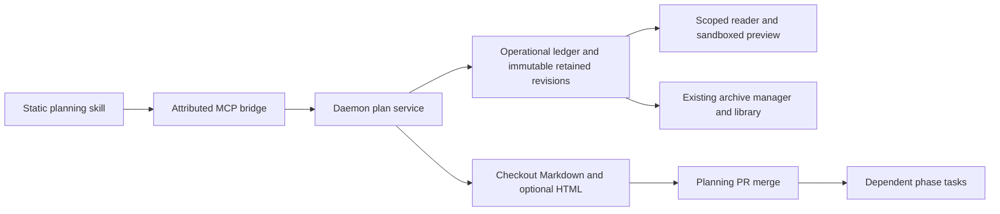
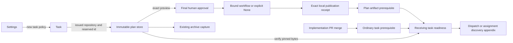

# Managed plans

Mission Control's daemon saves complete plan revisions. Settings > Skills > **Plan storage**
defaults to repository mode, where Markdown in `docs/plans/<slug>/` is the source of truth.
Local mode keeps the entire bundle beneath the repository-scoped Mission state store and
produces no checkout files. Generated HTML stays available
locally for review and is omitted from Git by default. Settings > Skills > **Commit
generated HTML plan files** opts new plans into publishing HTML alongside Markdown.
The checkbox remains configurable when skill installation is off, but is disabled in local mode without losing its saved value.

Each plan pins that policy when created. Changing settings does not relocate active
plans, reinterpret old revisions, delete tracked HTML, or migrate unmanaged plans.
Legacy plans keep their tracked layout and existing archive discovery. Adoption,
renaming, and deletion of managed checkout outputs require a future explicit migration.

## Tools and storage

Registered sessions use `get_plan_context`, `save_plan`, and `read_plan`. The MCP bridge
adds its own launch identity; the daemon resolves the primary or attached repository
from issued slots. Callers cannot choose a state-home path, storage policy, task, or
session owner. Missing registration and corrupt saved settings refuse managed writes.
Taskless sessions write relative to their registered checkout root even when launched
from a subdirectory. A linked worktree remains the write destination while its owning
repository supplies the retained plan namespace.
Both terminal and SDK plan dispatches require these tools in the built MCP handshake.

`save_plan` accepts a UUID request identity, a slug, an expected revision, and a complete
array of UTF-8 `{name, content}` files. Updates also name the returned plan id. Repeat
the identical request after an interruption; use a new request id for new content.
Every retry, including an already-ready save, requires the original issued checkout,
repository slot, and writer attribution. Moving to another checkout requires a new update
request; a ready receipt never implies that its files were copied into the new checkout.
Each Markdown file has a same-name HTML rendering. The API accepts flat `.md`, `.html`,
`.txt`, `.css`, and `.svg` files, at most 64 files, 1 MiB per file and 8 MiB total.
File sizes count decoded UTF-8 bytes. The HTTP save body allows 49 MiB: up to sixfold
JSON escaping of the 8 MiB content, plus 1 MiB for filenames and attribution metadata.
Bodies above that transport limit are refused before saving; the decoded file limits
still apply independently.
HTML is static and self-contained, using inline resources and bundle-relative navigation.
Unsupported artifacts, invalid Unicode, traversal, case collisions, missing renderings,
symlink components, and conflicting edits refuse the whole save. No file import or
agent-writable staging directory is needed.

The retained layout is:

```text
$MISSION_HOME/plans/<sanitized-repository-name>/<repository-key>/<plan-id>/<revision>/
```

`MISSION_HOME` normally resolves to `~/.mission-control`. The key hashes the canonical
owning repository path resolved by the existing repository resolver. Linked worktrees
share a namespace; unrelated same-name clones do not. Moving a repository requires
explicit future mapping. Revisions survive authoring-checkout and task/session removal.
Settings snapshots contain the storage and HTML preferences, not retained plan contents. There is no
automatic remote backup of excluded previews.

## Revisions, recovery, and publication

The daemon-only `managed_plans` and `managed_plan_revisions` tables retain attribution,
pinned policy, current revision, request identity, manifest hash and write intent.
Schema version 5 adds both tables without changing existing plan files. Version 6 adds task plan inputs, pinned task policy, reservations, approval mappings, validation mappings and publication receipts. Manifests use
version 1 and contain a bounded inventory, SHA-256 digests, source-rendering digest pairs,
and policy-eligible checkout paths. Unknown manifest or policy versions refuse reads.

A write intent is durable before staging starts. All retained files are staged and
verified before their revision directory is renamed into place. Plan reads and checkout
replacements walk directory components with no-follow, descriptor-relative operations
from the existing native filesystem addon. Temporary creation, baseline reads, rename,
and cleanup share a held parent directory, so a substituted parent symlink cannot redirect
them. New outputs use an exclusive rename. Updates exchange the staged file with the
current output atomically, then verify the displaced bytes against the recorded baseline.
A mismatch exchanges them back and retains both entries for conflict resolution. Stable
scratch names let an interrupted retry verify displaced bytes before accepting an already
matching output. Retained revision publication and recursive staging cleanup also use held
directory descriptors; publication cannot replace an existing revision. Only after every
required output is rechecked against its saved digest does the ledger expose the ready
revision. An update from another linked checkout can create outputs never written there.
Existing files must match that checkout's last saved revision or the latest repository
revision received through Git. Deleting a previously managed output in that checkout
remains a conflict even after another checkout saves a newer revision.
Conflicting edits during a multi-file write leave the save incomplete. Startup reports
incomplete revisions without applying their intents, because writer registration may have
been revoked before the interruption. A currently registered session must retry the exact
save request with matching attribution, repository slot, and issued checkout. That retry
rechecks live authority, removes orphan UUID staging directories under the repository's
write queue without touching published revisions or following symlinks, and replays
matching writes; operator conflicts remain incomplete. No cross-filesystem atomicity is
claimed, and the service never resets the index or runs Git publication commands.

`ready` means saved, not human-approved or published. The save result's `requiredPaths`
are empty in local mode, or Markdown plus opted-in HTML in repository mode; verify those in the pushed commit when publication is
authorized. Verify excluded HTML with `read_plan`. Repository phase tasks continue citing Markdown
paths and depending on the planning session. Only the planning PR's merge releases
repository publication prerequisites. The existing publication-context contract and
workflow versions are unchanged.

## Review and archives

Every save returns an exact `/?plan=<id>&revision=<n>` preview. Files > **Refresh managed
plans** lists the latest revisions across the session's primary and attached repositories
and opens that reader. The session listing API accepts `repoSlot` to narrow discovery;
omitting it includes all issued slots, with each retained plan listed once. **Previous
revision** links make every retained older revision reachable from the latest. Catalog
responses from this API and `read_plan` are `{plans, nextCursor}` with at most 100 plans,
ordered by slug and plan id. Pass `nextCursor` as `cursor` to continue until it is null.
Files exposes **Load more managed plans**, preserving loaded pages if a later request fails.
Cursors are bookmarks within the currently authorized repository scope, not access grants.
Refreshing starts again at the first page, including new plans inserted before a prior bookmark.
Catalog pages verify each manifest's ledger digest, schema, and identity without reading
the bundle files. Opening an exact revision or file verifies its retained contents against
the manifest, so missing or changed bytes still refuse review and archive capture.
Exact revision/file reads and save receipts retain their existing shape. The reader
identifies the revision, source Markdown and pinned Git eligibility. Relative phase links navigate the verified
bundle. It uses the same sandbox and CSP as Files and Archives. Guarded file endpoints
serve attachments; the session-file API remains checkout-confined.

At plan-task cleanup the existing archive manager reserves exact registered revisions
and captures them through the existing archive library, including excluded HTML. It
checks source digests during copying. Missing registered bytes refuse capture rather
than being mistaken for policy omission. Legacy plans retain diff discovery and partial
capture semantics. Saved Markdown and relevant phase context must still be registered
with `submit_workflow_evidence`; a preview locator alone cannot reach tool-less Personas.



## Phase 2 handoff and route adjustments

Phase 2 extends `ManagedPlanPolicySchema` in `src/shared/managed-plans.ts`, using the
same writer, repository identity, immutable references, preview and capture adapter.
It adds whole-plan local storage and its approval/publication and task-input contracts.
This release exposes no local-mode preference or new dependency satisfaction path.

The implementation uses a dedicated reader opened from Files rather than extending
editable session-file buffers to state-home paths. This preserves the checkout boundary
and keeps retained revisions readable after the session disappears. Content-only flat
bundles replace the proposed optional file-import path, avoiding a second filesystem
authorization surface. All Markdown documents get renderings, which makes phase navigation
consistent. Recoverable write intents include staging, closing the pre-manifest crash
window as well as partial checkout writes. Recovery requires an attributed retry instead
of automatic startup replay: startup precedes live session registration, and retained
attribution alone cannot authorize checkout writes after revocation. These are the material
route adjustments to carry into the Phase 1 PR description.

Behavior is covered by `managed-plans.test.ts`, attributed HTTP tests, settings
upgrade/restore tests, plan capture and MCP handshake tests, and
`e2e/specs/plan-storage.spec.ts`. Follow [AGENTS.md](../AGENTS.md) for test execution.

## Exact handoff and local publication

`skills.planStorage` is `repository` or `local` and defaults to `repository`. Missing
`commitPlanHtml` defaults to false. Task creation resolves the pinned plan policy and workflow
default together; route checks and persistence consume that same pair. Dispatch and live
assignment explicitly reserve an opaque plan id per canonical repository before launch or reset.
Discovery only describes locations and exact inputs and never reserves an identity.
Existing tasks without policy keep repository publication semantics and use the saved HTML
preference when their first plan policy is pinned. Existing plan
revisions always use their saved policy, even after settings change. Repository policy retains
its original shape; local policy is `{version: 2, storage: "local", commitPlanHtml: boolean}`.
The immutable manifest remains version 1 and all Phase 1 writer and archive checks remain.

`create_task` uses `/mcp/v3/tasks` whenever `planInputs` or `planPrerequisites` are supplied.
It never retries a version refusal through a legacy route. `planInputs` contains at most 16
`{repoKey, planId, revision, files}` records, each naming 1 to 32 flat Markdown filenames.
The repository key, opaque UUID, positive immutable revision and exact files are verified
against both the caller's issued scope and the receiving task's primary/attached roots.
Old tasks load empty inputs. Both fresh dispatch and live assignment check them before checkout
work and again before prompt delivery. Missing, damaged or unpublished inputs refuse dispatch;
there is no latest-revision fallback. Every managed task receives a short appendix listing
repository `docs/plans/` and the correctly scoped local store, plus exact `read_plan` calls for
pinned inputs. A context-only repository must still be attached to read its plan.
An explicit, validated `planInputs` update, including an empty list, clears corrupt-input
state and persists the replacement. Unrelated or invalid updates retain the refusal. Input
repair preserves the pinned policy and cannot clear independent policy corruption.
Every plan publication prerequisite must retain a matching exact Markdown input, including
after publication. Remove both together or replace them with a matching pair; clearing only
the inputs is refused.
Repository and mixed-work inputs must match the originating task/session's exact work
episode. An earlier episode's merged dependency cannot authorize a later episode's revision;
creation, updates and delivery all enforce this pairing.

For local plan-only work, `request_plan_decisions` takes `managedPlan: {repoSlot, planId,
revision}` via `/mcp/v2/reviews`. The daemon adds an explicit final-bundle approval choice,
exact preview and inventory. Human approval binds the full manifest digest, writer episode
and active workflow binding/version. Dismissal, ordinary decisions, an older revision or a
new binding do not approve the current bundle. Changes after approval require a new approval.
The latest human resolution for that revision, writer episode and binding controls approval.
A later **Needs revision** answer or dismissal blocks publication until another approval;
conflicting resolutions at the same timestamp also block. Renewed approval needs its own
workflow validation when a workflow is bound.

The final-bundle form also offers **Approve all future bundles for this task** beside
Submit. When the operator approves the bundle with it checked, the daemon records a standing
approval for the task. Choosing **Needs revision** with it checked records nothing. Every later final-bundle request for that task is then approved at creation,
without a prompt, and logged in the session's conversation as auto-approved rather than as the
operator's answer. The agent's tool result says it was approved automatically. When a request
also carries other open choices, the bundle is still auto-approved and logged, and only those
remaining choices are asked, as their own review; the agent's answer to it begins by stating the
bundle is already approved. Only the operator's own submitted answer
can grant this: Foreman, a delegated session, a dismissal and a review without a managed plan
task are refused. The publication gate accepts a standing approval exactly as it accepts a
direct one, so workflow binding and validation rules are unchanged.

New local plan tasks default to the appended **Local Plan Validation** workflow. Explicit
None is allowed; explicit incompatible choices are refused. Compatible workflows have no
session actions and no Inspector/PR completion policy. Their ordinary Persona/check graph
must complete. Before capture, the daemon freezes the exact approval/revision mapping on the
submission and requires retained evidence containing every Markdown filename and its full
saved text. Register this with `submit_workflow_evidence`; paths alone are insufficient for
tool-less reviewers. Manual bindings retain manual submission; automatic bindings start via
Foreman after the planning handoff. A workflow-bound local plan reaches completion verification
even with an empty Git diff, because its bundle lives outside the checkout. An empty diff is
neither proof of completion nor a reason to discard that handoff. Paused, failed, missing and
superseded submissions block publication. Binding archival invalidates bound approval instead
of silently publishing it.

After approval, schedule phases with exact `planInputs` and `planPrerequisites` identities.
The latter become distinct `type: "plan"` edges. Add `dependsOnTaskIds` for direct code phases;
do not add an impossible planning-session merge edge for local plan-only work. Without a
workflow, call `publish_plan` after scheduling. With a workflow, its completion notification
publishes the approved revision. The daemon verifies every issued checkout is clean and has
no diff from the task base before either path can publish. Mixed code-and-plan work retains
its ordinary task/session merge edge even when the plan bytes are local.

A version-2 local publication receipt records its UUID, repository/plan/revision, manifest
hash, final review, originating session/task/episode, workflow binding/version/submission
(or null for explicit None), and timestamp. Its durable table has no source-task cascade.
It releases only matching artifact edges, including after restart or source-task pruning.
The daemon still verifies retained bytes before dispatch. Ordinary task/session merge edges
are unchanged, and normal `TaskManager.complete` owns completion and checkout cleanup.
No local receipt requests a PR or calls broad dependent-task satisfaction.

An approved, frozen review-only validation can outlive its authoring session. The daemon
retains that workflow and task obligation using the recorded task episode; startup recovery
does not require a live agent. Publication still checks the current approval, binding,
submission, retained bytes and clean checkouts. A receipt already written before interruption
is reused to release its exact artifact edges and finish through `TaskManager.complete`.
Cancellation, a replaced episode, and paused or failed validation cannot authorize a new receipt.



Implementation choices relative to the proposed Phase 2 route: policy pins at task creation,
not first dispatch, so backlog edits and workflow defaults cannot disagree; dispatch still
reserves plan identity before launch. Local publication listens to the existing workflow
notifications and session-observation recovery, with shutdown owned by WorkflowManager, rather
than introducing another polling service. All session actions are excluded from local-only
validation because they can mutate the checkout or initiate publication; use a ship task for
such workflows. These choices preserve the original writer, revision, preview and archive
contracts and should be called out in the implementation PR.
