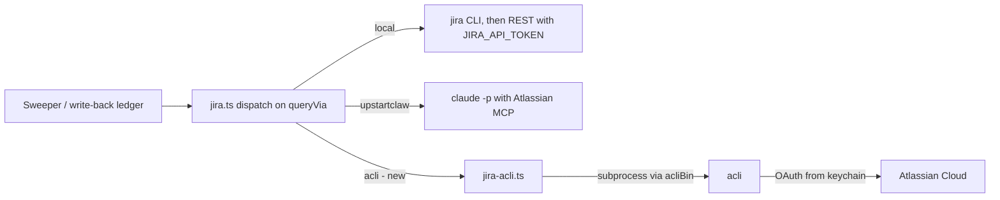

# Jira through the Atlassian CLI (acli)

Source: GitHub issue #1270, "feature: acli Integration". Scout report:
`docs/reports/acli-jira-integration/report.html` (archived, not committed).

## Goal

A Jira task source can run every Jira operation Mission Control performs through Atlassian's
official CLI, `acli`, authenticated by acli's own OAuth login. An operator who installs the
desktop app and runs `acli jira auth login --web` once gets a working Jira source - sweeping,
preflight, linked reads, write-back comments and resolve transitions - with no environment
variables, no token in Mission Control's database, and no Claude run per sweep.

## Why this is needed

- The desktop daemon copies only `PATH` from the login shell. The executable locator runs
  `$SHELL -ilc` and extracts `$PATH` between markers
  (`src/server/executables/locator.ts:140-183`); nothing else is captured. `JIRA_API_TOKEN` and
  `JIRA_EMAIL` exported in a shell profile therefore never reach an Electron-launched daemon.
- The local Jira method depends on those variables for three things even when the `jira` CLI
  (`ankitpokhrel/jira-cli`) is configured: resolve refuses outright without them
  (`RESOLVE_NEEDS_READ`, `src/server/task-sources/jira.ts:1473`, check at `:2105`); remote links
  are REST-only (`:1993`); and a filter larger than one CLI request can only be paged over REST
  (`:1336`).
- The UpstartClaw method is read-only (`UPSTARTCLAW_READ_ONLY`, `jira.ts:1453`), restricted to
  `upstartnetwork.atlassian.net` (`:1256`), and spends a Claude run per sweep (90 s budget).

## What acli offers

Verified on this machine against `acli version 1.3.40-stable` (`/opt/homebrew/bin/acli`) from
`--help` output and logged-out runs; acli was not logged in, so JSON shapes remain to be
captured (see Contract capture).

| Operation | acli command | Status |
| --- | --- | --- |
| Sweep | `acli jira workitem search --jql <q> --fields key,summary,description,priority --json [--limit N] [--paginate]` | Flags verified. `--limit` is "Maximum number of work items to fetch"; `--paginate` is "Fetch all work items by paginating through the results". JSON shape not yet captured. |
| Preflight | `acli jira auth status`, then the real JQL with `--limit 1` | Logged-out behaviour verified (below). Logged-in output not yet captured. |
| Read one issue | `acli jira workitem view <KEY> --fields status --json` | Flags verified. `--fields` accepts a field list, `*all`, `*navigable` and `-field`; there is no expand option. |
| Comment | `acli jira workitem comment create --key <KEY> --body <text or ADF>` | Verified: "Comment body in plain text or Atlassian Document Format (ADF)". |
| Transition | `acli jira workitem transition --key <KEY> --status <name> --yes` | Flags verified; `--yes` is "Confirm transition without prompting". |
| Remote (web) link | none | **Verified unsupported.** `workitem` offers archive, assign, attachment, clone, comment, create, create-bulk, delete, edit, link, list-watchers, search, transition, unarchive, view, watcher. `link create` takes only `--out`, `--in`, `--type` (or a JSON/CSV of those): issue-to-issue. Neither `acli --help` nor `acli jira --help` offers a raw API command. |
| List an issue's transitions | none found | No command or flag lists transitions; to be probed live with `view --fields "*all" --json`. |
| Auth | `acli jira auth login --web` (OAuth) or `--token`; also `acli auth login` (global OAuth across Jira and Confluence) | Both `acli jira auth status` and `acli auth status` exist. Profiles live in `~/.config/acli/*.yaml` (`current_profile`, `profiles`). |

Logged-out and bad-flag behaviour (all exit 1, nothing on stdout, message on stderr):

| Command | stderr |
| --- | --- |
| `acli jira auth status` | `✗ Error: unauthorized: use 'acli jira auth login' to authenticate` |
| `acli jira workitem search --jql ... --json` | `✗ Error: unauthorized: use 'acli [product] auth login' to authenticate` |
| `acli jira workitem search --bogus` | `✗ Error: unknown flag: --bogus` |
| `acli jira workitem link create --generate-json` | `✗ Error: unauthorized: use 'acli jira auth login' to authenticate` |

Because every failure exits 1, faults are classified from stderr text, never from the exit code
alone.

## Design

### One new query method, not a new source kind

`JiraConfigSchema.queryVia` (`src/shared/task-source.ts:525`) gains a third value:
`z.enum(["local", "upstartclaw", "acli"])`. The default stays `"local"`, so every stored source
parses and behaves exactly as before. No database migration: source config is a JSON blob parsed
by this schema. The `jira` kind keeps its id, label, mapper, deduplication ledger and capability
flags; `canPush` stays `false`.

### Request flow

### Server

- **Binary seam.** `acliBin()` beside `jiraBin()` in `src/server/config.ts`, read per call from
  `MISSION_ACLI_BIN` (empty counts as unset), defaulting to `acli`. Every acli subprocess goes
  through it so the browser suite can redirect it at a fake.
- **Executable catalog.** Append `"acli"` to `EXECUTABLE_IDS` (`src/shared/executables.ts`,
  append-only) and add `acli: spec("acli", "Atlassian CLI", "acli", "ACLI_BIN")` to
  `src/server/executables/catalog.ts`, so it resolves through the shared locator and appears in
  executable diagnostics like `jira`.
- **Rung module.** New `src/server/task-sources/jira-acli.ts` owns argv construction, output
  parsing, fault classification and the acli sweep, preflight, annotate and resolve. `jira.ts`
  dispatches to it from `sweep`, `preflight`, `annotate` and `resolve` the way it already
  dispatches `queryVia === "upstartclaw"`. The module reuses the existing exported helpers rather
  than growing a second mapper: `issuesFrom`, `candidateFrom` (through `sweepResultFromWalk`),
  `externalIdFor`, `issueKeyFor`, `commentBodyAdf`, `transitionFor`, `currentStatusFrom`, the
  `MAX_SWEEP_ISSUES` ceiling and the `tooBroad` advisory. `readLinked` needs no change because it
  calls `sweep` with a `key in (...)` JQL.
- **Exclusive credential.** A source set to acli uses acli only. It never falls back to the
  `jira` CLI or to `JIRA_API_TOKEN`, so the operator always knows which login acted.
- **Failures are sentences.** An acli fault classifier, modelled on `cliFault`
  (`jira.ts:630`), distinguishes not installed (`brew tap atlassian/homebrew-acli && brew install
  acli`), not logged in (`acli jira auth login --web`), logged in to another site
  (`acli jira auth switch`), no answer (timeout or killed child, `outcomeUnknown`), and refused.
  No failure becomes an empty sweep.
- **Site identity.** acli acts on its active login, not on the source's `site` field. Reads
  derive browse links from each issue's own `self` host when present (as `browseUrlFor` already
  does) and otherwise from the configured site. Every acli operation, read or write, requires
  positive proof that acli's active site is the configured site, checked with `acli jira auth
  status` immediately before it runs rather than once at preflight, because acli's active profile
  can change at any time. When it cannot be established, a sweep or linked read files nothing and
  a write is refused before any subprocess that could mutate. Issue keys are not unique across
  sites, so a sweep against the wrong site would file somebody else's issues and a write would
  change somebody else's ticket.
- **Sweep bounds.** One sweep reads at most `MAX_SWEEP_ISSUES` (1000) issues within the sweeper's
  60 s cap (`src/server/task-sources/sweeper.ts:28`). Asking acli for one more than the bound
  answers "is there a tail" exactly, as the CLI rung already does with `limit + 1`; a tail is the
  existing `tooBroad` advisory with the read issues still filed.

### Write-back

- **Comment.** `workitem comment create --key <KEY> --body <ADF JSON>` carrying `commentBodyAdf`.
  A run that died without an answer is `outcomeUnknown` and is never retried automatically, the
  same rule `cliWritebackFailure` already applies.
- **Remote link.** acli 1.3.40 has no remote-link capability (verified above), so a requested
  link is reported as unavailable and the comment is still posted. This is the wording and
  behaviour the CLI-only local path already has (`jira.ts:1992-1995`). The settings panel notes
  the limitation when Link via is not "Comment". If a later acli release adds remote links, the
  same fake-backed tests are where support is added.
- **Resolve.** Read the issue's current status with `workitem view --fields status --json`;
  already in the wanted status is success. Otherwise run `workitem transition --key <KEY>
  --status <name> --yes`. When acli refuses, the refusal names the issue's current status and
  quotes acli's own error, which may itself list the reachable statuses. This relaxes, for this
  method only, the rule that a refusal must list the reachable transitions
  (`RESOLVE_NEEDS_READ`). Before relying on the relaxation, the implementation checks whether
  `workitem view --fields "*all" --json` or acli's transition error exposes the available
  transitions; if one does, the full rule is kept by feeding that list to `transitionFor`.

### Settings panel

`src/web/components/TaskSourcesPanel.tsx:388-402` gains `<option value="acli">Atlassian CLI
(acli)</option>`, a short note naming the one-time `acli jira auth login --web`, and, once
write-back lands, the remote-link note above. The panel's existing "Check it works" button runs
the acli preflight unchanged.

### Contract capture before code

acli's logged-in JSON shapes are not documented, and the logged-out and bad-flag failures above
are the only outputs verified so far. Implementation starts by having the operator run
`acli jira auth login --web` on this machine, then running read-only commands and recording
outputs as test fixtures, rewritten so that no operator data is committed (synthetic hosts,
project and issue keys, people and text, with structure and relationships preserved): `acli jira auth status`,
a one-issue search, a paginated search, a no-results search, `view --json` with `status` and with
`*all`. No write command is ever run against a real Jira site; write-path fixtures come from the
fake. Child processes get an empty stdin so any unexpected prompt reads end-of-file instead of
hanging until the timeout.

### Tests

- A fake `acli` in `e2e/fixtures/fake-agents.ts`, wired through `MISSION_ACLI_BIN` in
  `e2e/fixtures/daemon.ts`, recording every invocation so no suite run can touch a real ticket.
- Unit tests beside the existing ones (`test/jira-map.test.ts`, `test/jira-preflight.test.ts`,
  `test/jira-writeback.test.ts`, `test/task-source-contract.test.ts`,
  `test/executable-contracts.test.ts`, `test/e2e-fixture-programs.test.ts`).
- Playwright: extend `e2e/specs/settings-task-sources-jira.spec.ts` (select acli, check it works,
  sweep files a card) and `e2e/specs/task-source-writeback.spec.ts` (comment and resolve recorded
  by the fake).

### Documentation

`docs/dispatch-and-backlog.md` Jira section (query methods, write-back, troubleshooting),
`docs/configuration.md` (`MISSION_ACLI_BIN`), and `docs/upstart.md` (acli as the env-free option
for Upstart Jira).

## Non-goals

- Pushing a backlog task to Jira (`canPush` stays `false`).
- Changing the local method's ladder or the UpstartClaw method.
- Capturing arbitrary environment variables from the login shell.
- Managing acli's login from Mission Control (no OAuth flow, no token storage).

## Acceptance criteria

1. A Jira source with Query via "Atlassian CLI (acli)" sweeps its JQL and files tasks with the
   same title, intent, browse link and priority mapping as the local method, on a daemon with no
   Jira environment variables.
2. "Check it works" names the fix for each of: acli missing, acli not logged in, acli logged in
   to a different site, empty JQL, and a JQL Jira rejects; a sweep that finds acli logged in to a
   different site files nothing and says so.
3. A filter larger than one sweep files what was read and shows the existing too-broad advisory.
4. Write-back on an acli source posts the comment, reports the remote link as unavailable, and
   resolves to the configured status; a refused resolve names the current status and acli's
   reason. No write is attempted when the active acli site cannot be proven to match.
5. Existing local and UpstartClaw sources behave exactly as before.
6. No test, unit or browser, can invoke a real `acli`.

## Adopted decisions

Submitted in the dashboard review of this plan:

- **Remote links**: report the link as unavailable and still post the comment. The operator asked
  for this to be verified; acli 1.3.40 was checked and has no remote-link support.
- **Resolve contract**: probe for a transition list (`view --fields "*all" --json`, acli's own
  refusal text); if none is exposed, move by status name and quote acli's error with the current
  status.
- **Fallback**: none. An acli source uses acli only.
- **Contract capture**: the operator installs and logs in to acli; the implementing agent captures
  read-only fixtures. acli 1.3.40 is installed; the login and live capture happen at the start of
  implementation.
- **Follow-up**: create a phased implementation plan.
