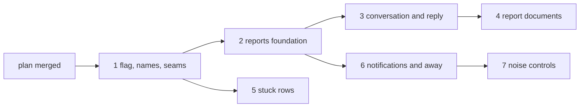

# Agent reports and inbox upgrades: phased implementation

Source: `docs/plans/agent-reports-and-inbox-upgrades/plan.md`. Its adopted decisions are
requirements here: the tool is `post_report`; `replaces` takes a report id and a bad id is refused
with the agent's open reports; Nudge and Continue use the specific wording; Mark read needs an
open report unless the agent has exactly one unread; the unseen-reports note is for spoken
messages only; no title source is recorded; a report notification opens the inbox at its report,
or at the report that replaced it; all three noise controls ship.

This task writes the plan and schedules the phases. It ships no product code.

## Findings that shaped the phases

- The flag and the name resolver are read by every other phase, and the naming rule changes
  surfaces that exist today, so they come first and alone.
- Reports and Stuck rows share only the flag, the resolver and the section order. Stuck rows fold
  the daemon's stall list (`src/web/lib/stalls.ts:33`) and touch no report code.
- The reports table is the one migration every report phase reads. Phase 2 creates every column,
  including the follow-up, announce and publication columns that Phases 3, 6 and 4 write, so the
  table is migrated once.
- The conversation entry, the reply and the gone-agent states all hang off the report card and
  the outbox (`src/server/pending-turns.ts:303`); they are one slice.
- Open report and Publish as scout need a reader and a new archive capture path (plan findings 5
  and 6). That is the least certain work, so it is its own phase and cannot hold up replies.
- Notification classes replace one filter shared by the browser and the daemon
  (`src/shared/alerts.ts:116`). Mutes filter the same path, so noise controls follow it.

## Plan validation round 1

Four findings were accepted and applied across the bundle:

- **Every card action has an owner and a test.** R25 now says which controls carry a spoken form
  and which are click-only, the table below assigns each action to a phase, and Phase 1 owns a
  test that fails on an undeclared control. Open report, Publish as scout, Start a follow-up task
  and Mute gained spoken forms. Mark all read is click-only: it names no agent, and the voice spec
  routes speech only by an agent's name or "reply".
- **The report stores its repository.** `ReportItem.repository` is persisted by Phase 2 and read
  by Phase 3's follow-up after the session is gone.
- **A failed follow-up dispatch cannot create a second task.** `ReportItem.followUpTaskId` is
  written when the task is created; a retry dispatches that task.
- **Publication is bound to the stored document.** The daemon builds the published page from the
  stored copy; the publish request carries no page, and a request that tries to supply one is
  refused.

## Plan validation round 2

Two findings were accepted and applied:

- **One statement of what clears a report.** R9 said only Mark read or a reply, while Phase 3
  also clears on a follow-up and Phase 7 on Mark all read. R9 is now the complete rule, and the
  section "What takes a report out of to read" below gives each way its phase. A follow-up clears
  the report because it is the reply to an agent that is gone (R11), and only once its task has
  been dispatched.
- **Retry is the follow-up action.** The Retry button after a failed dispatch is the declared
  `follow-up` action drawn with a different label, not a new action. `InboxActionButton` takes a
  label override for this. The same pass found the report's show and hide control undeclared, so
  it is now `toggle`, click-only with the reason `disclosure`; and the resident relaunch hint is
  stated to be text, not a control.

## Plan validation round 3

A later run raised two feasibility findings. Both were accepted and applied:

- **A report notification's click always has a report to show.** The notify switch and the
  listed-in-inbox switch are independent, so a notification can arrive for a report the inbox
  does not list. R22 and Phase 6 now say the click opens the inbox and draws one report on its
  own above the sections whenever the fold does not contain it: reports unlisted by the setting,
  or a report already read. Phase 6 adds `GET /api/reports/:id` for the already-read case and
  tests the switch combination. The pinned card changes neither the Reports section nor the to
  read figure.
- **Mark done needs a task.** A stall for unfinished work can come from a queue with no task
  (`src/shared/stall.ts:154`), and no route completes a queue. R16 and Phase 5 now draw Mark done
  only when the stall's facts carry a task, and it completes that task. A queue-only card offers
  Continue, says its items are handled in the session, and keeps Open session.

## Plan validation round 4

One consistency finding was accepted and applied:

- **One rule for a notification whose report was replaced.** The adopted decision and R22 said
  the click opens "that report", while Phase 6 opened the latest report of its chain. The rule
  chosen is the second, and it is now stated the same way in the adopted decision, R22, the
  design section, Phase 6 and its tests: the click opens the notified report, unless it has been
  replaced, in which case it opens the report that replaced it. That follows R12, under which a
  replacing report takes the earlier one's place and the inbox shows only the latest of a chain.
  The older version is not shown in the inbox; it stays in the conversation.

## Sizing and phase count

Estimated 3,100 to 3,850 non-test implementation lines across shared contracts, the daemon, the
MCP child and the dashboard. That is several times what one reviewable pull request holds. Seven
phases, each above 200 lines and each leaving the repository operable behind the flag:

| Phase | File | Delivers | Depends on | Est. lines |
| --- | --- | --- | --- | --- |
| 1 | `phase-1-flag-names-and-card-seams.md` | The `inbox` flag, one display name on existing surfaces, the section-order rule, the card action and spoken-hint seam | this plan merged | 350 to 450 |
| 2 | `phase-2-reports-foundation.md` | `reports` table, `post_report`, wire, Reports inbox section, to read figure, Mark read, `replaces` | 1 | 750 to 900 |
| 3 | `phase-3-report-conversation-and-reply.md` | Conversation entry, reply, relaunch hint, Start a follow-up task, voice text builders | 2 | 500 to 600 |
| 4 | `phase-4-report-documents.md` | Open report reader, Publish as scout | 3 | 350 to 450 |
| 5 | `phase-5-stuck-rows.md` | Structured stalls, Stuck section and cards, fixed messages | 1 | 450 to 550 |
| 6 | `phase-6-notifications-and-away.md` | What notifies you, notify classes, report notifications, Away digest | 2 | 400 to 500 |
| 7 | `phase-7-report-noise-controls.md` | Report guidance, per-agent mute, Mark all read | 6 | 300 to 400 |

Why not fewer: joining 1 and 2 would put a rename of live surfaces in the same review as a new
table and tool; joining 3 and 4 would tie replies to the archive work; joining 6 and 7 would put
the alert engine, the Away digest, a settings panel, a second table and an MCP startup read in one
pull request. Why not more: each phase is one vertical slice with its own storage, routes, UI and
specs.

## Concurrency and merge order

- After 1: phases 2 and 5 may run together.
- After 2: phases 3 and 6 may run together, and with 5.
- Phases 4 and 7 may run together.
- Phases that run together both edit `src/web/lib/attention.ts`,
  `src/web/components/AttentionInbox.tsx`, `src/web/App.tsx`, `src/server/routes.ts`,
  `src/shared/inbox.ts` and `docs/attention-and-alerts.md` in different places; the later one
  rebases. Two phases that add a migration (2 and 7, and the sibling plan) take the next schema
  number at merge time.

## Cross-phase contracts

Owned by Phase 1:

- Flag id `inbox`, stage `preview`, constant `INBOX_FLAG` in `src/shared/inbox.ts`.
- `agentDisplayName(input)` in `src/shared/display-name.ts` returns `{ name, source, spoken }`.
  Input: `callSign`, `resident: { referenceName, name, colorId }`, `taskTitle`, `sessionName`.
  `callSign` and `referenceName` are accepted and unset until voice adds them.
- `INBOX_SECTION_ORDER` in `src/web/lib/attention.ts`. Phase 5 adds `session_stuck` between
  `session_blocked` and `parked_finalization`; Phase 2 adds `agent_reports` last.
- `InboxActionSpec { id, label, spoken, clickOnly }` and the `INBOX_ACTIONS` registry. An action
  has a `spoken` form, or a `clickOnly` reason: `navigation`, `dismissal`, `disclosure` or
  `section-wide`.
- `InboxActionButton`, which draws a card control from its registry entry with a `SpokenHint`.
  A card may pass a different label for the same action; the action id and its spoken form do
  not change. The hint renders nothing until a voice-hints context says otherwise.
- `AlertScope.names`, which makes alert titles use the resolver.

Owned by Phase 2:

- Table `reports` and `ReportItem`: `id` (`r-<n>`), `sessionId`, `taskId`, `repository`,
  `author { key, name, residentProfileId }`, `title`, `body`, `url`, `document { name, kind }`,
  `rootId`, `version`, `supersededBy`, `createdAt`, `rootCreatedAt`, `openedAt`, `readAt`,
  `readBy`, `followUpTaskId`, `announcedAs`, `announcedAt`, `publishedArchiveKey`.
- `repository` is the posting session's repository root at post time, or null when it has none.
- `readBy` is one of `mark-read`, `reply`, `follow-up`, `mark-all`, or null while unread.
- Author key: `resident:<profileId>` or `session:<sessionId>`.
- Routes `POST /mcp/reports`, `POST /api/reports/:id/opened`, `POST /api/reports/:id/read`,
  `GET /api/sessions/:id/reports`; event `report_upsert`; snapshot field `reports`.
- Fold item `agent_reports` (id `agent-reports:<authorKey>`), `AttentionFold.toRead`, and the
  dashboard's `openReportId`. Reports never change `total` or `represented`.
- Stored documents live at `<state home>/reports/<id>/`.

Owned by later phases:

- Phase 3: `reportReplyText`, `unseenReportsNote`, `POST_REPORT_LINE` and
  `resolveMarkReadTarget` in `src/shared/reports.ts`; routes `POST /api/reports/:id/reply` and
  `POST /api/reports/:id/follow-up`; writes `followUpTaskId`.
- Phase 4: `GET /api/reports/:id/document`, `POST /api/reports/:id/publish`; writes
  `publishedArchiveKey`.
- Phase 5: `Stall.facts` and `Stall.fingerprint`; fold item `session_stuck`;
  `POST /api/sessions/:id/inbox-message`; turn id prefix `inbox-message:`.
- Phase 6: `Alert.notify`, alert kind `report`, `ui.alerts.notify` and `ui.alerts.reportsInInbox`;
  `GET /api/reports/:id`; the inbox's pinned report; writes `announcedAs` and `announcedAt`.
- Phase 7: table `report_mutes`, the `reports` settings entry, `GET /mcp/reports/guidance`,
  `POST /api/reports/read-all`.

## What takes a report out of to read

This is R9 in full. A report is unread until one of the first four rows happens.

| Way | `readBy` | Phase |
| --- | --- | --- |
| Mark read | `mark-read` | 2 |
| A reply that the outbox accepted | `reply` | 3 |
| A follow-up task that was dispatched | `follow-up` | 3 |
| Mark all read | `mark-all` | 7 |
| Replaced by a later report: not read, but its successor takes its place | none | 2 |
| Hidden, not read: reports unlisted by the setting, or a muted author | none | 6, 7 |

Opening the inbox or a report never clears it, including a report opened from a notification.

## Inbox actions and who declares them

Phase 1 owns R25's rule and its test. Each phase declares the actions it adds. `{name}` is the
agent's display name.

| Action | Card | Spoken form, or click-only reason | Phase |
| --- | --- | --- | --- |
| `answer-option` | Question | "{name}, option B" | 1 |
| `answer` | Question | "{name}, ..." or "reply, ..." while the card is open | 1 |
| `toggle` | Report, and its conversation entry | click-only: disclosure | 2 |
| `mark-read` | Report, and its conversation entry | "{name}, mark read" | 2 |
| `reply` | Report | "{name}, ..." or "reply, ..." while the card is open | 3 |
| `follow-up` | Report; drawn as Start a follow-up task, and as Retry after a failed dispatch | "{name}, follow up, ..."; "reply, ..." while the card is open | 3 |
| `open-report` | Report, and its conversation entry | "{name}, open report" | 4 |
| `publish-scout` | Report | "{name}, publish as scout" | 4 |
| `open-archive` | Report | click-only: navigation | 4 |
| `nudge`, `continue`, `resubmit`, `push` | Stuck | "{name}, nudge", "{name}, continue", "{name}, resubmit", "{name}, push" | 5 |
| `mark-done` | Stuck; drawn only when the stall has an open task | "{name}, mark done" | 5 |
| `stop` | Stuck | "{name}, stop" (interrupt) | 5 |
| `message` | Stuck | "{name}, ..." or "reply, ..." while the card is open | 5 |
| `open-session`, `open-run` | Stuck | click-only: navigation | 5 |
| `dismiss` | Stuck | click-only: dismissal | 5 |
| `mute` | Report | "{name}, mute reports" | 7 |
| `mark-all-read` | Reports heading | click-only: section-wide | 7 |

## Requirement ownership

| Phase | Requirements |
| --- | --- |
| 1 | R18, R19, R24 (the order rule), R25 (the rule and its test), R27 |
| 2 | R1, R2, R3, R4, R6, R7, R8, R9, R12, R14 |
| 3 | R5, R10, R11, R26 |
| 4 | R13 |
| 5 | R15, R16, R17 |
| 6 | R20, R21, R22, R23 |
| 7 | R28, R29, R30 |

## Not scheduled

Moving `inbox` to `default-on` and later retiring it are separate pull requests after the flag
has been used; `docs/feature-flags.md` forbids skipping the default-on release. Call signs, the
reference name, spoken delivery and the "turn both on" offer belong to the voice plan.

## Final verification

With all seven merged and the flag on: `npm run typecheck`, `npm run lint`, `npm run build`,
`npm run smoke`, `MISSION_TEST_CONCURRENCY=4 npm test` and `npm run test:e2e`. With the flag off,
every spec that predates this work passes unchanged.
