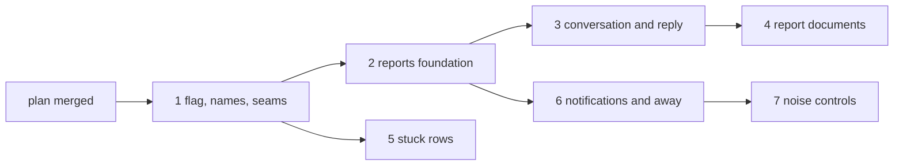

# Agent reports and inbox upgrades: phased implementation

Source: `docs/plans/agent-reports-and-inbox-upgrades/plan.md`. Its adopted decisions are
requirements here: the tool is `post_report`; `replaces` takes a report id and a bad id is refused
with the agent's open reports; Nudge and Continue use the specific wording; Mark read needs an
open report unless the agent has exactly one unread; the unseen-reports note is for spoken
messages only; no title source is recorded; a report notification opens the inbox at its report;
all three noise controls ship.

This task writes the plan and schedules the phases. It ships no product code.

## Findings that shaped the phases

- The flag and the name resolver are read by every other phase, and the naming rule changes
  surfaces that exist today, so they come first and alone.
- Reports and Stuck rows share only the flag, the resolver and the section order. Stuck rows fold
  the daemon's stall list (`src/web/lib/stalls.ts:33`) and touch no report code.
- The reports table is the one migration every report phase reads. Phase 2 creates every column,
  including the announce and publication columns that Phases 6 and 4 write, so the table is
  migrated once.
- The conversation entry, the reply and the gone-agent states all hang off the report card and
  the outbox (`src/server/pending-turns.ts:303`); they are one slice.
- Open report and Publish as scout need a reader and a new archive capture path (plan findings 5
  and 6). That is the least certain work, so it is its own phase and cannot hold up replies.
- Notification classes replace one filter shared by the browser and the daemon
  (`src/shared/alerts.ts:116`). Mutes filter the same path, so noise controls follow it.

## Sizing and phase count

Estimated 3,100 to 3,850 non-test implementation lines across shared contracts, the daemon, the
MCP child and the dashboard. That is several times what one reviewable pull request holds. Seven
phases, each above 200 lines and each leaving the repository operable behind the flag:

| Phase | File | Delivers | Depends on | Est. lines |
| --- | --- | --- | --- | --- |
| 1 | `phase-1-flag-names-and-card-seams.md` | The `inbox` flag, one display name on existing surfaces, the section-order rule, the card action and spoken-hint seam | this plan merged | 350 to 450 |
| 2 | `phase-2-reports-foundation.md` | `reports` table, `post_report`, wire, Reports inbox section, to read figure, Mark read, `replaces` | 1 | 750 to 900 |
| 3 | `phase-3-report-conversation-and-reply.md` | Conversation entry, reply, relaunch hint, Start a follow-up task, voice text builders | 2 | 500 to 600 |
| 4 | `phase-4-report-documents.md` | Open report reader, Publish as scout | 3 | 350 to 450 |
| 5 | `phase-5-stuck-rows.md` | Structured stalls, Stuck section and cards, fixed messages | 1 | 450 to 550 |
| 6 | `phase-6-notifications-and-away.md` | What notifies you, notify classes, report notifications, Away digest | 2 | 400 to 500 |
| 7 | `phase-7-report-noise-controls.md` | Report guidance, per-agent mute, Mark all read | 6 | 300 to 400 |

Why not fewer: joining 1 and 2 would put a rename of live surfaces in the same review as a new
table and tool; joining 3 and 4 would tie replies to the archive work; joining 6 and 7 would put
the alert engine, the Away digest, a settings panel, a second table and an MCP startup read in one
pull request. Why not more: each phase is one vertical slice with its own storage, routes, UI and
specs.

## Concurrency and merge order

- After 1: phases 2 and 5 may run together.
- After 2: phases 3 and 6 may run together, and with 5.
- Phases 4 and 7 may run together.
- Phases that run together both edit `src/web/lib/attention.ts`,
  `src/web/components/AttentionInbox.tsx`, `src/web/App.tsx`, `src/server/routes.ts` and
  `docs/attention-and-alerts.md` in different places; the later one rebases. Two phases that add a
  migration (2 and 7, and the sibling plan) take the next schema number at merge time.

## Cross-phase contracts

Owned by Phase 1:

- Flag id `inbox`, stage `preview`, constant `INBOX_FLAG` in `src/shared/inbox.ts`.
- `agentDisplayName(input)` in `src/shared/display-name.ts` returns `{ name, source, spoken }`.
  Input: `callSign`, `resident: { referenceName, name, colorId }`, `taskTitle`, `sessionName`.
  `callSign` and `referenceName` are accepted and unset until voice adds them.
- `INBOX_SECTION_ORDER` in `src/web/lib/attention.ts`. Phase 5 adds `session_stuck` between
  `session_blocked` and `parked_finalization`; Phase 2 adds `agent_reports` last.
- `InboxActionSpec { id, label, spoken }`, the `INBOX_ACTIONS` registry and the `SpokenHint`
  component, which renders nothing until a voice-hints context says otherwise.
- `AlertScope.names`, which makes alert titles use the resolver.

Owned by Phase 2:

- Table `reports` and `ReportItem`: `id` (`r-<n>`), `sessionId`, `taskId`,
  `author { key, name, residentProfileId }`, `title`, `body`, `url`, `document { name, kind }`,
  `rootId`, `version`, `supersededBy`, `createdAt`, `rootCreatedAt`, `openedAt`, `readAt`,
  `readBy`, `announcedAs`, `announcedAt`, `publishedArchiveKey`.
- Author key: `resident:<profileId>` or `session:<sessionId>`.
- Routes `POST /mcp/reports`, `POST /api/reports/:id/opened`, `POST /api/reports/:id/read`,
  `GET /api/sessions/:id/reports`; event `report_upsert`; snapshot field `reports`.
- Fold item `agent_reports` (id `agent-reports:<authorKey>`), `AttentionFold.toRead`, and the
  dashboard's `openReportId`. Reports never change `total` or `represented`.
- Stored documents live at `<state home>/reports/<id>/`.

Owned by later phases:

- Phase 3: `reportReplyText`, `unseenReportsNote`, `POST_REPORT_LINE` and
  `resolveMarkReadTarget` in `src/shared/reports.ts`; routes `POST /api/reports/:id/reply` and
  `POST /api/reports/:id/follow-up`.
- Phase 4: `GET /api/reports/:id/document`, `POST /api/reports/:id/publish`; writes
  `publishedArchiveKey`.
- Phase 5: `Stall.facts` and `Stall.fingerprint`; fold item `session_stuck`;
  `POST /api/sessions/:id/inbox-message`; turn id prefix `inbox-message:`.
- Phase 6: `Alert.notify`, alert kind `report`, `ui.alerts.notify` and `ui.alerts.reportsInInbox`;
  writes `announcedAs` and `announcedAt`.
- Phase 7: table `report_mutes`, the `reports` settings entry, `GET /mcp/reports/guidance`,
  `POST /api/reports/read-all`.

## Requirement ownership

| Phase | Requirements |
| --- | --- |
| 1 | R18, R19, R24 (the order rule), R25, R27 |
| 2 | R1, R2, R3, R4, R6, R7, R8, R9, R12, R14 |
| 3 | R5, R10, R11, R26 |
| 4 | R13 |
| 5 | R15, R16, R17 |
| 6 | R20, R21, R22, R23 |
| 7 | R28, R29, R30 |

## Not scheduled

Moving `inbox` to `default-on` and later retiring it are separate pull requests after the flag
has been used; `docs/feature-flags.md` forbids skipping the default-on release. Call signs, the
reference name, spoken delivery and the "turn both on" offer belong to the voice plan.

## Final verification

With all seven merged and the flag on: `npm run typecheck`, `npm run lint`, `npm run build`,
`npm run smoke`, `MISSION_TEST_CONCURRENCY=4 npm test` and `npm run test:e2e`. With the flag off,
every spec that predates this work passes unchanged.
