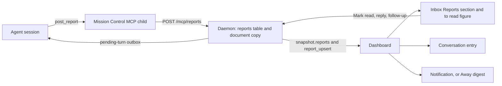

# Agent reports and inbox upgrades

Status: decisions adopted from the operator's review of revision 1; phased in `phased-plan.md`;
revised after plan validation rounds 1 to 4. This task delivers the plan and its phases only. No
product code changes here.

## Goal

Give agents a way to say "done, read this", and make the attention inbox the place where the
operator reads it, unsticks a stalled session, and sees one name per agent.

- An agent posts a **report** with a new MCP tool. The daemon stores it, the agent's conversation
  shows it, a new **Reports** inbox section lists it, and a new **to read** figure in the top bar
  counts it. The operator marks it read or replies to that exact report.
- The four stuck rules produce actionable **Stuck** rows that say why the session stalled and
  offer the fix in place.
- One rule picks an agent's display name on every surface.
- The operator chooses which kinds of item notify. Away mode summarises reports in its digest.
- All of it ships behind one new `inbox` preview flag, which the voice feature will require.

## Adopted decisions

The operator answered the spec's open items on 2026-11-22.

| Decision | Adopted | Not adopted |
| --- | --- | --- |
| The tool's name | `post_report`. | `send_report`, `submit_report`. |
| What `replaces` takes | The earlier report's id. An id that is not one of the agent's own unread reports is refused with a list of them, so a resident that lost the id can retry. | A stable key the agent chooses. |
| Nudge and Continue wording | The specific wording under "Stuck rows" below. | "Please report your status." and "Please continue with the open work." |
| Which report "Steve, mark read" clears when Steve has several and none is open | None. Mark read needs a report that is open on screen. With exactly one unread report it still works from anywhere, as the spec says. No per-agent Mark all read button. | All of the agent's reports, the oldest, or the newest. |
| The unseen-reports note on typed messages | Spoken messages only. This plan ships the note's text builder and voice appends it. | Adding it to typed messages. |
| Recording that a title was typed | Not recorded. Ranks 3 and 4 of the naming rule read "the task title". | A title-source column. |
| Clicking a report notification | Focuses the window and opens the inbox with that report open. If that report has since been replaced, the report that replaced it is opened, because a replacing report takes the earlier one's place (R12). | Opening the agent's conversation; focus only. |
| Noise controls | All three: editable report guidance, a per-agent mute, and Mark all read. | None; a section-wide Mark all read only. |
| After this plan | Create a phased implementation plan and schedule its tasks. | Stop after the plan. |

## Source and scope

- Source spec: "Feature request: Agent reports and inbox upgrades",
  https://claude.ai/artifact/SbAVfCNfQ4NNUMjM5BvqBu (doc id
  `cf399b0a-e0e1-4bc6-8d35-c33d60de90a0`), read at doc revision 14 on 2026-11-22.
- Companion: "Feature request: Voice addressing for agents",
  https://claude.ai/artifact/MHs47NN2d25hdqTpc4JVvE (doc revision 17), section "Notifications and
  UI", for the requirements both features share.
- Every code reference was checked against commit `7626494`, the commit the spec cites and the
  head of `main` when this plan was written.

Out of scope:

- **Filed plan decisions.** The spec's section of that name belongs to the sibling plan task
  "Filed Plan Decisions Phased Plan". Its open item (which flag, and whether snooze, the
  ten-question limit and merge closure apply to plan forms) is decided there.
- **Voice.** Listening, routing, call signs, the reference name and spoken delivery belong to
  "Voice Addressing for Agents Phased Plan". This plan builds the seams voice fills and nothing a
  person can hear or say.
- The spec's non-goals: no Cancel on any inbox card, no resuming a completed session, Foreman
  never acts on reports, and nothing reaches the scout archive unless the operator asks.

## Requirements captured from the spec

Each requirement has an id so a phase can own it. R28 to R30 come from the adopted decisions.

### Reports

| Id | Requirement |
| --- | --- |
| R1 | A new tool on the Mission Control MCP server, beside `request_input`, named `post_report`. Fields: `title` (required, one line, becomes the notification text and the row heading), `body` (required, Markdown, about 4,000 characters), `file` (optional checkout-relative HTML or Markdown document), `url` (optional link), `replaces` (optional id of this agent's earlier report). It returns at once with a receipt naming the report's id. No severity or category field. |
| R2 | The tool description says when to report: when asked to, or when the agent has finished something the operator must read in order to act. Progress stays on `report_status`. Anything urgent or needing a decision is a question. |
| R3 | An attached document is copied into the Mission state home when the report is posted, so it survives worktree cleanup. |
| R4 | Reports have their own SQLite table and never enter `reviews`: no effect on `pendingReviews`, completion holds, the ten-question limit, merge closure, Foreman triage or orphaning on eviction. |
| R5 | Conversation: a marked entry at the point the report was posted, with **Open report** and **Mark read**. The session is the report's permanent home. |
| R6 | Inbox: a **Reports** section below everything owed and above Snoozed, grouped by agent, oldest first. |
| R7 | Top bar: a separate **to read** figure beside need you, to answer and snoozed. Clicking it opens the inbox. |
| R8 | A report never turns a session amber, never puts it in Needs you, and never counts in need you or to answer. |
| R9 | A report stays in to read until the operator marks it read or answers it. Marking read is **Mark read**, or **Mark all read** (R30). Answering is a reply, or the follow-up task that stands in for a reply when the agent is gone (R11), once that task has been dispatched. A replaced report gives its place to its successor (R12). Opening the inbox or the report does not clear it. Mission Control records when each report was first opened, with no visible count. |
| R10 | Each report card has a reply box. The reply is delivered like a typed message and marks the report read. The message names its report ("Reply to your report 'Build failure diagnosed' (r-42), posted 12 minutes ago"), then the report text, then the operator's words. |
| R11 | Reports outlive their session: an exit or a merged pull request leaves them in to read. A resident that is not running: the reply box says "Steve isn't running" with a relaunch hint. A standard session that is gone: the reply box becomes **Start a follow-up task**, which dispatches a new session with the report as context and, like a reply, marks the report read. Completed sessions are never resumed. |
| R12 | A report posted with `replaces` takes the earlier one's place. The inbox shows only the latest with a note such as "updated 3 times" and keeps the original's place in the queue. Older versions stay in the conversation. Reports without `replaces` stack. |
| R13 | **Open report** shows the stored copy of the attached document. **Publish as scout** saves it to the scout archive, and only when the operator chooses it. |
| R14 | Foreman leaves reports alone: it never marks them read, replies, triages them or uses them as completion evidence. |

### Stuck rows

| Id | Requirement |
| --- | --- |
| R15 | The daemon's four stuck rules also produce rows in a new **Stuck** section right after Waiting on you. Stuck rows count in to answer. A row clears itself when the session moves again and can be dismissed like any other row. |
| R16 | Every row says why the session is stuck and offers the fix in place. No generic "session is stuck" card. Silent while working: last activity line and how long, with **Nudge** and **Interrupt**. Idle with a task or queue open: the open task or queue, with **Continue**, and **Mark done** when a task is open. A queue with no task has no task to complete, so that card offers Continue and says its items are handled in the session. Idle with a workflow run parked: the missing step, with **Resubmit** (manual or Preview runs only) or **Tell it to push** when it has unpushed commits. Unanswered Foreman escalation: what Foreman escalated, with a reply box. |
| R17 | Every stuck card also has a message box to the agent and **Open session**. Nudge and Continue send fixed messages. There is no Cancel on any inbox card. |

### One name everywhere

| Id | Requirement |
| --- | --- |
| R18 | One rule picks the display name: (1) a call sign, meaning a session's call sign or a resident's reference name; (2) a resident's profile name; (3) and (4) the task title, typed or generated. |
| R19 | Notifications, inbox rows, the review modal, question cards, report cards, the tray and voice cards all use it. Question cards draw the name in the resident's board colour. |

### Notifications, settings and Away mode

| Id | Requirement |
| --- | --- |
| R20 | A **What notifies you** group under the existing alerts settings, five switches, all on by default: blocking questions notify; questions filed while the agent keeps working notify; agent reports notify; agent reports are listed in the inbox; stuck sessions notify. |
| R21 | A notify switch only stops the notification; the item still appears in the inbox. Reports alone have the second switch: turned off, reports leave the inbox list and the to read figure and stay in each conversation. Other alerts are unchanged. |
| R22 | A report notification uses the display name and is worded by the agent's state. Stopped: "Steve's back: Build failure diagnosed". Still working: "Steve posted a report: Build failure diagnosed". A session that goes idle or finishes without a report stays silent. Clicking it opens the inbox with that report open. If that report has since been replaced, the click opens the report that replaced it, since the inbox shows only the latest of a chain (R12). The click works even when the inbox does not list the report to open, because reports are unlisted (R21) or it was already read: the inbox then draws that one report on its own. |
| R23 | Away mode: reports do not interrupt and collect in the inbox. The return digest summarises them ("4 reports waiting: Steve, Carol and 2 others"). Stuck sessions still break through. |

### Order, voice compatibility, rollout and noise controls

| Id | Requirement |
| --- | --- |
| R24 | Fixed section order: Decisions, Questions from agents, Parked on a menu, Pipeline lifecycle, Pipeline halts, Waiting on you, **Stuck**, Stuck finalizations, **Reports**, Snoozed. |
| R25 | Every inbox action has a spoken form, shown on the card as an always-visible hint in lighter text. Planned here as a seam: every control on a report or Stuck card, and the question card's two forms, is declared with its spoken form, which stays hidden until voice turns it on. A control that only navigates (Open session, Open run, Open archive), one that only shows or hides a report's body, a row's Dismiss, and the section-wide Mark all read, which names no agent, are declared click-only with that reason. |
| R26 | Hooks voice needs from reports: the line "When you have finished this, post a report." on spoken messages, the unseen-reports note, and binding speech to the report that is open on screen. Planned here as seams. |
| R27 | One `inbox` preview flag turns on reports, Stuck rows and the naming rule together. |
| R28 | **Report guidance** is editable: the operator can change the text that tells agents when to post a report, and reset it. |
| R29 | **Per-agent mute**: muting an agent stops its report notifications and keeps its reports out of the inbox list and the to read figure. They stay in its conversation. |
| R30 | **Mark all read** on the Reports section marks every listed report read. |

## Reference verification

Every reference in both specs was opened at `7626494`. All exist. The table records what each
one actually says.

| Spec reference | At `7626494` | Verdict |
| --- | --- | --- |
| `sessionLabel`, `src/shared/alerts.ts:125-127` | `s.task?.title \|\| s.name \|\| "a session"`; the function is private to the file | Matches |
| `deliverable()`, `src/shared/alerts.ts:116-118` | `a.severity === "attention"` | Matches |
| Stuck rules, `src/shared/alerts.ts:160-175` | Those lines are `stuckAlert`, which turns a stall into an alert. The rules are `detectStall` in `src/shared/stall.ts:226` | Finding 1 |
| `src/web/useNotifier.ts:120` | `detectAlerts(withKnownStalls(prev, scope), scope).filter(deliverable)` | Matches |
| `foldAlerts`, `src/shared/away-buffer.ts` | `:168`; the digest's kind table is `KIND_ORDER` at `:272` | Matches |
| `ReviewModal.tsx:98` | `src/web/components/ReviewModal.tsx:98`, `<strong>{session.name}</strong>` | Matches |
| `src/main/tray.ts` | Shows counts from `/api/report` and no session name | Finding 9 |
| `AttentionItem`, section slots, `represented`, `attentionDismissalKeys`, `total` in `src/web/lib/attention.ts` | Union at `:73`, `attentionDismissalKeys` `:260`, `foldAttention` `:355`, `represented` `:361`, `total` `:552` | Matches |
| `SECTION_TITLES` in `AttentionInbox.tsx`; figures in `Topbar.tsx` | `src/web/components/AttentionInbox.tsx:62`; `src/web/components/Topbar.tsx:499-531` | Matches |
| The new tool in `src/mcp/server.ts`, beside `request_input` | `request_input` is registered at `:969` | Matches |
| Snapshot field in `src/shared/types.ts`, handled in `src/web/useEventStream.ts` | Snapshot at `types.ts:3769`; the exhaustive switch ends at `useEventStream.ts:766` | Matches |
| A question's `context` cap | `DECISION_CONTEXT_MAX_CHARS = 4000`, `src/shared/decision-asks.ts:28` | Matches |
| Inbox sections named in the Problem section | The rendered order is exactly that list | Matches |
| "Only attention alerts are delivered, and only Away mode keeps info alerts" | True, but the buffering is the daemon's (`src/server/away/watcher.ts:204`); the browser notifier never reads Away mode | Finding 4 |
| "Open report shows that copy in the files viewer, the way a scout report opens" | A scout report opens its checkout file in the session's Files preview; that viewer reads only a session's checkout | Finding 5 |
| Filed plan decisions: `src/mcp/server.ts:544-545`, `src/shared/async-input.ts:46-56` and `:77`, `src/server/reviews.ts:343-348`, `src/shared/protocol.ts:693-700`, `src/server/routes.ts:5189-5227` | All six read as the spec describes | Matches (sibling plan owns them) |
| Voice spec: `addContinuationAddendum`, `src/server/reviews.ts:177`; `attachCall`, `src/server/reviews.ts:723`; the tray | All present as described | Matches (voice plan owns them) |

## Drift and findings that change the design

1. **The stuck rules are computed only by the daemon.** `detectStall` (`src/shared/stall.ts:226`)
   runs in the away watcher (`src/server/away/watcher.ts:156`) when stall detection is on, is
   served at `GET /api/away/stalls` (`src/server/routes.ts:7702`) and polled by the dashboard
   every five seconds (`src/web/lib/stalls.ts:33`). The inbox folds that list; it cannot
   recompute the rules, because a session going quiet emits no event. The thresholds are settings
   (10 and 20 minutes by default, and 5 minutes for an escalation, which the spec does not state).
   With stall detection off there are no Stuck rows.
2. **A stall's sentence cannot be the dismissal key.** The spec keys a dismissal on "the rule and
   its sentence", but the sentence carries the elapsed minutes ("idle 23m ..."), so a dismissed
   row would return every minute. `Stall` gains structured fields, and the key is built from the
   rule and the stable facts (run, round, what is open). The same fields choose the card's actions,
   so nothing parses a sentence.
3. **An agent is always mid-turn when it posts.** The tool is called inside a turn, so "stopped"
   versus "still working" is not known at post time. The daemon stamps each report once: "back"
   when its session settles within a short grace period (20 seconds) after posting, otherwise
   "working". The notification fires on that stamp, so "Steve's back" can trail the post by up to
   the grace period.
4. **Away mode does not change what the browser delivers.** Attention alerts always notify and
   info alerts never do. A report alert is a third class: delivered at the desk, buffered while
   away. The notifier gains the Away state and the per-kind settings, and the daemon's alert scope
   gains reports so the digest can count them.
5. **The Files viewer cannot show a state-home file.** Open report gets its own read-only route
   and sandboxed reader, following the managed-plan reader (`src/server/routes.ts:5787`,
   `src/web/components/ManagedPlanReader.tsx`).
6. **The scout archive only accepts scout submissions and plan captures.** Both arrive through a
   task's work episode (`src/server/archives/manager.ts:254`). Publish as scout needs a third,
   operator-initiated capture path. An archive page must be static HTML that passes the archive's
   checker. The daemon builds the published page from the stored copy alone: an HTML document as
   stored, a Markdown document rendered by the daemon. The publish request carries no page, and a
   page the checker refuses is reported on the card.
7. **No call sign or reference name exists yet.** Rank 1 of the naming rule is a seam: the
   resolver accepts both and voice adds the fields.
8. **Nothing records whether a title was typed.** `explicitTitle` is a local in
   `src/server/tasks.ts:3370`. Ranks 3 and 4 are both `task.title` and sit next to each other, so
   recording it would change no displayed name. The adopted decision is not to record it.
9. **The tray shows counts only.** There is no name to change there. The resolver is shared code,
   so voice's tray states can use it.
10. **The alerts settings are a top-bar popover.** Desktop notifications and Sound live in
    `src/web/components/AlertBar.tsx`, stored in `app_config` as `ui.alerts`
    (`src/shared/protocol.ts:4555`). "What notifies you" goes there.
11. **A notification click only focuses the window** (`src/web/useNotifier.ts:29`), plus a hash for
    runs and ensembles. A report notification adds opening the inbox at its report.
12. **There is no hook to add text to an operator's message.** A queued turn is delivered verbatim
    and matched by exact text when the agent echoes it (`src/server/pending-turns.ts:963`). That
    is why the unseen-reports note stays off typed messages and its delivery belongs to voice.
13. **There is no follow-up-task path.** Only hibernated tasks resume. Start a follow-up task is a
    new route that creates and dispatches a task from the report.
14. **Flags cannot depend on each other.** "Enabling voice offers to turn both on" is new mechanism
    and belongs to voice. Also, "inbox" already names headless mode's dispatch inbox
    (`src/shared/home-dispatch-inbox.ts`), so the flag's label says what it turns on.
15. **The top bar's figures are pinned by tests.** `e2e/specs/topbar-one-row.spec.ts:148` expects
    four pulse segments; a fifth has to fit the one-row ladder.
16. **A stuck session can also be amber.** It would appear under Waiting on you and under Stuck.
    A session with a visible Stuck row is not also drawn under Waiting on you.
17. **Reports must render after their session is evicted.** The row stores its author's display
    name, task, repository and resident profile at post time.
18. **`review` alerts already split by wait mode** (`src/shared/alerts.ts:260-286`), but an alert
    does not say which branch raised it. Alerts gain a notify class that the settings read.
19. **The database schema is at version 40** (`src/server/db.ts:287`). The reports table takes the
    next number at merge time; the sibling plan may also migrate, so the later one rebases.

## Design

The report never passes through the review channel. Foreman reads reviews and registered
evidence, and neither contains reports.

### Reports: storage, tool and wire

- A `reports` table, created beside its upgrade path with a schema version bump. One row per
  posted report: a short public id (`r-<n>`), the posting session, task and repository, the
  author's display name and resident profile at post time, title, body, optional url, the stored
  document's name and kind, the chain it belongs to (`replaces`), when it was first opened, when
  and how it was read, any follow-up task started from it, and how it was announced (finding 3).
- The document is copied to `<state home>/reports/<id>/` when posted. The daemon accepts only a
  path inside the posting session's checkout, an `.html` or `.md` file, within a size cap.
- The tool posts to a new `/mcp/reports` route with the same token and session resolution as
  `request_input`. With the flag off the daemon refuses and the tool says where to turn it on.
  The tool is added to `MISSION_MCP_TOOLS` and the action manifest; sessions on an older bundle
  do not have it.
- The wire gains `ReportItem`, a flag-gated `reports` snapshot field (unread, latest of each
  chain) and a `report_upsert` event. A session's full history, older versions included, is read
  per session for the conversation.
- Operator routes: opened, mark read, reply, follow-up, document, publish.

### Reports: surfaces

- **Inbox.** Rows are grouped by agent and collapsed to the title, the agent's name and the age.
  Opening a row shows the body, the link, Open report, Publish as scout, the reply box and Mark
  read, and records the first open. Mark read is the row's dismissal; there is no separate
  Dismiss.
- **Top bar.** "N to read", neutral tone, opens the inbox.
- **Conversation.** A marked entry where the report was posted, with Open report and Mark read.
  Older versions of a replaced report stay as entries.
- **Reply.** Delivered through the pending-turn outbox as an operator message: the line naming
  the report, the report text, then the operator's words. It is echoed and captured exactly as a
  typed message is.
- **Agent gone.** The card reads the live session and resident run: a resident that is not
  running shows the relaunch hint; a standard session that is gone offers Start a follow-up task
  in the repository stored on the report. The task it creates is recorded on the report, so a
  retry after a failed dispatch reuses that task and never creates a second. The report is
  marked read once the task has been dispatched, not before.

### Stuck rows

- `Stall` gains the structured facts each card needs (finding 2): what is open, the parked run's
  status, round and whether it can be resubmitted, the unpushed commit count, the escalation
  text and the last activity line.
- A `session_stuck` fold item with one card per rule, counted in to answer, dismissible, gone
  when the daemon stops reporting the stall.
- Actions call routes that exist: interrupt (`src/server/routes.ts:6884`), complete
  (`:10032`), resubmit (`:3326`) and send (`:6205`). Mark done completes the stall's open task
  and is drawn only when there is one. Nudge, Continue and Tell it to push send fixed messages
  marked as daemon-written:
  - Nudge: "Status check from your operator: you have gone quiet. Reply with one line on what you
    are doing and whether anything is blocking you, then carry on. If you are waiting on a
    long-running command, say which one."
  - Continue: "Your operator asks you to continue. Work is still open against this session. Pick
    it up where you stopped and carry it through. If something is blocking you, say what it is
    instead of stopping."
  - Tell it to push: "Push your commits. The review is waiting for a pushed head on this branch."

### One name everywhere

- One resolver in shared code returns the name and which rank supplied it: call sign or
  reference name (seam), resident profile name, task title, then the session name.
- With the flag on it is used by alert titles, inbox row headers, the review modal header,
  question cards, report cards and stuck cards. A resident's name is drawn in its board colour.

### Notifications, settings and Away mode

- `ui.alerts` gains the five switches. The alerts popover gains the **What notifies you** group.
- Alerts gain a notify class (blocking question, filed question, report, stuck). The notifier
  delivers by class, settings and Away state instead of by severity alone.
- A `report` alert kind fires on the announce stamp, worded "X's back: title" or "X posted a
  report: title". Clicking it opens the inbox with that report open, or with the report that has
  replaced it. A report the inbox does not list is drawn on its own above the sections, so the
  click always has a report to show. The Away buffer gains a reports kind whose rollup names the
  agents.
- "Agent reports are listed in the inbox" off removes the Reports section and the to read
  figure; conversations keep their entries.

### Noise controls

- **Report guidance.** A daemon setting holds the paragraph that says when to post a report. Its
  default is the spec's two cases. It is edited, and reset, in a new Reports panel in Settings.
  The MCP child reads it once when it starts and uses it in the tool's description, falling back
  to the default if the read fails. A change reaches sessions started afterwards.
- **Per-agent mute.** A mute is keyed to a resident's profile, or to a standard session. A muted
  agent can still post; its reports raise no notification and stay out of the inbox list and the
  to read figure, and remain in its conversation. Mute is offered on the report card. The Reports
  panel in Settings lists muted agents with Unmute.
- **Mark all read.** A button on the Reports section heading marks every listed report read. It
  is click-only, because it names no agent.

### Seams for voice

| Seam | What this plan provides | What voice adds |
| --- | --- | --- |
| Flag | The `inbox` flag id as a shared constant | The requirement and the "turn both on" offer |
| Spoken forms | Every control on a report or Stuck card is declared once with its label and either a spoken form ("Steve, mark read", "Steve, nudge", "reply, ...") or a click-only reason. Cards render a hint slot that shows nothing | Turning the hints on |
| One action path | A click and any other caller run the same action function | Calling it from a spoken command, with its cancel window |
| Mark read target | A pure rule: the report open on screen; else the agent's only unread report; else none | Saying "Steve, mark read" and showing the hint when the rule returns none |
| Open report | First-opened time on the report, and which report is open on screen | Binding "Steve, ..." and "reply, ..." to it |
| Message text | Builders for the unseen-reports note and the post-a-report line | Appending them to spoken messages |
| Names | The resolver takes a call sign and a reference name and says whether the name is a spoken one | The fields, the dispatch control and name validation |

### Flag off

With `inbox` off: the tool is refused, no report surface renders, no Stuck rows fold, names
resolve as today, and the new settings are hidden. Stored reports, mutes and guidance are kept
and return when the flag is turned on again.

## Coordination with the sibling plans

- "Filed Plan Decisions Phased Plan" edits the review channel (`src/mcp/server.ts`,
  `src/server/reviews.ts`, `src/shared/async-input.ts`). This plan adds a tool to the same MCP
  file and may add a migration alongside it. Neither consumes the other's contracts.
- "Voice Addressing for Agents Phased Plan" depends on both and consumes the seams above.

## Verification

Each phase carries its own tests. Every phase that changes the dashboard adds a Playwright spec
under `e2e/`, turns the real flag on through `PUT /api/feature-flags`, and keeps every agent
faked. A spec that opens a new modal calls `expectContentClearsBorder`. With the flag off, every
existing spec passes unchanged.
