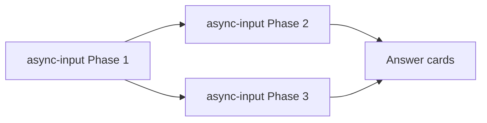

# Asynchronous input answer cards: phased implementation

Source: `docs/plans/async-input-answer-cards/plan.md`. Its adopted decisions are requirements
here: the card sits at the point the agent received the answer, showing "On its way to the agent"
at answer time until then; the work is one phase after async-input Phases 2 and 3.

## Findings that shaped the phase

- Every outbox message about a review passes through `ReviewManager.deliverToOutbox`
  (`src/server/reviews.ts:204`), but the row's final text is written later, in
  `queueReviewPendingTurn` (`src/server/db.ts`). That is also where Phase 2 folds several answers
  into one unclaimed row. The marker line must therefore be composed where the row text is
  finally written, from every review id the row carries, not prepended once in
  `deliverToOutbox`.
- The pending-turn row id is the turn id (`review-continuation:answer:<reviewId>`, or
  `review-continuation:<reviewId>` and `review-continuation:snooze:<reviewId>`). The session's
  `pendingTurns` can therefore tell the dashboard which answers are still queued, without a new
  field. Phase 2 decides the id of a coalesced row; this phase reads the review ids recorded in
  the row's marker line, so it does not depend on that id.
- Delivery may go to a runtime-transfer successor (`runtimeTransferSuccessor` in
  `deliverToOutbox`; reviews move with `transferPendingReviews`). Recognition must accept a
  review owned by this session or by a session in its transfer lineage.
- Review ids in the text do not prove who wrote the turn: an operator can paste a marker for a
  real review of the same session. Delegated turns already solved the same problem durably:
  `session_delegated_turns` (`src/server/db.ts`) records one row per delivery with the delivered
  text's fingerprint and the target transcript's size, and `delegatedTurnSources`
  (`src/server/delegated-turns.ts`) binds each row to exactly one later turn and never re-points
  it. It reserves the row and reads the transcript size before the send
  (`reserveDelegatedTurn`), so a turn that lands before the send returns is still after the
  offset. It also contests a delivery while another send of the same words is in its race window
  (`noteOtherSend`, `session_other_sends`), because a fingerprint cannot tell two identical turns
  apart. A delegated row binds only within `DELIVERY_LAG_MS` of its delivery. Delegated rows of a
  conversation that is no longer live are pruned by age (`pruneDelegatedTurns`), after which
  their turns lose their label. Answer cards cannot accept that: an old conversation must still
  show its cards, so bound review-message rows are exempt from age pruning and only expired
  unbound rows are pruned. Review-message recognition uses the same mechanism through a shared
  binding helper, so there is one binding rule rather than two.
- `attributeTranscript` (`src/server/transcript-attribution.ts:26`) is the single server-side
  pass over transcript turns. Its callers are the transcript route, the transcript stream,
  retro worthiness and workflow context. Attaching the presentation there reaches every reader
  at once. It already attaches `presentation` for launches and resident wakes.
- `TranscriptPresentation` (`src/shared/types.ts:4211`) is a `kind` union with a shared
  `displayText`. A `review-message` kind needs its own shape (`reviewIds`, `envelope`), so the
  union becomes a discriminated union rather than gaining a third literal.
- The dashboard derives display from presentation in `projectLaunchPresentation`
  (`src/web/lib/launch-presentation.ts`). That module states that every display consumer reads
  its projection. The new kind joins that projection, so rows, both renderings, find and the
  Yours rail agree.
- Resolved reviews are placed by `mergeConversation` (`src/web/lib/episodes.ts:44`) at
  `resolvedAt` and drawn by `ReviewAnswerCard` (`src/web/components/ReviewAnswer.tsx:27`) and
  `SnoozedReviewCard` (`src/web/components/ReviewSnooze.tsx:285`). Phase 3 adds an Asked entry
  and closed-state lines in the same files, which is why this phase follows Phase 3.
- `Registry.captureHookGoalPrompt` (`src/server/registry.ts:9223`) is the Goal reader that a
  restart can expose to an answer echo.

## Sizing and phase count

Estimated 380 to 480 non-test implementation lines: the envelope module (about 60), the writer
at the queueing point (about 30), the delivery table, its writer at delivery and the binding
helper extracted from delegated turns (about 90), recognition (about 40), the Goal reader echo
claim (about 20), the presentation union and projection (about 50), placement and
de-duplication (about 50), and the two renderings with the disclosure and status line (about 90).

One phase. Splitting the server marker from the dashboard rendering would land a marker line no
reader uses, or a renderer with nothing to render, and the two halves share one module and one
test fixture. The work is a single vertical slice that a mid-tier model can implement and verify.

| Phase | File | Delivers | Depends on | Est. lines |
| --- | --- | --- | --- | --- |
| 1 (async-input Phase 4) | `phase-1-answer-cards.md` | Marker line, delivery record and binding, answer cards at delivery, Remind me later line, Goal reader check | async-input Phase 2 and Phase 3 merged | 380 to 480 |

## Cross-phase contracts

Inherited from the async-input phases and not changed here:

- Answer rows are daemon-authored (`harness`), keep the `review-continuation:` prefix, and keep
  the operator-message escalation (steer at 60 s, interrupt at 180 s).
- Phase 2 owns the answer wording and coalescing; this phase adds only the first line.
- Phase 3 owns the Asked entry and closed-state lines; this phase only moves and de-duplicates the
  answer card for a delivered review.

Owned here:

- `src/shared/review-message-envelope.ts`: the only writer and parser of the marker line.
- `TranscriptPresentation` kind `review-message` with `envelope` and `reviewIds`.
- The review-message delivery table and the shared delivery-binding helper. Recognition and the
  Goal reader trust only a bound delivery row, never the marker text.

## Plan pull request review

One Inspector finding on #1612 was accepted and applied in revision 3: review-id ownership alone
let an operator's pasted marker turn their own message into an answer card, change its authorship
and skip Goal capture. Recognition now requires a durable delivery record bound to the turn.

Revision 4 applies two more findings from the same review. The delivery row and its transcript
offset are reserved before the send rather than at confirmation, so a fast turn cannot land at or
before the offset. A racing send of the same words contests the delivery instead of letting the
first matching turn win. The guarantee for pasted copies is narrowed to what Mission Control can
observe: a byte-identical copy typed straight into a terminal pane inside the delivery window is
the one stated residual.

Revision 5 applies one more finding: echo accounting in the Goal reader is stated as a count, as
`captureHookGoalPrompt` already does for other daemon-typed text, so an operator copy that
arrives before the delivery's echo cannot leave the delivery's echo to be captured in its place.

Revision 6 settles two details from the same review: the marker is valid only as the literal
first line, and a bound delivery keeps its `harness` origin even after the reviews it carried are
deleted, so the raw fallback stays bylined Mission Control.

Revision 7 settles retention and expiry. Bound rows are never pruned by age, so reopening an old
conversation still shows its cards. An unbound row binds only inside the delivery window,
expires after it and is pruned, and any later Mission Control send of the same words contests
it, so a delivery whose turn was altered or dropped cannot claim an operator's later copy. No
reviews are deleted by any retention today; the wording that assumed one was corrected.

Revision 8 bounds the Goal reader's echo debt. A delivery's owed echo is cleared when it arrives,
when the delivery's work cycle completes, or after `HUMAN_ECHO_TTL_MS`. These are the rules
operator follow-up echoes already follow, so a dropped or altered echo cannot swallow a later
operator copy.

## Final verification

With async-input Phases 1 to 3 and this phase merged and the flag on: `npm run typecheck`,
`npm run lint`, `npm run build`, `npm run smoke`, `MISSION_TEST_CONCURRENCY=4 npm test` and
`npm run test:e2e`. With the flag off, every spec that predates this work passes unchanged.
