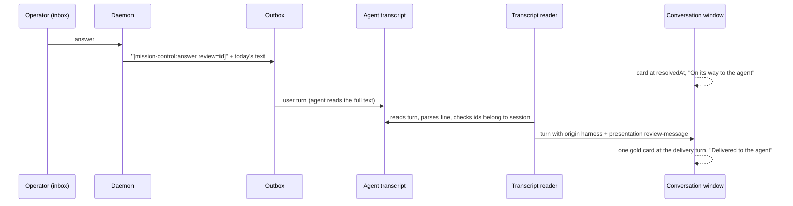

# Asynchronous input: answers render as answer cards

Status: approved by the operator on 2026-11-20 (revision 1), decisions recorded below; phased
in `phased-plan.md`. Addendum to `docs/plans/async-input-inbox/plan.md` (managed plan
`bc34ca62-7ee5-40d0-9428-25bd57e85755`, revision 8). No product code changes in this task.

## Adopted decisions

| Decision | Adopted | Not adopted |
| --- | --- | --- |
| Where the card sits | At the point the agent received the answer. Until delivery it shows at answer time with "On its way to the agent". | Always at answer time with the delivered turn hidden; answer time plus a "Delivered" chip. |
| Scheduling | A new phase after async-input Phases 2 and 3. | Folding the work into Phase 3. |
| After this plan | Create the phased implementation plan and schedule its task. | Stop after the plan. |

## Goal

When the operator answers a `request_input` question today, the conversation shows the answer
as the gold answer card: the question, the options with the chosen ones marked, and any typed
note. The agent's own tool result is hidden. Keep that experience once questions are filed
without stopping (`async-input`):

- The answer appears in the conversation as the same gold answer card, never as a raw block of
  daemon text that looks like someone typed a message.
- It appears once, not as a card plus a raw message.
- It keeps rendering that way after a daemon restart and on a reload of an old conversation.
- The agent still receives everything it receives today. Only the conversation window changes.

## What the plan does today, and why it falls short

The async-input plan delivers each answer through the pending-turn outbox as a message the daemon
writes (`review-continuation:answer:<id>`, recorded as `harness`). Section 3 of the plan says the
message "is not echoed as a human turn" because "the operator's answer is already recorded in the
conversation as the gold answer entry". Nothing in Phases 1 to 3 changes how the delivered turn
itself is drawn. On the Phase 1 branch (#1607):

| What the conversation shows | Evidence |
| --- | --- |
| The gold card, placed at the moment the operator answered. | `mergeConversation` in `src/web/lib/episodes.ts:44` places a resolved review at `resolvedAt`; `ReviewAnswerCard` in `src/web/components/ReviewAnswer.tsx:27`. |
| A second turn holding the raw delivered text, bylined "mission control" in chat mode, or `mission-control@mission ❯ <raw text>` in the terminal rendering. The text reads "Mission Control review <id> was answered after its MCP wait ended. Treat this as the result of your earlier review tool call:" followed by the answer. Phase 2 makes that text longer by restating the question and the `meanwhile` line. | `continuationText`, `src/server/reviews.ts:172`; turn bylines from `turnWho`, `src/web/lib/find.ts`; renderings in `src/web/components/TranscriptPanel.tsx` (chat `Turn` near line 2048, terminal near line 2240). |
| After a daemon restart, that same turn is bylined "you". | Turn authorship is matched by text against an in-memory record that a restart forgets (`src/server/injections.ts`, header comment; read in `src/server/transcript-attribution.ts:54`). |

The same raw turn already appears today, with the flag off, for every answer that arrives after
its call ended (a timed-out call, or Remind me later), and for the Remind me later "carry on"
instruction. With the flag on, every answer takes that path.

## Design

### 1. A marked first line on every outbox message about a review

Every message the daemon writes into the outbox about a review starts with one machine-readable
line, then a blank line, then exactly the text the agent receives today:

```text
[mission-control:answer review=1b0c9f4e-2a8d-4a43-9d3e-0f6c2b7e5a10]

Mission Control review 1b0c9f4e-... was answered ...
```

- Kinds: `answer` (a resolved question, in either wait mode) and `remind-later` (the snooze
  instruction).
- Several answers coalesced into one message (Phase 2) list every id in delivery order:
  `[mission-control:answer reviews=<id>,<id>]`.
- ASCII only, because terminal sessions receive the text through a pane paste, where non-ASCII
  characters are fragile.
- The line also tells the agent what the message is, so it costs nothing in clarity. The
  receipt and the tool description already tell the agent that answers arrive as messages.
- One browser-safe module owns the format, its writer and its parser:
  `src/shared/review-message-envelope.ts`. The daemon writes the line, and the transcript reader
  and the tests parse it, through the same functions. No other module matches the string.

### 2. Recognising the turn, durably

`src/server/transcript-attribution.ts` already attaches a `presentation` to user turns it can
explain (the launch prompt and resident wakes). It gains one more case. A user turn whose first
non-blank line parses as an envelope, and whose every review id belongs to this session in the
reviews table, gets:

- `origin: "harness"`, so its byline, find scope and the rail's Yours tab treat it as Mission
  Control's, including after a restart, when the in-memory record is gone.
- a new presentation kind, `{ kind: "review-message", envelope: "answer" | "remind-later",
  reviewIds: string[] }`. It is added to the `TranscriptPresentation` union in
  `src/shared/types.ts` beside `launch` and `resident`, not by repurposing either.

Ids are checked against the session's own reviews, so a turn that merely contains the marker,
for example the operator pasting one, renders as the plain text it is. Recognition reads only
the reviews table and the transcript, both durable, so it survives restarts and works on
history.

The Goal reader gains the same check: `Registry.captureHookGoalPrompt` never captures a prompt
whose first line is a valid envelope for this session. This closes the window in which a
restart between delivery and the prompt-hook echo lets an answer through as a Goal revision.

### 3. Drawing it

The dashboard projects a `review-message` turn the way `projectLaunchPresentation`
(`src/web/lib/launch-presentation.ts`) projects a launch: derived at display time, with the
native message kept as the panel's state.

- **Answer.** The turn is drawn as one `ReviewAnswerCard` per review id, in envelope order. It
  uses the same component and the same gold styling as today's card, in both the chat and the
  terminal renderings. The card gains one quiet line: "Delivered to the agent" with the
  delivery time, and, where the answer came from Foreman or a standing approval, the existing
  answerer label.
- **Remind me later.** The turn is drawn as the existing snoozed card line (`SnoozedReviewCard`
  styling), not as raw instructions.
- **Nothing is hidden for good.** Each card has a "What the agent received" disclosure that
  shows the raw delivered text. Find in conversation searches the card's visible text and the
  raw text inside the disclosure.
- **A turn whose ids are not all resolved or known** (an old row, or a review deleted by
  retention) falls back to today's raw rendering, bylined Mission Control.

### 4. One card per answer, placed where the agent received it

Today the call returns the moment the operator answers, so "when the operator answered" and
"when the agent received it" are the same instant. With message delivery they can be up to three
minutes apart, or longer while a session is paused or a permission dialog is open.

- Once the delivery turn is in the transcript, the card for that review is drawn there, at the
  turn, and `mergeConversation` drops the separate `resolvedAt` entry for that review id. The
  agent's reply then follows the card directly, which is how it reads today.
- Until then (the answer is queued in the outbox), the card is drawn at `resolvedAt` as today,
  with the line "On its way to the agent", derived from the session's `pendingTurns`.
- A call-mode answer that its call returned directly has no delivery turn, so it keeps today's
  placement at `resolvedAt` unchanged.

### 5. Flag and compatibility

- Gated by `async-input`. With the flag on, every outbox message about a review carries the
  line. Message-mode questions always carry it, whatever the flag says when they are answered,
  because they exist only because the flag was on.
- With the flag off, call-mode late answers and Remind me later instructions are written
  exactly as today. A conversation that already contains marked turns keeps rendering them as
  cards, because recognition does not read the flag.
- The line changes nothing about authorship, escalation (steer at 60 s, interrupt at 180 s),
  coalescing, or the `review-continuation:` turn-id prefix that resident pacing reads.
- An old MCP child is unaffected: the line is written by the daemon, not the child.
- Phase 2's answer text sits below the line unchanged. This plan adds the line; it does not
  reword answers.

## Flow

Before (Phase 1 to 3 as planned):

```text
operator answers -> gold card at resolvedAt
outbox delivers  -> raw "mission control" turn (reads "you" after a restart)
```

After:



## Where this lands

One implementation phase (`phase-1-answer-cards.md`, scheduled as async-input Phase 4), after
Phase 2 (it adds the line to the answer and coalescing
text Phase 2 writes) and Phase 3 (both edit the conversation's review placement in
`src/web/lib/episodes.ts` and `src/web/lib/timelineReviews.ts`, and the transcript renderings).
UI work, so it runs on Claude Opus 5.5 or higher.

Estimated 300 to 400 non-test lines: the envelope module, the writer at the outbox, recognition
in transcript attribution, the Goal reader check, the presentation union, the projection, the
placement and de-duplication rule, and the two renderings.

## Out of scope

- Rewording answers (Phase 2 owns the answer text).
- Changing when or how answers are delivered.
- Rendering other daemon-written turns (Foreman packets, workflow repair) as cards.
- Gate reviews (`request_plan_decisions`, `request_review` and the rest). Their answers still
  return through the blocking call and are already drawn as today.

## Risks

| Risk | Handling |
| --- | --- |
| A harness alters the delivered text (trims, prefixes, or merges a steered message into another turn). | Recognition looks for the envelope on the first non-blank line only. Anything else renders as today's raw text, so a miss looks like today, never like a wrong card. One fake-agent spec per runtime that delivers answers (SDK and terminal) pins it. |
| The agent is confused by the marker line. | It is a plain, self-describing header above unchanged text. Verified with the fake agents and one real dispatch per harness before the flag goes default-on, alongside the receipt check the async-input plan already requires. |
| An operator types or pastes the marker. | Ids must belong to this session's reviews. A pasted marker for a real answer only re-draws that answer, which is harmless. |
| The card moves from `resolvedAt` to the delivery turn when the answer is delivered. | Accepted for a single card per answer; the "On its way" line explains the interim state. |

## Verification

- Unit (`test/`): envelope write and parse round trip, coalesced ids, malformed and partial
  lines, non-ASCII rejection; recognition accepts only ids of this session; `origin` is
  `harness` with an empty injection record (the restart case); the Goal reader refuses a marked
  prompt; projection and `mergeConversation` draw one card per review, at the delivery turn
  when present and at `resolvedAt` with "On its way" when queued; a call-mode answer returned
  through its call is unchanged; flag off writes no line.
- Playwright (`e2e/`, fake agents, no model tokens): with the flag on, an answer given from the
  inbox appears as one gold answer card, in chat and terminal renderings, with no raw "Mission
  Control review" text visible and no "you" byline; the disclosure shows the raw text; after a
  daemon restart and reload the card is still a card; two answers delivered together draw two
  cards on one turn; Remind me later with a provisional option draws the snoozed line, not raw
  instructions. Modal-free, so no inset check is needed unless the disclosure opens a modal.
- `npm run typecheck`, `npm run lint`, `npm test`, `npm run build`, `npm run smoke`,
  `npm run test:e2e`.
