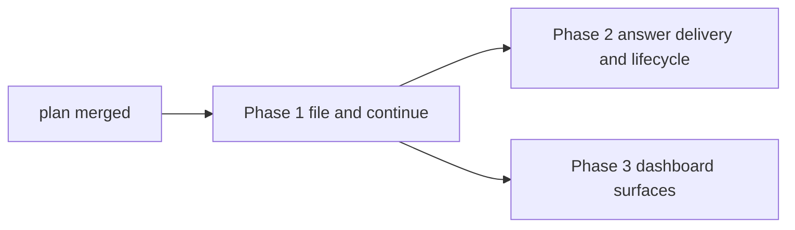

# Asynchronous input inbox: phased implementation

Source: `docs/plans/async-input-inbox/plan.md`. Its adopted decisions are requirements here:
the agent ends its turn to wait (no blocking variant); a mid-turn answer is delivered like an
operator message (steer at 60 s, interrupt at 180 s); every new question alerts; a merged pull
request completes the task and closes its open questions as moot.

## Findings that shaped the phases

- The dashboard's `unpausedStateDisplay` mirrors `reportBucket` by hand
  (`src/web/lib/format.ts:307-345`). The new idle clause must land in both in one phase, or the
  board and the server disagree about who is waiting.
- Every session carries its task's kind (`TaskSummary.kind`, `src/shared/types.ts:2759-2767`),
  so the idle clause can exempt a resident without a new field. The resident loop's hold reads
  the bucket (`src/server/residents/loop.ts:142`), so the exemption is what frees its wakes; no
  second predicate is needed there.
- Alerts fire on `pendingReviews` growing (`src/shared/alerts.ts:253-267`). Once message-mode
  questions are counted apart, the alert trigger must move with them in the same phase.
- Foreman can answer an `input` question, and its answer is excluded from the outbox in two
  places (`src/server/db.ts:5384` and `:5407`). A flag-on session would never hear it, so the
  any-actor delivery lands in Phase 1, not with the other delivery work.
- The source plan's first draft named no field for the merge closure. The browser cannot tell
  a merge closure from any other `orphaned` row, so Phase 1 adds `closed_reason`.
- `withdrawn` has a producer (Phase 2) and a renderer (Phase 3) that run concurrently, so the
  status is declared in Phase 1.
- The Foreman worker never reads SQLite, so the completion hold belongs at the daemon gates
  (`Registry.consumePromptedGeneration`, the workflow manager), not in the worker.
- Those three gates already refuse a session that is not idle
  (`src/server/registry.ts:10316`, `src/server/workflows/manager.ts:8022`, `:5281`), so the
  completion hold can be stated without a session-state condition.
- The shipped flag registry is empty (`src/shared/feature-flag-registry.ts`); a spec turns the
  real flag on with `PUT /api/feature-flags`.
- The database schema version is 35 (`src/server/db.ts:257`); review columns are added with
  `addColumn` beside the snooze columns (`:4257-4276`).

## Plan validation round 1

Two findings were accepted and applied across the bundle:

- **One scope for both completion rules.** The completion hold and the merge closure apply to
  every outstanding `request_input` question of the session: a snoozable `input` review, pending
  or snoozed, in either wait mode. An earlier draft limited both to message-mode questions,
  which left a snoozed call-mode question outside both.
- **No activation gap.** Both rules moved from Phase 2 to Phase 1, so the flag is safe to turn
  on as soon as Phase 1 merges. What Phase 1 leaves for later is quality, not safety: answer
  wording and authorship, coalescing, the bound, the agent's two tools and the dashboard detail.

## Plan validation round 2

One finding was accepted and applied:

- **One rule for prompted completion in every session state.** The source plan's consumer table
  said prompted completion was "not affected" while the agent works, while the completion rule
  and Phase 1 step 9 refused it whenever a question is outstanding. The rule chosen is the
  refusal: prompted completion, workflow resumption and automatic evidence preparation refuse
  while a `request_input` question is outstanding, whatever the session is doing. The table,
  the rule, Phase 1 step 9 and the verification now say that, and the table separates those
  three gates from queue sends and backlog assignment, which the completion hold does not cover.

## Plan validation round 3

One finding was accepted and applied:

- **Phase 1's exit criterion follows the consumer table row by row.** It said no consumer in
  the source plan's section 4 acts on a stopped session with a question open, which contradicted
  the rows the table leaves unheld. It now lists what is held, what is deliberately not held
  (operator messages, workflow repair rounds, `report_blocker`, resident wakes) and the
  snoozed-question exceptions, and names the merge as the one completion path that is not held.
- The same reading was applied to every other summary of the table, so none claims more than
  the table does: the table's own cells now say "not held" and "while a question is pending"
  where that is the rule, and "completed past by automation" became the three named gates.

## Sizing and phase count

Estimated 1,250 to 1,500 non-test implementation lines across shared contracts, the daemon, the
MCP child and the dashboard. One phase is too large for one reviewable pull request, and its
server half is useful before its dashboard half. Three phases:

- Phase 1 is everything needed for the flag to be safe to turn on, including residents and both
  completion rules, so it delivers the stated goal alone. Splitting it would leave a flag that
  lets prompted completion finish a task under an open question, or a second source of truth
  for what a question holds.
- Phases 2 and 3 are split because they share only contracts Phase 1 fixes and touch disjoint
  code (daemon and MCP against dashboard). A fourth phase for residents or for the two
  housekeeping tools would be under 200 lines and is folded in instead.

| Phase | File | Delivers | Depends on | Est. lines |
| --- | --- | --- | --- | --- |
| 1 | `phase-1-file-and-continue.md` | Flag, contracts, the non-blocking ask, what an open question holds, both completion rules, alerts, residents, agent instructions | this plan merged | 560 to 660 |
| 2 | `phase-2-answer-delivery-and-lifecycle.md` | Self-contained daemon-authored answers, coalescing, the open-question bound, `list_open_questions`, `withdraw_question` | 1 | 300 to 380 |
| 3 | `phase-3-dashboard-surfaces.md` | Card status line, ordering, badge, conversation Asked entry, Remind me later under async, Residents drawer | 1 | 380 to 460 |

Phases 2 and 3 may run concurrently and merge in either order. Both edit `docs/sessions.md` in
different sections; the later one rebases.

## Cross-phase contracts, owned by Phase 1

- Flag id `async-input`, stage `preview`.
- `ReviewItem.waitMode?: "message"`, `ReviewItem.meanwhile?: string | null`,
  `ReviewItem.closedReason?: "merged" | null`; columns `wait_mode`, `meanwhile`, `closed_reason`.
  Phase 1 writes `closedReason`; Phase 3 renders it.
- `ReviewStatus` gains `withdrawn` (appended, terminal, never a human resolution). Phase 2
  writes it; Phase 3 renders it.
- `Session.openQuestions: number`: pending message-mode questions, snoozed ones excluded.
  `pendingReviews` excludes message-mode questions.
- A resident session (`task.kind === "resident"`) is never `needs-you` for open questions alone.
- The completion rules cover every outstanding `request_input` question in either wait mode,
  and the completion hold applies in every session state.
- The consumer table in the source plan's section 4 is the complete statement of what a
  question holds and what it deliberately does not.
- `src/shared/async-input.ts`: the receipt text and the wait-mode decision. Phase 2 adds the
  answer text and the bound there. Phase 3 reads it only.
- Outbox turn ids keep the `review-continuation:` prefix, which resident pacing reads.
- Snooze mode ids (`judgment`, `option`, `hold`) are unchanged; Phase 3 changes labels only.

## Not scheduled

Moving `async-input` to `default-on`, and later retiring it and deleting `request_input`'s
long-poll, are separate pull requests after the flag has been used. `docs/feature-flags.md`
forbids skipping the default-on release.

## Final verification

With all three merged and the flag on: `npm run typecheck`, `npm run lint`, `npm run build`,
`npm run smoke`, `MISSION_TEST_CONCURRENCY=4 npm test` and `npm run test:e2e`. With the flag off,
every spec that predates this work passes unchanged.
