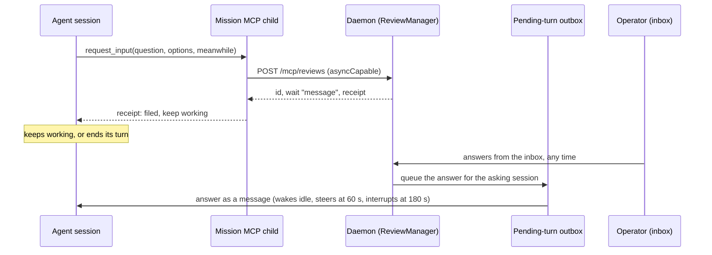

# Asynchronous input inbox

Status: decisions adopted from the operator's review of revision 1; phased in `phased-plan.md`;
revised after plan validation rounds 1 to 3. This task delivers the plan and its phases only.
No product code changes here.

## Goal

Today an agent that calls `request_input` stops until the operator answers. The goal is to make
a question something an agent files and works past:

- The ask returns at once. The agent keeps doing every part of its task that does not depend on
  the answer.
- The operator answers from the attention inbox whenever they get to it. The answer reaches the
  agent as a message, and the agent reconciles what it did meanwhile.
- An agent with nothing else to do ends its turn. Mission Control shows it as waiting and wakes
  it with the answer. That is the only case in which a question stops a session.
- A resident keeps running its standing task on its normal cadence while its questions queue in
  the inbox.

## Adopted decisions

| Decision | Adopted | Not adopted |
| --- | --- | --- |
| A question the agent cannot work past | The agent ends its turn and waits. Every ask returns at once; `request_input` has no blocking variant. | An in-call wait behind `blocking: true`. |
| An answer arriving mid-turn | Treated like an operator message: steer after 60 s where the runtime supports steering, interrupt after 180 s. | Steer at once and never interrupt; always wait for the turn to end. |
| Alerts | Every new question alerts, as today. The alert says whether the agent is still working or has stopped. | A quiet count with an alert only when a session stops. |
| A pull request merges with a question open | The task completes and the question is closed as moot. | Holding completion until the question is answered or dismissed. |
| After this plan | Create a phased implementation plan and schedule its tasks. | Stop after the plan. |

## What exists today

Most of the machinery is already built. The change is mainly in who starts the asynchronous
path and in what an open question is allowed to hold.

| Area | Today | Evidence |
| --- | --- | --- |
| The ask | `request_input` creates an `input` review, then long-polls the daemon in 30 second rounds until the review settles. The agent's turn stays open and idle for the whole wait. | `src/mcp/server.ts:829-912`, `189-236` |
| Client timeouts | MCP clients abandon the call after about five minutes. The model then asks again, which is where duplicate cards came from. Progress heartbeats, exact-duplicate re-attach, reworded-retry withdrawal and a detach route all exist to contain this. | `src/mcp/server.ts:146-164`, `src/server/reviews.ts:247-361` |
| Late answers | When the call has ended ("detached"), a later answer is queued through the durable pending-turn outbox as a message to the asking session. Idle sessions are woken after 1.5 s. Busy sessions get it by steer at 60 s (SDK runtimes) or interrupt at 180 s. | `src/server/reviews.ts:191-224`, `src/server/index.ts:916-918`, `src/server/pending-turns.ts:344-391`, `src/shared/message-delivery.ts:13-14` |
| Remind me later | The operator can release a blocked agent: the call returns at once with "not answered, carry on" and one of three instructions (best judgment, a provisional option, hold dependent work). The answer follows later as a message. This is the asynchronous path already, started by the operator one question at a time. | `src/shared/review-snooze.ts`, `src/server/reviews.ts:363-415` |
| The inbox | A fleet-wide attention inbox already lists "Questions from agents" grouped by session, answered in place with the same card as the per-session review modal, plus a Snoozed section. Nothing opens by itself: the inbox and the modal open on a click or the `e` key. | `src/web/components/AttentionInbox.tsx`, `src/web/lib/attention.ts`, `docs/attention-and-alerts.md` |
| What a pending question holds | `reportBucket` returns `needs-you` whenever `pendingReviews > 0`. That turns the session amber and holds Foreman prompted completion, the Foreman queue, workflow resumption, evidence preparation, backlog assignment, ensemble rebinding, `report_blocker` and resident wakes. | `src/shared/session.ts:405-411`, `src/server/foreman/prompted-wrapup.ts:192-194`, `src/server/residents/loop.ts:142`, `src/server/registry.ts:8882-8889` |
| Residents | A resident whose question is open shows "waiting on you" and its wakes are held until the question is answered or dismissed. | `docs/residents.md:452-458`, `src/server/residents/loop.ts:141-153` |

Three gaps in today's code matter once every question takes the message path:

1. **Foreman's answers are never delivered as a message.** The continuation query admits only
   `resolved_by = 'human'` or a controlling session (`src/server/db.ts:5377-5390`). Today the
   blocked call returns Foreman's answer directly, so nothing is lost. Without a blocked call it
   would never reach the agent.
2. **An answer message is treated as operator-typed text.** It is echoed as a human turn and
   offered to Goal capture (`src/server/pending-turns.ts:961-1012`). Only the snooze instruction
   is marked as daemon-written (`:147-149`).
3. **Merge-driven completion never looks at open questions.** `settleIfEpisodeFinished` checks
   only idle state, the queue and the landed pull request (`src/server/tasks.ts:1706-1754`).
   Today the blocked call keeps the session out of `idle`, which hides this. A snoozed question
   already holds nothing at all.

## Design

### 1. An ask that returns at once

`request_input` keeps its name and arguments and gains one optional argument:

- `meanwhile` (one line, at most 300 characters): what the agent will do while the question is
  open. Either the assumption it is proceeding on, or what it is holding back. Shown on the card
  so the operator can see what a late answer would overturn.

There is no `blocking` argument. An agent that cannot work past a question ends its turn.

The MCP child sends the ask to `POST /mcp/reviews` with a new `asyncCapable: true` marker. The
daemon decides how this ask waits and says so in the response:

- `wait: "message"` when the feature flag is on, the review is `request_input`'s own ask
  (`kind: "input"` with `snoozable`), the child declared `asyncCapable`, and the session can be
  messaged (`canMessage`). The response carries the receipt text. The child returns it as the
  tool result and never long-polls.
- `wait: "call"` otherwise. The child long-polls exactly as today. This covers the flag being
  off, an MCP child from an older build, and sessions an answer message cannot reach (Pipeline
  engine sessions and terminal sessions with no writable pane).

A message-mode question is a review **born detached**: it is inserted with
`mcp_wait_detached_at = created_at` and a new `wait_mode = 'message'` column, added beside the
existing review migrations. Being born detached is what lets the existing continuation outbox,
startup recovery, runtime transfer and orphaning apply without new paths. `ReviewItem` gains
`waitMode` and `meanwhile`. The status stays `pending`, so the inbox, the review modal, drafts,
Chat about it and Remind me later keep working on it unchanged.

The gates stay blocking and are out of scope: `request_plan_decisions`, `request_review`,
`configure_workflow_command`, `report_product_issue` and `propose_resident_instruction_changes`.
Their answer is the thing the agent is producing, so there is no other work to move on to.

### 2. What the agent is told

The receipt is built in one shared, browser-safe module beside `src/shared/review-snooze.ts`, so
the daemon, the MCP child and the tests read the same words. Its content, in order:

1. Filed, not answered. The question is in the operator's inbox and this call does not wait.
2. Keep working. Do every part of the task that does not depend on the answer. Where the work
   does depend on it, proceed only on a choice that is easy to reverse (the recommended option,
   if one was offered) and say which assumption was made. Hold anything irreversible or
   outward-facing.
3. Do not ask the same question again and do not poll. The answer arrives as a message in this
   conversation; reconcile the work with it then.
4. If nothing else remains, say what is waiting on the question and end the turn. Mission
   Control shows the session as waiting and wakes it with the answer.

This is the wording `snoozedToolResultText` already uses in production for Remind me later,
generalized so the agent does not need the operator to release it first.

### 3. How the answer comes back

Answers use the existing pending-turn outbox (`submitReviewContinuation`), with four changes:

- **Any actor's resolution is delivered.** For message-mode questions the continuation query and
  `isConversationResolvedReview` gate also admit `foreman` and `standing-approval`, closing gap 1.
- **The message stands on its own.** It restates the question, the agent's own `meanwhile` line
  and how long ago it was asked, then gives the answer and the instruction to reconcile. A
  dismissal says to keep what the agent chose. The agent may have compacted or cleared its
  context since asking, and today's text for an open-ended ask carries only the answer.
- **It is not the operator typing.** Answer rows get their own daemon authorship, like the
  snooze instruction, so they are not captured as a Goal revision and are not echoed as a human
  turn. The operator's answer is already recorded in the conversation as the gold answer entry.
  This closes gap 2.
- **Answers given together arrive together.** Answers waiting in the outbox for one session at
  the moment of delivery go as one message rather than one turn each, so draining a resident's
  five questions does not produce five wake-ups.

Delivery timing is the outbox's existing policy for an operator message, unchanged:

- **Idle**: a new turn starts after the 1.5 s idle settle.
- **Mid-turn**: steer after 60 s where the runtime supports steering (`MESSAGE_STEER_AFTER_MS`),
  interrupt after 180 s (`MESSAGE_INTERRUPT_AFTER_MS`). An answer therefore lands within about
  three minutes, and may abort what the agent was running to do so. Daemon authorship must not
  exempt an answer row from this escalation.
- **Paused, or a permission dialog is open**: held until that clears.
- **Gone**: the question was already settled `orphaned` when the session was removed.

### 4. What an open question holds

`Session` gains `openQuestions`: the count of pending message-mode questions. A snoozed
question is not counted, exactly as a snoozed question is not in `pendingReviews` today.
`pendingReviews` keeps its present meaning, a review an agent is stopped inside a call on, so
each existing reader of `pendingReviews > 0` keeps the meaning it has today. The readers that
must also see a message-mode question are edited to read `openQuestions` as well: they are the
ones named in the table below, and alerts (section 5).

`reportBucket` gains one clause just before its final `idle`: a session that is not confirmed
working and has `openQuestions > 0` is `needs-you`. A resident session is exempt (section 6).
The table is the complete statement of what a question does and does not hold, exceptions
included:

| Consumer | Agent still working | Agent's turn has ended |
| --- | --- | --- |
| Board tone and the **need you** count | Not amber. A quiet "1 question open" chip. | Amber, "waiting on your answer", while a question is pending. A snoozed question does not turn it amber, as today. |
| Inbox and the **to answer** count | Counted while pending. A snoozed question is listed under Snoozed, as today. | Same. |
| Foreman prompted completion, workflow resumption, automatic evidence preparation | Refused. These gates already refuse a working session, and the completion hold below refuses as well, so the rule is the same in every session state. | Refused by the completion hold below, for a pending or a snoozed question. |
| Foreman queue sends, backlog assignment | No change from any other working session: these act only on a session that has stopped. | Held through the existing `needs-you` checks while a question is pending. A snoozed question does not hold them, as today. |
| Operator messages, workflow repair rounds | Not held. Delivered as today. | Not held. Delivered as today. |
| Ensemble "awaits operator" and rebind safety, manual assign and reset | Count `openQuestions` too, so a session with a pending question is not rebound or reassigned underneath it. A snoozed question does not count, as today. | Same. |
| `report_blocker` | Not held. Allowed; the refusal applies only to a call-mode question. | Not held. Allowed. |
| Resident wakes | Not held (section 6). | Not held (section 6). |

Two completion rules are stated outright rather than inherited. Both have one scope: **every
outstanding `request_input` question of the session**, meaning a snoozable `input` review that
is pending or snoozed, whether it waits in a call or by message. Both are part of the flagged
feature: they apply to a message-mode question always, since one exists only because the flag
was on when it was asked, and to a call-mode question while the flag is on. Both land in the
first phase, so the flag is safe to turn on as soon as that phase merges.

- **An outstanding question holds prompted completion, snoozed or not, whatever the session is
  doing.** Prompted completion, workflow resumption and automatic evidence preparation refuse
  while the session has an outstanding question. The check sits at those gates and does not
  depend on session state: a working session is already refused there for being busy, so in
  practice the hold decides the outcome for a session that has stopped. It reads the registry's
  outstanding questions for the session, not only the amber bucket. A pending call-mode
  question already holds through `pendingReviews`; the new cases are snoozed questions in
  either wait mode, which hold nothing today. A parked question still does not turn the session
  amber, but those three gates can no longer finish the task around it. A resident has no
  completion to hold and is not held.
- **A merged pull request completes the task.** Merge-driven completion
  (`settleIfEpisodeFinished`) is the one completion path that is deliberately not held by an
  outstanding question: merging is the operator's own conclusion, and the gates above cannot
  carry a task to a merge past an outstanding question because workflow resumption is refused.
  When that completion closes the session, every outstanding `request_input` question is
  settled `orphaned` at that moment rather than at a later eviction, with the close reason
  `merged` recorded on the review. It leaves the inbox, and the conversation reads "Closed
  unanswered: pull request merged" where the question was asked or snoozed.

### 5. The inbox and the other dashboard surfaces

The attention inbox stays the one place to drain questions. No new view is added.

- **Card anatomy.** Each question card gains a status line under its title, derived from live
  session state: "Still working" with the agent's `meanwhile` line (for example: *proceeding
  with eslint; the config is one file and easy to swap*), or "Stopped, waiting on this answer".
  It also shows how long ago the question was asked. Answer, Dismiss, Chat about it and Remind me
  later are unchanged.
- **Ordering.** Within "Questions from agents", sessions that have stopped come first, then
  oldest question first, which is today's order.
- **Session surfaces.** The state badge reads "N questions open" in the working tone while the
  agent works, and becomes today's amber button once the agent has stopped. The badge, the `e`
  shortcut and a Residents drawer ask row still open that session's review modal.
- **Conversation.** A pending question is not shown in the conversation today, because the turn
  simply stops there. With the turn carrying on, the conversation gets an "Asked" entry at the
  point the question was filed, with an Answer button that opens the card. The existing gold
  answer entry is placed when it is resolved.
- **Alerts.** Every new message-mode question raises the same desktop notification and chime a
  question raises today, triggered by `openQuestions` growing. Its title says whether the agent
  is still working ("has a question, still working") or has stopped ("needs your answer"). No
  second alert is added for the moment a working session later stops.
- **Remind me later.** Still parks the card until a chosen time. Its "Meanwhile" choice starts
  on "Keep doing what it said", which sends the agent nothing. Choosing a provisional option or
  "hold" sends that instruction as a message through the existing snooze-instruction path.
- **Row Dismiss copy.** The inbox row's tooltip says "The agent keeps waiting". For a
  message-mode question it says the agent keeps working and the question stays open.

### 6. Residents

- The resident loop stops holding wakes for open message-mode questions. It still holds for a
  call-mode review, a gate and a permission dialog. A resident with questions open keeps
  iterating on its cadence and its questions accumulate in the inbox.
- A resident between iterations with questions open is not painted as stopped. It appears in the
  Residents drawer's needs-you group with its asks listed, as today.
- An answer arriving for a resident already counts as a human turn that preserves pacing
  (`review-continuation:` rows in `src/server/residents/loop.ts:73,144`). That stays.
- The loop prompt gains one sentence: check whether earlier questions were answered before
  asking again, and do not repeat a question that is still open.
- The built-in Agent Shepherd profile wording that implies it waits on `request_input` is
  updated in its source and regenerated, never hand-edited.

### 7. Retries, duplicates and limits

- **Exact duplicates** still re-attach to the open row. The repeat call returns the same receipt.
- **Reworded-retry withdrawal is skipped for message-mode questions.** `retriesReplacedBy` rests
  on the call being blocking: only a timed-out retry can arrive more than 30 seconds after an
  open question (`PARALLEL_ASK_WINDOW_MS`). A message-mode ask never times out, so a later,
  similar question is a new question and both stay.
- **A bound on open questions.** A session may hold at most 10 open message-mode questions. The
  next ask is refused with the titles of the open ones and the instruction to work on what it
  can or end its turn. The number is a proposal to tune in implementation.
- **Housekeeping tools** for the agent: `list_open_questions`, so an agent can recover what it
  asked after compaction, and `withdraw_question(id, reason)` for a question it no longer needs.
  Withdrawal appends a `withdrawn` review status; the status list is append-only.

### 8. Agent instructions

Launch prompts are fixed when a session starts and the flag is live, so every instruction is
reworded to be true in both modes: the tool files the question, and its result says whether the
answer is included or will arrive later as a message. Surfaces to change:

- the `request_input` tool description (`src/mcp/server.ts:829-850`);
- the Claude ask-channel redirect (`src/server/ask-channel-prompt.ts:48-85`);
- the Codex developer instruction, which says to "wait for the structured response before
  continuing" (`src/server/harness/codex/sdk.ts:122-131`);
- the `mockups` skill's "previews stay up while it waits" line, and the source comments that
  state the call always blocks (`src/server/reviews.ts`, `src/server/review-retry.ts`,
  `src/server/ask-channel.ts`, `src/server/dispatcher.ts`);
- `docs/sessions.md`, `docs/attention-and-alerts.md`, `docs/residents.md`, `docs/overview.md`
  and `docs/foreman.md`.

The rule that an agent must never ask in prose and end its turn is unchanged.

### 9. Feature flag

The feature lands behind a preview flag, `async-input`, following `docs/feature-flags.md`. The
shipped registry is empty, so this is the first real flag and owes the browser assertion that
its Settings row appears and that toggling it changes a second window without a reload.

- **Off**: every ask is `wait: "call"`. Behavior is exactly today's, including completion.
- **On**: new `request_input` asks from capable sessions are `wait: "message"`, and both
  completion rules in section 4 are active for every outstanding `request_input` question.
- **Turned off with questions open**: open message-mode questions stay answerable, their
  answers are still delivered, and they keep both completion rules until they are settled. Only
  new asks go back to blocking, and call-mode questions go back to today's completion behavior.
- The gate is read per ask and per completion check with `featureEnabled`, so it takes effect
  without a restart.
- Later pull requests move it to `default-on` and then retire it, at which point
  `request_input`'s long-poll path is deleted. The gates keep `waitForResolution`.

## Flow

Before, the agent's turn is parked inside the tool call:

```text
agent -> MCP child -> daemon long poll (30 s rounds, client gives up near 5 min)
operator answers -> daemon -> MCP child -> tool result -> agent resumes
```

After:



## Out of scope

- Making the gates asynchronous (plan decisions, diff review, confirmations).
- A second inbox view, or opening the inbox or a modal automatically.
- Expiring or auto-answering unanswered questions. Foreman's existing triage of routine `input`
  questions is unchanged apart from its answers now being delivered.
- Sending queue items to a session that has stopped on a pending question. The queue stays
  held, as today.
- Changing the outbox's steer and interrupt timings.
- Claude's built-in `AskUserQuestion` in sessions a person starts by hand.

## Risks and assumptions

| Risk or assumption | Handling |
| --- | --- |
| An agent told to keep working guesses at something irreversible. | The receipt forbids irreversible and outward-facing action on an assumption. The same wording is in production for Remind me later. Verified against the fake agents and one real dispatch per harness before the flag goes default-on. |
| An agent ends its turn while a question is open and prompted completion concludes it is done. | Section 4: the idle clause in `reportBucket`, plus the completion hold on every outstanding question, both in the first phase. A unit test per row of the section 4 table. |
| An answer interrupts a long-running command after 180 s. | Accepted with the adopted mid-turn decision: it is what an operator message does today. The answer text tells the agent to resume what was interrupted. |
| A question is closed unanswered by a merge. | Accepted with the adopted merge decision. The closure is recorded in the conversation, never silent. |
| Sessions launched before the flag flips carry the old "BLOCKS until they answer" prompt. | The receipt is self-describing and overrides that expectation. New wording is mode-neutral. |
| An MCP child from an older build cannot return a receipt. | It never sends `asyncCapable`, so the daemon answers `wait: "call"`. Its questions are call-mode and are still covered by both completion rules while the flag is on. |
| Agents ask more freely once asking is cheap, and every question alerts. | The open-question bound and exact-duplicate re-attach. Alert volume is reviewed before the flag goes default-on. |

## Verification

Each phase file lists its own unit, HTTP, MCP bundle and Playwright checks. Across the whole
feature the bar is:

- Flag off runs every existing spec unchanged.
- Flag on, with the fake agents and no model tokens: a dispatched session asks, keeps working
  without turning amber, stops and turns amber, and is woken by an answer given from the inbox;
  a resident keeps iterating with a question open.
- Flag on: an outstanding `request_input` question, pending or snoozed and in either wait mode,
  refuses prompted completion, workflow resumption and automatic evidence preparation whether
  the session is working or has stopped; a merge closes every one of them with the close reason
  `merged`.
- Flag on: every row of the section 4 table behaves as written, including the rows that are
  not held (operator messages, workflow repair rounds, `report_blocker`, resident wakes) and
  the snoozed-question exceptions.
- `npm run typecheck`, `npm run lint`, `npm run build`, `npm run smoke` and `npm run test:e2e`
  pass.

## Implementation phases

`phased-plan.md` splits the work into three phases: first **file and continue** (flag,
contracts, the ask path, what a question holds including both completion rules, residents,
agent instructions), then two that can run concurrently, **answer delivery and question
lifecycle** and **dashboard surfaces**. The flag is safe to turn on once the first phase has
merged. Moving the flag to `default-on` and retiring it are later pull requests and are not
scheduled.
