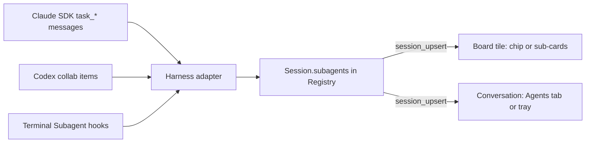

# Background sub-agent visibility

Issue: [#1438](https://github.com/teamupstart/mission-control/issues/1438)

Status: decisions adopted on 2026-11-12. Phased in [phased-plan.md](phased-plan.md).

## Scope of this planning task

This task delivers planning artifacts only: this plan, its mockups (all five are in revision 1)
and the phased implementation plan beside it. It ships no product code. The indicators, the
display setting and the data path described below are built by five separate implementation
tasks, one per phase in [phased-plan.md](phased-plan.md), each with its own pull request and
verification. The acceptance outcomes below belong to those tasks, not to this one.

## Adopted decisions

| Decision | Adopted |
| --- | --- |
| Which mockup | Build **both** Option 1 (agent chip and popover) and Option 2 (nested sub-cards). The operator picks one of the two in Settings > Display > Board card, where the existing card choices are. The setting allows only one or the other. |
| Scope | Background sub-agents only. |
| Fleet-wide top-bar count (Option 5) | Not in this change. |
| After this plan | Create a phased implementation plan. |

Two details follow from the mockup decision and are recorded here so the phases do not
re-decide them:

- **One setting covers the whole pair.** Each option was reviewed as a board half plus a
  conversation half. The setting selects the option, so it switches both halves together:
  the chip and the **Agents** rail tab, or the sub-cards and the **Background agents** tray.
- **Default.** A fresh install and an existing install with no stored value both use
  **Nested sub-cards** (Option 2), the recommended option. There is no "Off" value, because
  the decision was one or the other.

## Problem

A session can launch sub-agents: Claude through its Task/Agent tool, Codex through its
collaboration tools. A sub-agent launched in the background keeps running after the parent's
turn ends. So the board can show a parent as idle, or as needing you, while three agents are
still reading, editing and spending tokens under it. Nothing in the dashboard shows them today.

Two surfaces need an indicator:

- **The board.** The tile is where an operator decides "is this one done?".
- **The open conversation.** Residents are listed in the top-bar dock or the Residents
  drawer, not on the board. For them, the conversation is the only place a per-session
  indicator can be seen.

## What the daemon can already know

Both treatments draw only facts one of these sources states. Where a source says less, the
treatment shows less (see "Degraded rows").

| Source | What it states | Mission Control today |
| --- | --- | --- |
| Claude Agent SDK sessions | `task_started`: task id, description, `subagent_type`, `is_backgrounded`, `spawn_depth`, `parent_task_id`, launching `tool_use_id`. `task_progress`: total tokens, tool uses, duration, last tool, optional one-line summary. `task_updated`: status patch, moved to background. `task_notification`: completed / failed / stopped, summary, usage. Some tasks are flagged `ambient` and should not be counted. | Ignored. `src/server/harness/claude/sdk.ts` handles only the `init` and `compact_boundary` system messages. |
| Claude terminal sessions | Hook events. Only `SubagentStop` is installed (`src/server/harness/claude/hooks.ts`, `EVENTS`). | Shown as the ticker line "subagent finished" and nothing else. |
| Codex app-server sessions | `thread/started` with `parentThreadId`, `subAgentActivity` items (started / interacted / interrupted / completed), and `collabAgentToolCall` items with a `CollabAgentStatus`. | Read only to route frames to the right thread tree (`learnThreadTree` in `src/server/harness/codex/sdk.ts`). Not surfaced. |
| Codex terminal sessions | `SubagentStart` and `SubagentStop` hooks, already installed. | Ticker text only. |
| Pi | No known signal. | Shows nothing. |

### Degraded rows

When a source only says that an agent started and stopped (terminal hooks), a row shows type,
state and elapsed time, with no token, tool-count or last-tool values. It never shows a
placeholder number. Pi sessions show no sub-agent indicator.

## Shared behavior (both treatments)

- **Counting.** Only background sub-agents count. A foreground sub-agent blocks the parent's
  turn, so the parent already reads as working. `ambient` tasks are never counted. A
  sub-agent that starts in the foreground and is later moved to the background starts
  counting from that moment.
- **Idle parent with running agents.** A parent that is idle, or that needs you, while sub-agents
  are still running reads "idle · 2 agents still running". That way nobody mistakes it for
  finished.
- **Colors.** No new state color. Running is `--working` blue, done is `--idle` green, failed is
  `--danger` red, and stopped is `--exited` grey.
- **Finished agents.** A finished sub-agent stays listed, dimmed, until the parent's next turn
  starts. Then it folds into an "N finished" count.
- **Nothing to show.** A session with no background sub-agents, running or recently
  finished, draws neither treatment. The tile and the conversation look exactly as they do
  today.
- **No new controls.** Neither treatment stops, steers or opens a sub-agent's own
  transcript. Each of those is a separate follow-up.

Sample data used in the mockups:

| Type | Description | State | Elapsed | Tools | Last tool | Tokens |
| --- | --- | --- | --- | --- | --- | --- |
| Explore | Map every offset-pagination call site | running | 2m 14s | 18 | Grep | 41k |
| general-purpose | Convert billing report queries | running | 48s | 6 | Edit | 12k |
| Explore | Find contract tests for /ledger | done 1m ago | 1m 05s | 9 | - | 22k |

## The display setting

- **Where:** Settings > Display > Board card. It is a new radio choice, **Background
  sub-agents**, beside the existing **Task type** choice, and it uses the same picker
  (`DISPLAY_CHOICES` in `src/web/lib/board-card.ts`, rendered by `BoardCardPanel`).
- **Values:** **Chip and popover** (Option 1) and **Nested sub-cards** (Option 2). Exactly one
  is selected. The default is Nested sub-cards.
- **Copy:** the label is "Background sub-agents". The description is "How a session shows the
  sub-agents it launched in the background, on its card and in its conversation." The option
  tooltips are "A chip in the card's flags opens the list, and the conversation rail gains an
  Agents tab. Cards keep their height." and "Each agent hangs under its card, and a tray above
  the reply box lists them. Cards grow while agents run."
- **Persistence:** stored with the other display choices in the UI config, which the daemon
  validates. An unknown stored value falls back to the default.
- **Preview:** the panel's live preview card shows sample background agents, so switching
  the radio shows the board half of the chosen treatment before leaving Settings.
- **Effect:** applies immediately to every board card and to the open conversation, with no
  reload.

## Option 1: Agent chip and popover

- **Board:** one chip joins the tile's flag row (beside PR and review). It reads `3 agents`,
  with one status pip per agent. Clicking it opens a popover that lists the agents. The tile
  gains no height.
- **Conversation:** the Activity / Yours rail gains a third tab, **Agents 3**. Each agent gets
  a row: status, type, description, elapsed, last tool and tokens.

```
┌ Move the ledger to cursor pagination ───────┐
│ ● idle · 2 agents still running             │
│ [PR #1412] [⑂ 3 agents ●●○]                 │
└─────────────────────────────┬───────────────┘
        ┌─────────────────────┴──────────────┐
        │ ● Explore  Map offset call sites 2m│
        │ ● general  Convert billing      48s│
        │ ✓ Explore  Find contract tests  done│
        └────────────────────────────────────┘
```

## Option 2: Nested sub-cards (default)

- **Board:** small sub-cards hang beneath the parent tile on a tree spine. Each one shows type,
  description, elapsed, tool count and last tool. A header line on the parent reads
  `▾ 3 sub-agents · 2 running` and folds the group. Past three agents, the rest collapse to
  `+N more`.
- **Conversation:** a **Background agents** tray docks above the composer, so it stays visible
  whatever the rail is showing. Each row has a **Jump to launch** link that scrolls the log to
  the turn that launched that agent.

```
┌ Move the ledger to cursor pagination ───────┐
│ ● idle · 2 agents still running             │
│ ▾ 3 sub-agents · 2 running                  │
└──┬──────────────────────────────────────────┘
   ├─ ● Explore · Map offset call sites
   │    2m 14s · 18 tools · Grep
   ├─ ● general-purpose · Convert billing
   │    48s · 6 tools · Edit
   └─ ✓ Explore · Find contract tests   done
```

## Considered and not chosen

- **Option 3, card stack with hanging tabs and inline launch cards.** Not chosen.
- **Option 4, sub-agent lane with threads and a timeline tab.** Not chosen.
- **Option 5, fleet-wide tracker in the top bar.** Deferred; not in this change.

Revision 1 of this plan holds the full mockups for all five.

## Data path (built by the implementation phases)

Both treatments share one data path, and only the rendering differs:

1. Each harness adapter reads its own sub-agent signal: Claude SDK `task_*` system messages,
   Codex `subAgentActivity` / `collabAgentToolCall` items, and terminal `SubagentStart` /
   `SubagentStop` hooks. Claude terminal sessions need `SubagentStart` added to the installed
   hook events.
2. The adapter reduces those signals into a bounded `subagents` summary on the session, held by
   the registry.
3. The summary rides the existing `session_upsert` event. There is no new event type and no new
   SQLite table, because it is live state that is rebuilt from the stream.
4. The board tile and the conversation read that one summary through a shared selector. The
   display setting chooses which component renders it.



## Acceptance outcomes (met by the implementation phases)

The phase tasks in [phased-plan.md](phased-plan.md) meet these; this planning task does not.

1. With the default setting, a session that has background sub-agents shows nested sub-cards
   under its board tile and a Background agents tray above its composer.
2. With **Chip and popover** selected, the same session shows the agent chip in the tile's flag
   row, the chip opens the agent list, and the conversation rail has an **Agents** tab.
3. The setting appears under Settings > Display > Board card. Only one value can be selected,
   and switching it changes every card and the open conversation without a reload.
4. An idle parent with running background agents reads "idle · N agents still running".
5. Foreground and `ambient` sub-agents are not counted.
6. Terminal-hook sessions show type, state and elapsed time only, with no placeholder numbers.
7. A resident's conversation shows its agents under either setting.
8. A session with no background sub-agents looks exactly as it does today.

## Open questions for the phased plan

- The exact `SubagentStart` payload Claude sends to a terminal hook.
- Whether a parent's backgrounded task survives a daemon restart for SDK sessions.
