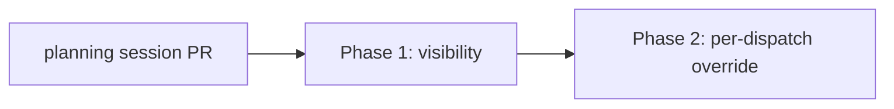

# Advisor mode for Claude sessions: phased implementation

Source plan: `docs/plans/claude-advisor-mode/plan.md` (managed plan `ba3d02de-9899-4a50-a392-0de751ab3b5f`).

## Adopted human decisions

| Decision | Choice | Owning phase |
|---|---|---|
| Scope beyond inheritance | Visibility + per-dispatch override; no live control on running SDK sessions | Phase 1 (visibility), Phase 2 (override) |
| Terminal launch mechanism | `--settings '{"advisorModel":...}'`, not the hidden `--advisor` | Phase 2 |
| Dispatch values besides Inherit | Opus, Sonnet, Off; Fable excluded | Phase 2 |
| Follow-up | This phased plan | n/a |

## Findings that change the source plan's route

1. **One transcript parser serves both runtimes.** The SDK subprocess writes the same `~/.claude/projects/<cwd>/<id>.jsonl` file the terminal TUI does, and `toMessage` in `src/server/harness/claude/transcript.ts:99-146` renders both. There is no separate SDK-stream conversion to change. Phase 1 changes the parser once.
2. **The "configured, not yet called" fallback is dropped.** The source plan's session indicator fell back to the effective settings. Terminal sessions have no cheap way to read them, and the SDK's `get_settings` is not in the typed surface. The Phase 1 chip shows only what the transcript proves: the advisor model on the newest assistant record that carries one. Phase 2 makes the requested override visible on the task itself, where it is a stored fact.
3. **Docs location.** `docs/models.md` has no effort heading. The per-dispatch knobs are documented under `### Default model` and `### Default effort` in `docs/dispatch-and-backlog.md:1109-1167`. The new `### Advisor` section goes beside them (Phase 1), and Phase 2 extends it.
4. **No env hook exists for terminal launches.** `isolatedAgentArgv` (`src/server/agent-subprocess-env.ts:223-237`) builds the child environment from Mission Control's own variables only. Phase 2 adds an extra-env option threaded through `spawnUniquely` and `spawnManagedResume` (`src/server/dispatcher.ts:3046-3066`). The SDK path already has a precedent, `withArtifactTool` (`src/server/harness/claude/sdk.ts:1277`).
5. **Resume must carry the override.** SDK resume relaunches from the `sdk_sessions` row (`src/server/sdk/supervisor.ts:1244`, `:1316`), so the override needs a column there next to `effort`. Terminal resume rebuilds argv from the task, so it needs the same args and env.
6. **No real advisor transcript exists on this machine.** Block and field shapes come from the CLI 2.1.317 binary. Phase 1 therefore opens with a probe gate: it captures one real advisor call (result frame and JSONL records) and builds its fixtures from that capture. If no real call can be captured, Phase 1 stops and reports back. The parser must still ignore any shape it does not recognise.
7. **UI gating is by capability.** The effort `<select>` is always rendered and takes its options from `capabilitiesFor(agent).effort`. The advisor control needs a new `advisor: AdvisorSpec | null` capability and renders only when it is non-null.
8. **Spend attribution is owned by Phase 1 in both cases.** Whether the real frame reports advisor tokens in `modelUsage` or only in `usage.iterations`, Phase 1 attributes them to the advisor model. Nothing is deferred to a follow-up.

## Sizing and phase count

Estimate of non-test implementation lines: **350 to 480**.

| Phase | Estimate | Assumptions |
|---|---|---|
| Phase 1 | 150 to 210 | Parser plus shared type (about 40), runtime meta (about 20), transcript row and chip UI plus CSS (about 70), docs (about 30), iteration-based spend rows if the probe needs them (about 20) |
| Phase 2 | 200 to 270 | Mirrors the effort pin across migration, schemas, task manager, resolver, capability, dispatcher, SDK store and supervisor, dispatch modal and draft. Effort-specific code in those files is about 160 lines today, plus the new env plumbing. |

**Why two phases, not one.** Each phase opens with its own gate, and either gate can stop its phase for a human decision. Phase 1 probes one real advisor call. Phase 2 confirms that `--settings` activates the advisor on a terminal launch. Combined, Phase 2's gate would also block the visibility work, which does not depend on it and is useful on its own: it is the only way an operator who already set `advisorModel` can see it. Phase 2 also carries a migration and launch-path changes that are worth reviewing apart from transcript rendering. Each phase is a working vertical slice with its own e2e spec.

**Why serial, not concurrent.** Both phases edit `e2e/fixtures/fake-claude.mjs` (advisor transcript blocks in Phase 1, recording the advisor env variable in Phase 2) and the same `### Advisor` docs section. Running them concurrently would guarantee merge conflicts for a small gain.

## Phases

| Phase | File | Depends on | Outcome |
|---|---|---|---|
| 1 | `phase-1-advisor-visibility.md` | planning session | Advisor calls show in the transcript and an advisor chip appears on sessions that used one; advisor spend attribution is pinned by test; docs explain inheritance |
| 2 | `phase-2-per-dispatch-advisor-override.md` | Phase 1 | Dispatch form gets an Advisor select (Inherit, Opus, Sonnet, Off) that reaches terminal and SDK launches and survives resume, without writing the operator's settings |

## Dependency graph and merge order

Merge order: planning PR, then Phase 1, then Phase 2. There are no concurrency groups.

## Cross-phase contracts

- **Shared type (Phase 1 owns):** `TranscriptMessage.advisor?: { model: string | null; outcome: "advised" | "redacted" | "declined" | "error"; text?: string; errorCode?: string }` in `src/shared/types.ts`. Phase 2 does not change it.
- **Runtime meta (Phase 1 owns):** `SessionMeta.advisorModel?: string | null`, from the newest main-chain assistant record carrying `advisorModel`. Phase 2 does not change it.
- **Fixture (Phase 1 owns):** `fake-claude.mjs` gains a deterministic prompt trigger that writes an advisor `server_tool_use` and `advisor_tool_result` pair, copied from the probe's captured transcript. Phase 2 may add env recording to the invocation record but must not change the advisor transcript output.
- **Docs (Phase 1 creates):** `### Advisor` in `docs/dispatch-and-backlog.md`. Phase 2 appends a `#### Per-dispatch override` subsection and must not rewrite Phase 1's text except to remove the sentence saying no override exists.
- **Capability and persistence (Phase 2 owns):** `HARNESS_CAPABILITIES.<agent>.advisor`, `tasks.advisor_model`, `sdk_sessions.advisor_model`, and `Task.advisorModel: "opus" | "sonnet" | "off" | null`.

## Final verification

After Phase 2 merges, an operator can:

1. Dispatch a Claude task with Advisor = Opus on either runtime. The launch carries the flag-layer setting and nothing is written to `~/.claude/settings.json`.
2. Dispatch with Advisor = Off and get `CLAUDE_CODE_DISABLE_ADVISOR_TOOL=1`.
3. Dispatch with Inherit and get the same argv and env as today.
4. See advisor rows and the chip whenever the transcript contains advisor calls, and see advisor tokens attributed to the advisor model in spend.

Both e2e specs pass under `npm run test:e2e`, and the CI unit shards are green.
