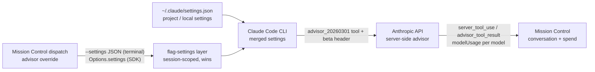

# Advisor mode for Claude sessions

Status: approved (revision 1 review). Investigation task; nothing here is implemented.

## The question

Claude Code has an `/advisor` mode. Is it supported for Claude sessions that Mission Control runs? If not, how do we support it? Can Mission Control inherit the setting from the operator's own Claude Code configuration, or does Mission Control need its own control?

## Short answer

- **It is already inherited, but you can't see it.** Both Claude runtimes load the operator's Claude Code settings. If `advisorModel` is set in `~/.claude/settings.json`, or in a project or local settings file, eligible Mission Control Claude sessions inherit it today with no Mission Control change. A session is eligible when the CLI's own rules allow the advisor: first-party API, the advisor feature available to the account, `CLAUDE_CODE_DISABLE_ADVISOR_TOOL` unset, and an advisor at least as capable as the main model (see the table below).
- **Mission Control has no advisor support of its own.** There is no code, UI, or doc for it. The conversation view drops the advisor's content blocks without showing them. No session shows whether an advisor is active, and a dispatch cannot choose one.
- **Recommendation:** keep inheritance as the default, and add a thin layer on top:
  1. Show the advisor where it is already happening.
  2. Add an optional per-dispatch override that writes only to Claude's session-scoped flag-settings layer, never to the operator's settings files.

## What advisor mode is (measured against Claude Code 2.1.317)

Findings come from the installed CLI binary (`~/.local/share/claude/versions/2.1.317`) and the Agent SDK typings (`@anthropic-ai/claude-agent-sdk@0.3.316`, `sdk.d.ts`). Each finding is labeled verified (observed directly) or inferred.

| Finding | Basis |
|---|---|
| `/advisor [opus\|sonnet\|fable\|...\|off]` is described as "Let Claude consult a stronger model at key moments". The main (executor) model gets a server-side `advisor` tool with no parameters, and the whole conversation is forwarded to the stronger advisor model when it is called. API tool type `advisor_20260301`, beta header `advisor-tool-2026-03-01`. | verified (binary strings) |
| It persists as the `advisorModel` key in Claude Code settings: "Advisor model for the server-side advisor tool" (`sdk.d.ts:9398`). Typing `/advisor` in an interactive session writes `userSettings`, the operator's global `~/.claude/settings.json`. | verified |
| A hidden CLI flag `--advisor <model>` exists ("Enable the server-side advisor tool with the specified model", `.hideHelp()`). | verified |
| SDK: `Options.settings` accepts `advisorModel`, and `Query.applyFlagSettings({ advisorModel })` changes it on a live session. The flag-settings layer is session-scoped and sits above user, project and local settings (`sdk.d.ts:3018-3045`). | verified (typings); live behaviour inferred, about 85% |
| Gating: the advisor only works with the first-party Anthropic API, not Bedrock or Vertex. It is behind a server-side feature flag unless `CLAUDE_CODE_ENABLE_EXPERIMENTAL_ADVISOR_TOOL=1` is set. `CLAUDE_CODE_DISABLE_ADVISOR_TOOL=1` turns it off completely. | verified (binary) |
| Pairing rule: the advisor must be at least as capable as the main model (the catalog's `advisor_rank`). Otherwise it does not activate on the main conversation, though subagents may still use it. | verified |
| A Fable advisor bills to usage credits and needs a one-time consent. When `--advisor fable` is set non-interactively, the CLI refuses to launch (`advisor_fable_consent` / `noninteractive_set_blocked`) unless the session kind is `bg`. | verified (binary); exact SDK-path behaviour inferred, about 70% |
| Transcript shape: an advisor call is a `server_tool_use` block named `advisor`, followed by an `advisor_tool_result` block. Its content is `advisor_result`, `advisor_redacted_result` or `advisor_tool_result_error`. Assistant messages carry an internal `advisorModel` field. Usage carries `iterations[]` entries of type `advisor_message`. | verified |
| Claude Code's own recommended setup is "Sonnet as the main model with Opus as the advisor. For certain workloads this gives near-Opus performance with reduced token usage." | verified |

## What Mission Control does today

| Surface | Today | Evidence |
|---|---|---|
| Terminal Claude sessions | The `claude` TUI starts with no `--setting-sources` restriction, so user, project and local settings all load. The operator can also type `/advisor` into the pane. | `src/server/dispatcher.ts:833-842`: argv is model, effort, mode, ask channel and extra directories only |
| SDK Claude sessions | `settingSources: ["user", "project", "local"]`, so `advisorModel` is inherited. The only flag-layer setting Mission Control sends is `disableClaudeAiConnectors` (resident sessions only), which does not touch the advisor. | `src/server/harness/claude/sdk.ts:1475`, `:1310` |
| Conversation view | Only `text`, `tool_use` and `tool_result` blocks are read. Advisor blocks are dropped without being shown, so a turn where the advisor redirected the work looks unexplained. | `src/server/harness/claude/transcript.ts:129-131` |
| Session and dispatch UI | No advisor indicator and no picker. The `effort` capability is the established pattern for a per-dispatch Claude launch knob with live SDK control. | `src/shared/harness-capabilities.ts:665-679`, `src/server/db.ts:4055-4057` |
| Spend | Per-model figures come from the SDK result's `modelUsage`. The advisor's tokens probably show up there under the advisor model's id, but no test proves it. | `src/server/harness/claude/envelope.ts:61-97`; inferred, about 65% |

## Inherit, or expose?

**Inherit by default; expose an optional override.** Inheritance already works and is the right default. The advisor is a property of the operator's Claude account and preferences, just like the model and effort defaults Mission Control already respects. Inheritance alone falls short in three ways:

1. **You can't see it.** The operator cannot tell from the dashboard whether a session has an advisor, or why its spend includes a second model.
2. **One global setting.** Mission Control dispatches many sessions with different models. Sonnet with an Opus advisor makes sense for routine backlog work and is pointless for an Opus session, which the pairing rule would skip anyway. A single global setting can't express that.
3. **`/advisor` writes the global settings file.** Typing it into any session, including an SDK session's composer, changes every later session the operator starts anywhere. A Mission Control override has to use the session-scoped flag layer so it never writes the operator's file.

## Configuration flow

Settings precedence, before and after. The override rides the existing flag-settings layer and never touches a settings file.

Today only the top path (settings files to the CLI) exists, and the return path is dropped at the transcript reader.

## Proposed changes

### 1. Visibility (no new configuration)

- **Transcript:** parse `server_tool_use` (name `advisor`) and `advisor_tool_result` blocks in the shared JSONL transcript parser (`transcript.ts`), which renders both runtimes. Render a compact "Advisor reviewed the conversation" row with the advisor's text when it is not redacted, and an error chip for `advisor_tool_result_error`. Unknown result content renders as nothing, matching the CLI.
- **Session indicator:** show the advisor model on the session header or chip when the latest assistant message carries `advisorModel`, at the location the Phase 1 probe observes in a real transcript. A read-only chip; no control in this step. (A "configured, not yet called" fallback was dropped during phasing: terminal sessions have no cheap read of effective settings.)
- **Spend:** Phase 1 first captures one real advisor result frame (its probe gate). It then attributes advisor tokens from whichever field the real frame uses: `modelUsage` keyed by the advisor model, or `usage.iterations` entries of type `advisor_message`. A focused test is built from that captured shape. Both cases are Phase 1's job; neither is deferred.
- **Docs:** add an `### Advisor` section to `docs/dispatch-and-backlog.md`, beside `### Default effort`, covering inheritance, the gating, the pairing rule, and the global-write caveat of typing `/advisor`.

### 2. Per-dispatch override

Follows the `effort` pattern end to end, with no parallel source of truth:

- **Capability:** add an `advisor` capability to `HARNESS_CAPABILITIES.claude` (`src/shared/harness-capabilities.ts`). It declares the selectable values, the terminal launch rendering, and the SDK rendering. Codex and Pi declare `null`, so the UI hides the control for them through the capability, never through a check on the agent name.
- **Persistence:** add `tasks.advisor_model TEXT` and `sdk_sessions.advisor_model TEXT` through `addColumn` next to their upgrade paths. The second column keeps the pin across SDK resume. `NULL` means inherit.
- **Values:** Inherit (default), Opus, Sonnet, Off. Fable is not offered (see Decisions). Values are model aliases, so the CLI resolves them per provider.
- **Terminal launch:** `--settings '{"advisorModel":"<alias>"}'`, the documented flag-layer input. The first step of the work confirms it activates the advisor. If it does not, stop and bring it back for a decision rather than switching to the hidden `--advisor` flag silently.
- **SDK launch:** merge `advisorModel` into `Options.settings`, alongside the existing `disableClaudeAiConnectors` entry, not replacing it.
- **Off:** `CLAUDE_CODE_DISABLE_ADVISOR_TOOL=1` in the session environment. This is the one verified way to override an inherited user setting.
- **Failures:** pairing and validation stay the CLI's job. A refused launch surfaces through the existing in-place launch-failure path.
- **UI:** an "Advisor" select on the dispatch form, next to effort, visible only when the selected harness declares the capability.
- **Tests:** unit tests for the argv and options rendering. A Playwright spec in `e2e/` drives the dispatch form against the fake agents and asserts the launched argv and options carry the override. It spends no model tokens.

## Risks and assumptions

| Assumption | Confidence | If wrong | How to confirm |
|---|---|---|---|
| `--settings` JSON with `advisorModel` activates the advisor on terminal launch the same way `--advisor` does | about 80% | Stop and return for a decision; the hidden `--advisor` flag is the fallback candidate | Phase 2 first step: launch with the flag and check the init or `/advisor` status |
| `modelUsage` includes the advisor model | about 65% | Phase 1 attributes from `usage.iterations` instead; either way Phase 1 owns it | Phase 1 probe gate: capture one real result frame on an account with the advisor enabled |
| `advisorModel` sits at the top level of the assistant transcript record | about 75% | The chip reads the location the probe observes | Phase 1 probe gate: capture the real JSONL records of the same advisor call |
| The operator's account has the advisor feature flag | unknown | The override is a no-op without the experimental env var | `/advisor` in a terminal session; SDK init `slash_commands` lists `advisor` only when enabled (inferred) |

## Out of scope

- Writing the operator's `~/.claude/settings.json` from Mission Control.
- Advisor support for Codex or Pi; they have no equivalent.
- Advisor settings on Foreman, Inspector or workflow Persona one-shot runs.
- Live advisor control on running SDK sessions (`applyFlagSettings({ advisorModel })`); deferred by decision. Terminal sessions keep the operator's own `/advisor` in the pane.
- Fable as an advisor value; deferred by decision.

## Decisions

Adopted in the revision 1 review:

| Decision | Choice |
|---|---|
| Scope beyond inheritance | Visibility + per-dispatch override. Live control on running SDK sessions is not in scope. |
| Terminal launch mechanism | `--settings '{"advisorModel":...}'`, not the hidden `--advisor` flag |
| Dispatch values besides Inherit | Opus, Sonnet, Off. Fable is excluded. |
| Follow-up | Create a phased implementation plan: see `phased-plan.md` (Phase 1 visibility, then Phase 2 per-dispatch override) |
