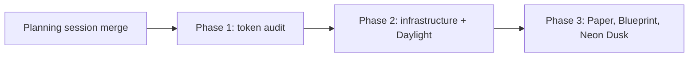

# CSS skins - phased implementation plan

Source plan: `docs/plans/css-skins/plan.md` (managed plan `64a51be3-81d8-4274-9152-ee13d2ef19fd`,
revision 2). This index splits that plan into merge units. The source plan owns the goal, the
token values and the per-skin decoration; the phase files own the route.

## Incorporated human decisions

| Decision | Adopted | Owning phase |
|---|---|---|
| Skins that ship | Daylight, Paper, Blueprint, Neon Dusk. Phosphor and High Contrast are not built. Default stays the default. | Daylight: Phase 2. Paper, Blueprint, Neon Dusk: Phase 3. |
| Styling scope | Colours, fonts, corner radius and scoped decoration. | Colours and radius: Phase 2 contract. Fonts (`--font-display`) and decoration: Phase 3. |
| Match system | No. One explicit skin per machine in v1. | Phase 2 (no OS listener, no `prefers-color-scheme` branch). |
| Follow-up | Phased implementation plan, scheduled as tasks. | This index. |

UI tasks are scheduled for Claude Opus 5.5 or higher (operator standing instruction).

## Repository findings that refine the source plan

Verified against the checkout on 2026-11-02. Each is a decision the phases follow.

1. **Literal colour counts.** `src/web/styles.css` has 75 hex literals and 31 `rgb()`/`rgba()`
   calls after the `:root` block (the plan said "about 100" and "about 20"). The most common
   are `#fff` (12), `#a878ff` (8), `#ef5f63`, `#e5877f`, `#e5534b` (7 each). Two
   `color-scheme: dark` declarations exist (line 2 in `:root`, and `select:not([multiple])`).
2. **Non-CSS literals.** `src/web/workflows/WorkflowCanvas.tsx` passes `#d34f4f` / `#76849b` to
   the React Flow minimap `nodeColor`; Phase 1 resolves them from tokens.
   `src/web/lib/htmlPreview.ts` injects fixed comment-mode and find-highlight styles into the
   sandboxed artifact preview, which renders operator content rather than app chrome; it is out
   of scope and stays literal. `src/web/lib/repo-color.ts` is an identity-hue palette with a
   distinctness test, not a theme token; Phase 2 verifies its frames stay visible on Daylight
   and Phase 3 on the other skins, without changing hues.
3. **`UiConfigPatchSchema` is `UiConfigSchema.partial()`.** A `.catch("default")` on the stored
   field would also silently coerce an invalid PATCH into `"default"`. Decision: the stored
   schema keeps `.catch("default")` for downgrade tolerance, and the patch schema validates
   `skin` with the strict enum so an unknown id is a 400 and the optimistic store rolls back.
4. **First paint reads `uiCache`, not the schema.** `src/web/lib/uiCache.ts` `coerce()` parses
   each field by hand (`parseLineDensity` and friends). `skin` needs its own `parseSkin` there
   or a cached skin is dropped before the daemon answers. `uiFields` in
   `src/shared/app-config-entries.ts` is `satisfies Record<keyof UiConfig, ...>`, so typecheck
   forces the `skin: "setting"` entry, which also puts it in settings backup and restore.
5. **Mermaid follows tokens only on render.** `readMermaidPalette()` reads computed tokens from
   `document.documentElement` when a diagram renders, and `src/web/mermaid-renderer.html` pins
   `color-scheme: dark`. Decision: Phase 2 re-renders mounted diagrams when the skin changes
   and passes the skin's colour scheme to the renderer.
6. **Electron.** `createWindow` in `src/main/window.ts` hard-codes `backgroundColor: "#0e1116"`.
   The preload exposes `window.missionDesktop` through `contextBridge` with
   `ipcRenderer.invoke("mission:...")` handlers registered in `src/main/index.ts`.
   `src/main/update-preferences.ts` is the existing pattern for a small persisted main-process
   preference file. Phase 2 adds the window-background bridge on those patterns.
7. **Settings search.** `src/web/lib/settings-search.ts` holds entries
   `{ id, title, description, category, anchor, keywords, kind, backup }`; covered by
   `test/settings-search.test.ts`.
8. **Geometry.** `test/line-strip-electron.test.ts` builds its own shell from
   `renderToStaticMarkup` plus the real stylesheet and asserts the 86px and 38.5px band
   heights. Phase 3, which changes stage-label fonts, extends it to render under
   `data-skin="paper"` and `data-skin="blueprint"`.

## Sizing

Estimated gross non-test production lines: **650 to 850**.

- Phase 1, token audit: about 180 to 260 changed lines in `styles.css` (106 literals, about 15
  new tokens, the chevron rewrite) plus about 10 in `WorkflowCanvas.tsx`.
- Phase 2, infrastructure and Daylight: registry about 60, schema/cache/config about 30,
  `lib/skin.ts` about 50, Electron bridge and persistence about 70, picker and its CSS about
  120, search entry and Mermaid re-render about 30, Daylight CSS about 40, docs.
- Phase 3, three decorative skins: `--font-display` adoption about 20, three skin files about
  150, registry entries about 30, docs.

Assumptions: no new dependency, no database migration (`app_config.ui` is a JSON field), the
skin files hold tokens plus at most a dozen decoration rules each.

## Phase-count rationale

Three phases, serial.

- **Phase 1 stands alone** because it is a large mechanical rewrite of a 37,000-line stylesheet
  whose only acceptance test is "nothing changed under Default". Mixing it with new visuals
  would make a regression in the audit indistinguishable from an intended skin difference.
- **Phase 2 is the vertical slice**: schema, persistence, live application, Electron first
  paint, picker, search, Mermaid and one real skin. Daylight belongs here rather than in
  Phase 3 because a picker with only Default is a dead surface, and Daylight is the skin that
  proves the audit on a light colour scheme end to end.
- **Phase 3 is separate** because its three skins are the ones that change typography and add
  decoration, which brings a distinct risk (measured ladders and geometry) and a large visual
  review. Folding it into Phase 2 would put four visual reviews and the whole infrastructure
  into one pull request. The case for this split is moderate; it is kept because a font change
  that moves a ladder breakpoint should not block the infrastructure from merging.

## Phases

| Phase | File | Outcome | Direct prerequisites | Model |
|---|---|---|---|---|
| 1 | `phase-1-token-audit.md` | Every colour in app chrome comes from a token; guard test keeps it so; Default is pixel-identical. | Planning session merge | Claude Opus 5.5 or higher (UI) |
| 2 | `phase-2-skin-infrastructure-daylight.md` | Skin picker in Display > Appearance applies Default or Daylight live, persists per machine, no flash in Electron. | Phase 1 | Claude Opus 5.5 or higher (UI) |
| 3 | `phase-3-paper-blueprint-neon-dusk.md` | Paper, Blueprint and Neon Dusk ship with `--font-display` and scoped decoration. | Phase 2 | Claude Opus 5.5 or higher (UI) |

## Dependency graph

Concurrency groups: none. Each phase consumes the previous phase's merged contract. Merge
order is 1, 2, 3.

## Cross-phase contracts

- **Token names** (Phase 1 owns): every token Phase 1 introduces is declared on `:root` in
  `styles.css` with its Default value. Later phases override tokens and never reintroduce
  literals into `styles.css`. Skin files under `src/web/skins/` are outside the guard.
- **Guard test** (Phase 1 owns): `test/style-literals.test.ts` scans `src/web/styles.css`
  outside `:root` against an explicit allowlist. Later phases may not widen the allowlist to
  add skin colours.
- **Registry** (Phase 2 owns): `src/shared/skins.ts` exports `SKINS` and `SKIN_IDS`, append-only,
  ids `default`, `daylight` (Phase 2), then `paper`, `blueprint`, `neon-dusk` (Phase 3) in that
  order. Each entry: `{ id, label, description, colorScheme, swatches }`.
- **Persistence** (Phase 2 owns): `ui.skin` in `UiConfigSchema` with `.catch("default")`;
  strict enum in `UiConfigPatchSchema`; `parseSkin` in `uiCache.ts`.
- **Application** (Phase 2 owns): `src/web/lib/skin.ts` sets `html[data-skin]` and
  `style.colorScheme`, and calls the desktop window-background bridge. Skin CSS selects on
  `:root[data-skin="<id>"]` only.
- **Skin file shape** (Phase 2 owns): `src/web/skins/<id>.css`, imported by
  `src/web/skins/index.css`, imported once from `main.tsx` after `styles.css`.
- **Contrast test** (Phase 2 owns): `test/skins.test.ts` parses every skin file and enforces
  4.5:1 for `--fg`, `--muted`, `--dim` and the state tones on `--bg`, `--panel`, `--panel-2`.
  Phase 3 skins must pass it unchanged.
- **E2E spec** (Phase 2 owns): `e2e/specs/settings-skins.spec.ts`, iterating the shipped skins.
  Phase 3 adds its skins to the same spec rather than a second file.
- **`--font-display`** (Phase 3 owns): declared on `:root` as `var(--sans)`, adopted on
  headings, card titles and Line stage names.

## Final verification strategy

After Phase 3 merges: `npm run typecheck`, `npm run lint`, `npm test`, `npm run build`,
`npm run smoke`, `npm run test:e2e` (including `settings-skins.spec.ts` over all five skins),
and `npm run test:electron` on macOS (including the Line strip under Paper and Blueprint).
A manual pass in the packaged app switches through all five skins with settings open and
confirms the window opens in the last chosen skin after a restart.
