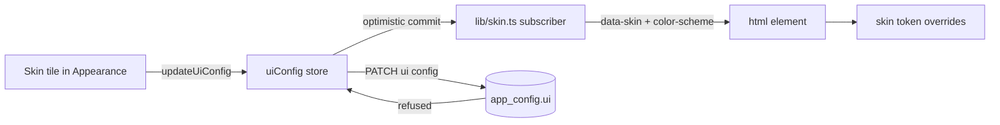

# CSS skins for Mission Control

Status: revision 2 (2026-11-02), decisions adopted. Six candidate skins were mocked up and
reviewed; four ship. The mock-ups of the four shipped skins are in `plan.html`.

## Adopted decisions

Recorded from the operator's review of revision 1:

| Decision | Adopted |
|---|---|
| Which skins ship | **Daylight, Paper, Blueprint, Neon Dusk**. Phosphor and High Contrast were reviewed and not selected. Default (today's look) stays the default. |
| How far a skin may go beyond colour | **Colours, fonts, corner radius and scoped decoration**, as the mock-ups show. |
| "Match system" option in v1 | **No.** One explicit skin per machine; a system-following option can be added later without a migration. |
| After approval | **Create a phased implementation plan** and schedule its tasks. |

## Goal

An operator opens **Settings > Display > Appearance**, picks a skin from a row of preview
tiles, and the whole dashboard repaints in that skin the moment the tile is selected - behind
the still-open settings page, with no Save button and no reload. The choice persists per
machine and is in force on the next launch from the first frame.

A skin is CSS only. It changes how Mission Control looks, never what it shows: no skin adds,
hides or reorders a control, and every session-state colour keeps its meaning.

## What exists today (verified)

- Colour is already tokenized. `src/web/styles.css` declares about 40 custom properties on
  `:root` (`--bg`, `--bg-2`, `--panel`, `--panel-2`, `--border`, `--border-soft`, `--fg`,
  `--muted`, `--dim`, the state tones `--working`, `--idle`, `--attention`, `--danger`,
  `--exited`, `--purple`, the resident palette, `--radius`, `--shadow`, `--mono`, `--sans`)
  and uses `var(--...)` about 5,000 times and `color-mix()` about 1,000 times.
- Some colour is still literal: about 100 hex values outside `:root`, about 20 `rgba()`
  shadows and scrims, an inline SVG chevron in `select:not([multiple])` whose stroke is
  hard-coded `#939eae`, and two `color-scheme: dark` declarations (`:root` and `select`).
  A light skin would show every one of these as a dark smudge.
- Display preferences already live in the daemon: `UiConfigSchema` in
  `src/shared/protocol.ts` (`app_config.ui`), read through the module store in
  `src/web/lib/uiConfig.ts`. `updateUiConfig` commits optimistically, emits to subscribers
  and rolls back if the daemon refuses. `readCache()` seeds the store synchronously at module
  load, so the first paint already has the cached value.
- `AppearancePanel` (`src/web/components/AppearancePanel.tsx`) holds one toggle today
  (Format messages) under the anchor `display/format-messages`; settings anchors are indexed
  in `src/web/lib/settings-search.ts`.
- `LineDensityPanel` is the existing pattern for a radiogroup of preview tiles
  (`layout-picker`, `layout-option view-option`, a thumbnail beside each label).
- The Electron window paints `backgroundColor: "#0e1116"` before the page loads
  (`src/main/window.ts:99`), and `src/web/index.html` declares
  `<meta name="color-scheme" content="dark light">`.
- `src/web/mermaid-renderer.html` pins `color-scheme: dark`, and third-party styles from
  `@xyflow/react` and `react-diff-view` are overridden in `styles.css` for dark only.

## The shipped skins

The current look stays as **Default** and remains the default for every existing and new
install. The four skins below are additions. Each is a set of token overrides plus, at
most, a small block of decoration scoped to that skin. The mock-ups in `plan.html` are drawn
from exactly these values; every pairing of a text or state tone against `--bg`, `--panel`
and `--panel-2` measured at least 4.5:1 in a WCAG contrast check of these drafts.

| Id | Name | Scheme | One line |
|---|---|---|---|
| `daylight` | Daylight | light | Clean, neutral light theme for bright rooms and daytime work. |
| `paper` | Paper | light | Warm cream and ink with serif headings, tuned for long reading. |
| `blueprint` | Blueprint | dark | Engineering drawing: deep cobalt, drafting grid, crisp white linework. |
| `neon-dusk` | Neon Dusk | dark | Late-night synth palette: violet surfaces, magenta and cyan glow. |

### Token values

| Token | Default | Daylight | Paper | Blueprint | Neon Dusk |
|---|---|---|---|---|---|
| `--bg` | `#0a0c0f` | `#f5f7fa` | `#f2ebde` | `#0b2547` | `#120a1f` |
| `--bg-2` | `#0e1116` | `#edf0f4` | `#ebe2d1` | `#0d2a52` | `#170d28` |
| `--panel` | `#14181e` | `#ffffff` | `#fbf7ef` | `#10315e` | `#1e1233` |
| `--panel-2` | `#171c23` | `#f0f3f7` | `#f5eee1` | `#133869` | `#24163d` |
| `--border` | `#232a33` | `#d3d9e1` | `#d6c9b2` | `#4673ad` | `#3d2766` |
| `--border-soft` | `#1b2129` | `#e3e7ed` | `#e4d9c6` | `#24497b` | `#2a1a47` |
| `--fg` | `#e7ebf1` | `#141a22` | `#2a2318` | `#eef5ff` | `#f4ecff` |
| `--muted` | `#939eae` | `#4a5564` | `#5a4e3c` | `#b3cbec` | `#bba8db` |
| `--dim` | `#7c8798` | `#5b6676` | `#6c5f4a` | `#9bb6dc` | `#a08cc2` |
| `--working` | `#4a9eff` | `#0b63ce` | `#2c5c99` | `#86ccff` | `#3fd0ff` |
| `--idle` | `#35c08a` | `#0f7f56` | `#3a7334` | `#62e8b4` | `#36f1a8` |
| `--attention` | `#f6a733` | `#9e5400` | `#9a5300` | `#ffc857` | `#ffb13d` |
| `--danger` | `#f85149` | `#cf222e` | `#ad2a1f` | `#ff8a8a` | `#ff5c86` |
| `--purple` | `#a371f7` | `#7c4dd6` | `#74468a` | `#c9adff` | `#ff6ad5` |
| `--radius` | `13px` | `10px` | `6px` | `3px` | `14px` |
| `--font-display` (new) | `var(--sans)` | `var(--sans)` | Iowan Old Style, Palatino, Georgia, serif | `var(--mono)` | `var(--sans)` |

### Decoration each skin adds beyond tokens

- **Daylight**: soft light-grey shadows (`--shadow` with 6-10% black), no decoration. State
  tones are darkened so they still clear 4.5:1 on white.
- **Paper**: serif `--font-display` on headings, card titles and the Line stage names.
- **Blueprint**: a 20px drafting grid drawn on the app background; headings and stage labels
  in `--mono` uppercase.
- **Neon Dusk**: a violet-to-indigo radial backdrop, a magenta glow on focused and attention
  surfaces, and a magenta-to-cyan gradient on the Dispatch button. `--purple` becomes
  magenta, so Foreman, cost and held all read magenta.

The Default skin has no decoration block and its tokens are exactly today's `:root`.

## Design

### One registry, browser-safe

`src/shared/skins.ts` exports `SKINS`, an append-only list of
`{ id, label, description, colorScheme: "dark" | "light", swatches }`, and `SKIN_IDS`.
It is the single source of truth: the settings picker renders from it, the schema validates
against it, and the contrast test iterates it. Ids are persisted and therefore never renamed
or reordered once shipped.

### Persistence

Add `skin` to `UiConfigSchema` with default `"default"`. Parse it with
`z.enum(SKIN_IDS).catch("default")` rather than a bare enum, so a config written by a build
that knew a skin this build does not (a downgrade, a removed skin) still reads and falls back
to Default instead of failing the whole `ui` record. No migration is owed: a missing key
parses to the default, like `lineDensity` did. `UI_CONFIG_DEFAULTS.skin = "default"`.

### Applying a skin live

A small module `src/web/lib/skin.ts` subscribes to the `uiConfig` store and writes
`document.documentElement.dataset.skin` and `document.documentElement.style.colorScheme`
whenever `skin` changes. It runs once at module load, before React renders, from the
synchronously seeded cache, so a reload paints in the chosen skin with no flash of Default.

Selecting a tile calls `updateUiConfig({ skin })`. The store commits optimistically, the
subscriber flips the attribute in the same tick, and every `var(--...)` in the page resolves
to the new values on the next frame. If the daemon refuses the write, the store's existing
rollback flips the attribute back, so the picker never shows a skin that is not in force.

### CSS layering

- Each skin is one file, `src/web/skins/<id>.css`, containing only
  `:root[data-skin="<id>"] { ...tokens... }` and, if it has one, its decoration block, every
  selector prefixed with `:root[data-skin="<id>"]`.
- `src/web/skins/index.css` imports them all and is imported once from `main.tsx` after
  `styles.css`. They ship in the main bundle (token files are a few hundred bytes each), so
  switching never waits on a network fetch or a lazy chunk.
- Skins use system font stacks only. No webfont files, no external requests.
- `color-scheme` follows the registry's `colorScheme`, so native scrollbars, form controls
  and the `select` picker match the skin. The hard-coded `color-scheme: dark` on `select`
  becomes `color-scheme: inherit`.

### Prerequisite: finish the token audit

Before any light skin can look right, the literal colours in `styles.css` have to become
tokens:

- Replace remaining hex literals outside `:root` with existing tokens or new named ones
  (for example `--scrim`, `--shadow-strong`, `--code-bg`).
- Replace `rgba(0, 0, 0, x)` shadows and scrims with `--shadow`, `--shadow-strong` and
  `--scrim` so a light skin can lighten them.
- Redraw the `select` chevron with `mask-image` plus `background-color: var(--muted)`, so
  its colour follows the skin instead of a stroke baked into a data URI.
- Theme the `react-diff-view` and `@xyflow/react` overrides and the syntax palette
  (`--syntax-*`) through tokens, and give the Mermaid renderer the skin's `colorScheme`.
- Add a guard test that fails when `styles.css` gains a raw hex or `rgba()` colour outside
  `:root` and an explicit allowlist, so the audit stays finished.

This phase changes no pixels under Default and is reviewable on its own.

### Electron first paint

`src/main/window.ts` paints `#0e1116` before the dashboard loads, which would flash dark
under a light skin. The preload exposes a `setWindowBackground(color)` call that the skin
module invokes with the skin's `--bg`, and the main process stores the last value so the
next launch opens with it. Browser tabs need nothing extra.

### The settings picker

`AppearancePanel` gains a **Skin** radiogroup above Format messages, built on the
`LineDensityPanel` tile pattern: one tile per `SKINS` entry with a small thumbnail drawn
from its swatches (background, panel, text and three state dots), its name and its one-line
description. Anchor `display/skin`, registered in `settings-search.ts` so searching "skin",
"theme", "dark", "light" or "colour" finds it. Selection is keyboard-reachable (arrow keys
within the radiogroup) and applies immediately. The section hint reads: "Applies the moment
you pick it - the dashboard behind this page repaints live."

### Contracts every skin must meet

- Text tones `--fg`, `--muted`, `--dim` and the state tones each clear 4.5:1 against
  `--bg`, `--panel` and `--panel-2`.
- `--working`, `--idle`, `--attention`, `--danger`, `--held` and `--exited` stay mutually
  distinguishable; a skin may retune their hue but never swap their meanings.
- `--agent-accent` still arrives inline from `AGENT_IDENTITY`; skins do not override agent
  brand colours.
- A skin never changes layout metrics that the Electron geometry tests and the measured
  ladders depend on (font size, line height, padding). Font family may change; the ladders
  are re-measured under each shipped skin in its e2e spec.

## Out of scope

- User-authored or imported CSS. v1 ships a fixed set of reviewed skins.
- Per-session or per-repository skins.
- A "Match system" option that follows the OS light/dark setting (declined for v1).
- The Phosphor and High Contrast candidates (reviewed, not selected).
- Changing agent brand colours, icons, layout or density.
- Live reconciliation of a skin chosen in a second open dashboard tab (the `uiConfig` store
  is not live-reconciled today; that follow-up is already noted in `lib/uiConfig.ts`).

## Testing

- `test/skins.test.ts`: registry ids are unique and kebab-case; every skin file declares
  every required token; the WCAG contrast contract above holds for every skin; the schema
  falls back to `default` for an unknown stored id.
- `test/style-literals.test.ts`: the token-audit guard.
- `renderToStaticMarkup` test for the picker: one radio per `SKINS` entry with an
  accessible name.
- `e2e/specs/settings-skins.spec.ts`: open Settings > Display, select each shipped skin by
  its radio name, and assert, without a reload, that `html[data-skin]` changed and the
  computed `background-color` of the app body changed to that skin's `--bg`; reload and
  assert the skin persisted; dismiss settings and confirm the Fleet board renders in the
  skin. Selected by role and label only, no `data-testid`.
- Electron geometry tests rerun under each shipped skin, since a font-family change
  (Paper's serif and Blueprint's monospace headings) can shift measured widths.

## Docs

Update `docs/ui.md` (Display settings) and `docs/skills-and-settings.md` with the Skin
picker, the shipped skins, and the contrast contract for anyone adding one. Add a short
"Adding a skin" section to `docs/agent-guides/change-contracts.md` (append-only id,
required tokens, contrast test).

## Risks

- **Literal colours missed by the audit** show as dark patches under light skins. The
  guard test and an e2e screenshot pass per light skin are the mitigation.
- **Glow and grid decoration** can cost paint time on large boards. Decoration is
  limited to backgrounds and `text-shadow`; no `filter` or `backdrop-filter` on scrolling
  content.
- **Font changes** in Paper and Blueprint headings can push measured ladders across a breakpoint.
  Mitigated by re-measuring under each skin.

## Open decisions

None. All decisions are recorded under Adopted decisions.

## Suggested phasing (for phased-plan to refine)

1. Token audit and guard test (no visual change under Default).
2. Skin infrastructure: registry, `ui.skin`, `lib/skin.ts`, Electron first paint, the
   Appearance picker with Default only, and the e2e spec skeleton.
3. The four shipped skins (Daylight, Paper, Blueprint, Neon Dusk), each with its contrast
   test pass and e2e coverage.
4. Docs.

The phased implementation plan in `phased-plan.md` refines this suggestion into three phases
and is authoritative for phase boundaries.
