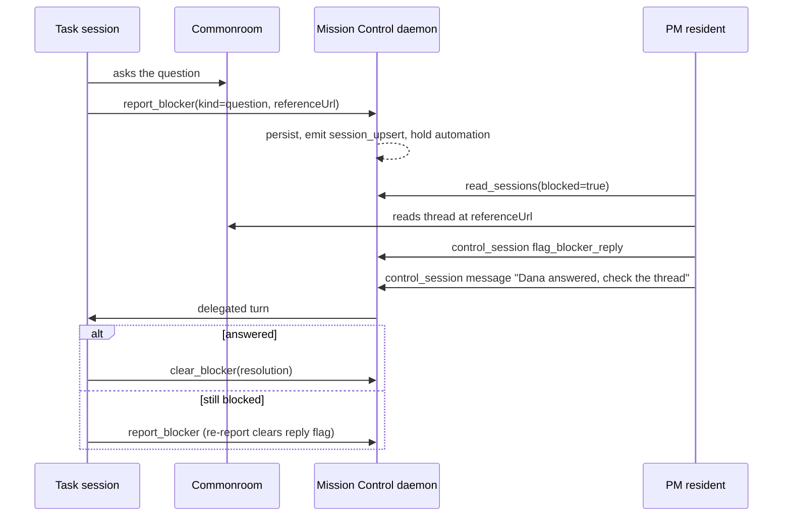

# Durable session blockers

A session that cannot go on because it is waiting on **someone or something other than you**
records a **blocker** with Mission Control: what it is waiting for, who owns the answer, where
the question lives, when it started, and what would let it resume. The blocker is stored in
SQLite, survives turn completion and daemon restarts, shows on the Board and in the session
detail, and is returned to residents through `read_sessions`. While it stands, Foreman's
automatic completion and every idle-triggered automation leave the session alone, without
marking anything complete.

Source: [issue #1373](https://github.com/teamupstart/mission-control/issues/1373). The HTML
rendering of this plan (`plan.html`) draws the three adopted placements (A, C and E), the
Display settings, the blocked card, the session-detail band, and the two flows below.

## Adopted decisions

Submitted from the dashboard reviews of revisions 2 and 3. Implementation is split into two
phases in `phased-plan.md`.

- **Placement is a Display setting** offering three of the five mockups: **A** (red frame at
  the top of Idle), **C** (Needs you over Blocked, stacked lanes) and **E** (a Blocked column
  of its own). Mockups B and D (compact rows) are not being pursued.
- **The new blocker fields are card items** in Settings → Display → Board card, so each can be
  switched off like any other optional card item.
- **A flagged reply shows a Reply flagged pill on the card only.** No alert, no digest line,
  and it does not count as an answer you owe. Residents own the follow-up.
- **Default placement:** In Needs you (C), confirmed in the review of revision 3.
- **Next:** a phased implementation plan.

## Why

Today a session that asked a question in Commonroom (or is waiting on a PR, a service, another
team) has two bad options. It can end its turn and look idle, in which case Foreman's prompted
completion, ship recovery, and the stuck-session alerts treat it as finished or stalled. Or it
can loop and poll, which does not happen reliably and spends tokens. A "product manager"
resident that wants to unblock such sessions has to parse transcript footers to find them.

A blocker gives every party one durable record:

- **The blocked session** says it is blocked, and is left alone until it is cleared.
- **A resident** lists blocked sessions, correlates them with answers elsewhere, flags a
  likely reply, tells the session to check again, and clears the blocker.
- **You** see what is blocked, on whom, and for how long, and can clear it yourself.

## Scope

In scope:

- A durable per-session blocker record and its wire field `Session.blocker`.
- Two MCP tools for the session itself: `report_blocker` and `clear_blocker`.
- Two `control_session` actions for residents and other controllers: `flag_blocker_reply` and
  `clear_blocker`, plus a `blocked` filter and a `blocker` summary on `read_sessions`.
- Dashboard routes and controls for you to flag and clear.
- A completion and automation hold on every idle-triggered mechanism listed below.
- Board, Console rail, card and session-detail presentation, with the placement chosen in
  Settings → Display and the blocker fields listed as Board card items.
- Guidance text that sends user questions to `request_input` and only other blockers to
  `report_blocker`.

Out of scope:

- Any Commonroom integration. Mission Control stays agnostic: the reference URL points at the
  Commonroom thread, and the resident does the correlating.
- Automatic clearing on a reply, or any reply detection by Mission Control itself.
- A new task status. `TASK_STATUSES` is append-only and terminal-aware; a blocker is session
  state, and the task stays `running`.
- Blocker fields on `list_tasks` / `get_task`. A follow-up can project them if residents need
  task-first reads.

## Vocabulary

"Blocked" already means at least ten things in this codebase (workflow run status `blocked`,
backlog `BacklogBlocker`, task priority `blocker`, Inspector severity `blocker`, the inbox's
`session_blocked` "Waiting on you" row, and others). To keep them apart:

- The record is a **session blocker**. Code names use `blocker` / `SessionBlocker`, never a
  bare `blocked` status, and never a new `SessionState` or `Tone` value.
- The UI word is **Blocked**, always next to the red blocker styling, so it does not read as a
  workflow-run "Workflow blocked".
- The web attention item kind `session_blocked` is unrelated and keeps its name.

## The record

```ts
// src/shared/types.ts
export const SESSION_BLOCKER_KINDS = ["question", "dependency", "service", "other"] as const;

export interface SessionBlocker {
  kind: SessionBlockerKind;      // question | dependency | service | other
  reason: string;                // one line, <= 200 chars: what is blocked
  waitingOn: string;             // who owns the answer, <= 120 chars ("Dana in #platform")
  resumeWhen: string;            // one line, <= 200 chars: the condition that unblocks
  details: string | null;        // Markdown for you to review, <= 4000 chars
  referenceUrl: string | null;   // http(s) link: the Commonroom thread, PR, status page
  startedAt: number;             // first report; kept across re-reports
  updatedAt: number;             // last report
  checkedAt: number | null;      // last re-report after a reply flag ("checked, still blocked")
  reply: {                       // set by flag_blocker_reply; null until flagged
    flaggedAt: number;
    flaggedBy: string;           // "operator" or "session:<controller-id>"
    note: string | null;         // <= 500 chars, e.g. "Dana answered at 14:02"
    referenceUrl: string | null; // link to the reply itself
  } | null;
}
```

| Kind | Meaning | Example |
|---|---|---|
| `question` | Asked someone other than you, somewhere else | A Commonroom question to the platform team |
| `dependency` | Waiting on other work: a PR, a task, another team's change | "Needs #1402 merged first" |
| `service` | A service, environment, or credential is unavailable | "Staging DB is down" |
| `other` | Anything else outside your input | "Waiting on vendor quota increase" |

There is deliberately no `user` / `operator` kind. A decision you can make goes through
`request_input`, which already blocks the turn and puts the session in Needs you.

### Storage and lifetime

- New table `session_blockers`, keyed by the session's note key (`agentSessionId ?? id`, the
  same key that carries notes, goals, invites and standing instructions across restarts), with
  `task_id` recorded for reference. Schema version 22 becomes 23 with a changelog line; the
  table is created in `migrate()` next to its upgrade path.
- Loaded into a Registry map at construction and projected onto `Session.blocker` wherever
  `note`, `goal` and `queue` are resolved (`mergeDiscovered`, `registerSdkSession`,
  `applyHook`, `applyDriverBinding`). A `SESSION_FIELD_COMPARATORS` entry compares it by JSON.
  Both terminal and SDK sessions therefore come back blocked after a restart.
- **Key rotation moves it**, as standing instructions and invites move, because a `/clear`
  inside the same task does not resolve what the task is waiting on.
- **It ends** when the session clears it, a controller or you clear it, the session's task
  reaches a terminal status (merge settlement, Mark done, cancel, fail), or no session has held
  its note key for the goal-pruning window (a `pruneGoals` twin, gated on the first sweep). An
  exit or `session_remove` alone never ends it, because a resumed conversation keeps the same
  key and is still blocked.
- Every set, re-report, flag and clear writes one `session_events` row (`session_blocker_set`,
  `_updated`, `_reply_flagged`, `_cleared`) with actor and duration, no free text beyond the
  one-line reason. That ledger is the history; there is no second history table.

## Tools and routes

### For the blocked session (MCP)

`report_blocker` posts `/mcp/blocker` and binds to the caller the way `report_status` does
(pane key or Mission session id). Input:

```json
{
  "kind": "question",
  "reason": "Need the retention window for audit logs before writing the migration",
  "waitingOn": "Dana (platform) in Commonroom #data-platform",
  "resumeWhen": "Dana or another platform owner answers with a retention window",
  "referenceUrl": "https://app.commonroom.example/threads/8812",
  "details": "Two options are viable: 30 days (cheap) or 400 days (SOC2)..."
}
```

- First call sets the blocker. A later call **updates** it and keeps `startedAt`. If a reply
  was flagged, a re-report means "I checked, still blocked": it clears `reply` and stamps
  `checkedAt`.
- The result tells the agent what happens next: end the turn now; Mission Control will not run
  automatic completion; when told to check again, check; if resolved call `clear_blocker` and
  continue, otherwise re-report and end the turn.
- Refused, with a message naming `request_input`, when the session has a pending
  `request_input` review of its own (it is already waiting on you).

`clear_blocker` posts `/mcp/blocker/clear` with an optional one-line `resolution`. Clearing a
session with no blocker is a no-op success.

Both names are added to `src/mcp/server.ts` and to `MISSION_MCP_TOOLS` in
`src/server/mission-mcp.ts` (the drift test enforces both), and to the observability tool table.

### For residents and other controllers (session control)

- `read_sessions` list form adds `blocker` (`{kind, reason, waitingOn, referenceUrl,
  startedAt, reply}`) to each row and accepts `blocked: true` to list only blocked sessions.
  The single-session form already returns the whole `Session`, so it carries `blocker` with no
  change.
- `control_session` gains two actions, mapped through `controlRequest` onto the dashboard
  routes below and logged as `session_control_action` like every other action:
  - `{"action":"flag_blocker_reply","note":"...","referenceUrl":"..."}` sets `reply`. It
    **does not** clear the blocker and does not send anything to the session.
  - `{"action":"clear_blocker","resolution":"..."}` clears it.
- The resident's "check again" is the existing `message` action. A delegated message starts a
  turn as it does today; the blocker stays until someone clears it.

### For you (dashboard)

- `POST /api/sessions/:id/blocker/reply` and `POST /api/sessions/:id/blocker/clear`, validated
  with Zod schemas in `src/shared/protocol.ts`.
- **Clear blocker** and **Flag reply** buttons in the session-detail blocker band.

## The resident flow



## Where the blocker holds automation

The hold is one shared predicate, `hasBlocker(s)` in `src/shared/session.ts`, applied at each
gate below. It is **not** folded into `reportBucket`: making blocked sessions `needs-you` would
send them to Foreman triage, raise attention alerts, and count them as answers you owe.

| Mechanism | Where the gate goes | While blocked |
|---|---|---|
| Prompted completion | `decidePromptedWrapup` (covers the post-verify recheck) and `Registry.consumePromptedGeneration` | Skipped **without consuming** the work-cycle generation, so clearing later can still complete it |
| Queue drain and wrap-up ask | `decideQueueTick` | No next item, no wrap-up; items stay queued |
| Pre-PR ship recovery | `decideShipRecovery` | No recovery sends, no escalation |
| Review follow-through, CodeRabbit, stack prompts | `followupOwnershipBlocker` (shared with the daemon rechecks) | No sends |
| Backlog autopilot | `agentIsFree` | Not assignable |
| Stack readiness | `StackReadiness.finishedEpisode` | Dependents not stamped ready |
| Workflow resumption and evidence-preparation recovery | `resumableRun`, `manager.ts` evidence recovery | Not resubmitted |
| Stuck-session alerts | `src/shared/stall.ts` rules for unfinished work and parked runs | No `stuck` alert; the blocker explains the silence |

Unchanged on purpose: your own queued turns (outbox) still deliver, delegated messages still
deliver, restart and capacity continuations still run, merge settlement still completes a
task whose PR merged (and clears the blocker), and Mark done still works.

## Presentation

### Placement rules (all options)

- A blocked session that is **asking you** stays in Needs you, and one that is **working**
  stays in Working; both carry the red **Blocked** flag. The Blocked placement holds blocked
  sessions that are idle or unconfirmed. Asking and working mean the session is not sitting on
  its blocker right now.
- Blocked wins over "held by a workflow" in the Idle column; the held marker stays on the card.
- Order inside Blocked: reply flagged first, then oldest `startedAt` first.
- Arrow keys and `⌘`-numbers follow the rendered order: one sequence per column, with a
  stacked lane following the lane above it.
- The Console rail mirrors the Board: a red **Blocked** group in the same relative position as
  the chosen placement (after Needs you for C and E, at the top of Idle for A).

### The blocked card

- Red spine and border, using the existing launch-failure tile precedent
  (`--tone-color: var(--danger)`, `color-mix` with `--danger`). No new colour tokens; every
  skin already defines `--danger`.
- A `Blocked · 3h` flag in `.tile-marks`. It is always drawn, like the `held` tag: it is the
  card's state, and an operator must not be able to configure themselves into missing it.
- Optional items, each a Board card item (below): the kind label (Question, Dependency,
  Service, Other), the one-line reason, "waiting on Dana (platform)", a link glyph that opens
  `referenceUrl`, and a **Reply flagged** pill when `reply` is set.

### Session detail

A red band at the top of the Conversation tab: kind, reason, waiting on, since, resume
condition, reference link, collapsible Markdown details, the reply flag (by whom, when, note,
link) and **Flag reply** / **Clear blocker** buttons.

### Placement setting

**Settings → Display → Blocked sessions** is a radio group built like **Residents** beside it
(`ResidentPlacementPanel`): `BLOCKED_PLACEMENTS = ["needs-you", "idle", "column"]` and
`BlockedPlacementSchema` in `src/shared/protocol.ts`, `UiConfig.blockedPlacement` with its
default in `UI_CONFIG_DEFAULTS`, an `app-config-entries.ts` row, and one
`data-anchor="display/blocked"` for the settings search. It is stored per machine and applies
live, like **Layout**.

| Choice | Mockup | What it draws |
|---|---|---|
| **In Needs you** (`needs-you`) | C | The Needs you column splits into two lanes with their own heads and scrollports. Needs you takes the remaining height; Blocked sits at the bottom, sized to its content between one card and 45% of the column, so it always shows at least one card. Either lane disappears when empty; the column hides only when both are empty. A collapsed column strip shows both counts (amber and red). |
| **At the top of Idle** (`idle`) | A | A collapsible red frame shaped like the repository frame, head "Blocked 3 · oldest 2d", above the idle cards. Its fold state persists per machine. |
| **Own column** (`column`) | E | A red **Blocked** column between Needs you and Working, hidden when empty like every other column, with the usual width and collapse controls (a new `BoardColumnId`, `"blocked"`, carried through `collapsedBoardColumns`). |

The panel's copy, one line per choice:

- **In Needs you**: Blocked sessions get their own lane under Needs you, scrolled on its own,
  always showing at least one card.
- **At the top of Idle**: Blocked sessions sit in a red frame above the idle cards, folded or
  open.
- **Own column**: Blocked sessions get a column between Needs you and Working, hidden when
  empty.

Default: **In Needs you** (C), confirmed in review.

All three render from one ordering. `fleet-order` produces the blocked group once; the setting
only decides where that group is drawn, so arrow keys, `⌘`-numbers and the Console rail never
compute a second order. C needs the most layout work: `.board-col-body` is the only scrollport
per column today, and the column head, collapse strip, drill-in rail morph and keyboard arrays
all assume one body. A reuses the repository frame almost unchanged. E reuses the column
machinery.

### Board card items

Five entries join the `card` group of `DISPLAY_ITEMS` in `src/web/lib/board-card.ts`, so they
appear in **Settings → Display → Board card** and are hidden through
`UiConfig.hiddenDisplayItems` like every other item. All five are shown by default, so no
`DISPLAY_ITEM_SEEDS` entry is needed.

| Id | Label | What unchecking it loses |
|---|---|---|
| `blockerKind` | Blocker kind | Whether a blocked card waits on a question, a dependency, a service or something else |
| `blockerReason` | Blocker reason | The one line saying what the session cannot do yet |
| `blockerWaitingOn` | Waiting on | Who owns the answer, without opening the session |
| `blockerLink` | Blocker link | One click from the card to the thread, PR or status page |
| `blockerReply` | Reply flagged | The sign that a resident or you saw a likely answer |

The `Blocked · age` flag and the red card tone are not items: they are the state. The
session-detail band always shows every field, because it is where you clear the blocker.

## Guidance for agents

- `report_blocker`'s description says: use it only when you are waiting on someone or
  something other than the operator; for a decision the operator can make, call
  `request_input` instead. Ask your question where the owner will see it first (for example
  Commonroom), then report the blocker with a link to that question, and end your turn.
- The same two sentences are added to the Claude ask-channel `REDIRECT_PROMPT` and to the Codex
  `MISSION_CONTROL_REVIEW_INSTRUCTION`. Claude SDK sessions rely on the tool description, as
  they already do for `report_status`.
- The built-in Agent Shepherd's instructions gain a short section: read blockers with
  `read_sessions(blocked=true)`, never clear one without evidence that the condition in
  `resumeWhen` is met, and prefer flag-then-message over clearing.

## Verification

- `test/`: migration from schema 22 (table created, idempotent); blocker survives a Registry
  rebuild for a terminal and an SDK session; key rotation moves it; a terminal task clears it;
  a stranded key is pruned after the window while a resumed one keeps it; re-report keeps `startedAt` and clears `reply`; refusal while a
  `request_input` review is pending; each gate in the automation table holds a blocked session
  and releases it after clearing, and prompted completion does not consume the generation;
  `read_sessions` filter and summary; the two `control_session` actions map to their routes;
  `MISSION_MCP_TOOLS` drift test; `boardColumnModes` and fleet ordering for each of the three
  placements; `BlockedPlacementSchema` parsing and default; the five new ids in
  `test/board-card-items.test.ts`; card markup with each item hidden via
  `renderToStaticMarkup`.
- `e2e/`: a spec that reports a blocker through the daemon route the MCP tool uses, then
  asserts the card appears in the default placement with reason, waiting-on and age; switches
  Settings → Display → Blocked sessions through all three choices and finds the card in each;
  unchecks a blocker card item and sees it leave the card; opens the session detail band;
  flags a reply (pill appears, blocker stays, no alert); clears it (card returns to Idle);
  restarts the daemon in between and sees the blocker again. For **In Needs you** it also
  asserts the two lanes scroll independently and that Blocked shows at least one whole card
  with Needs you full. There is no new modal, so no inset check.
- `npm run typecheck`, `npm run lint`, `npm run build`, `npm run smoke`, `npm run test:e2e`.

## Docs

`docs/sessions.md` (new "Blocked sessions" section and the tool list), `docs/residents.md`
(read and control additions), `docs/attention-and-alerts.md` (blockers suppress stuck alerts
and do not count as answers owed), `docs/ui.md` (the Blocked sessions setting, Board placements, card items),
`docs/observability-action-manifest.md` (tool table), `docs/database-and-migrations.md`
(schema 23).

## Risks

- **A blocker nobody clears.** The session is never auto-completed, so a forgotten blocker
  parks its task indefinitely. Mitigation: the Blocked placement is always visible when
  non-empty and shows age; stuck alerts are suppressed only for blocked sessions, and the age
  makes a two-day blocker obvious.
- **Agents misusing it for user questions.** Mitigated by the missing `user` kind, the
  description, the redirect prompt line, and the refusal while a `request_input` is pending.
- **Layout regressions (In Needs you).** Splitting one scrollport touches the drill-in morph and
  the collapsed strip; the e2e spec measures both lanes.
- **Three placements to keep working.** One ordering feeds all three, and the e2e spec walks
  each, so a change to one cannot silently break another.

## Open decisions

None. Every choice is recorded under Adopted decisions.
