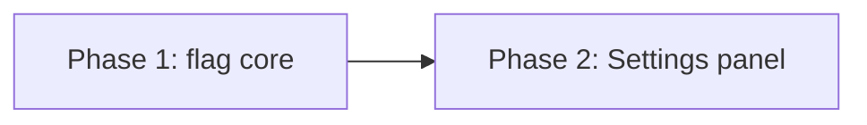

# Feature flags - phased plan

Source: [`plan.md`](plan.md). This index says how the work is split and what each phase may
assume about the other. The phase files hold the implementation detail.

## Human decisions carried in

| Decision | Choice | Owned by |
| --- | --- | --- |
| First flag | None. The registry ships empty and the ai-conductor switch is untouched. | Both phases |
| Master switch | Sets the default for preview flags and keeps individual choices. Turning it on with flags switched off asks whether to turn those on too. | Phase 1 owns the stored semantics, Phase 2 owns the question |
| Panel layout | One searchable list in Trust's styling, Advanced collapsed below. | Phase 2 |
| Follow-up | Phases are scheduled as Mission Control backlog tasks with the dependency recorded between them. GitHub issues were the first choice, but the planning session was not permitted to file them, so the operator chose backlog tasks. | This index |
| Alpha and individual flags | The update channel never changes a flag. A single preview flag can be switched on by hand on any channel. Only Enable all makes new preview features come on by themselves. Recorded during plan validation. | Phase 1 (resolution, docs), Phase 2 (copy) |
| An individual choice is always recorded | A flag intent always stores the choice, so a stored `off` always means the operator switched it off. Recorded during plan validation. | Phase 1 stores it, Phase 2's question reads it |

## Findings that shaped the split

1. **The backup coverage test couples the layers.** `test/settings-backup-coverage.test.ts`
   requires every `settings`-surface domain in `SETTINGS_BACKUP_DOMAINS` to be named by a
   control in `ALL_SETTINGS_CONTROLS`, and every `setting`-class `app_config` entry to have a
   domain. A control needs a category, and a category needs a panel. So Phase 1 cannot register
   the domain on the `settings` surface. It registers it on the `runtime` surface, which is the
   truth at that commit (operator configuration with no Settings control, like `away`), and
   Phase 2 moves it to `settings` in the same pull request that adds the control. `surface` is
   read only by that test and is not persisted; the domain **id** is persisted and never changes.
2. **The existing switch is out of scope.** `CONDUCTOR_INTEGRATION_ENABLED` and everything that
   reads it stay exactly as they are. Neither phase edits `src/shared/conductor-integration.ts`,
   `src/server/pipelines/availability.ts`, or the `test.skip` lines in the conductor specs.
3. **An empty registry makes `FeatureFlagId` the `never` type.** Every function that does real
   work therefore takes the definitions as a parameter that defaults to the registry, so unit
   and in-process HTTP tests can pass fixture definitions. `featureEnabled(id)` and
   `useFeatureFlag(id)` are typed against the real registry and are uncallable until a flag
   exists, which is correct.
4. **The browser suite can already build the app with a module swapped.**
   `e2e/fixtures/terminal-boundary-build.ts` bundles the production daemon entry with selected
   modules resolved to fixtures, and `e2e/fixtures/daemon.ts` picks the bundle per spec and
   serves whatever directory `MISSION_WEB_DIR` names. If the registry tuples live alone in one
   module, the same technique yields a real daemon and a real dashboard that know fixture
   flags. That is how populated flags are exercised through the connected panel, settings
   search and the palette, with no hook in the product.
5. **The config type can ride the wire.** The flag modules import nothing from `protocol.ts`,
   so `types.ts` may import the config type for the `feature_flags` event. This is why the
   event carries content, unlike `harnesses_config_changed`.
6. **Trust's leaves are plain classes** (`.trust-pane-head`, `.trust-pane-title`,
   `.trust-pane-count`, `.trust-search`, `.trust-grant` and its `is-on` / `is-off` states) in
   `src/web/styles.css`. Promoting them means renaming the shared subset and updating
   `TrustPanel.tsx`, with Trust's own specs as the regression check.

## Sizing

Estimated production code, excluding tests, test fixtures and documentation: **900 to 1,250 lines**.

| Area | Lines | Phase |
| --- | --- | --- |
| Shared registry, schemas, resolution, intent | 150 to 190 | 1 |
| `app_config` entry, backup domain, wire types | 30 to 45 | 1 |
| Daemon store, cache, subscription, middleware | 100 to 130 | 1 |
| Routes, registry snapshot and emit, restore republish | 80 to 100 | 1 |
| Dashboard state, hook, API client | 80 to 100 | 1 |
| Category, page wiring, search and palette entries | 80 to 110 | 2 |
| List, connected panel, dialog | 330 to 400 | 2 |
| Styles, including the promoted Trust leaves | 100 to 140 | 2 |
| Alpha sentence in Setup | 10 to 20 | 2 |

Assumptions: no schema migration (an `app_config` key needs none), no change to the conductor
switch, and the dialog reuses the existing `Overlay` modal shell.

## Why two phases and not one

One phase is the default, and this is well past the size where one is automatic. Two reasons
justify the split, and neither is "it has layers":

- **Size and breadth for one agent.** Combined, this is over a thousand lines across controlled
  paths (`src/shared/` wire contracts, the `app_config` and backup registries, the registry
  snapshot, `useEventStream.ts`) plus a new panel, a dialog, a CSS promotion that touches
  Trust, and two browser specs with a new build fixture. Each half has a different
  verification setup: Phase 1 is proven by unit and in-process HTTP tests, Phase 2 by the
  shipped build, a fixture-registry build, and visual inspection.
- **A real merge boundary.** Phase 1 leaves a working, tested HTTP API and event that the
  panel then consumes unchanged. Reviewing the stored semantics (which the operator chose
  carefully) separately from pixels reduces the chance that either is waved through.

The cost is that Phase 1 lands an API nothing calls yet. That is acknowledged, short-lived,
and fully tested. A third phase was rejected: splitting the populated list from the empty
panel would leave Phase 2 shipping a panel that cannot show a flag.

## Phases

| Phase | File | Delivers | Depends on |
| --- | --- | --- | --- |
| 1 | [`phase-1-flag-core.md`](phase-1-flag-core.md) | The registry, stored config, resolution, daemon gates, HTTP routes, the `feature_flags` event and snapshot field, the dashboard hook, developer documentation | Nothing |
| 2 | [`phase-2-settings-panel.md`](phase-2-settings-panel.md) | The Feature flags category, the list, the master switch and its question, search and palette entries, the alpha sentence, operator documentation, the AGENTS.md rule | Phase 1 merged |

There is no concurrency: Phase 2 consumes Phase 1's modules, routes and event. Merge order is
1 then 2.

## Cross-phase contracts

Phase 1 defines these and Phase 2 must not change them. If Phase 2 finds one wrong, it fixes
it in its own pull request and says so there.

| Contract | Value |
| --- | --- |
| Registry module | `src/shared/feature-flag-registry.ts`, exporting only `FEATURE_FLAGS` (empty) and `RETIRED_FEATURE_FLAG_IDS` (empty, append-only). Its path and export names are fixed, because Phase 2's browser build substitutes this one module |
| Logic module | `src/shared/feature-flags.ts`: `FeatureFlagDefinition` (`id`, `label`, `description`, `stage`, `keywords`), `FeatureFlagId`, schemas and pure functions. Browser-safe, no `node:` imports, no import from `protocol.ts` |
| Stages | `"preview"` and `"default-on"` |
| Stored key | `app_config` key `featureFlags`, shape `{ enableAll: boolean, overrides: Record<string, boolean> }` |
| Backup domain id | `feature-flags`. Surface is `runtime` after Phase 1 and `settings` after Phase 2 |
| Resolution | Stored choice, then `default-on` is on, then `preview` follows `enableAll`. The update channel is never an input |
| Intent | Master: `{ kind: "master", enabled, enableDisabled? }`. Flag: `{ kind: "flag", id, enabled }` |
| Stored choice | A flag intent always stores `overrides[id] = enabled`. It is never dropped for matching the default. A master intent changes no stored choice, except that `enabled` with `enableDisabled` clears every stored `false` for a known id |
| Explicitly switched off | The known definitions with a stored `false`. This list is what Phase 2's question names |
| Pure functions | Resolve one flag, resolve all, list the flags explicitly switched off, apply an intent. Each takes definitions as a defaulted parameter |
| Routes | `GET /api/feature-flags` and `PUT /api/feature-flags`, both answering `{ config }` |
| Event and snapshot | `{ type: "feature_flags", config }` and snapshot field `featureFlags` |
| Dashboard state | `MissionState.featureFlags`, and `useFeatureFlag(id)` |

The exact exported names are Phase 1's to choose where the repository suggests better ones,
except the registry module's path and its two export names. Phase 2 reads the rest from the
merged code, not from this table.

## Requirement ownership

| Requirement from `plan.md` | Phase |
| --- | --- |
| 1. Features hidden behind a flag | 1 (mechanism), 2 (AGENTS.md rule) |
| 2. Feature flags category, like Trust, with search | 2 |
| 3. Master switch and per-flag toggles | 1 (semantics), 2 (controls) |
| 4. Immediate effect, no restart | 1 (event, snapshot, subscription), 2 (write on click, second-window proof with populated flags) |
| 5. Default-on stage under Advanced | 1 (stage and resolution), 2 (Advanced list) |
| 6. Documented removal | 1 (`docs/feature-flags.md` lifecycle, retired ids) |
| 7. The channel never turns a flag on; the operator chooses, per flag or with Enable all | 1 (resolution has no channel input, a test that neither flag module imports an update-channel module, the rule in the docs), 2 (copy in the panel and in Setup) |

## Final verification

After Phase 2 merges, on a fresh checkout: `npm run typecheck`, `npm run lint`, `npm test`,
`npm run build`, `npm run smoke`, `npm run test:e2e`. Then by hand in a running app: open
Settings > Feature flags in two windows, flip the master switch in one, and watch the other
follow without a reload.

## Tracking

Each phase is a Mission Control backlog task: **Feature flags - Phase 1: Flag core** and
**Feature flags - Phase 2: Settings panel**. The Phase 2 task depends on the Phase 1 task. Both
also depend on the planning session, so neither is released until the pull request that
publishes this plan has merged, because they point at these files.

## Validation record

Plan Validation v3, repair round 1, asked for three changes, all applied:

1. One rule for alpha and individual flags, carried through requirement 7, the resolution
   table, the alpha section, both phases and their tests.
2. A flag intent always stores the choice, so a flag switched off while the master is off is
   still known to Phase 2's question.
3. A fixture-registry build in Phase 2 that runs populated flags through the connected panel,
   a second window, settings search and the palette, with a refused write and rollback. It
   replaces the earlier plan to mount only the presentational list with local state.
