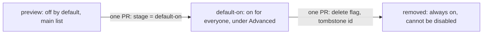
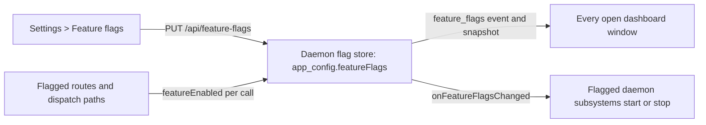

# Feature flags

## Goal

New features land dark. Each one sits behind a named flag that an operator turns on in
**Settings > Feature flags**, either one at a time or by opting in to all of them. A flag then
moves through two more pull requests: one that turns it on for everyone (and moves it under
**Advanced**, where it can still be switched off), and one that deletes it, so the feature is
permanent and cannot be disabled.

This plan builds the mechanism and ships it with no flags in it. The first flag is one
registry entry and its gates, added by whichever feature needs it.

## Requirements

1. Every new feature is hidden behind a flag until someone decides otherwise.
2. A **Feature flags** category in Settings, styled like Trust, with search.
3. A master switch, **Enable all feature flags**, plus a toggle per flag.
4. A change takes effect immediately in the daemon and in every open window. No restart, no Save button.
5. A flag can be defaulted on in a pull request. It then needs no action from the operator and is listed under **Advanced**.
6. A flag can be removed in a pull request. The feature is then always on. The process is documented.
7. The update channel never turns a flag on. On alpha, as on stable, a preview feature is on only because the operator chose it: by switching that flag on, or by switching on **Enable all feature flags**. Preview features that arrive with an update come on by themselves only when Enable all is on.

## Decisions adopted

The first four were submitted on the first review of this plan. The last two were recorded
during plan validation, which found the earlier wording inconsistent.

| Decision | Choice |
| --- | --- |
| First flag | None yet. The framework ships empty. The ai-conductor switch stays a compile-time constant and is not touched by this plan. |
| Master switch | It sets the default for every preview flag, present and future, and **keeps individual choices**. An operator can opt in to everything and still keep one flag they switched off on purpose. Turning the master switch on while some flags are switched off asks whether to turn those on too. |
| Panel layout | One searchable list in Trust's styling, with Advanced collapsed below it. |
| Follow-up | A phased implementation plan, with each phase scheduled as a Mission Control backlog task and the dependency between phases recorded on the tasks. GitHub issues were the first choice, but the planning session was not permitted to file them, so the operator chose backlog tasks instead. |
| Alpha and individual flags | The update channel is never an input. An operator on alpha can switch a single flag on by hand, exactly as on stable. What alpha never does is adopt a feature the operator did not choose. This reconciles "select individual ones to enable or disable" with "alpha deployments do not adopt features unless enable-all is selected": the second sentence is about what happens by default. |
| An individual choice is always recorded | Switching a flag on or off always stores that choice, even when the flag would have been in that state anyway. Without this, a flag switched off while the master was off left no trace, and turning the master on later would have enabled it without asking. |

## What exists today

| Area | Where | What it means for this plan |
| --- | --- | --- |
| The one existing switch | `CONDUCTOR_INTEGRATION_ENABLED` in `src/shared/conductor-integration.ts` (#1523) | A compile-time constant. It is the precedent for hiding a feature, and it stays as it is. |
| Daemon settings | Schema-validated blobs in `app_config`, registered in `APP_CONFIG_ENTRIES` (`src/shared/app-config-entries.ts`) | A new setting is a new key, a value class, and a backup domain. No migration. |
| Settings snapshots | `SETTINGS_BACKUP_DOMAINS` (append-only), pinned by `test/settings-backup-coverage.test.ts` | Flags need a domain. A domain on the `settings` surface must also be named by a Settings control, which constrains the phase order. |
| Settings navigation | `SETTINGS_CATEGORIES` in `src/web/lib/settings-registry.ts`, `renderCategory` in `SettingsPage.tsx`, `ALL_SETTINGS_CONTROLS` in `settings-search.ts` | A new category is one registry entry, one `case`, and its search entries. |
| Trust | `src/web/components/TrustPanel.tsx`, `.trust-pane-head`, `.trust-search`, `.trust-grant` in `src/web/styles.css` | A pane head with a title, a count and a filter, over rows whose pills write on click. This is the look to reuse. |
| Server events | `settings_status` carries content and is in the reconnect snapshot. `useEventStream.ts` handles every `ServerEvent` exhaustively. | A flag change needs an event of its own and a place in the snapshot. |
| Alpha | `UpdatePreferences.alpha` in `src/main/update-preferences.ts`, a desktop-owned file | The daemon never reads it, so nothing connects the channel to features today. |
| A browser build with one module swapped | `e2e/fixtures/terminal-boundary-build.ts` bundles the production daemon entry with selected modules replaced, and the test daemon serves whatever directory `MISSION_WEB_DIR` names | The same technique gives the browser suite a real daemon and a real dashboard that know fixture flags, with no hook in the product. |
| A contract to extend | `docs/agent-guides/change-contracts.md`, Registries: a Settings category may be withheld only by "a build-time switch, never a runtime probe" | Written against probing for installed software. It gains feature flags as the one sanctioned runtime gate. |

## Design

### Stages

A flag is in exactly one stage, and the stage is a field in source, changed only by a pull request.

| Stage | Default | Where it is listed | Can the operator change it |
| --- | --- | --- | --- |
| `preview` | Off | The main list | Yes, individually or through the master switch |
| `default-on` | On | Under **Advanced**, collapsed | Yes, it can be switched off |
| Removed | Always on | Nowhere | No. The flag no longer exists |



### Registry

Flags are declared in one browser-safe data module, `src/shared/feature-flag-registry.ts`,
which holds two tuples and nothing else. It ships empty. An entry will look like this:

```ts
export const FEATURE_FLAGS = [
  {
    id: "example-feature",
    label: "Example feature",
    description: "One sentence an operator can act on.",
    stage: "preview",
    keywords: ["words", "people", "search"],
  },
] as const satisfies readonly FeatureFlagDefinition[];

/** Ids of flags that were removed. Append-only. An id here is never used again. */
export const RETIRED_FEATURE_FLAG_IDS = [] as const;
```

The types, schemas and functions live beside it in `src/shared/feature-flags.ts`, which
derives `FeatureFlagId` from the registry. Deleting an entry therefore turns every remaining
reference to it into a type error. That is what makes removal mechanical rather than a search.

Keeping the data in a module of its own does two things: adding a flag is a one-file change,
and the browser suite can build a copy of the app with a fixture registry substituted for that
one module (see Testing).

Neither module imports from `protocol.ts`, so `types.ts` can carry the config type on the
wire without the dependency cycle that forces `harnesses_config_changed` to be content-free.

### Stored config and resolution

One `app_config` key, `featureFlags`:

```ts
{ enableAll: boolean, overrides: Record<string, boolean> }
```

`enableAll` defaults to `false`. One pure function, shared by the daemon and the dashboard,
answers whether a flag is on, in this order:

1. The operator's stored choice for that flag, if there is one.
2. `default-on` stage: on.
3. `preview` stage: the value of `enableAll`.

| Stage | `enableAll` | Stored choice | Result |
| --- | --- | --- | --- |
| `preview` | off | none | Off |
| `preview` | off | on | On |
| `preview` | on | none | On |
| `preview` | on | off | Off |
| `default-on` | either | none | On |
| `default-on` | either | off | Off |

There is no channel column. The update channel is not an input, so every row reads the same
on alpha and on stable. The second row is an operator switching one preview flag on by hand
with the master off, and it is allowed on every channel.

The browser sends intent and the daemon owns how it is stored. One shared pure function
applies an intent to a config, so both sides agree and a test can drive it directly.

- **Setting one flag always stores the operator's choice for it**, whichever way the master
  switch stands and whatever the flag would have been without it. A flag nobody has touched
  has no stored choice and follows its stage and the master switch. A stored `off` therefore
  always means "the operator switched this off", which is exactly the set the master switch
  asks about. Example: with the master off, switching a flag on and then off again leaves a
  stored `off`. Turning the master on later asks about that flag and does not silently enable it.
- **Setting the master switch** changes `enableAll` and nothing else. Individual choices are
  kept: a flag switched on by hand stays on when the master goes off, and a flag switched off by
  hand stays off when the master goes on.
- **Turning the master on with flags switched off.** The intent can name the flags the
  operator agreed to turn on as well. The same write clears the stored `off` for exactly those
  flags, so they follow their defaults again and come on. A flag the intent does not name is
  left alone, even one that another window switched off a moment earlier. The panel sends the
  names only after asking, and sends only the flags its question listed (see the panel below).

`overrides` is keyed by string, not by the id union, for three reasons that all come from
installations moving between builds:

- An id this build does not know is ignored when reading and **preserved when writing**. An
  operator who enables a flag on an alpha build, drops back to stable, changes something else,
  and returns to alpha finds the flag as they left it.
- An id in `RETIRED_FEATURE_FLAG_IDS` is dropped on the next write. No future build reads it.
- A retired id is never reused. Otherwise a years-old stored `off` would silently disable an
  unrelated new feature.

Keys are bounded (kebab-case, at most 64 characters, at most 512 entries) with the existing
`boundedRecord` helper in `src/shared/zod-shapes.ts`.

### Daemon

A new `src/server/feature-flags/` module, mirroring the other config modules:

- `featureEnabled(id)` is the only reader. It serves from an in-process copy that the write
  path replaces, so a gate on a hot path costs a map lookup. The daemon is the only database
  writer, so that copy cannot go stale.
- `requireFeature(id)` is Hono middleware for route groups. A gated route answers 404 with the
  flag's id and a sentence, the shape `conductorHidden` already uses.
- `onFeatureFlagsChanged(listener)` is for anything long-lived. A watcher, poller, or sweeper
  that belongs to a flagged feature subscribes, and starts or stops itself when its flag moves.
- A settings restore republishes through the same path, beside the existing
  `publishSettingsStatus` call in `src/server/settings-backups/service.ts`.

The rule for every flagged feature: **a flag takes effect without a restart.** Request-time
gates read `featureEnabled` per call. Long-lived work subscribes. A feature that can only
be gated at startup is not ready to be flagged.

Switching a flag off hides the feature and stops it starting new work. It never deletes
anything: persisted rows, consent, and configuration stay as they are, so switching it back on
restores them.

The Foreman worker never reads SQLite, so a flag it needs is handed to it in a message from
the daemon, like every other fact it receives.

### Wire

- `GET /api/feature-flags` returns the stored config.
- `PUT /api/feature-flags` accepts one intent, validated by a Zod schema through `parseBody`:
  set the master switch, or set one flag. A flag id this build does not know is refused with 400.
- A new `ServerEvent`, `feature_flags`, carries the config. The registry drops no-change
  frames, as it does for `settings_status`.
- The reconnect snapshot gains `featureFlags`, so a freshly opened window is right at once and
  gated UI never flashes in or out.



### Dashboard

- `useEventStream.ts` reduces `feature_flags` into `MissionState.featureFlags`, with a `case`
  of its own so the handler stays exhaustive.
- `useFeatureFlag(id)` is the only way a component asks. No component reads the config or the
  registry directly.
- Pure-data modules cannot use a hook. One that depends on a flag takes the resolved flags as
  an argument instead of freezing a constant at module load.

### Settings panel

A new category, `feature-flags`, labelled **Feature flags**, placed directly after Setup in the
**Sessions** group with the **This machine** scope. Setup says what this installation has;
this says what it offers.

```text
Feature flags                                              This machine
Preview features that are still being finished. Turn one on to try it.

[ ] Enable all feature flags
    Turns on every preview feature below, and any that a future update adds.
    Updating to an alpha build does not turn this on, or any flag.

Preview features  1                            [ Filter feature flags... ]
-----------------------------------------------------------------------
Example feature                                                  ( Off )
One sentence an operator can act on.
-----------------------------------------------------------------------

> Advanced: on by default (0 turned off)
```

- **One list, Trust's vocabulary.** The pane head (title, count, filter) and the on/off pill
  come from Trust. Those leaves are promoted to shared settings classes that both panels use.
  They are not copied under new names.
- **Every control writes on click.** The pill flips optimistically, and rolls back with an
  inline error if the daemon refuses. There is no Save button.
- **The master switch asks before it leaves anything off.** Turning it on while one or more
  flags are switched off opens a small dialog that names them and offers **Keep them off**,
  **Turn them on too**, and Cancel. Either answer turns the master on in one write. Cancel
  writes nothing. With nothing switched off there is no dialog. Turning the master off never asks.
- **The answer covers exactly the flags the dialog named.** The list is fixed when the dialog
  opens, and **Turn them on too** sends those flag ids with the master intent. A flag that
  another window switches off while the dialog is open was never named, so it stays off.
- **The filter** matches label, description, keywords and id, and covers the Advanced list too.
  A filter with matches only under Advanced opens it.
- **Advanced** is a collapsed disclosure listing `default-on` flags. Its summary line counts
  the ones turned off, so a disabled shipped feature is never invisible. It is absent when no
  flag is in that stage.
- **Empty state.** With no preview flags the list reads "No preview features right now. New
  ones appear here." The master switch stays, because it also governs future flags. This is
  the state the panel ships in.
- **Search.** Each flag and the master switch are entries in `ALL_SETTINGS_CONTROLS`, derived
  from the registry the way the harness cards derive from `AGENT_TYPES`, so settings search and
  the command palette find a flag by name. Each flag is a `toggle` that can be flipped from a
  result. The master switch is a `jump`, because it can open a question and belongs beside its
  explanation.
- The list is rendered from definitions handed to it, so a static render test can show
  populated rows. In a browser, populated rows are tested against a build of the real daemon
  and dashboard whose registry module is replaced by a fixture (see Testing).
- Rows carry `data-anchor="feature-flags/<id>"`. No `data-testid`.

### Alpha

The rule, stated once: **the update channel never changes a flag.** On every channel a preview
feature is on only because the operator chose it, either by switching that flag on or by
switching on Enable all feature flags. An alpha build delivers new preview features sooner,
and they arrive switched off unless Enable all is on.

So an operator on alpha who wants one preview feature switches that one flag on, and an
operator who wants every preview feature as it lands switches on Enable all. Neither is
different on stable.

Resolution takes two inputs, the flag's definition and the stored config, and the daemon has
no reader for `UpdatePreferences.alpha`, so there is no path by which a channel could turn a
flag on. The plan keeps it that way and says so in three places:

- The master switch's own description, as drawn above.
- One sentence under the alpha control in **Settings > Setup > Application updates**, saying
  alpha builds do not turn on preview features and linking to Feature flags.
- `docs/feature-flags.md`.

If alpha should later enable previews, that is one more step in the resolution order and one
more row in the table above. Nothing else moves.

### Lifecycle: the three pull requests

This section becomes `docs/feature-flags.md`, and is linked from AGENTS.md.

**1. Add a flag (stage `preview`).**

1. Append an entry to `FEATURE_FLAGS` with `stage: "preview"`.
2. Gate every entry point: `requireFeature` or `featureEnabled` in the daemon,
   `useFeatureFlag` in the dashboard. Long-lived work subscribes to changes.
3. Tests cover both states. The suite's default is every preview flag off, which is what
   ships. The feature's own tests and specs switch its flag on through the API.
4. Mention the flag in the feature's docs.

**2. Default it on (stage `default-on`).**

1. Change the entry's `stage` to `"default-on"`. That is the whole code change.
2. The flag moves under Advanced. Everyone gets the feature. An operator who had explicitly
   switched it off keeps it off, because that was their choice.
3. Extend the feature's spec to assert it is on without any setup.

**3. Remove the flag.**

1. Delete the entry from `FEATURE_FLAGS` and append its id to `RETIRED_FEATURE_FLAG_IDS`.
2. Run `npm run typecheck`. Every remaining reference is now a type error. At each one, delete
   the gate and the off-path code behind it.
3. Delete the tests that covered the off state, and the flag's mention in docs.
4. Stored choices for the id are dropped on each installation's next flag write.

A flag should not skip stage 2. The default-on release is the one where a problem can still be
switched off by the operator instead of by a hotfix.

### When the first flag arrives

Not part of this plan. The pull request that adds the first flag owes, beyond the lifecycle
steps above, one browser assertion against the shipped registry that its row appears in the
panel and that toggling it shows and hides the feature in a second window without a reload.

The ai-conductor integration is a natural candidate. Converting it means replacing
`CONDUCTOR_INTEGRATION_ENABLED` and `server/pipelines/availability.ts` with a flag, making
`startPipelineWatcher` subscribe, turning the dashboard lists that are frozen at module load
(`VISIBLE_SETTINGS_CATEGORIES`, `SETTINGS_CONTROLS`, the palette index, the Setup catalog
helpers, `TOUR_REQUIREMENTS`) into functions of the resolved flags, and removing the
`test.skip` lines from about a dozen specs. That is a plan of its own.

## Testing

| Layer | What it pins |
| --- | --- |
| `test/feature-flags.test.ts` | The resolution table above, row for row, with injected definitions, including a preview flag switched on by hand with the master off. A flag intent always stores the choice: with the master off, on then off leaves a stored `off`, and that flag stays off and is listed when the master goes on. The master switch keeping individual choices. A master intent that names flags clears the stored `off` for those flags only, and a stored `off` it does not name survives. Unknown ids preserved, retired ids dropped. No live id in the retired list. Ids unique and kebab-case. Neither flag module imports an update-channel module. |
| `test/feature-flags-http.test.ts` | GET and PUT, a flag intent with fixture definitions injected into the app, refusal of an unknown id, the emitted event, the snapshot field, republish after a settings restore. |
| `test/settings-backup-coverage.test.ts` | The new `featureFlags` key and `feature-flags` domain in the pinned lists. |
| `test/route-surface-oracle.test.ts`, `test/settings-sidebar-render.test.ts`, `test/palette-index.test.ts` | The new routes, category, anchors and palette entries. |
| `renderToStaticMarkup` | The list's markup for the empty state, a populated list, and Advanced with a turned-off count. |
| `e2e/specs/feature-flags.spec.ts` (the shipped build, empty registry) | The category is in the rail after Setup. The empty state. The master switch writes on click, shows in a second window without a reload, and survives a reload. Settings search finds it. The alpha sentence in Setup links here. |
| `e2e/specs/feature-flags-populated.spec.ts` (the real daemon and dashboard, built with a fixture registry substituted) | Through the connected panel: fixture rows are listed; a toggle reaches the daemon, a second window follows without a reload, and the state survives a reload. Settings search finds a flag and flips it from the result. The command palette lists it. The filter narrows and opens Advanced. Advanced counts what is turned off. With the master off, a flag switched on then off is asked about when the master goes on, and each of the dialog's three answers does what it says. A flag switched off in a second window while the dialog is open stays off after **Turn them on too**. A refused write rolls the control back and shows an inline error. `expectContentClearsBorder` on the dialog. |

The fixture-registry build is what closes the gap an empty registry leaves. It bundles the
production daemon entry and the production dashboard with exactly one module,
`src/shared/feature-flag-registry.ts`, resolved to a fixture under `e2e/`. Everything else is
the shipped code, so the spec observes a populated control sending an intent to the daemon and
the result arriving in another window. The refused write is produced by intercepting the
request in the browser, which the suite already does elsewhere. Nothing in `src/` knows about
the fixture.

## Documentation

- New `docs/feature-flags.md`: the model, the resolution table, the alpha rule, the lifecycle above.
- `docs/README.md` index, `docs/skills-and-settings.md` (the new category), `docs/event-stream.md`
  (the new event and snapshot field), `docs/setup.md` (alpha does not enable previews).
- `docs/agent-guides/change-contracts.md`: the Registries rule, and the retired-id tuple in the
  append-only list.
- `AGENTS.md`: a working rule that a new user-facing feature lands behind a flag, with a link.

## Phases

See `phased-plan.md`. Two phases, the second depending on the first:

1. **Flag core.** `phase-1-flag-core.md`.
2. **Settings panel.** `phase-2-settings-panel.md`.

## Non-goals

- A first flag, and any change to the ai-conductor switch.
- Flags that differ per repository, per session, or per browser. A flag is one fact for this machine.
- Remote or percentage rollout, or any flag service outside this daemon.
- Environment-variable overrides. A test sets a flag the way an operator does.
- Automatic expiry of old flags. A test that fails on a date breaks unrelated pull requests.
- Gating Electron main-process behaviour. The desktop shell must work without a healthy daemon, so it cannot depend on a daemon setting.

## Risks

- **Surfaces fixed at launch.** A session's MCP tool list is settled when it starts, so a flag
  flipped afterwards cannot add or remove a tool from a live session. The gated route still
  refuses with a clear sentence, and the next session sees the right list.
- **Switching off with work in flight.** The framework guarantees that nothing is deleted and
  nothing new starts. What happens to a run already in progress is the feature's decision, and
  each flagged feature states it in its own docs.
- **Flag debt.** Nothing forces removal. The mitigation is that removal is cheap by
  construction: one deleted entry, then follow the type errors.
- **An empty registry hides mistakes.** With no flag, nothing in the shipped app exercises a
  row. The fixture-registry build is the cover: the same production code with flags in it,
  driven end to end in a browser. It costs one extra dashboard build when that spec runs.
