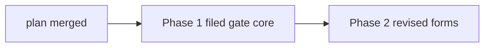

# Filed plan decisions: phased implementation

Source: `docs/plans/filed-plan-decisions/plan.md` (managed plan `b4224454-7296-43c5-9b3e-05cac88a7dde`).
Its adopted decisions are requirements here:

1. A new preview flag `filed-plan-decisions`, effective only while `async-input` is on.
2. No snooze on plan forms.
3. The ten-question limit stays per session and `request_input`-only. Plan forms are exempt, and
   no cross-session cap is added.
4. A merge closes an open filed plan form with the reason `merged`.
5. A revision is linked by an optional `revises` argument on `request_plan_decisions`.
6. Phase and schedule the work.

The completion hold applies to filed plan forms; the spec's "still a gate" settles that.

## Findings that shaped the phases

All line numbers are as of `7626494d8`. The source plan lists the verified spec references and
eleven further findings. These are the ones that decide phase boundaries:

- **The gate is one predicate swap, not a new subsystem.** The outbox, startup recovery, runtime
  transfer, orphaning and daemon authorship already carry any message-mode row
  (`src/server/db.ts:5448-5477`, `:5727-5758`). What is kind-specific is who is counted where
  (`src/server/registry.ts:7370-7383`), what holds completion (`src/shared/async-input.ts:96-101`)
  and the words. Those cannot be split: a filed form counted as an open question would let a
  resident run past a gate and leave a working agent's session grey.
- **Completion hold and merge closure share one scope.** Both read `questionHoldsCompletion`
  (`src/server/registry.ts:7396-7400`, `src/server/reviews.ts:808-838`), so decision 4 lands with
  the hold in Phase 1. Merge-driven completion waits for an idle session unless the agent is
  blocked in a call (`src/server/tasks.ts:1819-1820`); a filed form has no call, so the existing
  idle path closes it.
- **The limit needs no change.** It is already scoped to `isRequestInputQuestion` and to one
  session (`src/server/reviews.ts:358-369`). Listing and withdraw read the same helper
  (`openQuestions`, `:381-398`), so they need a second helper rather than a widened one.
- **Managed approval is bound by review id at creation and read from settled rows**
  (`src/server/plans/publication.ts:137-168`). The filed path changes only how
  `createMcpReview`'s managed branch creates the row and answers (`src/server/routes.ts:5189-5227`).
- **A test pins the opposite of decision 4.** `test/async-input-daemon.test.ts:324` asserts a
  merge "leaves gates alone". It stays true for call-mode gates and changes for filed ones.
- **`revises` needs persistence.** A withdrawn form is not in the live registry after a restart
  (`loadPendingReviews` restores pending and snoozed rows only, `src/server/db.ts:5878`), so the
  link and its number are stored on the new row. That is the only migration in this plan.
- **The prompt and four skills tell agents the tool blocks** (`src/server/plans/prompt.ts:123-125`,
  `skills/html-plans/SKILL.md:129`, `skills/grill/SKILL.md:53`, `skills/retro/SKILL.md:132`), and
  the Grill session action is generated from its skill (`npm run session-actions`).

## Sizing and phase count

Estimated 630 to 780 non-test implementation lines: shared contracts and text about 110, the
daemon (routes, review manager, registry, alerts) about 200, the MCP child about 50, persistence
and types for `revises` about 70, the dashboard about 150, prompts and skills about 60. Tests and
documentation are extra and are the larger part of Phase 1.

One phase is too large for one reviewable pull request, and it would hold the voice prerequisite
behind the revision work. Two phases:

- **Phase 1** is everything needed for the flag to be safe to turn on: a filed form that is
  counted, held, answered, closed, withdrawn and described correctly, with managed approval
  proven. Splitting it further would leave a flag that lets a task complete under an open gate,
  or a dashboard that says a held agent is working.
- **Phase 2** is additive: the `revises` link, its migration and its card. It is separate because
  it adds a tool argument, a schema version and a new view, none of which Phase 1 needs, and
  because Phase 1 alone already delivers the scope-change flow (withdraw, then file again).

A third, dashboard-only phase was considered and folded in: after Phase 1's wording work it would
be under 150 lines and would run against a contract only Phase 2 creates.

| Phase | File | Delivers | Depends on | Est. lines |
| --- | --- | --- | --- | --- |
| 1 | `phase-1-filed-gate.md` | Flag, predicates, wait negotiation, counts, completion hold, merge closure, alerts, receipt and answer, MCP child, withdraw and list, managed approval on the filed path, agent instructions, gate wording in the dashboard | this plan merged | 430 to 520 |
| 2 | `phase-2-revised-forms.md` | `revises`, validation, atomic replacement, persistence, the Revision tag and earlier-version view | 1 | 200 to 260 |

The phases are serial. Phase 2 edits files Phase 1 changes (`src/mcp/server.ts`,
`src/server/reviews.ts`, `src/server/routes.ts`, `src/shared/async-input.ts`), so it starts from
Phase 1's merge.

## Cross-phase contracts, owned by Phase 1

Phase 2 may rely on these and must not change them.

- **Flag.** Id `filed-plan-decisions`, exported as `FILED_PLAN_DECISIONS_FLAG` from
  `src/shared/async-input.ts`. One gate: `createMcpReview` reads it together with
  `ASYNC_INPUT_FLAG`, per ask. Nothing else reads it; every other reader asks the review.
- **Predicates** in `src/shared/async-input.ts`: `isFiledGate`, `agentKeepsWorking`,
  `isAgentAsk`. No reader tests `waitMode` or `kind` directly for these meanings.
- **Counts.** `Session.pendingReviews` counts pending reviews the agent has stopped on,
  including filed gates. `Session.openQuestions` counts pending reviews with `agentKeepsWorking`.
- **Scope of the two completion rules.** `questionHoldsCompletion` covers every outstanding
  filed gate, with no flag condition.
- **Text.** `filedPlanReceipt(review, options)` and `filedPlanAnswer(review)` are the only
  writers of the receipt and the answer. Phase 2 adds one sentence to the receipt and nothing
  to the answer.
- **Route response.** A filed form answers `{ id, sessionId, wait: "message", receipt }` from
  both `/mcp/reviews` and `/mcp/v2/reviews`.
- **Lifecycle helper.** `ReviewManager.openAsks(sessionId)` is what listing and withdraw read;
  `openQuestions(sessionId)` stays the limit's count.
- **Wait mode is fixed at insert.** No path turns a call-mode form into a filed one. An older
  MCP child that re-asks a filed form turns it back into a call (`attachCall`), as for questions.

## Coordination with sibling plans

- **Agent Reports and Inbox Upgrades.** It edits `src/web/lib/attention.ts`,
  `src/web/components/AttentionInbox.tsx`, `src/shared/alerts.ts` and `src/mcp/server.ts`, and adds
  a table. Neither plan depends on the other. Whichever schema change merges second takes the next
  free `CURRENT_DATABASE_SCHEMA_VERSION`; Phase 2 states that rule.
- **Voice Addressing for Agents.** It depends on both phases here. It must require three flags
  (decision 1), may rely on every `request_plan_decisions` ask from a current bundle on a
  messageable session being filed, and builds its own conversion of an already-blocking call.

## Final verification strategy

Each phase runs its own focused tests, `npm run typecheck`, `npm run lint`, `npm run build`,
`npm run smoke` and its e2e specs. After Phase 2 merges, the whole feature is checked once with
both flags on against a real plan task: file a managed final-bundle approval, see the session
amber and the form in `to answer`, message the agent, have it file a revision, approve it, and
confirm `publish_plan` or the bound workflow accepts that approval.

## Final cross-phase audit

- Every adopted decision has one owner: 1, 2, 3 and 4 in Phase 1; 5 in Phase 2; 6 is this
  document and its tasks.
- Every spec bullet has one owner: gate, amber, no held call, answer as a message, withdraw and
  managed approval in Phase 1; the revised card and its tag in Phase 2. "Changing scope without
  the form" works after Phase 1 (withdraw, then file a new form) and gains the link in Phase 2.
- Phase 1's receipt does not mention `revises`, because the argument does not exist until Phase
  2. Phase 2 adds that sentence. Found while writing Phase 2 and corrected in Phase 1.
- Phase 2 consumes only contracts Phase 1 owns and adds no reader of the flag.
