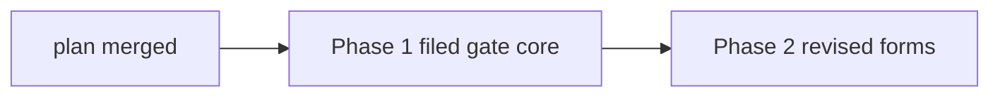

# Filed plan decisions: phased implementation

Source: `docs/plans/filed-plan-decisions/plan.md` (managed plan `b4224454-7296-43c5-9b3e-05cac88a7dde`).
Its adopted decisions are requirements here:

1. A new preview flag `filed-plan-decisions`, effective only while `async-input` is on.
2. No snooze on plan forms.
3. The ten-question limit stays per session and `request_input`-only. Plan forms are exempt, and
   no cross-session cap is added.
4. A merge closes an open filed plan form with the reason `merged`.
5. A revision is linked by an optional `revises` argument on `request_plan_decisions`.
6. Phase and schedule the work.

The completion hold applies to filed plan forms; the spec's "still a gate" settles that.

## Findings that shaped the phases

All line numbers are as of `7626494d8`. The source plan lists the verified spec references and
eleven further findings. These are the ones that decide phase boundaries:

- **The gate is one predicate swap, not a new subsystem.** The outbox, startup recovery, runtime
  transfer, orphaning and daemon authorship already carry any message-mode row
  (`src/server/db.ts:5448-5477`, `:5727-5758`). What is kind-specific is who is counted where
  (`src/server/registry.ts:7370-7383`), what holds completion (`src/shared/async-input.ts:96-101`)
  and the words. Those cannot be split: a filed form counted as an open question would let a
  resident run past a gate and leave a working agent's session grey.
- **Completion hold and merge closure share one scope.** Both read `questionHoldsCompletion`
  (`src/server/registry.ts:7396-7400`, `src/server/reviews.ts:808-838`), so decision 4 lands with
  the hold in Phase 1. Merge-driven completion waits for an idle session unless the agent is
  blocked in a call (`src/server/tasks.ts:1819-1820`); a filed form has no call, so the existing
  idle path closes it.
- **The limit needs no change.** It is already scoped to `isRequestInputQuestion` and to one
  session (`src/server/reviews.ts:358-369`). Listing and withdraw read the same helper
  (`openQuestions`, `:381-398`), so they need a second helper rather than a widened one.
- **Managed approval is bound by review id at creation and read from settled rows**
  (`src/server/plans/publication.ts:137-168`). The filed path changes only how
  `createMcpReview`'s managed branch creates the row and answers (`src/server/routes.ts:5189-5227`).
- **A test pins the opposite of decision 4.** `test/async-input-daemon.test.ts:324` asserts a
  merge "leaves gates alone". It stays true for call-mode gates and changes for filed ones.
- **`revises` needs persistence.** A withdrawn form is not in the live registry after a restart
  (`loadPendingReviews` restores pending and snoozed rows only, `src/server/db.ts:5878`), so the
  link and its number are stored on the new row. That is the only migration in this plan.
- **Today the review status `withdrawn` is written in one place.** The body of
  `ReviewManager.withdrawQuestion` (`src/server/reviews.ts:385-398`) is, as of `7626494d8`, the
  only code that settles a review as `withdrawn`. It finds the review among the calling session's
  own open asks and refuses a call-mode row, and it records no actor (`resolvedBy` is null). So
  today a `withdrawn` review was withdrawn by its own agent. The source plan's revision rule
  ("withdrawn by its agent") rests on that, and the contract below keeps it true once `revises`
  exists.
- **A filed row can become a call-mode row, and nothing remembers that it was filed.** When an
  older MCP child re-asks an open filed ask, `ReviewManager.attachCall`
  (`src/server/reviews.ts:406-411`) calls `markReviewWaitAttached`
  (`src/server/db.ts:5644-5652`), which sets `wait_mode`, `meanwhile` and the detach stamp to
  null. It does so only while the row is `pending` and its answer has not been queued. No column
  keeps the original mode.
- **The prompt and three skills tell agents the tool blocks** (`src/server/plans/prompt.ts:123-125`,
  `skills/html-plans/SKILL.md:129`, `skills/grill/SKILL.md:53`, `skills/retro/SKILL.md:132`). A
  fourth skill, `skills/phased-plan/SKILL.md:192`, tells the agent to obtain final approval
  through the tool and needs the same two-outcome wording. The Grill session action is generated
  from its skill (`npm run session-actions`).

## Plan validation round 1

One finding was accepted and applied:

- **A revision target that was withdrawn must have been withdrawn by its own agent.** The source
  plan said so; Phase 2 accepted any target whose status was `withdrawn` and never tested who
  withdrew it. Phase 2 now states the rule as the source plan does, decides it through one named
  predicate (`withdrawnByItsAgent`), lists "withdrawn, but not by its own agent" as a refusal
  case, and adds tests for who withdrew the target. The rule is also a cross-phase contract
  below, in the form round 2 gave it. The source plan's sentence was made explicit about the
  other closures that are never valid targets.

## Plan validation round 2

One finding was accepted and applied:

- **One write path for the status `withdrawn`.** Round 1's contract said `withdrawQuestion`
  stays the only writer of `withdrawn`, while Phase 2 directed `ReviewManager.create` to settle
  an open target as `withdrawn` itself. That was two writers, against the contract. The write
  path is now specified once and the same way everywhere. The status is written in one place,
  the review manager's agent withdrawal, which has two entries, both the asking agent's own act:
  `withdraw_question` (from Phase 1) and a `revises` that names an open form (from Phase 2).
  Phase 2 no longer writes the status in `create`. It calls the same path, split into a persist
  half and a publish half so the withdrawal commits in the new form's transaction. This is now
  said by the contract below, by Phase 1's step 6, exit criterion and handoff, by Phase 2's
  finding, step 4, tests, exit criteria and handoff, and by the source plan's revision sentence.

## Pull request review

Findings from the pull request's Inspector review. All were accepted and applied.

Round 1, one finding:

- **What a form is after `attachCall` converts it.** The contract said the wait mode is "fixed
  at insert" and, in the same bullet, that an older MCP child turns a filed form back into a
  call. So the mode can change after the row is written, in one direction. Phase 2 accepted a
  target that "has, or had" message mode and also refused a call-mode form, and a converted form
  fit both. The reviewer offered two rules; the one chosen is: **a converted form counts as a
  call-mode form for every rule in this plan**, and no original mode is recorded. Recording the
  original mode would add a column to answer a question nothing else asks, for a path only older
  MCP bundles reach. The contract below now says "decided at insert, with one conversion in one
  direction" and lists what a converted form is and is not. The source plan ("How an ask waits",
  "Withdraw, list and revise"), Phase 1's compatibility note, tests, exit criterion and handoff,
  and Phase 2's rule, refusals, compatibility note and tests say the same. Phase 2's "or had" is
  gone: every reader decides from the mode stored on the row now.

Round 2, two findings:

- **The source plan's receipt mentioned `revises`.** "What the agent is told" in the source plan
  described a receipt that tells the agent to file the revised plan with `revises`. Phase 1's
  step 3 and audit record say the Phase 1 receipt must not mention it, because the argument does
  not exist until Phase 2, whose step 1 adds that sentence. Someone building Phase 1 from the
  source plan would have shipped a receipt pointing at an argument the tool does not have. The
  source plan now describes the Phase 1 receipt (withdraw, then file the new plan as a new form)
  and says Phase 2 adds the `revises` sentence. Phase 1's step 3 uses the same words, and the
  Text contract below states it.
- **The Text contract's signatures.** The contract listed `filedPlanReceipt(review, options)` and
  `filedPlanAnswer(review)`, while Phase 1's step 3 defines
  `filedPlanReceipt(review, { bundleApproved? })` and `filedPlanAnswer(review, now)`. The
  contract now uses step 3's signatures and says Phase 2 changes neither.

Applied in the same revision, found while re-reading for the round: the citation for
`markReviewWaitAttached` was one line off and is now `src/server/db.ts:5644-5652`; the skills
finding above now names which three skills say the tool blocks and why the fourth changes too;
and Phase 1's flag-off note no longer reads as though an open filed form stops being answerable
when `async-input` is switched off.

## Sizing and phase count

Estimated 630 to 780 non-test implementation lines: shared contracts and text about 110, the
daemon (routes, review manager, registry, alerts) about 200, the MCP child about 50, persistence
and types for `revises` about 70, the dashboard about 150, prompts and skills about 60. Tests and
documentation are extra and are the larger part of Phase 1.

One phase is too large for one reviewable pull request, and it would hold the voice prerequisite
behind the revision work. Two phases:

- **Phase 1** is everything needed for the flag to be safe to turn on: a filed form that is
  counted, held, answered, closed, withdrawn and described correctly, with managed approval
  proven. Splitting it further would leave a flag that lets a task complete under an open gate,
  or a dashboard that says a held agent is working.
- **Phase 2** is additive: the `revises` link, its migration and its card. It is separate because
  it adds a tool argument, a schema version and a new view, none of which Phase 1 needs, and
  because Phase 1 alone already delivers the scope-change flow (withdraw, then file again).

A third, dashboard-only phase was considered and folded in: after Phase 1's wording work it would
be under 150 lines and would run against a contract only Phase 2 creates.

| Phase | File | Delivers | Depends on | Est. lines |
| --- | --- | --- | --- | --- |
| 1 | `phase-1-filed-gate.md` | Flag, predicates, wait negotiation, counts, completion hold, merge closure, alerts, receipt and answer, MCP child, withdraw and list, managed approval on the filed path, agent instructions, gate wording in the dashboard | this plan merged | 430 to 520 |
| 2 | `phase-2-revised-forms.md` | `revises`, validation, atomic replacement, persistence, the Revision tag and earlier-version view | 1 | 200 to 260 |

The phases are serial. Phase 2 edits files Phase 1 changes (`src/mcp/server.ts`,
`src/server/reviews.ts`, `src/server/routes.ts`, `src/shared/async-input.ts`), so it starts from
Phase 1's merge.

## Cross-phase contracts, owned by Phase 1

Phase 2 may rely on these and must not change them. Where a contract names something Phase 2
adds, that addition is the whole of what Phase 2 may do to it.

- **Flag.** Id `filed-plan-decisions`, exported as `FILED_PLAN_DECISIONS_FLAG` from
  `src/shared/async-input.ts`. One gate: `createMcpReview` reads it together with
  `ASYNC_INPUT_FLAG`, per ask. Nothing else reads it; every other reader asks the review.
- **Predicates** in `src/shared/async-input.ts`: `isFiledGate`, `agentKeepsWorking`,
  `isAgentAsk`. No reader tests `waitMode` or `kind` directly for these meanings.
- **Counts.** `Session.pendingReviews` counts pending reviews the agent has stopped on,
  including filed gates. `Session.openQuestions` counts pending reviews with `agentKeepsWorking`.
- **Scope of the two completion rules.** `questionHoldsCompletion` covers every outstanding
  filed gate, with no flag condition.
- **Text.** `filedPlanReceipt(review, { bundleApproved? })` and `filedPlanAnswer(review, now)`
  are the only writers of the receipt and the answer, with the signatures Phase 1's step 3 gives
  them. The Phase 1 receipt does not mention `revises`. Phase 2 adds one sentence to the receipt,
  about `revises`, and nothing to the answer, and it changes neither signature.
- **Route response.** A filed form answers `{ id, sessionId, wait: "message", receipt }` from
  both `/mcp/reviews` and `/mcp/v2/reviews`.
- **Lifecycle helper.** `ReviewManager.openAsks(sessionId)` is what listing and withdraw read;
  `openQuestions(sessionId)` stays the limit's count.
- **One write path for `withdrawn`, entered only by the asking agent's own act.** The review
  status `withdrawn` is written in exactly one place: the review manager's agent withdrawal,
  which is the body of `ReviewManager.withdrawQuestion` today. Its entries are:
  - `withdraw_question`, the only entry when Phase 1 merges. Phase 1 widens which asks it admits
    (plan forms) and changes nothing else about it: it still admits only the calling session's
    own filed ask.
  - from Phase 2, a `revises` that names an open filed plan form of the same session. Phase 2
    adds this second entry to the same write path, and may split the path into a persist half
    and a publish half so the withdrawal can commit inside `create`'s transaction.
  No phase adds a second place that writes the status, and no entry lets another session, the
  operator, Foreman or the daemon acting on its own produce it. Every other closure keeps its
  own status: an answer, `dismissed`, `orphaned` (eviction or merge) and `superseded`. A
  `withdrawn` review was therefore withdrawn by its own agent.
- **Wait mode: decided at insert, with one conversion in one direction.** The mode is written
  with the row. No flag change alters it, and no path turns a call-mode form into a filed one.
  The one conversion is the one filed questions already have: an older MCP child that re-asks an
  open filed form is handed the row and long-polls it, and `attachCall` clears the stored mode,
  only while the form is still pending. **A converted form is a call-mode form for every rule in
  this plan**, because nothing stored says it was ever filed:
  - it stays one pending review, and its answer is the call's result, never also a message;
  - `isFiledGate` and `isAgentAsk` are false for it, so it is not listed by
    `list_open_questions`, not withdrawable, and not a valid `revises` target;
  - `questionHoldsCompletion` does not cover it and a merge does not close it, exactly as for a
    plan form that was asked in call mode.
  Every reader decides from the mode stored on the row now; none asks what the mode used to be.
  A withdrawn form is no longer pending and so can never convert: it keeps the `message` mode it
  was withdrawn with.

## Coordination with sibling plans

- **Agent Reports and Inbox Upgrades.** It edits `src/web/lib/attention.ts`,
  `src/web/components/AttentionInbox.tsx`, `src/shared/alerts.ts` and `src/mcp/server.ts`, and adds
  a table. Neither plan depends on the other. Whichever schema change merges second takes the next
  free `CURRENT_DATABASE_SCHEMA_VERSION`; Phase 2 states that rule.
- **Voice Addressing for Agents.** It depends on both phases here. It must require three flags
  (decision 1), may rely on every `request_plan_decisions` ask from a current bundle on a
  messageable session being filed, and builds its own conversion of an already-blocking call.

## Final verification strategy

Each phase runs its own focused tests, `npm run typecheck`, `npm run lint`, `npm run build`,
`npm run smoke` and its e2e specs. After Phase 2 merges, the whole feature is checked once with
both flags on against a real plan task: file a managed final-bundle approval, see the session
amber and the form in `to answer`, message the agent, have it file a revision, approve it, and
confirm `publish_plan` or the bound workflow accepts that approval.

## Final cross-phase audit

- Every adopted decision has one owner: 1, 2, 3 and 4 in Phase 1; 5 in Phase 2; 6 is this
  document and its tasks.
- Every spec bullet has one owner: gate, amber, no held call, answer as a message, withdraw and
  managed approval in Phase 1; the revised card and its tag in Phase 2. "Changing scope without
  the form" works after Phase 1 (withdraw, then file a new form) and gains the link in Phase 2.
- Phase 1's receipt does not mention `revises`, because the argument does not exist until Phase
  2. Phase 2 adds that sentence. Found while writing Phase 2 and corrected in Phase 1; the source
  plan's own description of the receipt was brought into line in pull request review round 2.
- Phase 2 consumes only contracts Phase 1 owns and adds no reader of the flag.
- After Plan validation round 1, the revision-target rule reads the same in the source plan
  ("Withdraw, list and revise"), in the contract above and in Phase 2's step 4, refusal cases,
  tests and exit criteria: an open filed form, or one its own agent withdrew, and nothing else.
- After Plan validation round 2, every statement about who writes `withdrawn` names the same
  thing: one write path, entered by `withdraw_question` from Phase 1 and also by the `revises`
  replacement from Phase 2. No file describes a second writer, and Phase 2's replacement step
  no longer settles the status in `create`.
- After pull request review round 1, every statement about a form's wait mode names the same
  thing: decided at insert, never changed by a flag, and convertible only from filed to call
  mode by an older MCP child's re-ask. A converted form is a call-mode form in the source plan,
  in the contract above, in Phase 1 and in Phase 2. No file says the mode is fixed, and no rule
  depends on what a row's mode used to be.
- After pull request review round 2, the receipt and the answer are described the same way in
  the source plan, the Text contract and Phase 1's step 3: the same two signatures, a Phase 1
  receipt without `revises`, and one sentence added by Phase 2's step 1.
