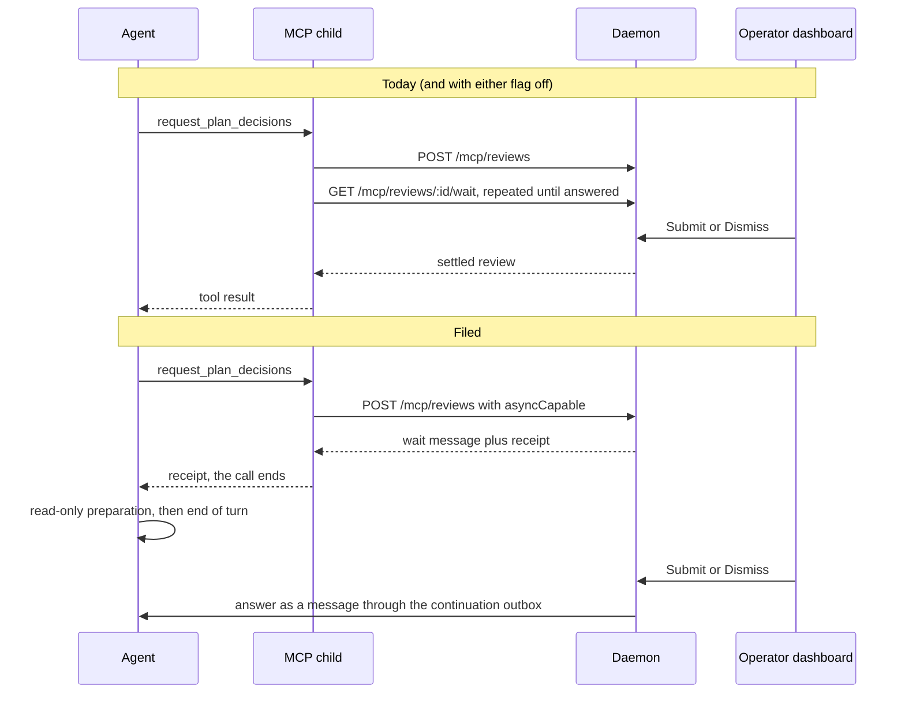

# Filed plan decisions

Revision 4, 2026-11-22. The operator's decisions of 2026-11-22 are adopted below, and the work is
split into two implementation phases (`phased-plan.md`). Revision 4 applies Plan Validation round
1, recorded in `phased-plan.md`. This is a plan-only task: it ships no product code. The phase
tasks scheduled from this plan build the feature.

## Summary

`request_plan_decisions` gains the filed mode `request_input` already has under the `async-input`
preview flag. The tool returns a receipt at once and holds no MCP call open. The form stays a
gate: the agent may do read-only preparation, then ends its turn and waits. The session is amber
in Needs you from the moment the plan is filed, and the answer reaches the agent later as a
message that restates the plan and each decision. Managed-plan approval, standing approval and
publication keep working on the filed path. It ships behind a new preview flag,
`filed-plan-decisions`, which takes effect only while `async-input` is also on. This is a hard
prerequisite for voice v1.

Reports, Stuck rows, the naming rule and voice are planned by sibling tasks ("Agent Reports and
Inbox Upgrades Phased Plan" and "Voice Addressing for Agents Phased Plan") and are out of scope.

## Source spec, captured

Section "Filed plan decisions (prerequisite for voice)" of the Claude Docs artifact "Feature
request: Agent reports and inbox upgrades" (https://claude.ai/artifact/SbAVfCNfQ4NNUMjM5BvqBu, doc
id `cf399b0a-e0e1-4bc6-8d35-c33d60de90a0`, tab revision 14, read 2026-11-22). Verbatim:

> `request_plan_decisions` gains the filed mode that `request_input` has under `async-input`. It
> ships before voice v1, so voice behaves the same for every kind of question.
>
> - **Still a gate.** The agent files the plan, may do read-only preparation, then ends its turn
>   and waits. It makes no edits and takes no outward action until the plan is answered.
> - The session is amber in Needs you, and the plan counts in **to answer**, from the moment it
>   is filed.
> - No MCP call is held open. That removes client timeouts, duplicate asks, and plans answered
>   after the call ended degrading into a generic message.
> - The answer reaches the agent as a message, through the same outbox as filed questions,
>   restating the plan and each decision.
> - **Changing scope without the form.** The operator messages the agent, typed or spoken, that
>   scope has changed. The agent withdraws the plan with a reason (`withdraw_question`) and files
>   a revised one.
> - The revised card replaces the old one and is tagged as a revision, for example "Revision 2",
>   linking the earlier version.
>
> **What has to change in the code.** Five checks assume plan decisions always block (line
> numbers as of commit `7626494`):
>
> 1. The tool never sends `asyncCapable` and always waits (`src/mcp/server.ts:544-545`).
> 2. `decideWaitMode` files only kind `input` with `snoozable` (`src/shared/async-input.ts:46-56`).
> 3. `ReviewManager.create` stores `waitMode` only for `input` with `snoozable`
>    (`src/server/reviews.ts:343-348`).
> 4. `CreateReviewSchema` refuses `snoozable` and `meanwhile` for other kinds
>    (`src/shared/protocol.ts:693-700`).
> 5. Listing, withdraw, the ten-question limit, snooze, completion holds and merge closure all key
>    on `isRequestInputQuestion` (`src/shared/async-input.ts:77`).
>
> Managed-plan approval also ties the review id to plan publication and standing approval
> (`src/server/routes.ts:5189-5227`). The filed path must keep that working.

From the same document's "Rollout and open items": "Filed plan decisions ship before voice v1."
Open item: "Which flag filed plan decisions ship behind, and whether snooze, the ten-question
limit and merge closure apply to plan forms." The adopted decisions below resolve it.

### What voice consumes

From "Feature request: Voice addressing for agents" (https://claude.ai/artifact/MHs47NN2d25hdqTpc4JVvE,
tab revision 17):

- **Blocked agents.** "Voice requires `async-input`, and filed plan decisions ship first, so new
  questions of both kinds are filed from the start. A blocking call remains only if it was
  already waiting when those were turned on, or comes from an older MCP bundle." Converting such
  a call into a filed question is voice's own work, built on what this plan delivers.
- **Answering a card by voice.** "`request_plan_decisions` form: fill-only by voice (...). It
  waits for 'Steve, submit' (or 'reply, submit') or a click. Validation prevents submitting a
  half-filled form."
- The open-questions note asks the agent to withdraw a settled question with `withdraw_question`.

## Adopted decisions

Submitted by the operator through `request_plan_decisions` on 2026-11-22, on revision 1.

1. **Flag: a new preview flag, `filed-plan-decisions`, effective only while `async-input` is
   on.** A plan form is filed only when both flags are on. The voice plan must therefore require
   three flags (`async-input`, `filed-plan-decisions`, the inbox flag) and offer to turn all on.
2. **No snooze on plan forms.** A filed form stays amber and in `to answer` until it is
   answered, dismissed or withdrawn. `snoozable` and `meanwhile` stay `input`-only, so spec check
   4 needs no schema change.
3. **The ten-question limit: plan forms are exempt.** The operator answered in their own words:
   "10 open asks per session is fine, and plans can be exempt, but we shouldn't limit a total of
   10 open asks in the inbox globally across all sessions". Read as: the limit stays ten open
   `request_input` questions per session, which is what the code does today
   (`ReviewManager.create` counts `openQuestions(sessionId)`, `src/server/reviews.ts:358-369`); a
   filed plan form consumes no slot and is never refused by it; and no global, cross-session cap
   exists or is added. A phase task must not introduce one.
4. **Merge closure applies.** A merge closes an open filed plan form as `orphaned` with the
   close reason `merged`, shown as "Closed unanswered: pull request merged".
5. **A revision is linked by an optional `revises` argument** on `request_plan_decisions`, naming
   the earlier review id. The daemon validates it, withdraws the earlier form in the same
   transaction if it is still open, and numbers the chain.
6. **Follow-up: create the phased implementation plan** and schedule its tasks.

Settled by the spec rather than asked: the completion hold applies to filed plan forms ("still a
gate").

## Code references, verified

The worktree's HEAD is `7626494d8`, the commit the spec cites. Every reference resolves exactly.

| # | Spec claim | Cited | Found | Drift |
| --- | --- | --- | --- | --- |
| 1 | The tool never sends `asyncCapable` and always waits | `src/mcp/server.ts:544-545` | `createReview("plan-decisions", ...)` then `waitForResolution(id, extra)` on those two lines | None |
| 2 | `decideWaitMode` files only `input` with `snoozable` | `src/shared/async-input.ts:46-56` | The function spans 46-56; the test is on line 53 | None |
| 3 | `ReviewManager.create` stores `waitMode` only for `input` with `snoozable` | `src/server/reviews.ts:343-348` | 343 `snoozable`, 344 `waitMode`, 345-348 `meanwhile` | None |
| 4 | `CreateReviewSchema` refuses `snoozable` and `meanwhile` for other kinds | `src/shared/protocol.ts:693-700` | Two `.refine` calls on 693-700; the schema starts at 665 | None |
| 5 | Listing, withdraw, the limit, snooze, holds and merge closure key on `isRequestInputQuestion` | `src/shared/async-input.ts:77` | Declared on 77-79 | None |
| 6 | Managed approval ties the review id to publication and standing approval | `src/server/routes.ts:5189-5227` | The `managedPlan` branch of `createMcpReview` spans 5189-5227 | None |

The decisions narrow two of the five checks. Check 4 needs no change (decision 2). Of check 5's
six readers, listing, withdraw, completion holds and merge closure widen to plan forms; the
limit and snooze stay `request_input`-only (decisions 2 and 3).

### Findings the spec does not list

These were found while verifying and shape the design below.

1. **Amber from filing needs the other session count.** `countPending` excludes every
   message-mode row (`src/server/registry.ts:7370-7375`), and `reportBucket` turns a session amber
   at once only on `pendingReviews > 0` (`src/shared/session.ts:412`). A message-mode row counted
   in `openQuestions` turns amber only after the agent stops, and never for a resident
   (`waitingOnOpenQuestion`, `src/shared/async-input.ts:132-136`).
2. **The managed branch never negotiates the wait.** It returns `{ id, sessionId }` with no
   `wait` field (`src/server/routes.ts:5227`) and never calls `decideWaitMode` (5232 is the
   unbound branch only). Both branches need the filed path.
3. **Approval does not read the wait.** `bindPlanReview` keys `managed_plan_reviews` on the review
   id at creation (`src/server/plans/publication.ts:137-145`), and `approval` reads settled rows
   (`:147-168`). Neither depends on a held call, so the filed path can keep both unchanged.
4. **The answer text is worded for a question.** `continuationText` picks `asyncInputAnswer` for
   every message-mode row (`src/server/reviews.ts:199-200`); that text names a "question" and a
   meanwhile line (`src/shared/async-input.ts:142-154`).
5. **The outbox is already kind-agnostic.** A message-mode row is born detached
   (`src/server/db.ts:5448-5477`), queued by `createReviewContinuationPendingTurn` (`:5727-5748`)
   and marked daemon-authored by `MESSAGE_ANSWER_TURN_PREFIX` (`:5758`).
6. **The dashboard reads `waitMode === "message"` as "the agent kept working".**
   `questionStatusLine`, `stoppedOnQuestions`, `allMessageMode` and `questionWait` in
   `src/web/lib/async-questions.ts`, the alert split in `src/shared/alerts.ts:187-195`, and the
   Asked entry (`src/web/lib/episodes.ts:42`, `src/web/components/AskedQuestion.tsx`).
7. **Three kinds of caller use the tool.** Plan review and managed approval, Grill me first
   rounds (`skills/grill/SKILL.md:39-53`) and retro proposals (`skills/retro/SKILL.md:131-132`).
   All of them stop on the form, so all become filed.
8. **Other blocking tools are untouched.** `request_review` (`src/mcp/server.ts:569-570`),
   `configure_workflow_command` (`:342`), `propose_resident_instruction_changes` (`:1587`) and the
   confirmation at `:1138-1140` keep long-polling.
9. **An operator message still reaches a held agent.** Queued turns drain on an idle session
   with no pane dialog (`canDrain`, `src/server/pending-turns.ts:651`); a pending review does not
   hold them. The scope-change flow depends on this.
10. **The flag registry has no flag-to-flag dependency.** `filed-plan-decisions` reads both
    flags at its one gate.
11. The database schema version is 40 (`src/server/db.ts:287`).

## The flow that changes

Today the MCP child holds a long poll open for as long as the operator takes. Filed, the child
makes one request and returns the daemon's receipt; the daemon later queues the answer as a
daemon-authored turn through the same outbox that carries filed question answers.

## Design

### How an ask waits

- `request_plan_decisions` sends `asyncCapable`. `decideWaitMode` answers `message` for a
  `plan-decisions` ask when `filed-plan-decisions` and `async-input` are both on, the child is
  capable and the session can be messaged (`canMessage`). Anything else is `call`, which is
  today's behavior unchanged: either flag off, an older MCP bundle, a Pipeline engine session or a
  terminal session with no writable pane.
- Both branches of `createMcpReview` decide the wait and say it in the response. Told `message`,
  the child returns the receipt and makes no further request.
- The wait mode is fixed when the row is written. A form filed while the flags were on stays
  filed and answerable after either is switched off; new asks block again.

### One rule for what a filed form is

`src/shared/async-input.ts` owns three predicates, and every reader below asks them instead of
testing `waitMode` or `kind` directly:

- `isFiledGate(review)`: a `plan-decisions` review in message mode.
- `agentKeepsWorking(review)`: a message-mode review that is not a filed gate. This replaces
  every bare `waitMode === "message"` test that means "the agent carried on".
- `isAgentAsk(review)`: a `request_input` question or a filed gate. Listing and withdraw read it.

Session counts follow: `pendingReviews` counts pending reviews the agent has stopped on (call-mode
waits and filed gates), and `openQuestions` counts pending reviews the agent works past.

| Reader | With a filed plan form open |
| --- | --- |
| Needs you, the state badge, `to answer` | Amber and counted from filing, because the form is a `pendingReviews` row |
| Alerts | The existing "needs review" alert fires once, at filing |
| Prompted completion, workflow resumption, automatic evidence preparation | Refused: the bucket is `needs-you`, and the completion hold is widened to filed gates |
| A merge of the task's pull request | Completes the task and closes the form as `merged` (decision 4) |
| Hibernate, backlog reassignment, ensemble finalization | Refused, as for any pending review |
| Resident wakes | Held while the form is open: a gate stops a resident too |
| Foreman | Cannot answer it, as today (`classifyPending` treats it as a non-input review) |
| Operator messages, typed or spoken | Delivered: nothing holds them |
| The ten-question limit, Remind me later | Not applied to plan forms (decisions 2 and 3) |
| Session eviction, daemon restart, runtime transfer | Orphaned, restored or moved by the existing message-mode paths |

### What the agent is told

- **Receipt** (`filedPlanReceipt`, the tool result): the plan is filed and not answered; this is
  a gate; read-only preparation is allowed; make no edits, commits, pushes, task creation or other
  outward action until the answer arrives; do not file it again or poll; the answer arrives as a
  message; if the operator says scope changed, withdraw the form with a reason and file the
  revised plan with `revises`; then say what is waiting and end the turn. The gate is an
  instruction, as it is for `request_input`; nothing enforces read-only at the tool level.
- **Answer** (`filedPlanAnswer`, a daemon-authored message): the review id and how long ago it
  was filed, the plan's title, the managed plan identity when bound, a bounded excerpt of the plan
  body, every decision with what was chosen (`formatResponse`, including notes and "Chat about
  it"), and what to do next. A dismissal says the request ended without approval and nothing was
  selected.
- The tool description, `src/server/plans/prompt.ts`, and the html-plans, phased-plan, grill and
  retro skills stop saying the tool always blocks. They say it either returns the answer or
  returns a receipt, and what to do on a receipt.

### Withdraw, list and revise

- `withdraw_question` accepts a filed plan form. `list_open_questions` lists it with its kind.
  Both routes stay behind `async-input`, as today.
- A withdrawn managed approval never approves: `approval` requires an answered row from an
  approving actor.
- `request_plan_decisions` takes an optional `revises: <review id>`. The daemon accepts it only
  for a filed plan form of the same session that is still open or was withdrawn by its agent
  with `withdraw_question`. A form closed any other way (answered, dismissed, closed by a merge
  or an eviction, replaced as a reworded retry, or withdrawn by anyone but its agent) is never a
  valid target. An
  open one is withdrawn in the same transaction as the new form is written, so the operator never
  sees both. The new row stores the link and its revision number (the earlier form's number plus
  one, starting at 2). An invalid `revises` is refused with the reason, and nothing is filed.
- The dashboard tags the revised card "Revision N" and links the earlier version, which the
  session's conversation keeps as a withdrawn entry.

### Managed-plan approval and publication on the filed path

| Case | Filed behavior |
| --- | --- |
| Final-bundle approval needs the operator | The review is created in message mode, bound with `bindPlanReview` exactly as today, marked `standingApprovalEligible`, and the response carries `wait: "message"` and the receipt |
| Standing approval covers the bundle, nothing else asked | Unchanged: the born-settled record is returned as `wait: "call"`, the child's first poll returns the approval, and the tool result is the approval itself |
| Standing approval covers the bundle, other decisions remain | The approval is recorded as today; the follow-up review is filed, and its receipt says the bundle is already approved. Its answer keeps `STANDING_FOLLOW_UP_NOTE` |
| "Approve all future bundles" ticked on a filed form | Unchanged: the grant commits with the answer in `POST /api/reviews/:id/resolve` |
| A revised bundle | A new plan revision is a new review with its own binding; `revises` links the cards only and never carries an approval forward |
| `publish_plan`, workflow freeze, Local Plan Validation | Unchanged: they read `managed_plan_reviews` and settled rows only. Tests prove each on a filed review |

### Dashboard

- The inbox row, the review modal and the form itself are the ones a blocking plan form uses
  today. The form keeps its completeness check, so a half-filled form cannot be submitted (voice
  relies on this). It offers Submit and Dismiss and no Remind me later.
- A filed form's status line reads as a gate ("Waiting on your decisions"), never "Still
  working". Row order, dismiss copy and the alert read the shared predicates.
- The conversation shows a filed plan where it was filed, with how it ended, like a filed question.
- A revised form shows its "Revision N" tag and the link to the earlier version.

## What the phase tasks deliver

This planning task is done when the phase documents are saved and every phase task is in the
backlog with its dependencies. The outcomes below belong to those phase tasks, not to this one.

- With both flags on, a current bundle and a messageable session, `request_plan_decisions`
  returns a receipt and no `/wait` request is made. With either flag off, behavior is today's.
- The session is `needs-you` and counted in `to answer` from filing, while its agent is still in
  its turn and after it stops.
- The answer arrives as one daemon-authored message restating the plan and each decision.
- Managed final approval, standing approval, the standing follow-up and `publish_plan` pass on a
  filed review; a withdrawn or dismissed review never approves.
- A merge closes an open filed form as `merged`; nothing else completes the task past it.
- Withdraw and `revises` work, and the revised card is tagged and linked.
- No surface says a held agent is still working, and no plan form offers a snooze.

## Phases

The phased index (`phased-plan.md`) and the phase files beside this plan are authoritative. The
investigation settled on two phases, merged in order:

1. **Filed gate core** (`phase-1-filed-gate.md`). The flag, the predicates, wait negotiation in
   both route branches, the counts, the completion hold and merge closure, alerts, receipt and
   answer text, the MCP child, withdraw and list for plan forms, managed approval and publication
   tests, agent instructions, and the dashboard wording that keeps every surface from calling a
   held agent working. Safe to turn on alone.
2. **Revised forms** (`phase-2-revised-forms.md`). The `revises` argument, its validation and
   persistence, the atomic replacement of an open form, and the "Revision N" tag with its
   earlier-version view.

## Non-goals

- Converting an already-blocking call into a filed one (voice's own work).
- Filing `request_review` or any other blocking tool.
- Enforcing read-only preparation at the tool level.
- Snoozing a plan form, a limit on plan forms, or any cross-session cap on open asks.
- Reports, Stuck rows, the naming rule, voice hints and voice routing.

## Risks

- **A plan task completing under an open form.** Mitigated by counting the form in
  `pendingReviews` and by the widened completion hold, both in phase 1, with tests at each gate.
- **A stale instruction.** An agent told the tool blocks could treat a receipt as approval. The
  receipt says "not answered" first, and the prompt and skills change in the same phase.
- **Older MCP bundles.** They never send `asyncCapable` and keep blocking; nothing regresses.
- **Approval drift.** The approval tables are untouched; phase 1 re-runs the publication and
  standing-approval suites against filed reviews.
- **Unbounded plan forms.** With plan forms exempt from the limit, the bounds are the gate itself
  (the agent stops), the identical-ask re-attach in `ReviewManager.create` and `revises`.
