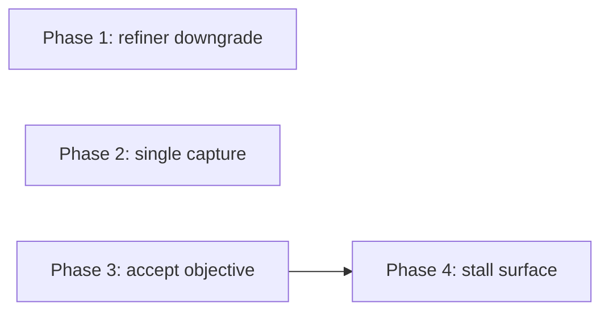

# Foreman stuck-goal recovery: phased implementation plan

Source plan: [plan.md](plan.md), managed plan `a5f32186-8e13-4119-9ed9-7e07c452c96c`. Phases are
merge units; each phase file is the implementation guide its task points at.

## Incorporated decisions

Requirements, submitted on the 2026-11-05 review: **D1** include the attachment-line
normalization in the prefix comparison (the comparison never changes stored text, and an
accepted amendment keeps every path line); **D2** surface the stall on
the console bind chip and bind dialog, not the board tile; **D3** keep the `unreconciled` badge
on manual runs, no snapshot schema change; **D4** put **Accept objective as is** in the Foreman
drawer and the dialog notice; phased follow-up selected; bundle approved at revision 1, whose
section 9 names these four phases.

## Investigated findings

Verified at `74eaf9434` and against the operator's `harness.db`, read-only.

- Rejection branch: `src/server/goal/refiner.ts:384-398`. The resolution path at lines 400-430
  already keeps `objective` and `text` for `steer`; `Registry.resolveGoal` (`registry.ts:8563`)
  records the steering note. `comparableObjective` (`refiner.ts:205`) has one caller.
- **Two human send paths reach an SDK driver and both capture at acknowledgement**: the outbox
  (`pending-turns.ts:931`) and the direct `/inject` route for an unbuffered human send
  (`routes.ts:5903` via `sdk/deliver.ts:62-67`, which passes `{ prompt, noteKey }` into
  `SdkSupervisor.send`, capturing at `supervisor.ts:714`). The prompt hook echoes either into
  `captureHookGoalPrompt` (`registry.ts:8324-8328`), which suppresses only the launch echo and
  daemon-authored injections. The reservation has two call sites, not the one the source plan
  names. Delegated turns use the same route; resident wakes are `resident` injections.
- `injections.ts` already has the ledger shape; `TurnOrigin` (`types.ts:3560`) has no human
  value and must not gain one. `completeWorkCycle` runs on the harness's turn-end signal.
- `upsertSessionGoalWithSteering` (`db.ts:10743`) writes one note; accepting several pending
  revisions needs a list writer. `GET /api/sessions/:id/goal` (`routes.ts:6779`) has no POST.
- The bind chip lives only in `ConsoleDetail.tsx:601-640`; `WorkflowBindingDialogHost`
  (`App.tsx:4612`) does not receive `workflowRunsBySession` (`App.tsx:2140`).
- `fake-claude.mjs:698-713` answers goal jobs with `initial`, which the refiner turns into
  `unclear` for later revisions: the deterministic stalled shape for the Playwright specs.

## Sizing estimate

| Phase | Non-test lines | Assumptions |
| --- | --- | --- |
| 1 | 40 - 70 | refiner branch, prompt rule, normalization, fake-agent marker, docs |
| 2 | 80 - 120 | ledger, two reservation sites, one claim, docs |
| 3 | 150 - 200 | registry method, db writer, route, api entry, drawer control, copy, styles, docs |
| 4 | 110 - 160 | predicate, chip state, dialog band, host wiring, styles, docs |

Total 380 - 550, above the one-phase threshold.

## Phase count rationale

Phases 1 and 2 would fit one pull request by size, but the approved plan names them separately
and their failure modes are opposite (a loose contract versus a typed instruction silently
dropped); a Phase 2 reviewer must look only at delivery and capture. Phase 3 introduces the
route and mutation that the drawer, the dialog and Foreman's next tick consume. Phase 4 depends
on Phase 3 because its notice calls the accept route. No preparation, test-only or docs-only
phase exists.

## Phases

| Phase | File | Layer | Direct prerequisites |
| --- | --- | --- | --- |
| 1 | [phase-1-refiner-amendment-downgrade.md](phase-1-refiner-amendment-downgrade.md) | server, docs, one e2e spec | none |
| 2 | [phase-2-single-capture-sdk-follow-ups.md](phase-2-single-capture-sdk-follow-ups.md) | server, docs | none |
| 3 | [phase-3-accept-objective.md](phase-3-accept-objective.md) | server + UI, e2e | none |
| 4 | [phase-4-stall-surface.md](phase-4-stall-surface.md) | UI, e2e | Phase 3 |

## Dependency graph and concurrency

Groups: `{1, 2, 3}` concurrently, then `4`. Every task also depends on this planning
session's pull request merging, which publishes the paths the tasks name.

## Cross-phase contracts

- Rationale markers: Phase 1 writes `Treated as steering:`, Phase 3 writes `Accepted by you:`.
- Phase 1 stores an accepted amendment with every ignored path line retained; Phase 2's echo
  ledger captures each delivered turn through exactly one door, marks an expectation captured
  only after that capture succeeded, and expires an unconsumed expectation at the next turn end
  or by age on its next read (source plan sections 3.1, 3.2 and 7).
- Documentation owners: Phase 1 and Phase 2 edit different paragraphs of `docs/sessions.md`;
  Phase 3 owns `docs/foreman.md`, the Goal section of `docs/sessions.md` and
  `docs/agent-guides/change-contracts.md`; Phase 4 owns `docs/workflows.md` only.
- Steering rows carry `relationship: "steer"` at a resolved revision. The refiner (Phase 1)
  writes through the existing single-note writer; the accept route (Phase 3) writes through the
  new list writer `upsertSessionGoalWithSteeringNotes`, and neither phase changes the other's writer.
- Phase 3 owns `POST /api/sessions/:id/goal/accept` and `api.acceptGoal`; Phase 4 calls them
  unchanged. Phase 4 owns `workflowCompletionStall` in `src/web/lib/held.ts` and adds nothing to
  the wire. The source plan's section 7 invariants hold in every phase.

## Final verification

`npm run typecheck`, `npm run lint`, each phase's focused `node --test` files; Phases 1, 3 and 4
run their Playwright spec after `npm run build`, and the full `npm run test:e2e` runs before the
last merges. On a live daemon afterwards: a latched session resolves on the first retry, an SDK
follow-up shows `promptRevision 2`, a stalled binding shows the chip state, and accepting the
objective is followed by a claimed run on Foreman's next tick.
