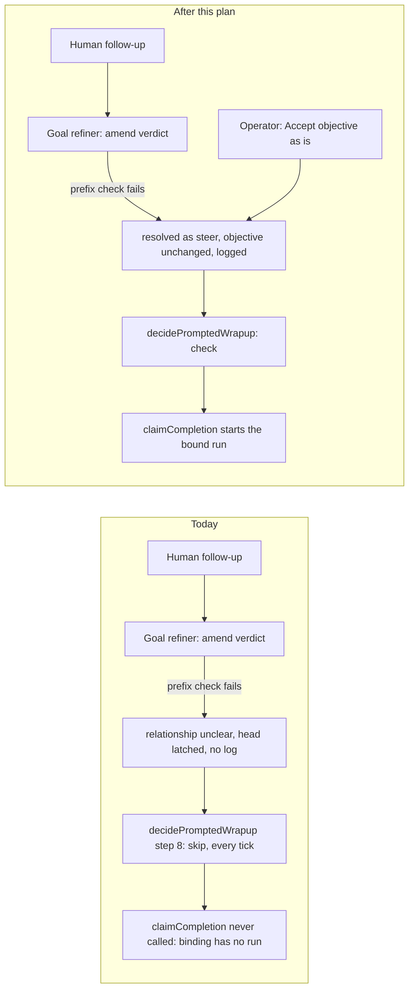

# Foreman stuck-goal recovery: an unresolved intent must never silently stop a bound workflow

Status: revision 9 (2026-11-06), repaired after Plan Validation rounds 1 to 3 and three pull
request review rounds; sections 3.1, 3.2, 3.3 and 7 carry the repairs. Decisions adopted from the first
review are in section 10. Nothing here is implemented.

Source: the investigation report for task `4bda9656` ("Move Advisor Settings to Harness Page",
session `sdk:3cf99086`, note key `dd55fb3a`, binding `5a6e1be2`). Every claim below was
re-verified against the code at `74eaf9434` and, where it concerns durable state, against the
operator's `harness.db` opened read-only. Nothing was written to that database.

## Answer first

The defect has two layers, and the report found only the first.

1. **The amend-rejection branch of the goal refiner is a trap with no exit.** When the model
   classifies an instruction as `amend` and its proposed objective fails the mechanical prefix
   check in `amendmentPreservesObjective`, the refiner stamps `relationship: "unclear"`, latches
   the queue head in memory, logs nothing, and leaves the revision pending. From then on
   `resolvedSessionIntent` is null, `decidePromptedWrapup` skips at step 8 every tick, and
   `claimCompletion` is never called. The only goal route is a GET; the UI shows a tooltip.
2. **Every human follow-up on an Agent SDK session is captured twice.** The driver's
   acknowledgement captures it in `pending-turns.ts`, and the agent's `UserPromptSubmit` hook
   echo captures it again in `Registry.captureHookGoalPrompt`, because nothing marks a delivered
   human turn as an echo the way the restart continuation is marked. The duplicate is then
   classified against a conversation that has moved on, which is exactly how "B" was judged
   `steer` at revision 4 and `amend` at revision 5.

Measured on the operator's state on 2026-11-05: **5 sessions** currently carry the identical
latch rationale ("The proposed amendment did not explicitly preserve the current objective"),
and **15 duplicate consecutive revision pairs across 9 sessions** sit in the steering log. One of
the latched sessions (`006bfca8`) has a pending queue that is literally the same "also please
make sure …" text twice, so the latch fires even on a textbook amendment.

What gets built, in build order:

| # | Proposal | Verdict | Why |
|---|----------|---------|-----|
| 1 | Resolve a rejected amendment as `steer` | **Build** | Un-sticks the queue without letting a model shrink the contract: steering never changes the objective. |
| 6 | Log the rejection branch | **Build** (with 1) | The transport and parse branches already log; this one was reconstructed from a rationale string. |
| new | Capture one revision per SDK follow-up | **Build** | Removes the duplicate behind the misclassification and halves refiner spend on SDK sessions. |
| 4 | Human escape hatch: accept the objective as is | **Build** | Every other latch path (parse failure, exhausted transport, lost legacy prompt, a genuine `unclear`) still has no exit. |
| 5 | Surface the stall on a bound session | **Build** | A `foreman_complete` binding with a finished work cycle and an unresolved goal is an invisible dead end today. |
| 3 | Treat an option pick as steering | **Build as a prompt rule only** | Cheap and correct; deterministic matching is brittle ("B, but change …" is not a pure pick) and unnecessary once 1 lands. |
| 2 | Strip attachment paths | **Comparison normalization only (adopted, D1)** | A path is part of what the human asked about; ignore it in the comparison, never drop it from the objective. |

The incident task itself has already been recovered by hand (the binding now has one run and
the task is done). This plan is about the product.

## 1. What happened, verified

### 1.1 The gate chain

| Gate | Code | Verified behaviour |
|------|------|--------------------|
| Amend preservation | `src/server/goal/refiner.ts:214-224` | After whitespace folding and lower-casing, the proposal must start with the whole current objective (screenshot path included), continue with `also`, `additionally`, `and` or `plus`, and contain none of `but`, `except`, `instead`, `drop`, … |
| Rejection branch | `src/server/goal/refiner.ts:384-398` | Sets `failedFor`, writes `relationship: "unclear"` and the rationale, returns unresolved, logs nothing. |
| Head latch | `src/server/goal/refiner.ts:199-203, 227-247` | `dueForRefine` only ever offers `pendingPrompts[0]`; `failureKey` includes `promptRevision`, so a new prompt buys one retry; `failedFor` is in memory, so a restart buys one more. |
| Intent guard | `src/shared/goal.ts:50-67` | `resolvedSessionIntent` returns null when `resolvedPromptRevision !== promptRevision` or `relationship === "unclear"`. |
| Foreman step 8 | `src/server/foreman/prompted-wrapup.ts:227-230` | `skip: "the latest instruction has unresolved intent"`; the worker returns false and persists nothing (`worker.ts:2057-2065`). |
| Claim | `src/server/workflows/manager.ts:3640` | `claimCompletion` is the only automatic way a `foreman_complete` binding gets a run. |
| Goal routes | `src/server/routes.ts:6779` | `GET /api/sessions/:id/goal` only. `SetGoalSchema` exists in `src/shared/protocol.ts:1770` but no route consumes it. |
| UI | `src/web/components/session-bits.tsx:1427-1452`, `ForemanDrawer.tsx:165-215` | Goal line: tooltip only. Drawer: "Automatic wrap-up is paused until this instruction is classified." with no control. |

The guard was introduced by `1c29a9559` ("reconcile durable session objectives", 2026-07-31) and
is deliberately fail-closed so a schema-valid model reply cannot shrink a completion contract.
That property is kept by this plan; see section 7.

### 1.2 The timeline, corrected

The report's timeline is right about events and wrong about revisions. The steering log and the
goal row together give the real sequence:

| Time | Human turn (`session_events`) | Revisions opened | Classified |
|------|-------------------------------|------------------|------------|
| 16:11:38 | opening request plus screenshot path | 1 | initial |
| 16:16:29 | "open the mockups" | 2 **and 3** | steer at 16:16:39, steer at 16:17:41 |
| 16:17:28 | "B" | 4 **and 5** | **steer** at 16:18:41; revision 5 later judged `amend`, rejected, latched |
| 16:18:36 | "B, but change 'Overrides by model' to 'Advisor Overrides' …" | 6 **and 7** | never reached |
| 16:19:36 | daemon restart; the restart continuation is correctly not captured | | |
| 16:48:04 | final Stop; work cycle completes | | Foreman skips every tick from here on |

Three facts the report did not have:

- Revision 4 "B" was classified correctly as steering ("The user selected mockup B, advancing
  the existing objective from mockup review to implementation"). The latch came from its
  duplicate at revision 5, judged a minute or more later with "B, but change …" already in
  the conversation window.
- Every follow-up was doubled, including the two before the restart, which did not cause it.
- The pattern is fleet-wide: 15 duplicate pairs in 9 sessions, always revisions N and N+1 with
  byte-identical text, always on SDK sessions.

### 1.3 Why the duplicate exists

`Registry.captureAcceptedPrompt` (`registry.ts:8490`) is the one capture path, and it appends a
revision unconditionally. It is reached from two doors for the same human turn:

- `src/server/pending-turns.ts:931`, after the SDK driver acknowledges the composer's text.
- `src/server/registry.ts:8324-8328` (`captureHookGoalPrompt`), when the agent's
  `UserPromptSubmit` hook echoes the same text back.

The hook door suppresses only a seeded launch echo (`isSeededLaunchEcho`, matched by
fingerprint while the opening turn is in progress) and a daemon-authored delivery
(`isDaemonAuthoredPrompt`, which spends an `injections.ts` reservation). A human turn delivered
through the outbox reserves nothing (`journalDelivered` only journals and emits
`turn_delivered`), so its echo is captured as a second instruction. `docs/sessions.md:1576-1578`
describes the intended design, "Agent SDK delivery records that boundary directly from the
driver's acknowledgement; terminal delivery observes it through the harness's prompt hook", and
no existing test pins a follow-up's hook echo.

## 2. Every way the head can latch

| Path | Where | What persists | Heals today | After this plan |
|------|-------|---------------|-------------|-----------------|
| Amend fails the prefix check | `refiner.ts:384-398` | `unclear` + rationale, head pending | Never: a new prompt or restart re-asks the same question | Resolved as steering (section 3.1); the human route also applies |
| Model reply fails to parse | `refiner.ts:352-366` | `unclear` + "Intent could not be reconciled" | One retry per new prompt or restart | Human route; stall surface shows it |
| Transport failure after 3 attempts | `refiner.ts:305-351` | rationale only, relationship untouched | One retry per new prompt or restart | Human route; stall surface shows it |
| Legacy revision with lost text | `refiner.ts:261-274` | `unclear`, head pending for good | Never | Human route records it as steering with "(not captured)" |
| Genuine model verdict `unclear` | `refiner.ts:379-381, 416-428` | revision resolved, relationship `unclear` | The next prompt's classification | Human route; stall surface shows it |
| Duplicate capture of one turn | `pending-turns.ts:931` + `registry.ts:8328` | two revisions, the second judged late | n/a | One revision per delivery (section 3.2) |
| Refine cancelled by shutdown | `refiner.ts:298-304` | nothing | Next poll retries clean | unchanged |

The parse branch keeps its fail-closed stamp: `runJobStructured` already retries JSON syntax
once, and a reply that still does not validate is evidence about the reply. What changes is that
a person can now end the pause.

## 3. Design

### 3.1 Refiner: a rejected amendment is steering

`src/server/goal/refiner.ts`, the branch at lines 384-398, becomes:

- `relationship = "steer"`, and the ordinary resolution path runs: `objective` and `text` stay
  what they were (`mayChangeObjective` is false for steer), `objectiveVersion` is unchanged,
  `resolvedPromptRevision` advances to the head, the head leaves `pendingPrompts`, and
  `Registry.resolveGoal` records the steering note it already records for every steer.
- `rationale` is `Treated as steering: the proposed amendment did not retain the current
  objective. <model reason>`, clamped by `goalLine(…, 480)` like every rationale. The prefix is
  a stable marker the drawer, tests and the log can match on.
- `console.error("[goal] <session>: amendment at revision <n> did not preserve the objective
  (<rule>); treated as steering")`, mirroring the transport and parse branches, where `<rule>`
  is the mechanical check that failed (`not-a-prefix`, `no-additive-connector` or
  `retracting-word`), reported by the preservation check in place of a bare boolean. The log
  never carries objective text: a prompt can hold anything a person typed, and daemon logs are
  not the goal row. The model's reason stays in the rationale, beside the prompt it describes.
  The report could not say which rule the incident broke; from now on the rule is in the log.
- `failedFor` and `transportAttempts` are cleared exactly as on any resolution.

Two small companions land in the same change:

- **Prompt rule (proposal 3).** `src/server/goal/prompt.ts` `RULES` gains one line under
  `steer`: when the current objective explicitly offers choices ("pick one", "A or B", a list of
  options), a reply that names one of them is steering, not an amendment. A unit test asserts the
  rendered prompt carries the sentence.
- **Comparison normalization (proposal 2, adopted as D1).** `comparableObjective` drops any
  line that is only an absolute filesystem path before folding, on both sides of the comparison.
  The stored objective, the card text and the frozen run contract are untouched: the screenshot
  path is part of what the human asked about and Personas may need it. The downgrade alone
  prevents the latch; the normalization lets genuine amendments through as amendments. Because
  an accepted amendment can omit a path line the comparison ignored, the refiner appends every
  bare absolute-path line of the current objective that the proposal omits, in original order,
  before storing it, so the durable and frozen contracts keep every path line.

What this gives up: the pause was meant to make a person notice that the objective might need
to grow, but with no surface and no exit it made nobody notice anything. The replacement is
visible: the drawer shows steering with the "Treated as steering" rationale, and the steering
note reaches the next workflow run.

### 3.2 Capture: one revision per human turn on an SDK session

`src/server/injections.ts` gains a second, separate ledger for **expected human echoes**:
`expectHumanEcho(sessionId, text)`, `confirmHumanEcho`, `releaseHumanEcho` and
`claimHumanEcho`, fingerprinting text the way the authorship ledger does. It holds one entry
per send, and entries for identical text stay in send order: each send keeps a ticket to its
own entry, and a hook claims the oldest live entry for its text, because identical texts are
dequeued in the order they were sent. The ledger is separate because `TurnOrigin` has no human
value and must not get one: the conversation log reads `originOf` to label automation, and a
human turn must keep reading as the human's.

Both human send sites expect the echo **before** the driver send: `SdkSupervisor.send` when it
is handed an accepted goal (the direct `/inject` path through `sdk/deliver.ts:62-67`), and the
outbox's `deliverSdk` in `src/server/pending-turns.ts` (around lines 895-953), for the same
reason the restart continuation reserves before its send (`supervisor.ts:1419-1432`): the agent
can fire the hook before the daemon's send promise resolves.

An expectation is *open* (sent, not acknowledged), *confirmed* (acknowledged) or *captured*
(one revision exists for it). Exactly one of the two doors captures each delivered turn,
whichever arrives first:

- **Echo first.** The hook finds an open or confirmed expectation and captures the prompt
  itself; only once `captureAcceptedPrompt` has returned a goal does it mark the expectation
  captured. The acknowledgement path then confirms, sees the mark and skips its own capture; if
  the acknowledgement fails, is refused, or stays uncertain, the hook has already proved the
  agent received the turn. If the hook's capture returns null or throws, the entry is left as it
  was and the acknowledgement records the turn as if no echo had arrived.
- **Acknowledgement first.** Either send path captures as it does today and, once the registry
  has returned a goal, marks the expectation captured; the later echo finds a captured
  expectation, consumes it and is dropped. A capture that fails at acknowledgement leaves the
  entry confirmed, so a later echo records the turn instead.
- **Refused send, no echo.** The expectation is released; nothing was delivered and nothing is
  captured.
- **Identical retype before the first echo.** The retype opens a second entry behind the first.
  The first send's delayed echo matches the first entry, captured at its acknowledgement, and is
  skipped; a refused retype releases only its own entry. The first turn keeps one revision.
- **Uncertain outcome, no echo.** The expectation stays open until it expires.
- **Expiry.** Each expectation records the turn it belongs to: the completed work-cycle
  generation plus one, or plus two when a cycle is active at the send, because the driver queues
  a follow-up sent mid-turn and Claude dequeues it after that turn, so its hook can arrive after
  the previous turn's `completeWorkCycle`. An expectation expires when its own turn completes,
  never at the end of the turn it was queued behind, and by age 120 seconds after it becomes
  eligible (at creation for an idle session, at the previous turn's completion for a queued
  send). The age bound needs no timer: every read drops an eligible entry older than 120 seconds
  before answering, so a session that never completes a turn still cannot have a captured entry
  swallow a later identical hook-only arrival. A retype is its own send with its own expectation.

`Registry.captureHookGoalPrompt` consults the ledger after the launch-echo check and before the
daemon-authorship check. "Saying the same thing twice still works" (`docs/sessions.md`) holds
because every human SDK turn is captured by its own send. The ledger is in memory, like the
authorship ledger; a restart between a delivery and its echo lets one duplicate through, which
section 3.1 makes harmless.

The launch is already handled by `isSeededLaunchEcho` and the dispatcher's `acceptedGoalPrompt`;
Phase 2 verifies that delegated turns and resident wakes reach the same reservation.

### 3.3 Escape hatch: accept the objective as is

**Route.** `POST /api/sessions/:id/goal/accept`, no body, beside the existing GET in
`src/server/routes.ts`. Answers 404 when the session has no goal, 409 when it has no objective
yet, 200 with the full `SessionGoal` otherwise. Idempotent: a goal that is already resolved and
not `unclear` is returned unchanged.

**Registry.** `acceptGoalObjective(id, now)`:

- Every pending revision becomes a steering note in one transaction through a new list writer,
  `upsertSessionGoalWithSteeringNotes(goal, notes)` in `src/server/db.ts`, beside the refiner's
  unchanged single-note writer `upsertSessionGoalWithSteering`: instruction = the pending prompt
  or `(not captured)` for a legacy null, rationale `Accepted by you: the current objective is the
  completion contract.` A resolved-but-`unclear` goal with nothing pending records its latest
  prompt the same way, as a one-note list.
- `relationship = "steer"`, `resolvedPromptRevision = promptRevision`, `pendingPrompts = []`,
  `focus` = the last pending prompt's `goalLine`, `rationale` as above with the count recorded.
- `objective`, `text`, `source`, `openingPrompt` and `objectiveVersion` are not touched: the
  route confirms the contract, never shrinks or grows it; changing the objective stays the
  refiner's job through the next `amend` or `replace`.
- Emits through `syncSessionsForGoal`, so every card and the drawer's `intentRefreshStamp`
  update; a refinement in flight for the old head is abandoned by the compare at `refiner.ts:371-376`.

**Drawer.** `IntentSummary` in `src/web/components/ForemanDrawer.tsx` renders a button
**Accept objective as is** when the goal has an objective and the intent is resolving or
`unclear`, with the tooltip "Record the pending instructions as steering and let Foreman judge
completion against this objective". It calls the route and shows the error inline on failure.
A goal with no objective keeps the drawer's existing empty state and no button; since
`captureAcceptedPrompt` seeds a heuristic objective from the first captured prompt, that state
is an uninstructed session or a legacy row, and the empty state says the next instruction
becomes the objective. The route's 409 is reachable only by a direct call. The drawer is opened
by the `Foreman intent` control in the console detail header. The same control also appears in
the bind dialog's stall notice (section 3.4, adopted as D4), under the same objective rule.

**Goal line.** The two paused tooltips in `GoalLine` end with "Open Foreman intent to accept
the objective as is." so the state names its exit.

### 3.4 Surface the stall on a bound session

A shared predicate `workflowCompletionStall(session, binding, runs)` in `src/web/lib/held.ts`,
next to `workflowBindChipTitle`, returns a reason string when all of these hold, and null
otherwise:

- the session's binding is `foreman_complete` and `active`, and the session has no active run;
- `session.goal` is unresolved: `resolvedPromptRevision < promptRevision` or
  `relationship === "unclear"`;
- `session.workCycle` is a completed cycle: `generation >= 1`, `active === false`,
  `completedAt !== null`.

An unresolved goal with a completed, inactive cycle means Foreman skipped that generation:
consumption requires a resolved intent at the same tick, and a later prompt opens a new active
cycle first. The predicate needs nothing the card does not already carry;
`promptedConsumedGeneration` stays off the wire.

Surfaces (adopted as D2):

- **Bind chip** (`ConsoleDetail.tsx:601-640`): the armed chip gains a `stalled` class and the
  tooltip "<workflow> v<n> is waiting on this session's goal: Foreman cannot call the work
  complete while the latest instruction is unresolved. Click for ways to proceed."; its
  accessible name is unchanged.
- **Bind dialog** (`WorkflowBindingDialog.tsx`): opened on a stalled binding, it shows a notice
  band above its actions with the same sentence and two buttons: **Accept objective as is** (the
  route from 3.3; the band disappears when the goal resolves and Foreman verifies and claims on
  its next tick) and the existing **Submit bound version** (a manual run that freezes the
  current objective and carries the `unreconciled` badge; see 3.5). The band is `.modal-bleed`
  and keeps its own padding.

The board card's workflow tile is run-centric (`SessionTile.tsx` takes `workflowRun`) and a
stalled session has no run, so the tile stays out of scope.

### 3.5 What a manual run freezes while revisions are unreconciled

Verified against `manager.ts:1951-2080` and `workflows/context.ts:1150-1190`:

- `prepareSubmit` freezes intent once per submission through `readWorkflowIntentSnapshot`,
  which refuses only an incompatible session; a stuck intent does not block it.
- The snapshot carries `rawGoal` = the durable objective (version 1 in the incident),
  `intentSource` = `{objectiveVersion 1, promptRevision 7, resolvedPromptRevision 4,
  relationship "unclear"}` and steering notes up to revision 4; pending revisions 5-7 reach
  Personas only through the bounded transcript.
- `classifyWorkflowGoalProvenance` (`workflows/goal-provenance.ts:227`) already records the
  verdict `unreconciled` for this shape, draws the badge in run detail, and does not block
  (`docs/workflows.md:1050-1067`).

So a manual submission around a stalled goal is not wrong, but it reviews against a contract
the person may consider incomplete, with the later asks labelled only by a badge. The plan makes
accept-first the obvious path: after **Accept objective as is**, the former pending instructions
are steering notes at the new resolved revision, so a run frozen afterwards carries them as
labelled steering context and the badge no longer fires. Decision D3 keeps today's badge-only
behaviour and the run intent snapshot schema unchanged.

## 4. Flow change

The one load-bearing arrow that changes is the refiner's rejection branch, and a second door into
the same gate chain opens for the person. A second flow changes at the capture layer.

The capture-layer change is the one section 3.2 draws in words: today a composer send reaches
`captureAcceptedPrompt` twice (the acknowledgement, then the hook echo); afterwards the send
expects its echo first and exactly one door captures.

## 5. Tests

Every agent binary stays faked. No spec or test spends model tokens.

### 5.1 node:test

| File | Cases |
|------|-------|
| `test/goal-refiner.test.ts` | The cases Phase 1 lists in full: both fail-closed amendment tests become "resolves as steering" (objective, text and version unchanged, `resolvedPromptRevision` advanced, `steer`, empty `pendingPrompts`, the "Treated as steering" rationale, one `console.error` naming the session, revision and failed rule with no objective text, one spawn); an amendment that preserves the objective once an attachment line is ignored is accepted, advances the version, and the stored objective keeps that path line (D1); a steering note exists for the downgraded revision. |
| `test/workflow-run-intent-snapshot.test.ts` (Phase 1 case) | A run frozen after such an amendment carries the path line in `rawGoal`, so the frozen contract retained it too. |
| `test/foreman-reads-goal.test.ts` or a new `test/goal-prompt.test.ts` | The rendered goal prompt carries the option-pick rule. |
| `test/goal-steering-log.test.ts` | A downgraded amendment appends exactly one steering row, with the marker rationale, and a later run reads it. |
| `test/pending-turn-manager.test.ts`, `test/sdk-supervisor.test.ts`, new `test/human-echo-ledger.test.ts` | The cases Phase 2 lists in full: exactly one revision for an SDK follow-up whether its echo arrives before or after the acknowledgement, after an early echo whose acknowledgement is refused or uncertain, after a failed capture at either door (a throw through `t.mock.method`, or a null from a stale note key), for a follow-up acknowledged while a turn is running and echoed after that turn completes, per send on an identical retype, and for a first send whose delayed echo arrives around an identical retype the driver refuses (the echo is skipped against the first entry, the refused entry is released); a refused send with no echo captures nothing; an entry is gone once its own turn completes; with no turn end at all, a captured entry for an idle send older than 120 seconds (injected clock) no longer suppresses a later identical hook-only arrival, which is captured. |
| Phase 3 and Phase 4 test files | The cases those phases list in full: `acceptGoalObjective` records pending revisions as steering rows in order, `(not captured)` for a null legacy prompt, leaves objective, version, source and opening prompt untouched, and is idempotent; `POST /api/sessions/:id/goal/accept` answers 404, 409, 200 and idempotent 200 and emits one `session_upsert`; an accepted goal is a resolved intent and the worker verifies, consumes and claims the bound workflow on the next tick; a run frozen after acceptance carries the former pending instructions as steering and classifies `objective`; the drawer shows **Accept objective as is** only for resolving and `unclear` intents with an objective; `workflowCompletionStall` is a table with each conjunct false yielding null. |

### 5.2 Playwright, in `e2e/`

`e2e/fixtures/fake-claude.mjs` gains one marker branch in the goal answer: an instruction
containing `E2E_AMEND_SHRINK` returns `relationship: "amend"` with an objective that does not
start with the current one. Everything else keeps the existing `initial` reply, which the refiner
turns into `unclear` for any later revision: the deterministic way to produce the other stall.

| Spec | What it proves |
|------|----------------|
| `e2e/specs/goal-amendment-downgrade.spec.ts` | Send a marker follow-up; the Goal line no longer says wrap-up is paused; `Foreman intent` opens the drawer reading "steering" with the marker rationale; the goal route is resolved with objective and version unchanged. |
| `e2e/specs/goal-accept-objective.spec.ts` | Send a plain follow-up; the drawer reads "needs more context" and offers **Accept objective as is**; after the click it reads "steering", the button is gone, and the revisions are equal. |
| `e2e/specs/workflow-stall-chip.spec.ts` | Publish and bind a `foreman_complete` workflow, send a plain follow-up, `POST /hooks/Stop` with the harness token; the chip carries the stall tooltip, the dialog shows the notice with both actions and `expectContentClearsBorder` passes, accepting clears the stall; a second case submits and asserts the `unreconciled` badge. |

Selectors use roles, labels and placeholders. No `data-testid`.

## 6. Documentation

- `docs/sessions.md` Goal section: "a narrower amendment stays unresolved" becomes "a narrower
  amendment is recorded as steering and the objective stands"; "counted once, not twice" extends
  from the launch to every SDK follow-up; the accept action is described beside the relationships.
- `docs/foreman.md` drawer table: the drawer's accept control.
- `docs/workflows.md`: the stall notice on the bind dialog, and what a manual submission around
  an unresolved goal freezes.
- `docs/agent-guides/change-contracts.md`: the invariant in section 7, stated once.

## 7. Fail-closed invariants this plan keeps

1. Only `initial`, `amend` and `replace` may change `objective`; `steer` and `unclear` never do
   (`refiner.ts:400-407`, unchanged). A downgraded amendment is a steer.
2. The human route never changes `objective`, `objectiveVersion`, `source` or `openingPrompt`.
   It confirms the existing contract and records the pending instructions as steering.
3. The prefix check stays mechanical. The normalization in D1 is applied identically to both
   sides and only removes lines that are bare absolute paths, and an accepted amendment never
   drops one: every ignored path line the proposal omits is appended to the stored objective.
4. `resolvedSessionIntent`, `sessionIntentMatches`, the claim guard in `claimCompletion` and the
   frozen run contract are unchanged.
5. The refiner's compare-and-set (`refiner.ts:371-376`) still abandons a verdict whose head or
   objective moved, including when a person accepted the objective mid-flight.
6. The echo ledger never loses a human turn: exactly one of the two doors captures each
   delivered turn, an expectation is marked captured only after that door's capture has
   succeeded, an unconsumed expectation expires when its own turn completes or by age once
   eligible and never at the end of the turn it was queued behind, echoes of identical text are
   matched to entries in send order, and a retype is its own send with its own capture.

Each line is pinned by a test in section 5.

## 8. Sessions already latched

No migration. The daemon restart after deploy retries each latched head once with the new
branch, which resolves the amend-rejection cases (all five on this machine) as steering; the
parse, transport and legacy cases wait for the accept control, which the stall surface points at.

## 9. Phases and dependencies

| Phase | Scope | Layer | Depends on |
|-------|-------|-------|------------|
| P1 | Refiner downgrade, log line, prompt rule, D1 normalization, `docs/sessions.md` | server, node:test | none |
| P2 | Expected-echo ledger, outbox reservation, hook claim, `docs/sessions.md` | server, node:test | none |
| P3 | Accept route and registry method, drawer control, Goal line copy, `docs/foreman.md`, `docs/sessions.md`, the change contract | server + UI, node:test + e2e | none |
| P4 | Stall predicate, chip state, bind dialog notice, `docs/workflows.md` | UI, node:test + e2e | P3 (the notice calls its route) |

P1, P2 and P3 can land in any order. Every UI phase carries its Playwright spec and uses Claude
Opus 5.5 or higher when scheduled.

## 10. Adopted decisions (2026-11-05 review)

- **D1 Attachment normalization in the prefix comparison: include.** `comparableObjective`
  ignores bare absolute-path lines on both sides; the comparison never changes stored text, and
  an accepted amendment keeps every path line the proposal omitted (round 1 repair).
- **D2 Stall surface scope: console bind chip plus bind dialog notice.** The board card tile is
  not flagged.
- **D3 Unreconciled instructions on a manual run: keep the existing `unreconciled` badge and rely
  on accept-first.** No change to the run intent snapshot schema.
- **D4 Accept control placement: Foreman drawer and the bind dialog notice.**
- **Implementation follow-up: a phased plan**, written beside this plan as `phased-plan.md` and
  `phase-*.md` and scheduled as dependency-linked tasks. The bundle was approved at revision 1.

## 11. Not established

- Which door fires first for a doubled turn. Not needed: reserving before the send handles both
  orders.
- Whether Codex SDK sessions and delegated turns double the same way. The steering-log
  duplicates on this machine are all Claude SDK sessions; P2 verifies the other paths.
- Which rule the incident's revision 5 broke. The proposed text was never persisted and is not
  logged (section 3.1); P1 logs the failed rule from now on.
