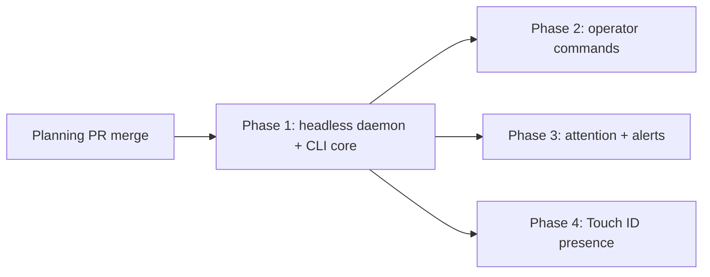

# Headless Mission Control: phased implementation

Source plan: [`plan.md`](plan.md) (`docs/plans/headless-mission-control/plan.md`). The source
plan is the requirement. This index and the phase files are the proposed route.

## Incorporated decisions

These come from the review of revision 1, and they are requirements, not open questions.

| Decision | Adopted |
|---|---|
| Operator surface | A CLI plus a skill for harnesses |
| Grant-gated actions headless | macOS Touch ID for all three (session control, resident launch, product-issue publishing). Chosen in chat. |
| Headless alerts | All three: `watch`, macOS notifications from the daemon, and a webhook or shell-command hook |
| Generic declarative harness | Left out |
| Follow-up | Phased implementation (this document) |

## Findings from the repository

- `launchMode` is computed at `src/server/index.ts:992` as `desktop`, `daemon` or `dev`, and
  `index.ts` never reads `process.argv`. `bin.mission-control` points at the raw `.ts` entry.
- `src/main/utility-supervisor.ts` imports `electron`'s `utilityProcess`, so it cannot be
  imported by the daemon. Only its restart policy (`Math.min(500 * restarts, 5000)`) is
  portable. Phase 1 extracts that policy into a module with no Electron import, and leaves the
  Electron supervisor in place.
- The session-control grant route is `PUT /api/sessions/:id/session-control`
  (`src/server/session-control.ts:113`). It already refuses agent callers
  (`sessionControlCallerRefusal`) and asks `authorize(...)`, which is injected
  (`src/server/routes.ts:1322`). That injection point is where Touch ID plugs in.
- The resident-launch grant is consumed by `ResidentManager.consumeLaunchClick`
  (`src/server/residents/manager.ts:612`). It does not gate the launch itself. It gates whether
  the run gets **Control other sessions**. An ungranted run still starts, without control.
- Product-issue publishing resolves through `resolveProductIssueAuthorization()`
  (`src/server/product-issue-authorization.ts:102`). It already has a command test seam,
  `MISSION_PRODUCT_ISSUE_AUTHORIZATION_CMD`.
- `foldAttention` (`src/web/lib/attention.ts:342`) depends on `stateDisplay` from
  `src/web/lib/format.ts`. Everything else it imports is already in `@shared`, so moving it
  into `src/shared/` is a move, not a rewrite.
- The Alerts setting is one global toggle, `ui.alerts.{notifications,sound}`
  (`src/shared/protocol.ts:4449`). It is not per-kind, and the source plan was corrected to
  match.
- Skills ship by adding a directory under `skills/`. `src/server/skills/reconcile.ts`
  installs each one as `mission-<name>` into every harness that supports skills.
- Bundles are listed for smoke checks in `scripts/smoke-bundles.mjs:500`. The MCP bundle
  (`build:mcp`) is the model for a new `build:cli`.
- Native addons are built per directory under `native/` (`keep-awake`, `state-lock`) and
  published through `publishNativeAddon`. `test/native-addon-publish.test.ts` enforces this.

## Sizing

The estimate is about 2,200 to 3,300 non-test lines of production code. It assumes:

- daemon mode, Foreman supervision and readiness: 300 to 450;
- the CLI framework and its operator commands: 900 to 1,300;
- the attention move, `/api/attention`, the event and the three alert sinks: 500 to 800;
- the Touch ID addon (Objective-C++, about 120), the presence authorizer, the three resolver
  hooks and the grant commands: 450 to 700.

That is well above the one-phase threshold, and the work splits along fixed contracts. Four
phases are used, because each of Phases 2, 3 and 4 is independently testable, consumes only the
CLI framework and the headless mode from Phase 1, and touches disjoint server files.

- **Why not three (merging 3 into 2)?** Phase 3 moves a hot dashboard module and needs a
  Playwright spec. Phase 2 has no UI surface. Combining them puts a UI regression risk into an
  otherwise pure CLI review and makes the change about 2,000 lines.
- **Why not merge 4 into 2?** Phase 4 is security-sensitive (a native addon and a new
  authorization signal) and deserves its own review. It is also the only macOS-specific work.

## Phases

| Phase | File | Delivers | Direct prerequisites |
|---|---|---|---|
| 1 | [`phase-1-headless-daemon-and-cli-core.md`](phase-1-headless-daemon-and-cli-core.md) | `headless` launch mode, daemon-supervised Foreman, readiness route, the `mission-control` CLI entry with `serve`/`status`/`doctor`/`logs`, typed client, command registry, the skill and doc skeletons | planning PR merge |
| 2 | [`phase-2-cli-operator-commands.md`](phase-2-cli-operator-commands.md) | sessions, control, tasks, review answer/approve/reject, plan show/decide, blocker, dialog, `config`, and the actor header | 1 |
| 3 | [`phase-3-server-attention-and-alerts.md`](phase-3-server-attention-and-alerts.md) | `foldAttention` in `src/shared/`, `GET /api/attention`, `attention_changed`, `inbox`/`watch`, macOS and outbound alert sinks | 1 |
| 4 | [`phase-4-touch-id-presence.md`](phase-4-touch-id-presence.md) | the `native/operator-presence` addon, `operator-presence.ts`, Touch ID for all three grants, and `grant`/`resident launch`/`issue publish` commands | 1 |

**Concurrency.** Phases 2, 3 and 4 may run at the same time and merge in any order once Phase 1
has merged.

**Merge order.** Phase 1 first. Then Phases 2, 3 and 4 in any order.

## Cross-phase contracts (owned by Phase 1)

1. **The command registry.** `src/cli/commands/<group>.ts` files each export a `CommandGroup`.
   `src/cli/commands/index.ts` lists them. A later phase adds a new group file plus one line
   in that index, and never edits another phase's group file. Merge conflicts are limited to
   that one array, one line per group.
2. **The client.** `src/cli/client.ts` exposes `request(method, path, {body, schema})` and
   `stream(path, onEvent)` (SSE). It reads the base URL from `BASE_URL` in
   `src/shared/harness-runtime.mjs`, and it sets the actor header through `actorHeaders()` in
   `src/cli/actor.ts`. Phase 1 owns `actor.ts` and its rule. Later phases call it and never
   reimplement it.
3. **Output.** `src/cli/output.ts` owns the `--json` switch, plain-text tables at 80 columns,
   and the exit codes: 0 for success, 1 for a refusal or error the daemon reported, 2 for usage,
   and 3 when the daemon is unreachable.
4. **The skill and docs skeleton.** `skills/headless/SKILL.md` and `docs/headless.md` have one
   `##` section per command group. Each phase adds only its own sections.
5. **`launchMode: "headless"`** is reported by `GET /api/health`. Phase 3 reads it to decide
   whether the macOS sink is active.

## Final verification (after all phases merge)

- `npm run typecheck`, `npm run lint`, `npm test`, `npm run build`, `npm run smoke`,
  `npm run test:e2e`.
- The source plan's manual acceptance script: with Electron closed, run `mission-control serve`,
  dispatch to Claude and to Pi, answer `request_input` from the CLI, approve a plan, and get a
  macOS notification and a webhook delivery. Then grant session control with Touch ID, and kill
  the session.

## Audit record

- Every source-plan section has exactly one owner:
  - section 1 belongs to Phase 1;
  - sections 2 and 5 are split: Phase 1 owns the framework, `serve`/`status`/`doctor`/`logs`,
    the actor rule and the skill skeleton, and Phase 2 owns the operator commands;
  - sections 3 and 4 belong to Phase 3;
  - section 6 belongs to Phase 4.
- The source plan names `inbox` and `watch` under section 2's table. They are owned by Phase 3,
  because both read `/api/attention`.
- `grant`, `resident launch` and `issue publish` are owned by Phase 4.
- The Touch ID behaviour for resident restarts, an operator-started launch only, is recorded
  in the source plan's Risks section and is owned by Phase 4.
