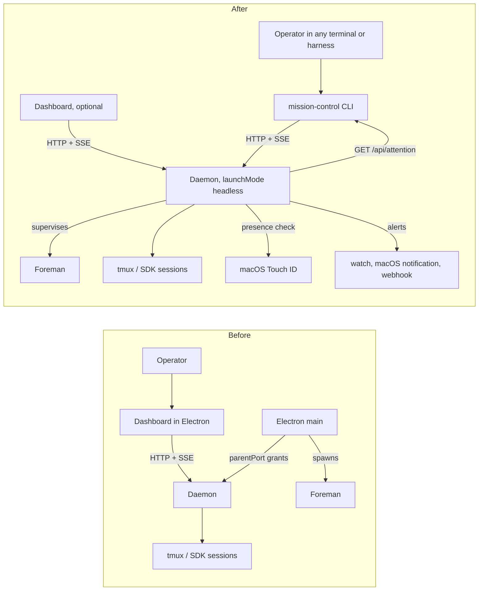

# Headless Mission Control

Today you open the dashboard to do Mission Control work. Dispatching a task, watching a
session, answering `request_input`, and approving a plan all happen in the React UI, which
usually runs inside the Electron shell. The goal of this plan is to make Mission Control fully
usable from a terminal, with no dashboard and no Electron, and to do it in a way that works
from any CLI harness (Claude Code, Codex, Pi, or a plain shell).

## What already works headless, and what does not

The daemon is less tied to the UI than it looks. The gaps are specific and short.

| Piece | Headless today? | Evidence |
|---|---|---|
| Daemon process | **Yes.** `npm start`, `make up`, and the LaunchAgent (`scripts/install-service.mjs` -> `scripts/start-service.mjs`) all run `src/server/index.ts` with no Electron. Electron adopts a healthy daemon instead of spawning one (`src/main/daemon.ts:9-37`). | `src/server/index.ts:862`, `:992` (`launchMode` is `desktop`, `daemon` or `dev`) |
| Agent sessions | **Yes.** tmux runs `new-session -d` and needs no window (`src/server/terminal/tmux.ts:511-520`). SDK runtimes need no terminal at all. | `docs/harnesses-and-terminals.md:211-215` |
| HTTP API and events | **Yes, on the same machine.** About 380 routes, SSE at `GET /events` and `GET /api/sessions/:id/transcript/stream`. `/api/*` asks only for a loopback `Host` (`src/server/routes.ts:1851-1862`). | `docs/event-stream.md` |
| Auth token | **Yes.** The daemon mints `~/.mission-control/token` itself. | `src/shared/harness-runtime.mjs:116-167` |
| Keep Awake | **Yes.** It lives in the daemon. | `src/server/keep-awake.ts:84` |
| Foreman worker | **No, not automatically.** Only Electron starts it (`src/main/index.ts:411` -> `src/main/foreman.ts:23`). `npm run foreman` works by hand. | heartbeat lease `/api/foreman/heartbeat` |
| Attention inbox | **No.** It is computed in the browser (`foldAttention`, `src/web/lib/attention.ts:342`). Only dismissals are persisted. | `docs/attention-and-alerts.md` |
| Alerts | **No.** They use the browser Notification API (`src/web/useNotifier.ts:28`). | |
| Session-control grant, resident-launch grant, product-issue publishing | **No, by design.** They need a trusted click carried over Electron's private `parentPort`. With no parent port the answer is always `false` (`src/server/session-control-authorization.ts:37-40`). | `docs/security.md` |
| Operator CLI | **No.** `bin.mission-control` points at the raw daemon entry, and nothing in `index.ts` reads `process.argv`. The only operator scripts are `scripts/new-session.mjs` (worktree lease) and `scripts/db-shell.mjs`. | `package.json` |

Every human-in-the-loop point already has an HTTP resolve route, so the server side is
complete. What is missing is a client for the terminal.

| Human-in-the-loop point | Stored in | Resolve route |
|---|---|---|
| `request_input`, `request_plan_decisions`, managed-plan approval | `reviews` table | `POST /api/reviews/:id/resolve` (approve, reject, answer, dismiss) |
| `report_blocker` | `session_blockers` | `POST /api/sessions/:id/blocker/reply`, `/blocker/clear` |
| SDK permission prompts, AskUserQuestion, Codex approvals | `session.dialog` (in memory, `src/server/sdk/dialog.ts`) | `POST /api/sessions/:id/select-option`, `/submit-options` |
| Work-queue approval | queue tables | `POST /api/sessions/:id/queue/:itemId/approve` |
| Inspector findings | | `GET /api/inspector/findings`, `POST /api/inspector/resolve-findings` |
| Workflow gates | | `/api/workflow-runs/:id/{retry,cancel,grant-rounds,resubmit}`, `/api/workflow-deliveries/:id/resolve` |

## Shape of the change

Six changes, all additive. The dashboard keeps working exactly as today and can attach to a
headless daemon at any time.

### 1. A headless launch mode that owns its Foreman

- Add a `headless` value to `launchMode` (`src/server/index.ts:992`). It is chosen by
  `mission-control serve` or by `MISSION_HEADLESS=1`, and it is reported by
  `GET /api/health`, so the dashboard and the CLI can tell which mode they are talking to.
- In headless mode the daemon supervises Foreman itself with `child_process.fork`, with the
  restart and backoff behaviour of `src/main/utility-supervisor.ts`. Extract the backoff policy
  into one shared module that both the Electron supervisor and the daemon import, so there is no
  second copy. The heartbeat lease stays the single source of truth for which worker acts. A
  worker that was started separately still wins or stands by exactly as it does today
  (`src/main/foreman.ts:17-21`).
- Serving the built SPA stays on when `dist/web` exists. Headless means "does not need a UI",
  not "refuses one".
- On start, run a readiness check and print it: tmux (or another multiplexer) is installed
  for terminal runtimes, the SDK runtimes that are enabled, the Mission MCP probe, the
  Foreman lease holder, and the token path. A missing multiplexer is a warning that names
  which harness runtimes still work (the SDK ones), not a refusal.
- `scripts/install-service.mjs` gains `--headless` so the LaunchAgent runs the same mode.

### 2. An operator CLI: `mission-control <command>`

- A new `src/cli/` entry, bundled to `dist/cli/mission-control.mjs` and pointed to by
  `package.json` `bin`. Running it with no subcommand keeps today's behaviour (it starts the
  daemon), so existing `bin` users see no change.
- A small typed client, `src/cli/client.ts`, parses every response with the Zod schemas that
  already live in `src/shared/protocol.ts`. It adds no new wire contract. If a command needs a
  route that does not exist yet, the route is added to the daemon with its schema in `shared/`.
- Commands (first cut):

| Group | Commands | Routes used |
|---|---|---|
| Daemon | `serve`, `status`, `doctor`, `logs` | `/api/health`, a new readiness route |
| Sessions | `ls`, `show <id>`, `tail <id>` (live transcript), `pane <id>`, `diff <id>` | `/api/sessions`, `/transcript/stream`, `/pane`, `/diff` |
| Control | `send <id> <text>`, `queue <id> <text>`, `interrupt`, `pause`, `resume`, `kill`, `pause-all` | `/send`, `/queue`, `/interrupt`, pause routes, `/kill` |
| Tasks | `task add`, `task ls`, `task dispatch <id>`, `task cancel` | `/api/tasks*` |
| Inbox | `inbox`, `answer <review-id>`, `approve` / `reject`, `blocker reply`, `dialog <session>` | the resolve routes in the table above |
| Plans | `plan show <id>` (Markdown in the terminal, plus the preview path), `plan decide <review-id>` | reviews and plan reads |
| Watch | `watch` (one live stream of attention changes) | `GET /events` |

- Every command takes `--json` for scripts and for agents. Human output is plain text that
  fits in 80 columns.
- `answer` and `plan decide` render a decision's options as a numbered list and take a choice
  as an argument (`--choice 2`) or interactively when stdin is a TTY. Free text is used only for
  open questions, the same rule the dashboard follows.
- Actor identity follows the existing rule (`src/server/session-control.ts:89-101`). When the
  CLI runs inside a session that Mission Control manages (a harness token or session id is
  present in its environment), it sends `x-mission-operation-actor: agent`. Operator-only actions
  are then refused there, exactly as they are for `curl` from that session today. From your own
  shell, it acts as the operator, which is the same trust the loopback dashboard has now.

### 3. Attention on the server, so a terminal can see what needs you

- Move `foldAttention` and the helpers it needs (`stateDisplay` from `src/web/lib/format.ts`)
  into `src/shared/attention.ts`, which stays browser-safe and has no `node:` imports. The
  dashboard imports it from there. There is one fold, not a web copy and a CLI copy.
- Add `GET /api/attention`, which folds the daemon's own snapshot with the persisted
  dismissals, and emit an `attention_changed` server event. Handle it exhaustively in
  `src/web/useEventStream.ts`, even though the dashboard keeps folding locally.
- `mission-control inbox` lists the items, and `mission-control watch` streams them.

### 4. Headless alerts on three channels

All three channels read the same daemon-side fold. The dashboard's Alerts setting
(`ui.alerts.notifications` in `app_config`, `src/shared/protocol.ts:4449`) is a single on/off
toggle, not a per-kind list, and it gates the macOS sink, so turning notifications off in the
dashboard turns them off headless too. A new
`src/server/alerts/` owns delivery, with one `AlertSink` per channel, and fires on
`attention_changed` transitions only (a new item, or one that moves into a louder state), never
on every snapshot.

- **`mission-control watch`.** Prints each transition as one line (and as NDJSON with `--json`).
  It works only while a terminal is running it.
- **macOS notifications from the daemon.** The daemon posts them with `osascript -e 'display
  notification ...'`, so no terminal has to stay open. This sink is enabled only when no
  dashboard is subscribed to `/events` (the CLI marks its own stream `?client=cli`), so you never
  get the same alert twice. It is inert on
  other platforms.
- **Webhook or shell-command hook.** Set in `app_config` under `alerts.outbound`: an HTTPS URL
  that receives a JSON POST, or a command that receives the same JSON on stdin. The payload
  carries the item kind, session or task title, and a short summary. It never carries
  transcript text or prompt bodies, because those can hold secrets. Each delivery has a 10 s
  timeout, one retry, and a failure log line, and a failed delivery never blocks the daemon. It
  is off until configured, and `mission-control alerts set` sets it.

### 5. Make any CLI harness able to drive it

The CLI is the harness-neutral surface. Any agent that can run a shell command can use it,
which covers Claude Code, Codex and Pi without registering a tool in each vendor's format
(Pi has no `mcp` slot today, `src/server/harness/index.ts`).

- Ship a skill at `skills/headless/` (installed as `mission-headless`) that teaches a harness the CLI: what to run, how to
  read `--json`, and which actions need the human. Install it through the existing skills path,
  so every harness with `skills` support gets it.
- The skill says plainly that answering a review or approving a plan is the human's job. The
  CLI enforces this through the actor rule above for managed sessions.

### 6. Touch ID for the three human-only grants

Three actions need proof that a person, not an agent, approved them: the session-control
grant, a resident launch, and product-issue publishing. `docs/security.md` sets the bar: "No
HTTP header, machine token or file can substitute for the private shell reply"
(`src/server/session-control-authorization.ts:36`). A CLI flag, a token file, or a TTY prompt
does not meet it, because an agent running as the same user can produce all three. Today the
only signal that does is a click in the desktop app, sent over Electron's private `parentPort`.
Headless, these three actions use a macOS Touch ID prompt instead.

**How it works.** The operator runs a CLI command, for example `mission-control grant
session-control <session>`, `mission-control resident launch <profile>`, or `mission-control
issue publish <draft>`. The daemon then shows a system Touch ID sheet whose text names the
exact action and target ("Allow session 'Fix login bug' to control other sessions"). The action
runs only if a finger on the sensor confirms it.

- **A native addon, `native/operator-presence/`**, built like `native/keep-awake/` and published
  only through `publishNativeAddon` (a rename, never a copy). It calls `LAContext
  evaluatePolicy` with `LAPolicyDeviceOwnerAuthenticationWithBiometrics`. That policy is
  biometrics only, with no password fallback, because a typed password is something
  automation can reproduce.
- **One authorizer, three callers.** `src/server/operator-presence.ts` exposes
  `authorizeWithPresence({ action, target, requestId })`. Each of the three resolvers
  (`sessionControlAuthorization`, the resident-launch authorizer, and
  `resolveProductIssueAuthorization` in `src/server/product-issue-authorization.ts:102`) chains
  the same way: the Electron `parentPort` when the desktop app owns the daemon, then Touch ID,
  then refuse. The existing `MISSION_PRODUCT_ISSUE_AUTHORIZATION_CMD` test seam keeps working,
  and there is one generic seam for tests in place of three.
- **It refuses rather than guesses.** Any of these returns `false` with a reason the CLI prints:
  no Touch ID hardware, biometrics not enrolled, a locked screen, the prompt cancelled, or a
  60 s timeout. Biometrics are also refused when the request arrives with no console session at
  the Mac, for example an SSH-only login, so nobody can approve it. Not macOS: refuse.
- **One prompt at a time, and attributed.** A second request while a prompt is open is refused,
  not queued. Requests are rate-limited to one every 10 s, so an agent cannot flood you with
  prompts hoping for a reflexive touch. Each prompt, and its result, is written to the audit log
  with the actor header of the request that caused it. The prompt text says when the request
  came from a managed session.
- **The desktop path does not change.** When Electron owns the daemon, the click is still the
  signal, and Touch ID is not consulted.

The residual risk is a prompt you did not ask for. An agent can call the route and make a
genuine Touch ID sheet appear. The mitigations are the exact action text, the rate limit, and
the "requested by a managed session" label. Touching the sensor is still a deliberate act by
the person at the Mac, which is the property the click had.

## Remote use

This plan assumes the CLI runs on the same machine as the daemon. The daemon stays bound to
`127.0.0.1` and keeps the `Host` check. Over SSH, `ssh -L 7317:127.0.0.1:7317` passes the
loopback `Host` check unchanged, so a laptop can drive a headless box with no daemon change.
A network listener is out of scope.

## Browser-only state that headless does not need

The durable UI settings already live in `app_config.ui` (`GET`/`PUT /api/ui/config`). What is
left in `localStorage` (last dispatch repo, selected workflow, storage-banner dismissal, tour
announcements, review drafts) is dashboard convenience. The CLI takes `--repo` and `--workflow`
explicitly, with defaults from `mission-control config`, which reads and writes `app_config`.
Nothing is migrated.

## Testing

- `test/`: a client test for each command group against the in-process HTTP app, Zod parsing
  of each response, the actor header inside and outside a managed session, the headless Foreman
  supervisor (restart, backoff, lease standby), and the moved attention fold. The existing fold
  tests move with it.
- `e2e/`: moving `foldAttention` changes a dashboard import. The rule in `AGENTS.md` applies, so
  a Playwright spec checks that the Attention inbox still lists a pending review and a blocker,
  and that dismissing one removes it.
- `test/`: the alert sinks (transition-only firing, a payload with no transcript text, webhook
  timeout and retry, the macOS sink silent while a dashboard is connected) and
  the presence authorizer (the parentPort-then-Touch-ID-then-refuse order, every refusal
  reason, one prompt at a time, the rate limit, and the audit record) through an injected fake
  of the addon. CI is Linux, so the real addon is never loaded there.
- `test/native-addon-publish.test.ts` covers the new addon builder, so it cannot copy onto
  `dist/native`.
- `npm run smoke` covers the new `dist/cli` bundle.
- A manual Touch ID check on a Mac: grant session control from the CLI, approve it once,
  cancel it once, and let it time out once.
- A manual acceptance script: start `mission-control serve` with Electron closed, dispatch a
  task to Claude and to Pi, answer a `request_input` from `mission-control answer`, approve a
  plan, and kill the session. No dashboard is opened.

## Documentation

- A new `docs/headless.md`: start modes, the CLI reference, the limits that remain, and SSH
  forwarding. Link it from `docs/README.md` and `docs/overview.md`.
- `docs/security.md` gains the actor rule for the CLI, the Touch ID presence signal (what it
  proves, when it refuses, and the unrequested-prompt risk), and the outbound alert payload.
- `docs/attention-and-alerts.md` gains the three headless channels.

## Risks

- **Two Foreman supervisors racing.** Electron adopting a headless daemon would start a second
  worker. This is already safe, because the lease decides and the loser idles as standby. Tests
  pin it.
- **The route surface is large.** The client covers the routes in the tables above, not all 380.
  More commands are added when they are needed.
- **Moving `foldAttention`** touches a hot dashboard path. It is a move with its tests, not a
  rewrite.
- **Touch ID prompts you did not ask for.** See section 6. The rate limit and the attributed
  prompt text are the mitigation, and they are tested.
- **Resident restarts and Touch ID.** A resident run that restarts on its own reuses
  `residentRestartRequestId(runId)` (`src/shared/session-control-authorization.ts`). Touch ID is
  shown only for a launch an operator started from the CLI, never for an automatic restart, so
  nobody gets a fingerprint prompt they did not cause. An automatic restart keeps whatever it
  gets today when no click is armed.
- **Outbound alerts leak data.** The payload is fixed to titles and kinds, and a test pins that
  no transcript or prompt text is included.

## Out of scope

- **A generic declarative harness** for CLIs Mission Control does not know yet (Gemini CLI,
  opencode, Aider). Decided: leave it out. Claude, Codex and Pi are the supported harnesses.
- **A network listener or remote auth.** SSH forwarding covers remote use.
- **Touch ID on other platforms.** Off macOS, the three grants refuse headless.

## Decisions adopted (review of revision 1)

1. **Operator surface:** a CLI plus a skill for harnesses (sections 2 and 5).
2. **Grant-gated actions headless:** a macOS Touch ID confirmation through a native helper
   (section 6). This was discussed in chat, and the operator chose Touch ID for all three
   actions.
3. **Headless alerts:** all three channels, which are `watch` output, macOS notifications from
   the daemon, and a webhook or shell-command hook (section 4).
4. **Generic declarative harness:** left out (see Out of scope).
5. **Follow-up:** create a phased implementation plan.
