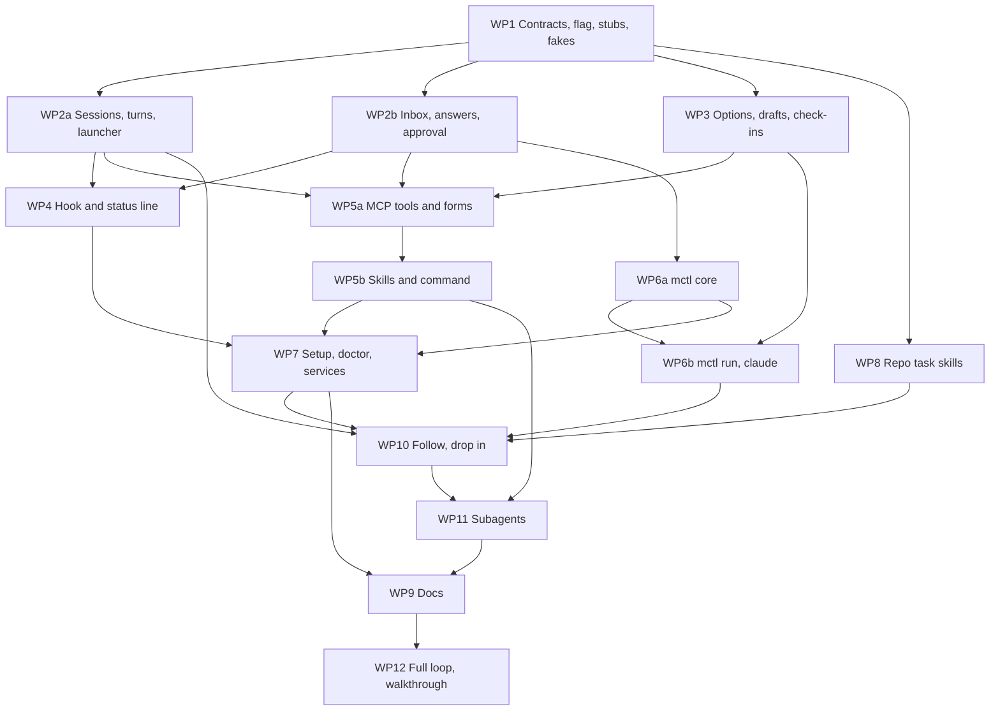

# Headless mode (FR-05): delivery plan

Source: Commonroom spec "FR-05 Headless Mode (CLI, MCP, Skills, Hooks)", version 3 (2026-11-19), spec id `d2cdf331-4f03-4c77-957d-246cfde0017c` in Commonroom workspace `3f6f4db8-da93-485b-aeb8-88c7bda98709` (read it with the Commonroom `get_spec` tool; Commonroom is the source of truth). This plan turns the spec's section 8 work breakdown into scheduled Mission Control tasks. It does not restate the spec's design; every task reads the spec.

Supersession: the spec states it replaces the earlier proof-of-concept specs. The older local plans `headless-mode`, `headless-mode-install` and `headless-mode-phases` are superseded by this plan and are not used as inputs.

## Adopted decisions (human, from the first review)

- **D-A Sequencing: stack on prerequisite branches.** Each phase task depends on its prerequisite tasks in `stack` mode, so a phase can start from its prerequisites' unmerged branches instead of waiting for them to merge. Every task also depends on the planning session so none starts before the plan artifacts are on `main`. Rebase onto `main` as prerequisites merge.
- **D-B Human-only packages: create a chat task for WP0.** The spikes S1 to S8 run as an interactive chat task with the owner at a terminal. WP12's live walkthrough remains the owner's, and the WP12 task writes the automated loop test and flag-off sweep.
- **D-C Harness and effort: Claude, launch-time defaults.** No model or effort override.
- **Follow-up: phased plan.** Phases are written in `phased-plan.md` and `phase-*.md` and scheduled as tasks.
- **Final bundle approval** was given for revision 1; this revision only records these decisions and adds the phase files.

## Hard requirement: the `headless-mode` flag

Everything this feature adds is gated by one `preview` flag, `headless-mode`, in `src/shared/feature-flag-registry.ts` (spec 7.1, rule 3.2). Off by default. Gates: `requireFeature("headless-mode")` on `/mcp/dispatch/*`, `featureEnabled` per operation (never cached at module load), `onFeatureFlagsChanged` for long-lived work. Never read `process.env` for it and never add a second mechanism. With the flag off, nothing visible changes and worker launches stay byte-identical. Every task carries this as an acceptance line, and every feature needs a flag-off and a flag-on test.

## Flow of work

## Scheduling approach

- One Mission Control task per work package, one pull request each, all targeting `main`.
- Each task depends on the tasks whose work it builds on (spec "Merges after"), in stack mode (D-A).
- WP1 depends only on this planning session. After WP1, WP2a, WP2b, WP3 and WP8 run in parallel (four agents).
- WP0 is a chat task with no dependencies (D-B).
- WP12's live walkthrough needs a person.

| Wave | Tasks | Builds on |
|---|---|---|
| 1 | WP1 | plan merged |
| 2 | WP2a, WP2b, WP3, WP8 | WP1 |
| 3 | WP4, WP5a, WP6a | WP4: WP2a+WP2b; WP5a: WP2a+WP2b+WP3; WP6a: WP2b |
| 4 | WP5b, WP6b | WP5b: WP5a; WP6b: WP6a+WP3 |
| 5 | WP7 | WP4, WP5b, WP6a |
| 6 | WP10, then WP11 | WP10: WP2a, WP6b, WP7, WP8; WP11: WP5b, WP10 |
| 7 | WP9, then WP12 | WP9: WP7, WP11; WP12: WP9 |

## Work packages

Full cards are in spec section 8.3 and the design in section 7. Per-package phase files are listed in `phased-plan.md`. "Owns" is the only set of files a package may edit (spec 8.1 rule 2).

| WP | Goal | Features | Spec sections | Owns |
|---|---|---|---|---|
| WP1 | Register `headless-mode`, all shared contracts, schema 35, route and tool stubs (501 while flag on), `mctl` command registry, build scripts and `bin`, fakes, flag-off tests | F1 | 2.3, 2.4, 3, 7.1, 7.18 | `feature-flag-registry.ts` (one entry), `src/shared/home-dispatch*.ts`, `src/server/db.ts`, `src/server/home-dispatch/routes.ts` and stubs, `src/mcp/home-dispatch/index.ts`, `src/server/mission-mcp.ts`, `src/cli/index.ts`, `src/cli/commands/index.ts`, package.json scripts and `bin`, `test/helpers/home-dispatch-fakes.ts` |
| WP2a | Home sessions, turn log, launcher decision, intent detector, hook route dispatch output | F3 F4 F10 F16 | 7.2, 7.3, 7.4, 7.9, 7.20 | `home-dispatch/sessions.ts, turns.ts, launcher.ts, hook-output.ts, intent.ts` |
| WP2b | Inbox, answers and receipts, plan approval, config view | F4 F5 | 7.7, 7.8, 7.9 | `home-dispatch/inbox.ts, answers.ts, approval.ts, config.ts`, `src/shared/home-dispatch-inbox.ts` |
| WP3 | Dispatch options, `kindAfterWork`, drafts, check-ins, banner text | F3 F4 F6 F16 | 7.5, 7.6, 7.7, 7.20 | `home-dispatch/options.ts, drafts.ts, checkins.ts`, `src/shared/dispatch-options.ts, after-work.ts`, import swap in `DispatchModal.tsx` |
| WP4 | Owned hook fields and output, status line segment and cache writer | F3 F4 F10 | 7.3, 7.12 | `hooks/harness-hook.mjs`, `hooks/harness-statusline.mjs`, `home-dispatch/statusline-cache.ts` |
| WP5a | The six MCP tools, forms, worker rule, live tool registration | F3 F4 F5 F10 F16 | 7.10, 7.18, 7.20 | `src/mcp/home-dispatch/*` |
| WP5b | `mission-dispatch` and `mission-checkin` skills, command, flag and harness gating of skill links | F3 F5 F16 | 7.11, 7.20 | `skills/dispatch/`, `skills/checkin/`, gating in `src/server/skills/reconcile.ts` |
| WP6a | `mctl` client and read commands | F6 | 7.13 | `src/cli/client.ts`, `commands/get, describe, logs, status, config` |
| WP6b | `mctl run`, `mctl claude` (no workspace), `mctl daemon` | F6 F3 | 7.13 | `commands/run, claude, daemon` |
| WP7 | `mctl setup` and `doctor`, Foreman LaunchAgent, shared MCP registration module | F2 | 7.14 | `commands/setup, doctor`, `scripts/install-service.mjs`, registration module |
| WP8 | Repository task skills in the worker's first prompt | F7 | 7.15 | `instructions/repo-task-skill.ts`, `composeTurnOne` in `dispatcher.ts` |
| WP10 | Terminal runtime for home-dispatched tasks, `mctl pick`, jump route, mux mirror, `mctl claude` workspace | F8 | 7.16 | runtime rule in `harnesses.ts`, one call site in `dispatcher.ts`, `commands/pick.ts`, `jump.ts`, `mux-mirror.ts` |
| WP11 | Briefer and kind subagents, `reconcileAgentLinks`, picker subagent lines | F9 | 7.17 | `agents/`, `skills/agent-links.ts`, `src/cli/pick-subagents.ts` |
| WP9 | `docs/headless-mode.md` and linked docs, alpha and security notes | F11 | 5, 7.19 | `docs/` |
| WP12 | Full-loop test, flag-off sweep | F12 F10 | 6 | `test/home-dispatch-loop.test.ts` |

## Rules every task brief carries

1. Read spec sections 1 to 6 and 8.1, then your card and only the section 7 parts it lists.
2. Gate with `headless-mode` as above. The spec's acceptance criteria for your features are the done bar, plus section 6's definition of done: relevant tests, `npm run typecheck`, `npm run lint`, and `build` and `smoke` when build surfaces change. Test titles start with the feature ID.
3. Respect AGENTS.md: no `data-testid`, no em dashes, never hand-edit generated files, schema changes only in `migrate()`, and only WP1 adds schema 35.
4. One owner per file. Hot files (`db.ts`, `routes.ts`, `mcp/server.ts`, `mission-mcp.ts`, `dispatcher.ts`, `reconcile.ts`, hooks, `install-service.mjs`, `docs/`) are touched only by their listed owner.
5. Contract changes after WP1 are additive only, in a separate commit titled `contract: ...`, and called out in the pull request.
6. Open questions Q1 to Q10 are never decided in a pull request; build to the spec's stated position. Where the code on `main` disagrees with the spec, `main` is right; say so in the pull request.
7. No visible dashboard change; dashboard guided-dispatch e2e specs pass unchanged.

## WP0 spike checklist (owner, on a real machine, run as a chat task)

S1 user-scope MCP sees `CLAUDE_CODE_SESSION_ID` and entrypoint (blocks WP5a). S2 elicitation forms from the user-scope server (WP5a). S3 `/mission-dispatch` invocable as a reconciler-linked skill, including `claude "/mission-dispatch"` (WP5b, WP6b). S4 agents link as `mission-briefer` (WP11). S5 exactly one Foreman leader with LaunchAgent plus app (WP7). S6 hook `systemMessage` and `additionalContext` shown on SessionStart and UserPromptSubmit (WP4). S7 `tools/list_changed` honoured mid-session (WP5a). S8 skill invoked for the 7.20 phrases, 20 phrasings by hand (WP5b). Record answers in the Commonroom spec.

## Open questions (build to the stated position)

Q1 gated approvals; Q2 "Enable all" includes it; Q3 restart a session opened before the flag was on; Q4 not required in v1; Q5 repo-wide inbox; Q6 keep `.claude/skills/{kind}`; Q7 checkout-only `mctl`; Q9 unchanged until FR-04; Q10 "schedule" means shelved. The owner closes these, not implementers.
