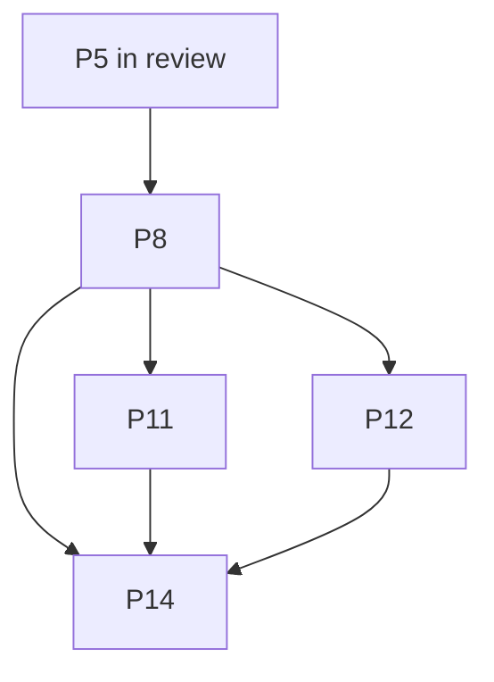
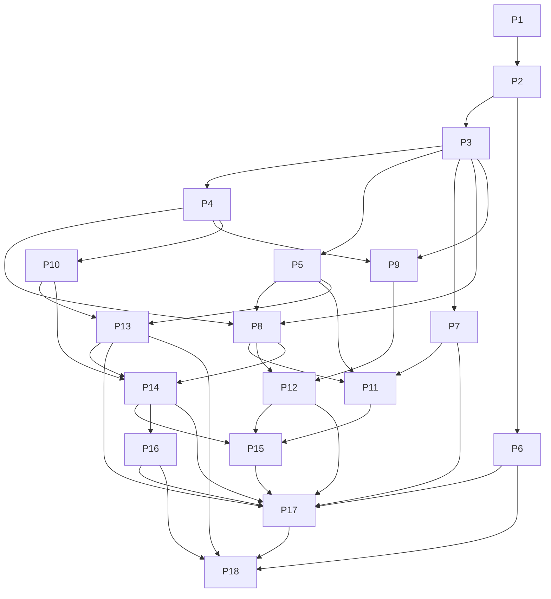

# FR-05 headless mode: minimal Claude-session E2E plan (phased, revision 18)

Source: `docs/plans/headless-mode-implementation/plan.md` (revision 18, section 0 is the minimal plan). Spec: Commonroom `d2cdf331-4f03-4c77-957d-246cfde0017c`, version 21, sha256 `1fd49cff22923784a63151d622d0bcc3b83729f912dce2b6530d059821f661c3`. Design: the round 2 design artifact (claude.ai artifact `2dJEKTxXd9Hzi9zDgDayZo`) and its spike review. The repository wins over the spec where they differ.

Goal: one real end-to-end test. A person opens Claude Code in a repository with the mod installed and no dashboard open. **The Mission Control pane shows their tasks as Claude launches.** They dispatch a task from the conversation, are signalled when something needs them (toast, status entry, band), answer or approve in the pane's Needs you tab, and the task runs to a result that the pane shows. The mod is the display. Everything else is deferred (section 6).

## 1. State of main

| Phase | State | Note |
|---|---|---|
| P1, P2, P3 | merged | flag, contracts, CLI and mod and pane skeleton, fakes, home sessions |
| P4 | merged (#1580) | read-only inbox, receipted answers, plan approval, `shaping` field (verified in plan.md 0.4). Its original backlog task shows cancelled; the PR is what counts. |
| P5 | in review (#1582) | dispatch options, drafts, banner builder. Treated as built. |
| P6 | in flight (#1565) | repository task skills. Not in this chain; merges on its own. |

## 2. Kept phases

One pull request per phase, to `main`, behind the `headless-mode` flag. No stacked branches: each phase branches from `main`. A later phase waits for its parent to merge, then runs `git rebase --onto origin/main <old base>`. Up to five phases run in parallel; this chain peaks at three.

| Phase | File | Minimum scope | Starts after | Merges after | Gate |
|---|---|---|---|---|---|
| P8 | `phase-8-mod-core-and-glance-layer.md` | mod adapter, host, client, flag following, inbox poll, toasts, band with its `1` button, status entry, banner, the real `paneOpen` and `paneClose`, **opens the pane at session start**, `mod-calls` smoke check | P5 merged | P5 | none (S14, S18, S19 soft) |
| P11 | `phase-11-mod-dispatch-flows-and-tool.md` | `/mission-dispatch` (fast path, description, confirm), `inbox`, `check` and `pane` arguments, `start_dispatch` tool, launcher part gated | P8 merged | P8 | S10 or S11 for the launcher part only |
| P12 | `phase-12-mission-control-pane.md` | the pane, cut to two tabs: **Needs you** (first) and **Tasks**; answer, approve and request changes in the pane; docked and inline forms | P8 merged | P8 | none (S21, S22 soft) |
| P14 | `phase-14-setup-doctor-and-mod-install.md` | `mctl setup` and `mctl doctor` reduced to: find `claude`, stage and install the mod, version probe, daemon and flag check; plus the Claude-session loop proof | P8 merged | P11 and P12 | none (S17, S18 soft) |

Dependency graph:

P14 starts with P11 and P12 (staging and install need only P8) and merges last. Its loop proof commit waits until both have merged, then P14 rebases with `git rebase --onto origin/main <old base>`. P14 is the last kept phase and owns the acceptance test (plan.md 0.3). The earlier draft of this plan used dialogs instead of the pane; the design review shows the pane works and a second overlay pane does not, so the dialogs phase is withdrawn.

## 3. What the person can do after each merged phase

- After P5 (built, not visible): the daemon can build dialog pages, drafts and a banner.
- After P8: with the mod loaded by hand (`claude --plugin-dir dist/mod/mission-control`, or the fake host), Claude launches with the banner and the pane open to a placeholder, and the mod follows the flag, polls the inbox, and shows toasts, the band with `1`, and the status entry.
- After P12: the pane shows what is happening as Claude launches: Needs you (waiting, blocked) first, then Tasks (running, ready, queued, with the workflow stage line). They answer a question, approve a plan (two presses, with the revision on the button) or request changes, in the pane.
- After P11: `/mission-dispatch` and the `start_dispatch` tool start a task; `/mission-dispatch inbox`, `check` and `pane` open the pane. The loop is complete for a hand-loaded mod.
- After P14: `mctl setup` installs the mod on a clean machine, `mctl doctor` names what is wrong, and the automated loop test runs. This is the real end-to-end state.

## 4. Rules for every phase

1. Re-read the spec version and sha256 above. If the spec moved past 21, stop and report.
2. Behind the `headless-mode` preview flag; flag-off tests prove no behavior change.
3. Do not touch `src/server/terminal/`, `src/server/actions.ts`, `src/mcp/server.ts`, `src/server/mission-mcp.ts`, `hooks/harness-hook.mjs` or `hooks/harness-statusline.mjs`. Nothing under `src/mod/`, `src/cli/` or `src/server/home-dispatch/` imports `src/server/terminal/`.
4. Tests use `node:test` and the fakes in `test/helpers/home-dispatch-fakes.ts`; no model tokens. The pane is drawn inside Claude Code, so its proof is fake-host tests plus `claude plugin test` run locally with output attached to the pull request.
5. One owner per file. A contract change only adds, in its own `contract:` commit.
6. No em dash in prose. No generated-file edits. No evidence artifacts committed.
7. Open a reviewable pull request through the pull-request skill and follow it to green CI.
8. A hard gate is satisfied only by the owner's answer posted to Commonroom. The only hard gate left is S10 or S11 for P11's launcher part: without it the launcher stays off and the rest of P11 merges. Soft spikes never block a merge; the pull request says which answers it used or that none was recorded.
9. Design rules from the spike review: no Alt+I and no second overlay pane (neither works in Claude Code 2.1.329); one pane, with Needs you as its first tab; the band's digit `1` button, `/mission-dispatch inbox` and `ctrl+x tab` then a letter reach it; the status entry is set only while something needs the person; plan approval is a focused button confirmed with Enter showing the revision; a visible Back button beside Esc.

## 5. Sizing

| Phase | Estimate (gross non-test lines) |
|---|---|
| P8 | 800 to 1,200 |
| P11 | 600 to 900 |
| P12 | 900 to 1,400 |
| P14 | 600 to 1,000 |

About 2,900 to 4,500 lines in four pull requests, down from about 6,700 to 10,900 lines in eight.

## 6. Later iterations (deferred, not deleted)

| Phase or part | Reason deferred |
|---|---|
| P6 repository task skills | In flight on its own (#1565); the loop works without repository skills. |
| P7 Codex readiness and fail-fast | The loop does not need Codex; P11's confirm omits the Codex line. Needs hard spike S27. |
| P9 residents and chat routes | Chat and follow in the pane, and the Residents tab, need transcript wrappers and a live residents route that do not exist; not in the loop. Needs hard spike S16. |
| P12 Workflows and Residents tabs, chat, follow | The pane ships with Needs you and Tasks; the other tabs follow P9 and the review field on inbox items. |
| P10 mctl client and read commands | The mod is the display; `mctl` reads are a second surface. P14 talks to `/api/health` directly. |
| P13 mctl run, claude and daemon | Terminal entry points, not the Claude-session loop. P14 owns its own `claude` detection in `src/cli/claude-cli.ts`. |
| P15 subagents and agents step | A nicety on top of the pane. |
| P16 app packaging of the mod | The person installs with `mctl setup` from a built tree; shipping inside the app comes later. |
| P17 docs | Written once the shape settles; each kept phase documents its own part. |
| P18 full loop and flag-off sweep | Replaced by P14's loop proof; the full sweep follows the later iterations. |

The old phase files stay in this folder with a DEFERRED banner. Their numbers are not reused.

---

# Archive: previous full phase plan (revision 16, superseded)

Kept for history. Nothing below schedules work. Where it disagrees with the sections above, the sections above win.

## FR-05 headless mode: phased implementation plan

Source: `docs/plans/headless-mode-implementation/plan.md` (revision 16). Spec: Commonroom `d2cdf331-4f03-4c77-957d-246cfde0017c`, version 18, sha256 `feece3821c5ef3ca868907c056b7fd6b87878c138c3ca881c90fd718d679e514`.

### 1. Incorporated decisions

- Jordan's constraint: dropping WP10 leaves the existing Focus feature untouched; guards 2 and 3 live in P1, guard 1 in P5, and all three in P18; the owner clarifies D50 in the spec.
- WP1 is two pull requests, P1 and P2.
- The "mods can load" checks are folded into P14 (WP7) and P8 (the `mod-calls` smoke check), as plan-local requirements without spec ids.
- S28 (FR-06 ledger and retro trigger) runs in two stages as two scout tasks that open no pull request; they are not phases.
- Spike answers live in task reports and Commonroom, with no results file in the repository.
- Review repairs (revision 4): widget placement is out of v1; P4 merges after P3; P8 owns `paneOpen` with a placeholder view that P12 replaces; P14 probes the installed mod version and reinstalls a stale build.
- Review repairs (revision 5): P7 merges after P3; P10's `logs` has defined interim behavior until P9 lands; P13's launcher handoff is defined (`mctl claude` starts plain Claude until P11 and P14); P17 merges after P13; a failed mod reinstall has an honest recovery path, with no rollback claimed.
- Review repairs (revision 6): P15 owns the one pane edit for subagent lines (the slot P12 reserves); S28a answers its questions on `main` and S28b's later findings land additively; P17 merges after P6 and P16.
- Review repairs (revision 7): P14 owns the one edit that makes the already-merged `mctl claude` use the shared `claude` detection (P14 now merges after P13). The subagent chain it also repaired is restated in revision 10.
- Review repairs (revision 9): P14 has one merge rule for the soft spikes S17 and S20 (warn until a recorded answer confirms the fact); P13's launcher outcome is conditional on P11's launcher being enabled.
- Review repairs (revision 10): a sweep by class. Named paths: routes use their spec 2.3 paths and per-task subagent data is the `subagents` field on inbox items (P4) and the transcript response (P9), formatted by P15's `subagentLines`. Gates: one hard rule and one soft rule, repeated. Conditionals: both branches of each spike-dependent outcome in each downstream phase.
- Review repairs (revision 11): S4 has a mergeable fallback; P14 uses one confirmation threshold (documentation alone never permits fail); P5 merges after P3 and P8 after P5; the plan carries a producer to consumer audit table.
- Review repairs (revision 12): plan 6.8 holds script-derived producer to consumer and spike tables; every unordered pair has a stated reason; P7's `codex` step has a defined interim before P14's commands exist.
- Review repairs (revision 13): the chat poll interval is stated once (1.5 s, or 3 s under S23); the runtime and Focus test (guard 1) is P5's, with guards 2 and 3 in P1 and all three repeated in P18.
- Review repairs (revision 14): the S19 fallback is P8's inert path (no daemon change is planned); an unanswered S23 uses 3 s and 30 rows; spikes run on throwaway kits; six merge waves with the order inside each stated.
- Review repairs (revision 15): two fresh-context reviews were run before saving and every finding was fixed in the same revision; the deviations table of `plan.md` section 9 records each frozen criterion the plan no longer matches literally.
- Review repairs (revision 8): a sweep of every file for stub, slot, optional-field and interim wording; P1 and P2 now name the owner of every route stub, CLI command, setup step, mod flow and pane; P12 names the fields its header and rows read; P15 names the source of the subagent events.

### 2. Findings from the repository

- `main` (`c2b873f6f`) has no `src/mod/`, `src/cli/` or `src/server/home-dispatch/`. Schema is 35, so schema 36 is free. There is no preview flag yet, so P1 owes the first-flag Settings-row browser assertion.
- Dashboard Focus exists and is unrelated to the withdrawn WP10: `POST /api/sessions/:id/focus`, `actions.focus`, `src/server/terminal/`.
- `src/server/environment/claude-managed.ts` exists with a narrow `MANAGED_ENV_KEYS` reader that P14 extends.
- No outcome ledger exists on `main`; S28 only investigates.
- Discrepancy with the brief: the spec is at version 18 (brief said 8), which adds WP18.

### 3. Rules for every phase

1. First re-read the spec version and sha256 above. If the spec moved past 18, stop and report.
2. Everything lands behind the `headless-mode` preview flag. Flag-off tests prove no behavior change.
3. Do not touch `src/server/terminal/`, `src/server/actions.ts`, `src/mcp/server.ts`, `src/server/mission-mcp.ts`, `hooks/harness-hook.mjs` or `hooks/harness-statusline.mjs`. Nothing under `src/mod/`, `src/cli/` or `src/server/home-dispatch/` imports `src/server/terminal/`, and only P9's `chat.ts` imports `sendText` (not `focus` or `raiseThrough`) from `src/server/actions.ts`.
4. Tests use `node:test` with the fakes in `test/helpers/home-dispatch-fakes.ts`; no model tokens; UI changes to the dashboard need a Playwright spec, and the mod pane is covered by fake-host tests.
5. One owner per file (spec 8.1). A contract change after P1 only adds, in its own `contract:` commit.
6. No em dash in prose. Do not hand-edit generated files. Do not commit evidence artifacts.
7. Open a reviewable pull request to `main` through the pull-request skill, and follow it until CI is green. Its merge releases dependents.
8. A merge gate is satisfied only by the owner's answer posted to Commonroom: read it, quote it in the pull request, and stop without merging the gated part if none exists (the whole phase, except that for P11 it is the launcher part only, and the rest of P11 then merges with the launcher switched off). The merge gates are S10 or S11 (the launcher part of P11), S16 (P9 and P12) and S27 (P7). Negative answers: if S10 and S11 both failed, the rest of P11 merges with the launcher off and the owner decides; if S16 and its `chat_first` fallback both fail, P9 and P12 wait for the owner; if S27 is false, record `CODEX_AUTH_MTIME_RELIABLE = false` and P7 merges with that behavior. An unrecorded hard gate also holds every phase that has the gated phase as a prerequisite.
9. Soft spikes never block a merge: when no answer is recorded the phase uses the fallback in plan 5.1 and its pull request says which answers it used or that none was recorded. The soft spikes are S4, S5, S8, S12, S14, S15, S17 to S26 (S18 and S19 included).

### 4. Sizing and phase count

Estimate, gross non-test production lines (documentation lines for P17):

| Phase | Estimate |
|---|---|
| P1 | 700 to 1,100 |
| P2 | 900 to 1,500 |
| P3 | 500 to 800 |
| P4 | 1,000 to 1,600 |
| P5 | 500 to 800 |
| P6 | 200 to 350 |
| P7 | 700 to 1,100 |
| P8 | 900 to 1,400 |
| P9 | 600 to 900 |
| P10 | 500 to 800 |
| P11 | 900 to 1,400 |
| P12 | 1,500 to 2,300 |
| P13 | 400 to 700 |
| P14 | 1,200 to 1,900 |
| P15 | 400 to 700 |
| P16 | 80 to 200 |
| P17 | 600 to 1,000 (docs) |
| P18 | 400 to 700 (integration tests and checks) |

Total about 11,000 to 18,500 production lines plus documentation. That is far above the 200-line single-phase threshold, and no mid-tier model can do it in one task. The phase count follows the approved plan and the spec's work packages, which are ownership boundaries (one owner per file) that let up to five phases run in parallel (wave 2). The 1,500-line cap of spec 8.1 rule 5 is advisory for these phases: P4, P12 and P14 estimate above it, each has one owner for its files, and the owner may split one if its pull request passes the cap, which adds a phase and a task.

Deviations from the "fewest phases" rubric, stated so they can be challenged:

- **P6** is about 200 to 350 lines. It stays separate because it owns the hot file `composeTurnOne`, which the task-shaping plan also edits, so it needs its own rebase and review.
- **P16** is under 200 lines. It stays separate because it changes a controlled release file (`electron-builder.yml`) and should be reviewed alone.
- **P17** (docs) and **P18** (integration proof) are not merged into earlier phases because the spec makes one owner of `docs/` and because the full-loop proof needs every user-facing package already on `main`. Each earlier phase still ships its own tests.

The run's frozen acceptance criteria that the plan no longer matches literally are recorded in the deviations table of `plan.md` section 9.

### 5. Phase table

| Phase | Spec WP | Direct merge prerequisites | Gate |
|---|---|---|---|
| P1 `phase-1-contracts-flag-and-server-seams` | WP1a | none | none |
| P2 `phase-2-cli-mod-pane-skeleton-and-fakes` | WP1b | P1 | none |
| P3 `phase-3-home-sessions-and-launcher-decision` | WP2a | P2 | none |
| P4 `phase-4-read-only-inbox-answers-and-approval` | WP2b | P3 | none |
| P5 `phase-5-dispatch-options-drafts-and-banner` | WP3 | P3 | none |
| P6 `phase-6-repository-task-skills` | WP8 | P2 | none |
| P7 `phase-7-codex-readiness-and-fail-fast` | WP18 | P3 | S27 recorded (hard); S24 to S26 (soft) |
| P8 `phase-8-mod-core-and-glance-layer` | WP13 | P3, P4, P5 | S14, S18, S19 (all soft) |
| P9 `phase-9-residents-and-chat-routes` | WP16 | P3, P4 | S16 (hard) |
| P10 `phase-10-mctl-client-and-reads` | WP6a | P4 | none |
| P11 `phase-11-mod-dispatch-flows-and-tool` | WP14 | P8, P5, P7 | S10 or S11 (hard, launcher part only); S8, S12, S15 (soft) |
| P12 `phase-12-mission-control-pane` | WP17 | P8, P9 | S16 (hard); S21 to S23 (soft) |
| P13 `phase-13-mctl-run-claude-daemon` | WP6b | P10, P5 | none |
| P14 `phase-14-setup-doctor-and-mod-install` | WP7 | P8, P10, P13 | S5, S14, S17, S18, S20 (all soft) |
| P15 `phase-15-subagents-and-agents-step` | WP11 | P11, P12, P14 | S4 (soft) |
| P16 `phase-16-app-packaging-of-the-mod` | WP15 | P14 | none |
| P17 `phase-17-docs` | WP9 | P14, P15, P12, P7, P13, P6, P16 | none |
| P18 `phase-18-full-loop-and-flag-off-sweep` | WP12 | P6, P13, P16, P17 | none |

P18 lists P6, P13, P16 and P17 directly because every other phase is already a transitive prerequisite of one of them.

### 6. Dependency graph, concurrency and merge order

The merge order is in six waves, with the required order inside each wave, in plan 6.2. Concurrency: after P2, P3 and P6 run together; P4, P5 and P7 follow P3. P8 follows P3, P4 and P5, P9 follows P3 and P4, and P10 follows P4, so they run together once those have merged. P11 to P13 run together once their prerequisites land, and P14 follows P13. P15 and P16 run together. P17 then P18 close the work. Every task also depends on the planning session, which releases them when its pull request merges the plan files.

### 7. Cross-phase contracts

- P1 owns every shared schema, route stub and schema 36. Later phases fill stubs and never change a stub's shape. Stub owners are listed in P1 section 9 (routes) and P2 section 9 (CLI commands, setup steps, mod flows and pane).
- P2 owns the fake daemon and the fake `claude`; each later phase adds its own fixture file and one registration line, and never edits P2's file otherwise.
- P3 owns home-session rules (spec 7.2); P4, P5, P7, P8 and P9 call them and never re-implement them.
- P4 owns `src/shared/home-dispatch-inbox.ts` (`workflowStages`, `residentLoopLabel`); P12 asks P4's owner for changes.
- P8 owns `src/mod/register.ts`, `host.ts` and `types/index.d.ts`; P11 and P12 add flows and panes with one registration line each; whichever of P11 and P12 merges second rebases, and the merge is mechanical.
- P14 owns `scripts/install-service.mjs` and the setup-step files except `agents.ts` (P15) and `codex.ts` (P7).
- Subagent lines: P1 declares `subagents` on inbox items and on the transcript response; P4 creates `src/server/home-dispatch/subagent-state.ts` and fills the inbox counts; P9 fills the transcript lines from it; P12 reserves two slots in `src/mod/pane/header.tsx`; P15 owns `src/shared/subagent-lines.ts` (`subagentLines`) and fills both slots, editing nothing else in the pane.
- P13 owns `src/cli/commands/claude.ts` and resolves `claude` from `PATH`; P14 owns `src/cli/claude-cli.ts` and the one edit that makes `mctl claude` call it.
- P8 owns `paneOpen` and `paneClose` with a placeholder view; P12 replaces the view and changes no signature.
- P14 owns the installed-version probe and stale-build reinstall; P16 relies on it.
- Home-dispatched tasks are created through the dashboard path with no runtime override (Focus guard 1).

### 8. Final verification

`npm run typecheck`, `npm run lint`, `npm test`, `npm run build`, `npm run smoke` and `npm run test:e2e` pass on `main` after P18; the flag-off sweep shows no behavior change; the Focus guards pass; the live walkthrough in P18 is done by a person.
