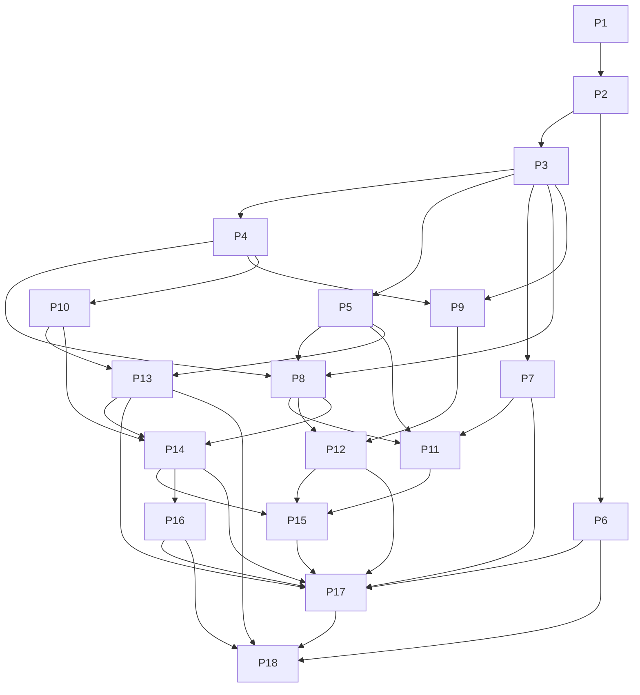

# FR-05 headless mode: phased implementation plan

Source: `docs/plans/headless-mode-implementation/plan.md` (revision 12). Spec: Commonroom `d2cdf331-4f03-4c77-957d-246cfde0017c`, version 18, sha256 `feece3821c5ef3ca868907c056b7fd6b87878c138c3ca881c90fd718d679e514`.

## 1. Incorporated decisions

- Jordan's constraint: dropping WP10 leaves the existing Focus feature untouched; three guards live in P1 and P18; the owner clarifies D50 in the spec.
- WP1 is two pull requests, P1 and P2.
- The "mods can load" checks are folded into P14 (WP7) and P8 (the `mod-calls` smoke check), as plan-local requirements without spec ids.
- S28 (FR-06 ledger and retro trigger) runs in two stages as two scout tasks that open no pull request; they are not phases.
- Spike answers live in task reports and Commonroom, with no results file in the repository.
- Review repairs (revision 4): widget placement is out of v1; P4 merges after P3; P8 owns `paneOpen` with a placeholder view that P12 replaces; P14 probes the installed mod version and reinstalls a stale build.
- Review repairs (revision 5): P7 merges after P3; P10's `logs` has defined interim behavior until P9 lands; P13's launcher handoff is defined (`mctl claude` starts plain Claude until P11 and P14); P17 merges after P13; a failed mod reinstall has an honest recovery path, with no rollback claimed.
- Review repairs (revision 6): P15 owns the one pane edit for subagent lines (the slot P12 reserves); S28a answers its questions on `main` and S28b's later findings land additively; P17 merges after P6 and P16.
- Review repairs (revision 7): P14 owns the one edit that makes the already-merged `mctl claude` use the shared `claude` detection (P14 now merges after P13). The subagent chain it also repaired is restated in revision 10.
- Review repairs (revision 9): P14 has one merge rule for the soft spikes S17 and S20 (warn until a recorded answer confirms the fact); P13's launcher outcome is conditional on P11's launcher being enabled.
- Review repairs (revision 10): a sweep by class. Named paths: routes use their spec 2.3 paths and per-task subagent data is the `subagents` field on inbox items (P4) and the transcript response (P9), formatted by P15's `subagentLines`. Gates: one hard rule and one soft rule, repeated. Conditionals: both branches of each spike-dependent outcome in each downstream phase.
- Review repairs (revision 11): S4 has a mergeable fallback; P14 uses one confirmation threshold (documentation alone never permits fail); P5 merges after P3 and P8 after P5; the plan carries a producer to consumer audit table.
- Review repairs (revision 12): plan 6.8 holds script-derived producer to consumer and spike tables; every unordered pair has a stated reason; P7's `codex` step has a defined interim before P14's commands exist.
- Review repairs (revision 8): a sweep of every file for stub, slot, optional-field and interim wording; P1 and P2 now name the owner of every route stub, CLI command, setup step, mod flow and pane; P12 names the fields its header and rows read; P15 names the source of the subagent events.

## 2. Findings from the repository

- `main` (`c2b873f6f`) has no `src/mod/`, `src/cli/` or `src/server/home-dispatch/`. Schema is 35, so schema 36 is free. There is no preview flag yet, so P1 owes the first-flag Settings-row browser assertion.
- Dashboard Focus exists and is unrelated to the withdrawn WP10: `POST /api/sessions/:id/focus`, `actions.focus`, `src/server/terminal/`.
- `src/server/environment/claude-managed.ts` exists with a narrow `MANAGED_ENV_KEYS` reader that P14 extends.
- No outcome ledger exists on `main`; S28 only investigates.
- Discrepancy with the brief: the spec is at version 18 (brief said 8), which adds WP18.

## 3. Rules for every phase

1. First re-read the spec version and sha256 above. If the spec moved past 18, stop and report.
2. Everything lands behind the `headless-mode` preview flag. Flag-off tests prove no behavior change.
3. Do not touch `src/server/terminal/`, `src/server/actions.ts`, `src/mcp/server.ts`, `src/server/mission-mcp.ts`, `hooks/harness-hook.mjs` or `hooks/harness-statusline.mjs`. Nothing under `src/mod/`, `src/cli/` or `src/server/home-dispatch/` imports the first two.
4. Tests use `node:test` with the fakes in `test/helpers/home-dispatch-fakes.ts`; no model tokens; UI changes to the dashboard need a Playwright spec, and the mod pane is covered by fake-host tests.
5. One owner per file (spec 8.1). A contract change after P1 only adds, in its own `contract:` commit.
6. No em dash in prose. Do not hand-edit generated files. Do not commit evidence artifacts.
7. Open a reviewable pull request to `main` through the pull-request skill, and follow it until CI is green. Its merge releases dependents.
8. A merge gate is satisfied only by the owner's answer posted to Commonroom: read it, quote it in the pull request, and stop without merging if none exists. The merge gates are S10 or S11 (the launcher part of P11), S16 (P9 and P12) and S27 (P7).
9. Soft spikes never block a merge: when no answer is recorded the phase uses the fallback in plan 5.1 and its pull request says which answers it used or that none was recorded. The soft spikes are S4, S5, S8, S12, S14, S15, S17 to S26 (S18 and S19 included).

## 4. Sizing and phase count

Estimate, gross non-test production lines (documentation lines for P17):

| Phase | Estimate |
|---|---|
| P1 | 700 to 1,100 |
| P2 | 900 to 1,500 |
| P3 | 500 to 800 |
| P4 | 1,000 to 1,600 |
| P5 | 500 to 800 |
| P6 | 200 to 350 |
| P7 | 700 to 1,100 |
| P8 | 900 to 1,400 |
| P9 | 600 to 900 |
| P10 | 500 to 800 |
| P11 | 900 to 1,400 |
| P12 | 1,500 to 2,300 |
| P13 | 400 to 700 |
| P14 | 1,200 to 1,900 |
| P15 | 400 to 700 |
| P16 | 80 to 200 |
| P17 | 600 to 1,000 (docs) |
| P18 | 400 to 700 (integration tests and checks) |

Total about 11,000 to 18,500 production lines plus documentation. That is far above the 200-line single-phase threshold, and no mid-tier model can do it in one task. The phase count follows the approved plan and the spec's work packages, which are ownership boundaries (one owner per file) that let up to 14 agents work in parallel.

Deviations from the "fewest phases" rubric, stated so they can be challenged:

- **P6** is about 200 to 350 lines. It stays separate because it owns the hot file `composeTurnOne`, which the task-shaping plan also edits, so it needs its own rebase and review.
- **P16** is under 200 lines. It stays separate because it changes a controlled release file (`electron-builder.yml`) and should be reviewed alone.
- **P17** (docs) and **P18** (integration proof) are not merged into earlier phases because the spec makes one owner of `docs/` and because the full-loop proof needs every user-facing package already on `main`. Each earlier phase still ships its own tests.

## 5. Phase table

| Phase | Spec WP | Direct merge prerequisites | Gate |
|---|---|---|---|
| P1 `phase-1-contracts-flag-and-server-seams` | WP1a | none | none |
| P2 `phase-2-cli-mod-pane-skeleton-and-fakes` | WP1b | P1 | none |
| P3 `phase-3-home-sessions-and-launcher-decision` | WP2a | P2 | none |
| P4 `phase-4-read-only-inbox-answers-and-approval` | WP2b | P3 | none |
| P5 `phase-5-dispatch-options-drafts-and-banner` | WP3 | P3 | none |
| P6 `phase-6-repository-task-skills` | WP8 | P2 | none |
| P7 `phase-7-codex-readiness-and-fail-fast` | WP18 | P3 | S27 recorded (hard); S24 to S26 (soft) |
| P8 `phase-8-mod-core-and-glance-layer` | WP13 | P3, P4, P5 | S14, S18, S19 (all soft) |
| P9 `phase-9-residents-and-chat-routes` | WP16 | P3, P4 | S16 (hard) |
| P10 `phase-10-mctl-client-and-reads` | WP6a | P4 | none |
| P11 `phase-11-mod-dispatch-flows-and-tool` | WP14 | P8, P5, P7 | S10 or S11 (hard, launcher part only); S8, S12, S15 (soft) |
| P12 `phase-12-mission-control-pane` | WP17 | P8, P9 | S16 (hard); S21 to S23 (soft) |
| P13 `phase-13-mctl-run-claude-daemon` | WP6b | P10, P5 | none |
| P14 `phase-14-setup-doctor-and-mod-install` | WP7 | P8, P10, P13 | S5, S14, S17, S18, S20 (all soft) |
| P15 `phase-15-subagents-and-agents-step` | WP11 | P11, P12, P14 | S4 (soft) |
| P16 `phase-16-app-packaging-of-the-mod` | WP15 | P14 | none |
| P17 `phase-17-docs` | WP9 | P14, P15, P12, P7, P13, P6, P16 | none |
| P18 `phase-18-full-loop-and-flag-off-sweep` | WP12 | P6, P13, P16, P17 | none |

P18 lists P6, P13, P16 and P17 directly because every other phase is already a transitive prerequisite of one of them.

## 6. Dependency graph, concurrency and merge order

Concurrency: after P2, P3 and P6 run together; P4, P5 and P7 follow P3. After P4, P8, P9 and P10 run together. P11 to P13 run together once their prerequisites land, and P14 follows P13. P15 and P16 run together. P17 then P18 close the work. Every task also depends on the planning session, which releases them when its pull request merges the plan files.

## 7. Cross-phase contracts

- P1 owns every shared schema, route stub and schema 36. Later phases fill stubs and never change a stub's shape. Stub owners are listed in P1 section 9 (routes) and P2 section 9 (CLI commands, setup steps, mod flows and pane).
- P2 owns the fakes. Later phases extend them additively.
- P3 owns home-session rules (spec 7.2); P4, P9 and P7 call them and never re-implement them.
- P4 owns `src/shared/home-dispatch-inbox.ts` (`workflowStages`, `residentLoopLabel`); P12 asks P4's owner for changes.
- P8 owns `src/mod/register.ts`, `host.ts`; P11 and P12 add flows and panes with one registration line each.
- P14 owns `scripts/install-service.mjs` and the setup-step files except `agents.ts` (P15) and `codex.ts` (P7).
- Subagent lines: P1 declares `subagents` on inbox items and on the transcript response; P4 creates `src/server/home-dispatch/subagent-state.ts` and fills the inbox counts; P9 fills the transcript lines from it; P12 reserves two slots in `src/mod/pane/header.tsx`; P15 owns `src/shared/subagent-lines.ts` (`subagentLines`) and fills both slots, editing nothing else in the pane.
- P13 owns `src/cli/commands/claude.ts` and resolves `claude` from `PATH`; P14 owns `src/cli/claude-cli.ts` and the one edit that makes `mctl claude` call it.
- P8 owns `paneOpen` and `paneClose` with a placeholder view; P12 replaces the view and changes no signature.
- P14 owns the installed-version probe and stale-build reinstall; P16 relies on it.
- Home-dispatched tasks are created through the dashboard path with no runtime override (Focus guard 1).

## 8. Final verification

`npm run typecheck`, `npm run lint`, `npm test`, `npm run build`, `npm run smoke` and `npm run test:e2e` pass on `main` after P18; the flag-off sweep shows no behavior change; the Focus guards pass; the live walkthrough in P18 is done by a person.
