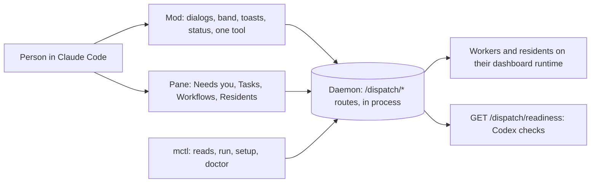
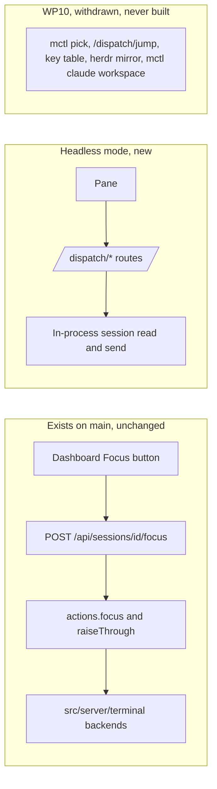
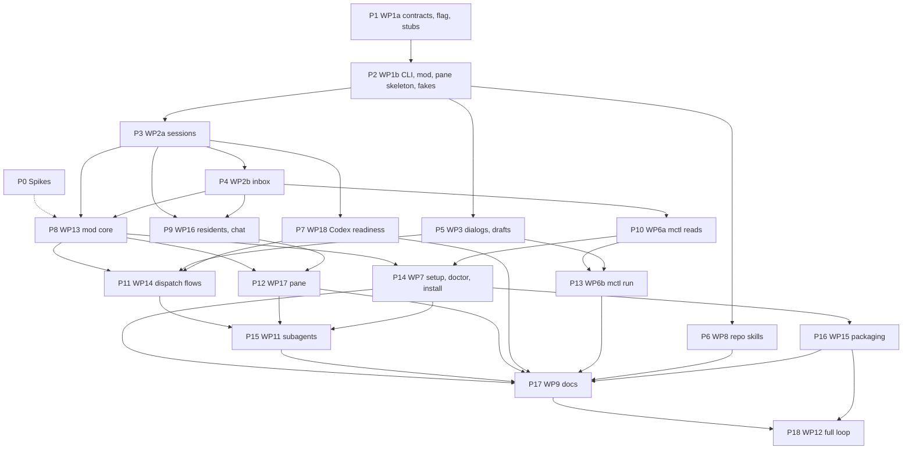

# FR-05 headless mode: implementation plan

| | |
|---|---|
| What this plan delivers | The dependency-ordered phases, spikes, and risks for building FR-05 headless mode (a Claude Code mod plus a natively drawn Mission Control pane, with `mctl`) on `main`, one pull request per phase, every change behind the `headless-mode` preview flag. |
| Spec | Commonroom, workspace Meta Harness, spec `d2cdf331-4f03-4c77-957d-246cfde0017c`, **version 18**, 236,444 characters, sha256 `feece3821c5ef3ca868907c056b7fd6b87878c138c3ca881c90fd718d679e514`. The spec, not this plan, is the contract: where they differ, the current spec version wins. |
| Base | `main` at `c2b873f6f`. It has no `src/mod/`, `src/cli/` or `src/server/home-dispatch/`, no preview flag in `src/shared/feature-flag-registry.ts`, and database schema 35 (`CURRENT_DATABASE_SCHEMA_VERSION`). |
| Not done here | No code, no edit to the spec, no post to Commonroom. Phase tasks go to the backlog and are not started. |
| Revision | 6. Revision 2 (approved) applied the owner's first-review choices: the "mods can load" checks are folded into WP7 and spike S17 (6.5), and spike answers are recorded in task reports and Commonroom, not in a repository file. Revision 3 added the phased implementation files. Revision 4 repairs the Plan Validation review (section 9): widget placement is out of v1, spike reports have one recording path, P4 now merges after P3, the pane-open handoff between P11 and P12 is safe, and the mod upgrade path has a version probe and a reinstall step. Revision 5 closes the second review round (section 9): the pane-open ownership wording, P7 after P3, interim behavior for P10's `logs` and P13's launcher handoff, P17 after P13, and an honest recovery path when a mod reinstall fails. Revision 6 closes the third round: P15 owns the one pane edit for subagent lines (a slot P12 reserves), S28's timing is stated for its two stages, and P17 merges after P6 and P16. |

## 1. Read this first: the brief and the spec disagree on the version

The request names spec "current version 8" and work packages WP0 to WP17. The spec is at **version 18**. Version 8 was the first publication of this design. Versions 9 to 18 repaired it and added the Codex review gate: F20, section 7.25, **WP18**, D54 to D57, L40 to L43, Q24 to Q26 and spikes S24 to S27. Every item the request names (section 7.10 and 7.10a, 7.22 to 7.24, WP0 to WP17 with WP10 withdrawn, 8.4, D44, D48 to D53, S17 to S23) is unchanged in meaning at version 18, so this plan covers version 18 and adds WP18 and its spikes. Planning against version 8 would leave out a work package that the merge order of WP14 and WP9 already depends on.

A phase task must re-read the spec's version and sha256 before it starts. If the spec has moved past 18, the task stops and reports the difference instead of building to a stale contract.

## 2. How this plan relates to the plans that already exist

| Plan | Where | Status | What this plan does with it |
|---|---|---|---|
| `headless-mode-native-pane` | `docs/plans/` on `main` (#1551) | Current. It tracks spec versions 8 to 18 (what changed and why). It has no phases. | Kept as is. This plan is its implementation counterpart. It is not a phase plan, and nothing here edits it. |
| `headless-agent-sdk` | `docs/plans/` on `main` | Unrelated: the Agent SDK transport for one-shot calls and the Foreman worker. | Name collision only. No dependency, and no phase touches it. |
| Headless mode delivery plan (spec v3, 15 phases including `wp10-follow-drop-in`, MCP tools and skills) | Local plan store | Superseded. It builds a terminal runtime, MCP tools and skills that D38, D42, D43 and D50 withdrew. | Not used. Its phase files are not scheduled. |
| Headless mode implementation phases (7 phases, older spec) | Local plan store | Superseded by the same decisions. | Not used. |
| Headless install plan that avoids conflicts (a named `spike` instance with its own state home) | Local plan store | Superseded by D28 and D44: the mod installs into the normal setup through the app-staged folder marketplace. | Not used. Its conflict list is a useful input to spike S17 only. |
| Headless mode spec and acceptance (old) | Local plan store | Superseded: the spec in Commonroom replaces both earlier specs. | Not used. |
| "`mctl setup` checks that Claude Code mods can load (FR-05 spec v12)" | Local plan store | **Id clash, resolved by owner decision.** It proposes spec edits (new decisions D54 to D58, a spike S25, setup checks for `disableAllHooks`, managed mod policy and the Claude Code version floor). Spec version 12 was published for the Codex gate instead, so those ids now mean something else in the spec (D54 to D57 and S25 are Codex's). The proposal was never merged into the spec. | **Folded into WP7 and spike S17** as plan-local requirements (6.5), by the owner's decision on the first review. They carry no spec ids: the phase task cites local plan `8065dbe0-950a-4572-b358-8e5b5489e69b`, revision 2, by its check names, until the owner renumbers them into the spec. |

Git history also shows that an earlier set of `docs/plans/headless-mode*` documents was removed from `main` (`c847dd69f`). Nothing in this plan depends on them.

## 3. What the build is, in one picture

The load-bearing facts, all from the spec:

- The mod calls only `/api/health` and `/dispatch/*`. It never calls another `/api/*` route (7.10).
- Answers, chat and approvals happen in the pane, over new `/dispatch/` wrappers that apply the home-session rules (D48, D49).
- The mod ships only inside Mission Control (D44), is staged by rename at `{stateDir}/mod/`, and is installed by `mctl setup` through a folder marketplace (7.10a).
- Nothing depends on tmux or herdr (D50).

## 4. Constraint 1: dropping WP10 must not affect the existing focus and pane-jump feature

Jordan's constraint, checked against D50 and against `main`.

### 4.1 What WP10 would have added, and what exists today

| | Exists on `main` today | WP10 would have added (all new, none on `main`) |
|---|---|---|
| The feature people use | Dashboard **Focus**: `POST /api/sessions/:id/focus` (`src/server/routes.ts`), `focus()` and `raiseThrough` in `src/server/actions.ts`, the terminal backends in `src/server/terminal/` (tmux, herdr, wezterm, iterm, cmux, ghostty), and Settings > Setup > Terminals "Opens in" (`docs/harnesses-and-terminals.md`, "Multiplexer focus terminal") | Nothing here. WP10 never touched it. |
| Headless jump | None | A terminal runtime for home-dispatched tasks, `mctl pick`, `POST /dispatch/jump`, the tmux key table, the herdr mirror, the `mctl claude` workspace, `tasks.origin_terminal`, `home_dispatch_sessions.terminal` |

D50 withdraws the right-hand column. The words "the jump route" in D50 mean the **new** `/dispatch/jump`, not `/api/sessions/:id/focus`. PR #1541, the only code ever written for WP10's neighbours, was closed unmerged (L39), so withdrawing WP10 removes no shipped code and changes no behavior that exists.

### 4.2 Verdict

**D50 does not affect the existing Focus feature.** It adds nothing to, and removes nothing from, any path Focus uses. Three things could still break it indirectly, and the plan closes each with a test rather than an assumption:

1. **Runtime resolution.** D50 says home-dispatched tasks keep the runtime a dashboard task of their kind gets. If a home-dispatched task ever passes a runtime override, it could land on a runtime Focus cannot raise. WP2a and WP6b must create tasks through the same path as the dashboard and pass no runtime. Test: a home-dispatched task of a kind whose default runtime is a terminal gets a pane, and `POST /api/sessions/:id/focus` on it returns what it returns for a dashboard task.
2. **The route-surface oracle.** WP1 regenerates the committed route-surface oracle (`test/route-surface-oracle.test.ts`). The regenerated diff must add `/dispatch/*` entries and change no existing `/api/*` entry. Test: a guard that fails if any `/api/sessions/:id/focus` or terminal route entry differs from `main`.
3. **Controlled paths.** `src/server/terminal/` and `src/server/actions.ts` are owned by no work package. Test: a guard that fails if any file under `src/mod/`, `src/cli/` or `src/server/home-dispatch/` imports from them, and the pull request template for every phase states that those paths are untouched.

### 4.3 What the user does lose, stated plainly

A headless user cannot jump from the pane to a worker's terminal pane. They chat in the pane, or press `d Open in the dashboard` and use the existing Focus button there. That is a smaller feature than version 7 promised, not a regression: it never existed. The plan's one suggested spec change, for the owner to apply and not for this plan to edit, is to write "the new `/dispatch/jump` route (not `/api/sessions/:id/focus`)" into D50 so no later reader mistakes the two.

## 5. Spikes, run first

The spec's WP0 says the spikes need a person at a terminal, and says to record answers in the spec. This plan does not edit the spec, and by the owner's decision it adds no results file to the repository. No spike opens a pull request. The person-run spikes (they need a managed Mac, several terminals or the desktop app) are written up by the person who ran them. The two agent-run spikes, S28a and S28b, are scout tasks whose final report is the write-up. In both cases the owner posts the answer to Commonroom. A gated phase task reads the recorded answer before it merges, and its pull request names the spike it relied on.

### 5.1 The gates and what they block

| Spike | Question (short) | Blocks | Gate? | If no |
|---|---|---|---|---|
| S10, S11 | Can the launcher open from `classic.SessionStart`, or hold the first prompt? | WP14 launcher | **Merge gate** | Owner decides; the rest of WP14 merges with the launcher off |
| S16 | Does a message through `/dispatch/tasks/{id}/send` reach a worker waiting on `request_input`; else does `chat_first` work? | WP16, WP17 | **Merge gate** | Owner decides how chat works |
| S27 | Does every `codex login` and `logout` change `auth.json`'s mtime? | WP18 | **Merge gate**, but either answer has a defined behavior (7.25) | Record `CODEX_AUTH_MTIME_RELIABLE = false` |
| S14, S17 | Do `marketplace add` and `install --scope user` run without prompts, here and on a managed Upstart Mac? | WP7, WP13 | Soft | `CLAUDE_CODE_PLUGIN_DIRS` through the settings installer, and ask the policy owner (Q19) |
| S18 | Does `/reload-plugins` load a restaged build with no `plugin update`, and does a fresh session after restaging show the new installed version in `claude plugin list`? | WP7, WP13 | Soft | Loading at session start is not enough on its own: P14 detects a stale installed version and reinstalls (6.5, `mod-current`) |
| S19 | Does a mod one `modApi` behind or ahead stay fully inert? | WP13 | Soft | The daemon hides the capability |
| S20 | Does `claude` detection find every install place, including from a LaunchAgent? | WP7 | Soft | Add the place, or `MISSION_CLAUDE_BIN` |
| S21 | Does the Esc, refuse, reopen-after-150-ms pattern keep the keyboard in iTerm2, Terminal.app, tmux and herdr, docked and inline, ten times? | WP17 | Soft | Esc hands the keyboard back; only Back returns to the list |
| S22 | Does the pane draw and take keys in the desktop app's local sessions and in VS Code? | WP17 | Soft | Terminal only in the alpha; the command says so |
| S23 | What do the 5 s inbox poll, 1.5 s chat poll and 50 items cost? | WP17 | Soft | Chat poll 3 s, Tasks tab capped at 30 rows |
| S4, S5, S8, S12, S15 | Agents as `subagent_type`, one Foreman leader, `start_dispatch` phrasing, `$.prompt.fill`, tool offer and withdrawal | WP11, WP7, WP14 | Soft | Per spec 11.2 |
| S24, S25, S26 | `codex login status` per account type, `codex` found from the LaunchAgent, model-id matching | WP18 | Soft | Per spec 11.2 |

### 5.2 S17 to S23, with the pass test a person runs

| Spike | Setup | Pass when | Evidence to record |
|---|---|---|---|
| S17 | A managed Upstart Mac with the real policy. Stage a build at `{stateDir}/mod/`. | `marketplace add` and `install --scope user` finish with no prompt; the mod loads in a terminal session, a desktop-app local session and a terminal worker | The commands, exit codes, `claude plugin list`, the policy files read, which of the 6.5 switches the policy sets and what each stopped, and what each surface showed |
| S18 | Stage build A, install, open a session. Stage build B over it by rename. | `/reload-plugins` loads B with no `plugin update`; `claude plugin list` shows B's version, in the same session after reload and in a fresh session; an open `$.ui.ask` survives | The two build versions, what `/reload-plugins` printed, and the installed version string `claude plugin list` shows before restaging, after reload and in a fresh session |
| S19 | Run mods with `modApi` one below `minModApi` and one above the daemon's | Exactly one notice; no dialog, tool, status entry, band or toast | A screen recording or transcript for each |
| S20 | Detect `claude` from a shell install, Homebrew, the native installer, the desktop app's embedded CLI if any, and from the app and LaunchAgent with a minimal `PATH` | Each finds the same `claude`; the first version that loads mods is recorded for Q20 | The detection output per place, with the version |
| S21 | Run the Esc pattern ten times in each of iTerm2, Terminal.app, tmux and herdr, docked and inline | Ten of ten keep the keyboard in the pane in every cell, or the failing cells are listed | A table of 8 cells by 10 runs |
| S22 | Open the pane in the desktop app's local sessions and in VS Code | It draws and takes keys on each, or the command's "terminal only" message is chosen | Screenshots (gitignored) and the verdict |
| S23 | A fake daemon with 50 inbox items and one open chat | Daemon CPU and the pane's redraw time stay within the budget the owner sets in the task report | CPU samples and redraw timings for 5 s and 1.5 s polls, and for 3 s as the fallback |

Run order: S17, S14, S20 first (they decide whether the install path stands), S10 and S11 and S16 next (the two merge gates that can stop a package), then the rest in parallel. S27 and S24 to S26 are independent and run beside them.

### 5.3 S28: outcome ledger and retro trigger for home-dispatched workers (FR-06)

This is the second explicit item in the request. The spec's section 12.2 says Mission Control keeps an FR-06 outcome ledger of every task end, and that FR-05 v2 will read it and let any harness report a finish, with shapes "not designed yet". FR-05 v1 builds none of that (D32). The spike's job is to find out whether a worker started from a home session can feed the ledger and be offered a retro, so that the contract needs no breaking change later. It runs in two stages (below). S28a runs on `main` and does not gate P1; it can answer questions 1, 4 and 5 and give a first reading of 6 from the planned schemas, so any additive field it recommends can go into P1 or P2 before they merge or, afterwards, into a `contract:` commit. S28b needs the inbox and chat routes, so it answers 2, 3 and the rest of 6 after P1 has merged; anything it finds is handled only by additive changes under the spec's rule that later contract changes only add (8.1 rule 3), never by reopening a v1 shape.

**What `main` shows (read, not assumed).**

- There is no outcome ledger. A search of `src/`, `docs/` and `.agents/` finds no `outcome ledger` or `task_outcomes` table. The only "ledger" hits are the spend ledger, the Inspector's ledger rows and workflow delivery ledgers.
- A retro is offered per session by `retroSummary` (`src/server/retro-worthiness.ts`) when a human turn exists beyond the opening brief (`corrections`) or the Inspector resolved findings (`findings`). It is started by `POST /api/sessions/:id/retro` (`src/server/retro.ts`), which types a packet into a live session, files a backlog task, or creates one post-merge follow-up task, and which is a person's action from the dashboard.
- `complete_retro_no_change`, `retroFollowupForSource` and `retroPrPostureForTask` carry the outcomes the ledger would list (lesson, no lesson).

**Questions the spike answers.** Each answer is a yes or no with a pointer to evidence.

1. **End signals.** For a home-dispatched task, which events mark the end (task status, session exit, pull request merge), and does each carry the task's origin so a ledger row could say it came from a home session?
2. **Corrections.** When a person answers through `POST /dispatch/answers`, or chats through `/dispatch/tasks/{id}/send`, does `retroSummary` see a correction? The send route delivers with origin `human`, so chat probably counts. An answer to a `request_input` question may not appear as a human turn. This is the most likely gap: a headless-only user could do all their steering in the pane and never make a task retro-worthy.
3. **Trigger surface.** With no dashboard open, nothing offers the retro. Where could it surface without breaking the pane's rule that nothing starts without the person's press (F19, D39): a Needs you item, a toast, or a Tasks row, and what does its press call?
4. **Delivery.** `POST /api/sessions/:id/retro` is an `/api` route, and the mod may not call it (7.10). Would the daemon need a `/dispatch/` wrapper, and which home-session rule (7.2) governs it?
5. **Field mapping.** Which of the ledger's fields (task, session, outcome of lesson, no-lesson or dismissed, review id, path, sha256, commit, pull request, merge sha, published-at) does Mission Control already hold for a home-dispatched task, and which would be new columns?
6. **Contract headroom.** Do the v1 shapes in WP1 (`src/shared/home-dispatch.ts`, the inbox item, the `tasks` origin) have room for an additive retro item and an outcome read, per the spec's rule that later contract changes only add (8.1 rule 3)?

**Two stages, because the second half needs code that does not exist yet.**

| Stage | When | Method | Output |
|---|---|---|---|
| S28a | Now, on `main`, beside the other spikes. A scout task (6.7). | Read-only code trace of questions 1, 4 and 5, plus a fake-agent run of an ordinary dashboard task to see exactly what `retroSummary` counts | A written result in the S28a task's final report, with file and line pointers, which the owner posts to Commonroom |
| S28b | After the inbox (WP2b) and chat routes (WP16) merge. A scout task (6.7). | A no-token run on the fakes in `e2e/fixtures/fake-agents.ts`: dispatch a home task, answer a question through `/dispatch/answers`, chat through `/send`, finish it, and read `retroSummary` and the retro routes | A written result in the S28b task's final report, which the owner posts to Commonroom: answers to questions 2, 3 and 6, a go or no-go on adding an additive retro item to the pane, and the list of fields FR-06 must add |

**Guardrails.** S28 writes no endpoint, table or pane item. It may recommend one additive field for a later `contract:` commit (8.1 rule 3). It records Q-style open items for the FR-06 owner rather than answering them.

## 6. The phases

One pull request each, to `main`, behind `headless-mode`; P0 opens none. Work package ids are the spec's. WP10 has no phase. "Starts after" says when an agent may begin against the stubs and fakes; "Merges after" says what must already be on `main`.

### 6.1 Phase table

| Phase | Work package | Goal | Starts after | Merges after | Gates |
|---|---|---|---|---|---|
| P0 | WP0 | Person-run spikes S4 to S27, with no pull request and no scheduled task (6.7); S28a is a scout task; each answer is posted to Commonroom by the owner | none | none | none |
| P1 | WP1a | The preview flag, shared contracts, schema 36, route stubs (501 while on), regenerated route oracle, flag-off tests, the Settings row browser assertion, and the Focus guard tests of 4.2 | none | none | none |
| P2 | WP1b | The CLI command registry, the mod and pane skeleton, `npm run build:mod`, the `PluginState` contract, and the fakes in `test/helpers/home-dispatch-fakes.ts` | P1 | P1 | none |
| P3 | WP2a | Home sessions, the registration answer, the launcher decision, the intent detector | P2 | P2 | none |
| P4 | WP2b | The read-only inbox, `blocked` state, `needsYouOrder`, `workflowStages`, `residentLoopLabel`, answers and receipts, plan approval, config view, reviewer rows. Calls P3's home-session predicate, so it merges after P3. | P2 | P3 | none |
| P5 | WP3 | Dialog pages, drafts, the banner builder, the shared `kindAfterWork` | P2 | P2 | none |
| P6 | WP8 | Repository task skills in `composeTurnOne` | P2 | P2 | none |
| P7 | WP18 | Codex readiness, `GET /dispatch/readiness`, the Codex setup step and doctor checks, the flag-gated fail-fast reviewer gate. Applies P3's home-session rules, so it merges after P3. | P2 | P3 | **S27 recorded**; S24 to S26 |
| P8 | WP13 | Mod core: adapter, `ModHost`, poll, toasts, the band and its `1` button, the status entry, the banner, the real `paneOpen` and `paneClose` host calls with a placeholder pane view until P12, and the `mod-calls` smoke check (6.5) | P2 | P3, P4, S14 | none |
| P9 | WP16 | Residents and chat routes, including the transcript stream | P2 | P3, P4 | **S16** |
| P10 | WP6a | `mctl` client and read commands. Until P9 lands, `mctl logs` reports that the transcript routes are not available yet (6.3). | P2 | P4 | none |
| P11 | WP14 | Dispatch flows, `start_dispatch`, the intent nudge, the confirm summary's Codex line. The `inbox`, `check`, `pane` and task-id arguments call P8's `paneOpen`, which shows a placeholder until P12 lands (6.3). | P2 | P8, P5, P7 | **S10 or S11**; S8, S12, S15 |
| P12 | WP17 | The pane: four tabs, item views, two-press approval, chat and follow, Residents, reviewer rows, and a reserved `subagentLines` header slot that P15 fills. Placements are dock and inline; the widget placement is v1.1 and falls back to the inline view (6.6). It replaces P8's placeholder. | P2 | P8, P9 | **S16**; S21, S22, S23 |
| P13 | WP6b | `mctl run`, `mctl claude` (starts Claude with no workspace and no added prompt; the launcher is P11's and appears once P11 and P14 are in, 6.3), `mctl daemon` | P2 | P10, P5 | none |
| P14 | WP7 | `mctl setup` and `doctor` (every step except agents and Codex), `claude` detection, the "Mods can load" step and its checks (6.5), mod staging, install and the stale-version reinstall, the Foreman LaunchAgent | P2 | P8, P10 | S5, S14, S17, S18, S20 |
| P15 | WP11 | The subagent line formatter and its one pane edit (filling P12's reserved header slot, with a rendered-pane test), the agents setup step and doctor check | P2 | P11, P12, P14 | S4 |
| P16 | WP15 | Packaging: the built mod ships outside `asar`, and the app stages it at start | P2 | P14 | none |
| P17 | WP9 | Docs | P2 (drafting) | P14, P15, P12, P7, P13, P6, P16 | none |
| P18 | WP12 | The full-loop test, the flag-off sweep, the no-multiplexer check, the context check, the live walkthrough | P2 | all | none |

Plus two scout tasks that open no pull request: **S28a** (starts with the plan) and **S28b** (after P4 and P9 merge). Each ends with a written final report (6.7).

Deviation from the spec: WP1 is split into P1 and P2 along its file list. It lands the flag, schema, every route, the CLI registry, the mod and pane skeleton, the build, and the fakes; the spec itself caps a pull request near 1,500 lines (8.1 rule 5) and WP1's file list is likely to pass it. P1 is contracts and server seams; P2 is the CLI, mod, pane and fakes. One owner per file is kept. The owner chose the split (section 8).

### 6.2 Merge order

Merge waves, in which phases inside a wave merge in any order:

| Wave | Phases |
|---|---|
| 1 | P1, then P2 |
| 2 | P3, P5, P6 |
| 3 | P4 and P7 (both after P3) |
| 4 | P8, P9, P10 |
| 5 | P11, P12, P13, P14 |
| 6 | P15, P16 |
| 7 | P17, then P18 |

### 6.3 Per-phase notes that the phase files must carry

- **Every phase.** Behind `headless-mode`; flag-off tests prove no behavior change; no edit to `src/server/terminal/`, `src/server/actions.ts`, `src/mcp/server.ts`, `src/server/mission-mcp.ts`, `hooks/harness-hook.mjs` or `hooks/harness-statusline.mjs` (D43, 4.2); tests use `node:test` and the fakes; no em dash in prose; no model tokens in any test.
- **P1.** Registers the flag as `preview`. Because it is the first real flag, it owes a Playwright assertion against the shipped registry that its Settings row appears and that toggling it changes a second window without reloading (`docs/feature-flags.md`, "Three pull requests per flag"). Uses schema 36 because `main` is at 35. Regenerates the route oracle and the diff adds only `/dispatch/*` entries.
- **P2.** Fakes serve the inbox, residents and transcript shapes. Later phases replace stubs and never change a stub's shape.
- **P5, P6.** P6 owns `composeTurnOne` in `src/server/dispatcher.ts`. The task-shaping plan's Phase 2 also edits `composeTurnOne` (spec 12.2), so P6 must be rebased onto whichever lands first, and its pull request names the other plan.
- **P7.** Merges after P3, whose home-session rules the readiness route applies. Owns the one flag-gated change to `src/server/workflows/engine.ts` and `src/server/llm/provider-failure.ts`. The pull request calls it out, adds a test that with the flag off every reviewer path keeps today's retries (Q25), and merges only after S27's answer is recorded as `CODEX_AUTH_MTIME_RELIABLE`.
- **P9 and P12.** Neither merges until S16 and its `chat_first` fallback are recorded. If both fail, they wait for the owner (8.1 rule 8).
- **P4.** Merges after P3. The inbox, answers and approval routes call P3's home-session predicate, so there is no interim state in which they run without it.
- **P8 and P11, the pane-open handoff.** P8 implements the real `paneOpen` and `paneClose` host calls (open id `mission`, focus, size, close) and draws a placeholder view reading `The Mission Control pane is not available in this build yet.` P11's `inbox`, `check`, `pane` and task-id arguments call `paneOpen` with the tab or task id and nothing else, so they work before P12 lands and show the placeholder. P11's exit check: with the fake host, each argument records one `paneOpen` with the right target, and no argument errors while the placeholder is in place. P12 replaces the placeholder and changes no call signature.
- **P10, `mctl logs` before P9.** The transcript routes are P1 stubs that answer 501 until P9 lands. `mctl logs` and `mctl logs -f` then print `the transcript routes are not available in this build yet`, exit 1 and do not retry. P10's tests cover that state against a daemon whose routes answer 501, and the real routes need no change to `mctl` once P9 merges.
- **P13, the launcher handoff.** `mctl claude` starts Claude with no workspace and no added prompt. The launcher is P11's and appears on its own once P11 and P14 (the mod install) are in, so before then `mctl claude` starts a plain Claude session. P13's exit check asserts that with a fake `claude` runner and no mod installed; the launcher's own acceptance belongs to P11.
- **P11.** The launcher part merges only when S10 or S11 passes; otherwise the rest of P11 merges with the launcher switched off.
- **P14 and P16, D44.** The mod ships only inside Mission Control. No pull request opens in claude-code-extensions. `src/server/mod-stage.ts` publishes by writing a sibling folder and renaming it, never by copying onto the published path (the rule CLAUDE.md sets for native addons). P16 changes `electron-builder.yml` by one named entry, and keeps `asar` off. `npm run smoke` runs `claude plugin validate dist/mod/mission-control` when `claude` is installed.
- **P14 and P16, upgrading an installed mod.** Staging a new build does not by itself change what `claude plugin list` shows, and the install step skips anything already listed. P14 therefore compares the installed version with the staged `plugin.json` version after staging, and if they differ it reinstalls (`claude plugin uninstall`, then marketplace add if needed, then install), never `claude plugin update` (D47). There is no rollback: uninstalling removes the old install and the staged folder already holds the new build. If the install after the uninstall fails, setup retries once. If it still fails, the mod may be left uninstalled, so setup prints the cause and the two recovery commands (`claude plugin marketplace add {stateDir}/mod`, `claude plugin install mission-control@mission-control --scope user`), finishes the other steps and exits 1, and doctor reports `mod-enabled` failed. The daemon keeps working and a session without the mod shows nothing. P14 tests the upgrade, and the double-failure path, against a fake `claude` runner with a stale installed version. P16 adds a test that an app-staged newer build makes doctor report the mod stale and `mctl setup` bring it current. S18 supplies the real-world evidence.
- **P12, placements.** Dock and inline only. The widget placement (the desktop app's small form) is v1.1 (6.6): when Claude Code reports `widget`, the pane draws the inline form, and no widget-specific layout, task or test exists in this plan.
- **P12.** The pane is drawn inside Claude Code, so Playwright cannot drive it. Its proof is the fake-host `node:test` files named in 7.22 and `claude plugin test` run locally, with output attached to the pull request (Q17). A Playwright spec is required only for a dashboard UI change, which is P1's Settings row.
- **P15 and P12, subagent lines.** P12 reserves one `subagentLines` slot in `src/mod/pane/header.tsx` and renders nothing in it. P15 creates `src/shared/subagent-lines.ts`, fills that slot and edits nothing else in the pane. P15's test renders the pane header with the fake host at 40, 71 and 120 columns, with and without lines, and P12's tests must still pass.
- **P17.** Docs list the pane, its keys, the `1` first-key note and residents, and say the pane's cost leaves out review calls (Q26). They also carry the mods troubleshooting section of 6.5.
- **P18.** The no-multiplexer check asserts nothing in headless mode requires tmux or herdr, and the Focus checks of 4.2 run again against the whole stack.

### 6.4 Gate recording, with no results file

Because spike answers live in task reports and Commonroom, a gate is satisfied only when the answer is posted there. The gated phase tasks (P7, P9, P11, P12) carry the gate in their task text and, before merging, read the owner's recorded answer through Commonroom and quote it in the pull request. If no answer is recorded, the task stops and reports that, and does not merge.

### 6.5 Folded in: "Mods can load" checks for WP7 (and one smoke check for WP13)

Source: local plan `8065dbe0-950a-4572-b358-8e5b5489e69b`, revision 2, folded in by the owner's decision. It was written as spec edits to version 11, so these requirements are **not in spec version 18**, and its decision and spike numbers are not used here. The Claude Code facts in it come from the Claude Code mods documentation and were not observed on a machine, so spike S17 and S20 confirm them.

**What it adds.** One setup step between finding `claude` and installing the mod, plus doctor lines. If a check marked fail does not pass, setup skips the mod install, prints each cause with its fix, finishes the other steps, and exits 1, as it does when no `claude` is found (D45). Setup never changes any of these switches, except the mod's own enabled state.

| Check | Looks at | Severity |
|---|---|---|
| `mods-version` | `claude --version` is at least 2.1.287 (the docs also give 2.1.286 for the desktop app) | fail below 2.1.287; warn below 2.1.327 until S20 fixes the floor (Q20) |
| `mods-user-switch` | `disableAllHooks` is not `true` in user, project or local settings | fail |
| `mods-managed-policy` | Managed settings set none of `allowManagedModsOnly`, `allowManagedHooksOnly`, `disableAllHooks`; a `strictKnownMarketplaces` list is reported | fail for the first three; warn for the list |
| `mods-sideload-policy` | Managed settings do not set `disableSideloadFlags` | fail |
| `mods-stale-env` | `CLAUDE_CODE_ENABLE_FUNCTION_HOOKS` is unset | warn |
| `mods-traffic` | Not `CLAUDE_CODE_DISABLE_NONESSENTIAL_TRAFFIC` set on a version below 2.1.288 | fail |
| `mods-can-load` | `claude plugin test` in an empty temporary folder says mods can load | fail |
| `mod-enabled` | `claude plugin list` shows `mission-control@mission-control` installed and enabled at user scope; setup installs or re-enables it, doctor fails | fail in doctor |
| `mod-current` | The version `claude plugin list` shows for `mission-control@mission-control` equals the staged `plugin.json` version. On a difference, setup reinstalls (6.3) and re-checks in a fresh `claude` invocation; doctor only reports | fail in doctor; setup fails only if the reinstall does not bring it current |
| `mod-calls` | `claude plugin validate {stateDir}/mod/mission-control` lists only allowed calls (`$.http.fetch`, `$.ui.*`, `$.session.append`, `$.command.register`, `$.tool.register`, `$.prompt.fill`, `$.state`, `$.clock`, `$.env.get`) | fail; also run by `npm run smoke` (P8) |

**Where it lives.** A second narrow allowlist beside `MANAGED_ENV_KEYS` in `src/server/environment/claude-managed.ts`, which exists on `main` today. A new probe module in `src/server/environment/`, and a step file in `src/cli/setup-steps/` that P14 owns. The probes read files read-only, run `claude` through the executable registry, and spend no model tokens. Nothing in the dashboard calls them.

**Two findings that reach beyond headless mode.** Reported by setup and doctor only, with no dashboard change:

- `disableAllHooks` also silences Mission Control's own hook and status line wrapper, which session discovery depends on, whether or not headless mode is on.
- `disableSideloadFlags` rejects `--mcp-config` at startup, and Mission Control passes it to the workers it dispatches (`askChannelArgs` in `src/server/ask-channel.ts`). This has been read in the docs and not seen on a machine; S17 checks it on a managed Mac.

**Out of scope.** `claude -p`, Agent SDK runs, `--bare`, `--safe-mode` and Codex's non-interactive runs: undefined behavior, covered by no check or doc beyond saying they are unsupported.

**Tests and docs.** A `test/home-dispatch-claude-mods.test.ts` runs every check against planted user, project, local and managed settings in a temporary home and a fixture managed root, with a fake `claude` runner, and asserts the planted files are unchanged. P17 adds a troubleshooting section, which includes the manual recovery commands, naming each switch, how doctor reports it, and its fix, and notes that disabling the mod in `/plugin` lasts only until the next `mctl setup`.

**What the owner still has to do.** Land these checks in the spec under new ids (D54 to D57 and S25 are taken), so the spec and the build agree. Until then P14's pull request cites this plan's check names.

### 6.6 What is not built

WP4, WP5a, WP5b and WP10 (withdrawn); FR-05 v2 shaping, context injection, skill routing and any outcome or retro endpoint (D32); the Settings > Setup install row (Q21); a push event stream (Q16); the widget placement (v1.1).

### 6.7 How the phases are scheduled

`phased-plan.md` and the `phase-*.md` files beside this plan carry the detail. Eighteen backlog implementation tasks are scheduled, one per phase P1 to P18, each depending on this planning session and on its direct merge prerequisites. Two more backlog tasks are scout tasks, which end with a final report and open no pull request: S28a (depends only on this planning session) and S28b (depends on P4 and P9 as well). Their reports are the written results the S28 rows promise, and the owner posts them to Commonroom. Nothing depends on a scout task, because a task that opens no pull request cannot release dependents.

The person-run spikes of P0 are not tasks: they need a managed Mac, several terminals or the desktop app. Each is written up by the person who runs it and posted to Commonroom by the owner. Gated phases carry their gate in the task text (6.4) and read that posted answer.

## 7. Risks

| # | Risk | Likelihood and effect | Mitigation |
|---|---|---|---|
| R1 | The spec keeps moving: 18 versions in about a day, and the brief was already stale | High. A phase built to an old version breaks at integration. | Pin the sha256 in this plan; every phase re-reads the version first and stops on a mismatch. |
| R2 | The Claude Code mod API behaves differently from its types (Esc, focus, placement, `$.ui.status`) | Medium. The pane's feel depends on L33 to L37, which are 2.1.329 observations, not guarantees. | S19 to S23 first; each has a stated fallback; P12 pins the version it was tested on. |
| R3 | Managed Claude Code policy blocks the folder marketplace or mods (Q19) | Medium for Upstart machines. P14 could finish and still not install. | S17 on a managed Mac before P14 starts; fallback `CLAUDE_CODE_PLUGIN_DIRS`; the "Mods can load" checks of 6.5 name the cause and the fix instead of failing silently. |
| R4 | A merge gate fails (S10 and S11, or S16) | Medium. F3 or F5 has no accepted behavior without it. | Gates are explicit in the table; the owner decides; the rest of the package still merges where the spec allows. |
| R5 | P1 is large and sits on the critical path | High. Every phase waits for it. | Split into P1 and P2; P1 is server seams only. |
| R6 | Parallel pull requests collide on hot files (`db.ts`, `routes.ts`, the route oracle, `register.ts`, `engine.ts`) | High with six agents at once. | Spec 8.1 hot-file owners; P1 stubs every route so later phases change values, not rows; each pull request rebases before merging. |
| R7 | The Codex fail-fast gate changes dashboard behavior | Medium. It sits in the shared workflow engine. | Flag-gated; a flag-off test proves today's retries; Q25 keeps dashboard tasks out of FR-05. |
| R8 | Existing Focus breaks indirectly (constraint 1) | Low, and the cost is high. | The three guards in 4.2, repeated in P18. |
| R9 | Headless-only users never reach a retro because pane answers are not "corrections" | Medium. FR-06's learning loop starves for home-dispatched work. | S28a on `main` now and S28b once the routes exist; later findings are additive contract changes; findings go to the FR-06 owner. |
| R10 | Poll cost with many items or several sessions (S23) | Low to medium. | The 3 s and 30-row fallbacks. |
| R11 | A worker's text reaches the model or forges an inbox line | Low if the renderer is shared. | One renderer with fences (7.18, L15); P12 and P18 test the context check (F18). |
| R12 | The mod cannot be tested in CI (Q17) | Certain. Adapter tests run locally only. | Flows are tested under `node:test` with the fake host in CI; local adapter output is attached to the pull request. |
| R13 | `composeTurnOne` is edited by two plans | Medium. | P6 rebases on whichever lands first and names the other plan. |
| R14 | Stale local plans are scheduled by mistake | Low, but wrong work would result. | Section 2 marks them superseded; only this plan's phases are scheduled. |
| R15 | The user expects a pane-to-terminal jump | Medium for tmux users. | Section 4.3 states the loss; the dashboard link and Focus remain. |
| R16 | P14 builds the 6.5 checks from a plan that is not in the spec, and from documentation facts nobody has observed | Medium. A check could fail a working machine, for example a wrong version floor. | P14 cites the check names, S17 and S20 confirm the floor and each switch before P14 merges, warns are used where a fact is unproven, and the owner lands the checks in the spec under new ids. |
| R17 | A gate answer lives only in a task report and Commonroom, so a phase task can miss or misread it | Medium. A gated pull request could merge on a stale or absent answer. | 6.4: the phase task names the spike in its text, quotes the recorded answer in its pull request, and stops if none exists. |
| R18 | An installed mod stays on an old build after a new one is staged, because install skips anything already listed | Medium. The pane or daemon routes could disagree with the mod (`modApi` inert path), and nothing says why. | `mod-current` check, a version probe after staging, a reinstall that retries once and otherwise leaves a printed recovery path (no rollback is claimed), tests in P14 and P16, and S18 evidence (6.3, 6.5). |

## 8. Decisions adopted

Asked as selectable decisions on revision 1, and recorded here. Choices that differed from the plan's recommendation are marked, and revision 2 applies them.

1. **Jordan's constraint and D50 wording.** Adopted: add the three Focus guards to P1 and P18, and ask the owner to clarify D50 in the spec ("the new `/dispatch/jump` route, not `/api/sessions/:id/focus`"). The owner applies the clarification; this plan does not edit the spec.
2. **WP1 as two pull requests.** Adopted: P1 contracts and server seams, then P2 CLI, mod and pane skeleton and fakes.
3. **The "mods can load" plan.** Adopted, **differing from the recommendation**: fold its checks into WP7 and spike S17 now (6.5), with no spec ids until the owner renumbers them.
4. **S28 scope.** Adopted: two stages, S28a now on `main` and S28b after the inbox and chat routes merge (5.3).
5. **Where spike answers live.** Adopted, **differing from the recommendation**: task reports and Commonroom only, with no results file in the repository (5 and 6.4).
6. **Phased follow-up.** Adopted: create the phased implementation plan, once this revision is approved.

## 9. Repairs after the Plan Validation review (revisions 4 to 6)

Revision 4:

| Finding | Repair | Where |
|---|---|---|
| Widget placement is out of v1 (6.6) but P12 listed it | P12 builds dock and inline only; `widget` falls back to inline | 6.1, 6.3, phase 12 |
| Spike reports had two recording paths, and S28a promised a task report while 6.7 said no task | S28a and S28b are scout tasks whose final reports carry the results; person-run spikes are written up by the person; all are posted to Commonroom; no repository file | 5, 5.3, 6.1, 6.7 |
| P4 consumed P3's home-session predicate but could merge first | P4 merges after P3 and the graph, waves and tasks say so | 6.1, 6.2, 6.3, phase 4 |
| P11's pane arguments called P12's open, with only a stub before it | P8 implements `paneOpen` with a placeholder view; P11 calls only `paneOpen`; P11 has an exit check for the interim state; P12 replaces the placeholder | 6.1, 6.3, phases 8, 11, 12 |
| No path for an installed mod to receive a restaged build | `mod-current` check, version probe after staging, reinstall (never `plugin update`) with a failure path, tests in P14 and P16, S18 extended | 5.1, 5.2, 6.3, 6.5, R18, phases 14 and 16 |

Revision 5, after the second review round:

| Finding | Repair | Where |
|---|---|---|
| P12 said P11 calls P12's open function, against the P8 `paneOpen` contract | P12 now says it replaces P8's placeholder behind the existing `paneOpen` call and adds no entry point | phase 12 |
| P7 applies P3's home-session rules but could merge first | P7 merges after P3; graph, waves, task and phase 7 updated | 6.1, 6.2, 6.3, phase 7 |
| P10 `mctl logs` could merge before P9's routes | Interim behavior defined and tested: the 501 stub gives a not-available message and exit 1, no retry | 6.1, 6.3, phase 10 |
| P13 promised a launcher that P11 builds | `mctl claude` starts plain Claude with no added prompt; the launcher is P11's and appears once P11 and P14 are in; exit check added | 6.1, 6.3, phase 13 |
| P17 documents P13's commands but could merge first | P17 merges after P13; graph and task updated | 6.1, 6.2, phase 17 |
| Reinstall recovery claimed the old install was kept, with no rollback step | No rollback is claimed: retry once, then print two recovery commands, exit 1, doctor reports `mod-enabled` failed; the double-failure path is tested | 6.3, 7 (R18), phase 14 |

Revision 6, after the third review round:

| Finding | Repair | Where |
|---|---|---|
| P15 promised subagent lines in the pane with no pane edit, and P12 merges first | P12 reserves a header slot; P15 owns the formatter and the one slot fill, with a rendered-pane test | 6.1, 6.3, phases 12 and 15 |
| S28 said it ran before WP1 froze contracts, but S28b runs after P4 and P9 | S28a does not gate P1 and answers questions 1, 4, 5 and a first reading of 6; S28b answers 2, 3 and the rest of 6 later; later findings are additive under 8.1 rule 3 | 5.3, R9 |
| P17 documents P3 to P16 but could merge before P6 and P16 | P6 and P16 are now prerequisites of P17; graph, table, phase 17 and the task updated | 6.1, 6.2, phase 17 |

No recorded human decision changed. Decision 5 (spike answers in task reports and Commonroom) is kept: reports are task reports where an agent ran the spike, and Commonroom posts everywhere.
