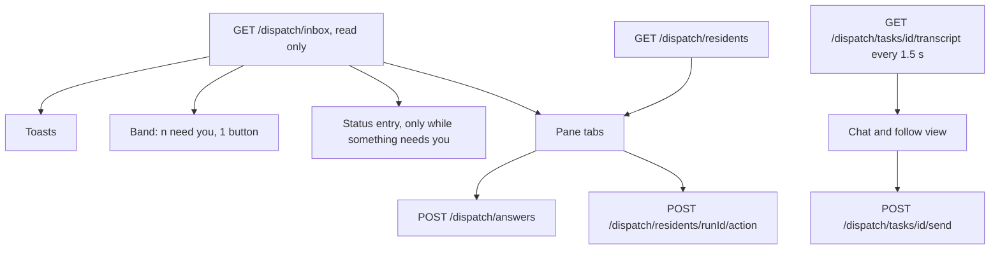

# FR-05 headless mode, spec versions 8 to 18: Mission Control drawn natively in Claude Code

| | |
|---|---|
| What this plan delivers | The current Commonroom spec "FR-05 Headless Mode (Claude Code mod, CLI)", version 18, rebuilt around the round 2 design, with acceptance criteria, contracts and work packages ready to build. Version 8 was the first publication; versions 9 to 11 are review repairs; version 12 added the Codex review gate; version 13 makes that gate consistent with the rest of the spec; versions 14 to 18 repair its readiness contract (section 10). This plan tracks the spec. The spec, not this plan, is the implementation contract: where they differ, the current spec version wins. |
| Spec | Commonroom, workspace Meta Harness, spec `d2cdf331-4f03-4c77-957d-246cfde0017c` |
| Base | Version 7, 157,764 characters, sha256 `4767b767...1db38` (verified before editing) |
| Current text | The complete version 18 text, 236,444 characters, sha256 `feece382...9e514`, at `.evidence/fr05-v8/spec-v18.md` (gitignored), with every earlier version and each repair script beside it |
| Design inputs | "Headless mode, round 2: Mission Control drawn natively inside Claude Code" (claude.ai artifact `2dJEKTxXd9Hzi9zDgDayZo`), and its linked "Round 2 Design Review" (`RJ3ixtnr45t7cQ3L7PbGjH`), both 2026-11-19 |
| Code checked | `main` at `d4cf02cb2`: session transcript and send routes, resident routes and `ResidentRunSummary`, `WORKFLOW_RUN_STATUSES`, the Claude Code 2.1.329 mod API types |
| Not done here | No code. Publication to Commonroom is done (section 8). |

## 1. What the person gets

Walking back from the design, which the request names as the final experience. Where a drawn frame and a tested replacement in the review differ, the review wins: there is no Alt+I hotkey and no overlay floating over the conversation.

1. **Glance.** While Claude keeps working, a toast says a worker asks a question. The band above the prompt reads `mission-control: 4 need you` with a `1` button. A plain status line carries the counts. Both go away when nothing needs the person.
2. **One pane.** `1` at an empty prompt, `/mission-dispatch inbox`, or the launcher's Check in opens the Mission Control pane. Claude Code draws it docked on the right when its fullscreen layout has room, and inline above the prompt otherwise. It is the same in iTerm2, Terminal.app, tmux and herdr.
3. **Four tabs.** Needs you (`i`), Tasks (`t`), Workflows (`w`) and Residents (`r`).
   - Needs you lists every decision, oldest first: task questions, plans and reviews to approve, and resident requests, then blocked workflow runs.
   - Tasks groups work as needs you, running (with slots), ready (with the PR and its checks), and queued and shelved counts.
   - Workflows shows each run's stage strip `start › work › review › pr › merge` with its checks and any blocked reason.
   - Residents shows each loop's state (working, waiting on you, waiting for wake, paused) with Run now and Pause or Resume.
4. **Answer in place.** A question's options are buttons `1` to `9`. Write an answer is a text field in the pane. A plan is approved by pressing Enter twice on a focused `Approve rev {hash}` button.
5. **Chat and come back.** Chat turns the pane into that worker's or resident's live conversation, read from the daemon, with the question pinned on top. The person's words go to the worker unchanged. Esc or Back returns to Needs you on the next item.
6. **Codex reviews (version 12).** When the after work reviews on Codex, the confirm summary says so. Unless `reviews ready` covers that workflow's reviewers, it shows one warning: a failed prerequisite, no recent reading, a failed review path, an unverified review path, or (if spike S27 finds account switches can be invisible) reviews verified earlier for a named account, each with its fix. Start now always stays (v15, v17). The Workflows tab shows one row per reviewer with its model, state and time. A reviewer that fails because Codex is missing or signed out blocks the run at once with the fix, instead of retrying for up to 10 minutes. `mctl setup` and `mctl doctor` check the Codex prerequisites where the reviews run, with no model tokens, and report `Codex can start`. Only `mctl doctor --live`, one real reviewer call per pinned model through the reviewers' own runner, reports `reviews ready` (v14). That result is cleared when the Codex version, the account, or any reviewer's model or transport changes (v15). A mod read still starts no process: it spots a changed binary or sign-in by checking file timestamps, and until `mctl` re-reads Codex, the confirm says `Codex not checked recently` instead of claiming ready (v16). One cache age, 10 minutes, applies everywhere (v17). If S27 finds account switches can be invisible, every `mctl` read re-checks the sign-in, even within that age, so `mctl doctor` reports `reviews ready` only for the account it just read (v18).
7. **Unchanged from version 7:** the launcher, the dispatch dialogs, the description, the confirm, `start_dispatch`, the banner, `mctl` reads and runs, repository task skills, and subagents. Since version 10 the launcher ships only when spike S10 or S11 passes (section 10).

## 2. Architecture change

The load-bearing change is where answers and chat travel. In version 7, answers went through dialogs and notices, and chat switched the person's terminal into the worker's tmux or herdr pane. In version 8, both stay inside Claude Code's pane and travel over new `/dispatch/` wrappers.

```mermaid
flowchart LR
  subgraph Before[Version 7]
    P1[Person] -- dialogs and notices --> M1[Mod]
    M1 -- mctl pick --jump --> T1[tmux or herdr]
    T1 -- switch client --> W1[Worker's terminal pane]
    D1[(Daemon)] -- terminal runtime --> W1
  end
  subgraph After[Version 8]
    P2[Person] -- pane: Needs you, Tasks, Workflows, Residents --> M2[Mod]
    M2 -- /dispatch/inbox, answers, residents --> D2[(Daemon)]
    M2 -- /dispatch/tasks/id/transcript and send --> D2
    D2 -- in-process session read and send --> W2[Worker or resident, any runtime]
  end
```



## 3. Components: added, changed, removed

| Area | Versions 8 to 18 | Change from version 7 |
|---|---|---|
| Mod: pane | `$.ui.open({ id: "mission" })` drawn by one `ui.render` hook on `Pane`, branching on `placement` (dock, inline, widget) and sized to `bodyColumns`. `ui.close` hook for Esc to Back. Source in `src/mod/pane/`. | **New** (7.22 to 7.24) |
| Mod: band | `ui.render` on `AbovePrompt`: the banner until the first prompt, then `{n} need you` with a `Button` hotkey `1`, only while something needs the person. Coloured text, never a coloured row. | Replaces the waiting row |
| Mod: status entry | `$.ui.status` set only while something needs the person, plain text, cleared otherwise. | S13 answered (L37) |
| Mod: toasts | Adds resident requests and blocked runs. Never held by the pane. | Extended |
| Mod: dialogs | Dispatch only (launcher, kind, after work, repo, confirm). | Answers and approvals moved to the pane |
| Mod: command | `inbox` (alias `check`), `pane`, `{taskId}` open the pane. | `pick` and `answer {taskId} {text}` withdrawn |
| Mod: state | `$.state` atoms in a `PluginState` contract: tab, view, selection, armed approval, chat cursor, snapshots. | Extended |
| Mod: hooks not used | `prompt.edit` (Alt never reaches it, L32); `ui.press` (buttons carry their handlers). | Recorded |
| Daemon: inbox | `GET /dispatch/inbox` is read only and returns items with `pending` (question, options, revision, summary, link), `run` (workflow slug, version, status, phase, step, checks, blocked reason), `pr` checks, `canMessage`, resident requests, a `blocked` state and `needsYouOrder` (by age, not type: waiting items oldest first, then blocked, v11). Every approvable item carries a `revisionHash` (v10). | Rewritten (7.7) |
| Daemon: residents | `GET /dispatch/residents`, `POST /dispatch/residents/{runId}/{run-now, pause, resume}`, in process over existing resident code. | **New** (7.24) |
| Daemon: chat | `GET /dispatch/tasks/{taskId}/transcript?since=`, `GET /dispatch/tasks/{taskId}/transcript/stream` (read only, for `mctl logs -f`, v11) and `POST /dispatch/tasks/{taskId}/send`, in process over the existing session routes, under the home-session rules. `mctl` may read and stream, never send (v10). | **New** (7.23) |
| Daemon: Codex readiness | `GET /dispatch/readiness[?live=1]` returns the `CodexReadiness` shape (v13): whether Codex is required, the enabled workflows with Codex reviewers, the checks with their fixes, `canStart`, the last `reviewPath` result and `reviewsReady` (v14). A mod read never probes: it returns the cache, marked `stale` or empty. Only `mctl` refreshes a stale cache, and `live=1` (`mctl doctor --live`) runs the reviewer-path check (v14). The result is keyed to the enabled reviewer set (`reviewerSet`, each distinct model and transport), and cleared when that set, the Codex version or the account changes (v15). A mod read detects those changes without a process: the reviewer set in process, the `codex` binary and `$CODEX_HOME/auth.json` by `stat` (the file is never opened). A detected change marks the cache stale and clears the review path until `mctl` re-reads Codex (v16). | **New** (7.25, v12) |
| Daemon: Codex fail fast | While the flag is on, a reviewer call on Codex that fails because Codex is missing or signed out blocks the run at once with the fix. One gate in `src/server/workflows/engine.ts`, owned by WP18. | **New** (7.25, D57) |
| Daemon: withdrawn | `POST /dispatch/checkins`, `POST /dispatch/jump`. | Withdrawn |
| Dispatcher and runtime | Home-dispatched tasks keep the dashboard runtime for their kind. No terminal runtime, `homeTerminalFromEnv`, `origin_terminal`, tmux key table, herdr mirror, `mctl pick` or `mctl claude` workspace. | Withdrawn (D50) |
| Data | No new tables. `origin_terminal` and `home_dispatch_sessions.terminal` are not added. | Smaller |
| MCP contract | Unchanged. No MCP tool, server or form is added. The `mission-control` server's tool list is identical. The mod still adds one sentence to `create_task`'s description in a home session. The mod never spawns Codex or any other agent CLI (D54). | Restated in 2.3 |
| Owned hooks | `hooks/harness-hook.mjs` and the status line wrapper unchanged in v1 (D43). D53 amends D43 only for how attention is shown, so this still holds. | Unchanged |
| Skills | None for Claude (D42). Agents `mission-briefer`, `mission-explorer` and `mission-reviewer` unchanged. Subagent lines move from the picker to the pane (`src/shared/subagent-lines.ts`). | Picker gone |
| Setup skills | `mctl setup` and `doctor` run an ordered list of steps (`src/cli/setup-steps/`, WP1). WP7 owns every step but agents and Codex. WP11 owns the agents step and its doctor check (v10), and WP18 owns the Codex step and its doctor checks (v12). F2 is accepted only once WP11 and WP18 merge (v13). `--off` no longer unbinds tmux, and the config view drops `dispatch.multiplexer`. Mod staging and install (7.10a) are unchanged. | Changed (v10) |

## 4. Acceptance criteria, by feature

The draft rewrites these features. Every other feature keeps its version 7 criteria, with references updated.

| Feature | Versions 8 to 18 |
|---|---|
| F2 | Accepted once WP11 adds the agents step and WP18 the Codex step, each with its doctor checks; WP7 delivers the rest of setup (v10, v13) |
| F3 | Check in on my tasks opens the pane on Needs you. The launcher has an S10 or S11 merge gate, with no fallback that lets a first prompt reach the model (v10) |
| F4 | Rewritten: toasts within one poll; band and status entry only while something needs the person; "needs you" defined as waiting plus blocked; one inbox response behind every surface |
| F5 | Rewritten: pick, write an answer and chat all in the pane; two-press `Approve rev {hash}` for plans, diff reviews and plain plan reviews (v10); receipts; chat while a question is pending, through the `chat_first` fallback and an S16 merge gate (v10); who may answer includes this repository's residents and residents with no repository (v9) |
| F6 | `mctl logs` reads, and `logs -f` streams, the authorized transcript routes; several messages in one session appear as they arrive (v10, v11) |
| F8 | Replaced: "Follow workers and residents from the pane": Tasks, Workflows and Residents tabs, a live follow view, workers on their dashboard runtime, no multiplexer |
| F9 | Subagent lines in the pane instead of the picker |
| F10 | Adds that workers get no pane and cannot read or message others, and that nothing touches the person's terminal |
| F11 | Docs add the pane, its keys, the `1` first-key note and residents |
| F12 | The full loop covers an answer from the pane, a chat message, and a resident question |
| F18 | The pane, chat transcripts and chat messages never reach the model; measured after a chat |
| F19 | **New**: one pane, four tabs, the opening routes, docked or inline, Needs you in age order (v11), safe keys, agreement with every other surface, invisible to the model, never holds toasts |
| F20 | **New** (v12): Codex reviews are ready, visible and fail fast. Readiness in two levels: zero-token prerequisites in setup and doctor (`Codex can start`), and `reviews ready` only after `mctl doctor --live` passes for the current reviewer set (v14, v15); the confirm warning in six defined states (v15, v17); reviewer rows in the Workflows tab; the harness mark (`codex · headless`); fail fast on a missing or signed-out Codex; the mod never spawns Codex |

## 5. Work packages

| WP | Versions 8 to 18 |
|---|---|
| WP1 | A new pull request from the latest `main`, because PR #1541 closed unmerged (8.4). It also stubs the new routes and the pane, and its fakes serve the new shapes. |
| WP2b | Adds the read-only inbox fields, the `blocked` state, `workflowStages`, `residentLoopLabel` and resident answers |
| WP3 | Loses check-ins |
| WP10 | Withdrawn (D50) |
| WP7 | Every setup and doctor step except agents (WP11, v10) and Codex (WP18, v13) |
| WP11 | Subagent lines for the pane, plus the agents setup step and doctor check; merges after WP7, WP14 and WP17 (v10) |
| WP13 | Adds the `Pane` and `ui.close` seams, the `PluginState` contract, the band and the quiet status entry |
| WP14 | Dispatch flows only; the pane-opening arguments call WP17. The launcher merges only behind the S10 or S11 gate (v10). Draws the confirm summary's Codex line from the readiness route, so it merges after WP18 (v13) |
| **WP16** | **New**: residents and chat routes, including the transcript stream (`src/server/home-dispatch/residents.ts`, `chat.ts`); merges behind the S16 gate |
| **WP17** | **New**: the pane (`src/mod/pane/*`), including the reviewer rows and harness mark (v12) |
| **WP18** | **New** (v12): Codex readiness, `GET /dispatch/readiness`, the Codex setup step and doctor checks, and the fail-fast gate. Merges after WP1 only, in wave 2. WP14 and WP9 merge after it (v13) |

Merge waves: (1) WP1; (2) WP2a, WP2b, WP3, WP8, WP18; (3) WP13, WP16, WP6a; (4) WP14, WP17, WP6b, WP7; (5) WP11, WP15; (6) WP9, then WP12.

## 6. Decisions, lessons, questions and spikes

- **New decisions**:
  - D48: one pane with four tabs replaces check-in, and every answer happens in it.
  - D49: chat inside the pane over `/dispatch/` wrappers.
  - D50: nothing depends on tmux or herdr.
  - D51: residents are in scope.
  - D52: how the pane opens, with no Alt hotkey.
  - D53: two-press approvals and a quiet glance layer.
  - D54 to D57 (v12): only the daemon starts Codex; reviewer calls stay one-shots tracked as rows; readiness is checked in the daemon with no tokens; a missing or signed-out Codex fails fast.
  - D21 and D22 are withdrawn by D50. D26 is amended by D48, D39 by D48, D49 and D53, and D43 by D53. D53 changes only how attention is shown, so D43's rule that the owned hook, the `mission-control` MCP server and the status line wrapper are unchanged in v1 still holds. No ID is renumbered.
- **New lessons** L32 to L39 record the round 2 spike results and the facts about `main` above. L40 to L43 (v12) record the Codex headless scout.
- **Questions:** Q14 is closed. Q22 (Restart from the terminal) and Q23 (full tool calls in chat) are new, each with a position until decided. Q24 (refuse Start now when Codex is not ready: no, warn), Q25 (fail fast with the flag off: not in FR-05) and Q26 (record reviewer spend: not in v1) came with v12.
- **Spikes:**
  - S13 is answered.
  - S12 now covers the description only.
  - S16 is rewritten for chat over `/send`, with a `chat_first` fallback, and is a merge gate for WP16 and WP17 (v10).
  - S10 and S11 are a merge gate for the launcher (v10).
  - S21 (Esc pattern robustness), S22 (desktop app and VS Code) and S23 (poll cost) are new.
  - S24 (sign-in reporting per account type), S25 (finding `codex` from the LaunchAgent) and S26 (model id matching) came with v12, for WP18.
  - S27 (does every sign-in change `auth.json`'s mtime) came with v16. Since v17 it is a merge gate for WP18, and either answer has a defined behavior: if no, mod reads never claim `reviews ready`, and every `mctl` read re-checks the account (v18).

## 7. Choices for you

These were asked as selectable decisions in the dashboard on revision 1. You picked the recommended option for all four, chose **Stop after this plan** for the phased follow-up, and approved the bundle.

1. **Terminal runtime (D50).** Recommended: withdraw WP10 from v1. The design says nothing depends on tmux or herdr, and chat no longer needs a pane. The alternative keeps WP10 and F8's jump as an optional v1 extra.
2. **Residents with no repository (D51).** Recommended: show them in every home session, since built-in residents such as Agent Shepherd may have no repository. The alternative shows only residents attached to this repository.
3. **When the pane opens (D52).** Recommended: only when asked, because an unasked open is placed only from 144 columns and would surprise people. The alternative also opens it at a fresh start when something already needs the person.
4. **How version 8 lands in Commonroom.** Recommended: publish it as version 8 directly, as versions 1 to 7 were. The alternative files it as a proposal for a person to accept on the website.

## 8. Publication (done)

1. The chosen options were applied to the draft: the sources of D50 to D52 read "Human, 2026-11-19 (plan review)".
2. The spec was confirmed to still be version 7 with the same sha256.
3. Version 8 was published directly, with 191 exact edits and a summary naming D48 to D53, F19, WP16, WP17 and the withdrawals.
4. Its stored sha256 (`b237e7ef...`) matched the draft.
5. An announcement thread on the spec links the design and lists what changed.
6. Versions 9, 10 and 11 were published the same way, each from the version before it. Each stored sha256 matched its local build (section 10).
7. Version 12 was published from version 11 by another session, from the Codex headless scout. This session read it back, verified its sha256 against the stored one, and diffed it against version 11.
8. Version 13 was published from version 12 by this session, and its stored sha256 matched the local build.
9. Version 14 was published from version 13 the same way, after the next Plan Validation review.
10. Version 15 was published from version 14 the same way, after the review that followed.
11. Version 16 was published from version 15 the same way, after the next review.
12. Version 17 was published from version 16 the same way, after the review that followed.
13. Version 18 was published from version 17 the same way, after the next review.

## 9. Verification already run

- The version 7 text was assembled from three range reads, and its sha256 matched the one Commonroom reports.
- The draft is produced by one script (`build_v8.py`) from that text. Every edit must match exactly once, or the build stops. The script checks that there are no em dashes.
- The heading outline was compared before and after. Only the intended headings changed or were added: F8, F19, 7.7, 7.11, 7.12, 7.16, 7.22 to 7.24 and 8.4.
- The design's code claims were checked against `main`:
  - transcript at `src/server/routes.ts:4657` and send at `:6117`;
  - resident run actions in `src/server/residents/routes.ts`;
  - `ResidentLoopState` in `src/shared/residents.ts`;
  - `WORKFLOW_RUN_STATUSES` in `src/shared/workflow.ts:2426`.
- The mod API names (`closeOnEscape`, `holdToasts`, `placement`, `bodyColumns`, `ui.close` refusal by answering without `next`, `Button` `hotkey`, `Input`) were checked against the Claude Code 2.1.329 types.
- Stale terms were searched for: check-in, waiting row, `mctl pick`, `M-h` and multiplexer. Each remaining use is a withdrawal note or a historical decision.

## 10. Changes after version 8 (spec versions 9 to 18)

Versions 9 to 11 are repairs from the Plan Validation workflow. Version 12 came from another session. Version 13 is this session's review of version 12. Versions 14 to 18 are Plan Validation repairs. Each was published from the version before it, and each stored sha256 was checked.

| Version | sha256 | Repairs |
|---|---|---|
| 9 | `d805b03f...` | **Residents with no repository (D51).** They can now be read, answered, chatted with, run, paused and resumed from any home session. Updated: 7.2, 7.7, 7.8, 7.23, 7.24, F4, F5, F8, F19 and the F8 tests. |
| 10 | `ebc5fad9...` | **Five repairs:** (1) `mctl logs` reads an authorized transcript route, and the send route refuses `mctl`. (2) Every review approval is a two-press `Approve rev {hash}`, and `approve_review` carries `revisionHash`. (3) The agents setup step and its doctor check move to WP11, and F2 waits for it. (4) Chat stays available while a question is pending, through `chat_first`, with S16 as a merge gate. (5) The launcher has an S10 or S11 merge gate. |
| 11 | `1c4b0fdb...` | **Two repairs:** (1) Needs you has one ordering rule, by age not type, in 7.7, 7.22 and F19. (2) `mctl logs -f` follows a new read-only `GET /dispatch/tasks/{id}/transcript/stream`, which wraps the existing `transcriptStreamHandler`, so several messages in one session appear as they arrive. It reconnects on a session change and exits when the task ends. |
| 12 | `1c493944...` | **The Codex review gate**, from the Codex headless scout, published by another session. It adds F20, 7.25, WP18, D54 to D57, L40 to L43, Q24 to Q26, S24 to S26 and `GET /dispatch/readiness`. It also amends 7.7 (`run.reviewers`, `agent`, `runtime`), 7.14 (the Codex setup step and doctor lines), 7.22 (reviewer rows, harness mark), WP2b, WP14 and WP17. |
| 13 | `773b9490...` | **Makes version 12 consistent with the rest of the spec:** (1) `GET /dispatch/readiness` gets its contract (the `CodexReadiness` shape, callers, `live=1` for `mctl` only). (2) The mod draws the confirm line from it, and the draft text is unchanged. (3) WP18 joins the merge graph in wave 2, after WP1 only, and WP14 and WP9 merge after it. F2 waits for WP11 and WP18. (4) WP7 no longer owns `codex.ts`, and new hot-file rows cover the workflow engine and the setup-step list. (5) The 7.1 gates cover the fail-fast check and the readiness route. |
| 14 | `27707cf9...` | **Two repairs to the readiness contract:** (1) A mod read never probes: it returns the cached prerequisites, marked `stale` or empty. Only `mctl` refreshes, so a dispatch confirm spawns nothing, and the confirm line says `Codex not checked recently` when there is no fresh reading. (2) The zero-token checks are prerequisites (`Codex can start`); `codex-headless` does not exercise the reviewer transport. `reviews ready` comes only from `mctl doctor --live`, one reviewer call per pinned model through `codexRunner` with the reviewers' transport, kept until the Codex version or sign-in changes. F2, F20, the doctor report, the `CodexReadiness` type and the tests are updated. |
| 15 | `cfb261bd...` | **Two repairs to review readiness:** (1) The confirm warning covers the review path. A five-row table picks one line above Start now: failed prerequisite, no or stale reading, failed review path, unverified review path, or none when `reviews ready` covers the draft's workflow. Start now stays in every row. (2) The live result is keyed to the enabled reviewer set (each distinct model and transport) and records the account. It is cleared when the Codex version, the account or that set changes, so a changed pinned model or transport shows `review path not verified` until a new live check passes. F20, the `CodexReadiness` type and the tests are updated. |
| 16 | `6c454165...` | **One rule for detecting Codex changes on a probe-free mod read:** the reviewer set is recomputed in process; the `codex` binary is checked by `stat` and a PATH lookup; sign-in is checked by `stat` of `$CODEX_HOME/auth.json` (never opened). All of these run on every read. A binary or sign-in change marks the prerequisites stale and clears the review path. The confirm shows `Codex not checked recently` until `mctl` re-reads the version and account. The one blind spot, an account switch that leaves the mtime unchanged, is spike S27, bounded by the cache age and fail-fast. `CodexReadiness` adds `observed`, and a new invalidation test covers each change. |
| 17 | `af463b1c...` | **One cache age and an honest S27 failure path:** (1) One constant, `HOME_DISPATCH_READINESS_MAX_AGE_MS` (10 minutes), sets staleness for mod reads, `mctl` refreshes, the confirm and the tests, and the 2-minute fallback is gone. (2) S27's answer is recorded as `CODEX_AUTH_MTIME_RELIABLE` (`accountChangeVisible`). If it is no, mod reads never report `reviewsReady`, and the confirm shows a new row: reviews verified {age} ago for {account}, an account switch cannot be seen here, run mctl doctor. S27 is a merge gate for WP18. The Confirm table has six rows, and the tests add an unchanged-mtime account switch and staleness by age. |
| 18 | `feece382...` | **When mctl re-reads the Codex account:** while `CODEX_AUTH_MTIME_RELIABLE` is false, every `cli` read runs `codex login status`, even when the cache is fresh, at no token cost. `CodexReadiness` adds `accountVerified` (S27 says switches are visible, or this `cli` read just ran `codex login status`), and `reviewsReady` requires it. Mod reads therefore never claim ready when S27 is no, and `mctl doctor` reports `reviews ready` only for the account it just read; a changed account clears the review path. Invalidation case (d) now runs `mctl doctor` within the cache age after an unchanged-mtime account switch. The CLI refresh row, the Invalidation table, Cost and the S27 row are updated. |

The decisions recorded on revision 1 are unchanged. Versions 9 to 11 and 13 to 18 make the spec match those decisions and its own contracts. Version 12 brought the Codex decisions D54 to D57, which are recorded in the spec as owner decisions from the Codex headless scout.
