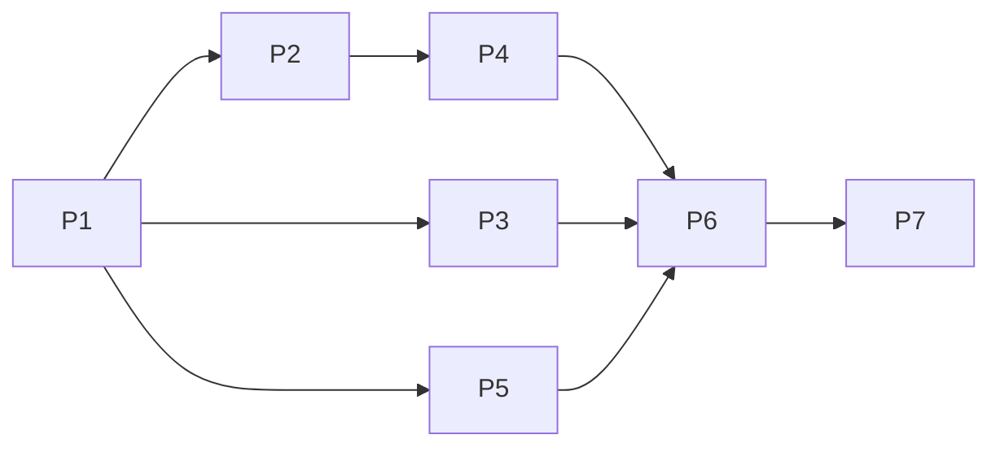

# Headless mode: phased implementation plan

Source plan (main bundle revision 4): `docs/plans/headless-mode/plan.md`, with `docs/plans/headless-mode/spec.md` (build spec) and `docs/plans/headless-mode/acceptance.md` (criteria). Those three files are authoritative; this index and the phase files only say how to split and order the work. This bundle sits in its own folder so the approved source plan is not re-saved for each phase edit.

## Delivery: one spike branch

This is a spike and alpha code (acceptance section Delivery, AC-DEL-01 to 05). **Every phase commits to a single upstream branch, `feat/headless-mode-spike`.**

- The branch is created by phase 1 from the Phase 0 commits on the local branch `feat/headless`, and pushed to `origin`: `git push origin feat/headless:feat/headless-mode-spike`.
- Each phase starts from the tip of `origin/feat/headless-mode-spike`, does its work, and pushes its commits to that branch. It does not create a phase branch upstream and does not open a pull request. A phase's own working branch in its worktree stays local.
- Pushes are fast-forward only. Before pushing, fetch and rebase your commits on the branch tip. Never force-push, rewrite history or `git reset --hard`.
- Phases 2, 3 and 5 may run at the same time. They touch disjoint files, so a rebase is expected to be trivial. If a rebase conflicts, the phase that is pushing resolves it and re-runs its verification before pushing.
- Nothing merges to `main` and nothing is released. Contracts may change before that is decided; record each change in the phase's report and its commit message.
- **Dependency release.** The scheduled tasks are chained with dependencies, but Mission Control releases a task dependency when the prerequisite's pull request merges, and no phase opens one. After a phase pushes its last commit, the operator releases its dependents with the existing **Unblock dependents** (explicit completion override) action on that task. Every phase task also still waits on the planning session, which releases when the planning pull request for these documents merges to `main`. This manual step is a known cost of the single-branch delivery rule.

## Human decisions incorporated

- Opening Claude: the launcher question is asked automatically on the first message of every new session (startup only), with no `/mc`. `mctl claude` submits `/mc` so it appears with no typing. `/mc` stays as an optional shortcut.
- Frequency: every new session, never resume, clear or compact; switchable off.
- Repo question: only when the session is not inside a repo.
- Guided questions follow the existing Settings, Dispatch, "Guided dispatch" switch (`ui.guidedDispatch`).
- Grill me first is not offered from the terminal.
- Delivery: spike and alpha code on the single upstream branch `feat/headless-mode-spike`; phases add to it directly.
- Phased implementation requested.

## Repository findings that shape the split

1. **Phase 0 is not on `main` or `origin`.** Contracts, schema 35, seams and `todo` tests exist only on the local branch `feat/headless` (commits `ae01b4e3c`, `457b2335f`, `5e627037c`). Phase 1 publishes that branch as `feat/headless-mode-spike`. If the local ref is missing, rebuild from spec section 2 and push the result as that branch.
2. **Option rules live in the dashboard.** `afterWorkForKind` is inside `src/web/components/DispatchModal.tsx` (about line 1730); the guided steps are in `src/web/lib/guided-dispatch-steps.ts`; `taskDefaultWorkflowId` is in `src/shared/task.ts`; `resolveTaskAgent` is in `src/server/harnesses.ts`. Phase 2 extracts or mirrors them with a parity test.
3. **`create_task` is worker-facing.** It routes to `/mcp/tasks`, `/mcp/v2/tasks` or `/mcp/v3/tasks` (`src/mcp/server.ts`) and its schema omits `grillFirst` and `personaId` on purpose. Phase 4 adds result fields only.
4. **Worker identity.** The MCP server reads `MISSION_SESSION_ID` (`src/mcp/server.ts`, top). Phases 1, 3 and 4 use it so workers never become home sessions or get the launcher.
5. **Guided switch.** `guidedDispatch` is a UI config value (`src/shared/protocol.ts`, `app-config-entries.ts`).
6. **A hook cannot start a turn.** The automatic launcher therefore works through the first `UserPromptSubmit` of a session: the daemon decides (phase 1), the hook injects an instruction (phase 3), the skill asks (phase 4). `UserPromptSubmit` also fires for `/loop` and background reports, so the daemon offers it once per session and only for an interactive `startup` session. The interactive value of the entrypoint is spike S-06; until confirmed, only the candidate value `cli` is accepted and unknown never prompts.
7. **Task dependencies are merge-gated.** Documented in `docs/dispatch-and-backlog.md`: a task dependency is satisfied by the prerequisite's merged pull request, with an explicit completion override. See "Dependency release" above.

## Sizing

Estimated non-test implementation: about 6,000 to 7,500 lines across shared contracts, daemon routes, MCP tools, hook, plugin text, CLI and setup. That is far above 200 lines and spans separable boundaries (daemon API, option catalogue, hook, MCP and plugin, CLI reads, setup), so it is split into seven phases. Complexity drivers: schema migration, security-sensitive answer and approval paths, the once-per-session launcher decision, launchd and plugin installation isolation, and parity with dashboard rules. The split also keeps each push reviewable by commit range on the single branch.

| Phase | Why it is its own unit |
|---|---|
| 1 | Foundation every other phase consumes: the branch, contracts, schema, API, launcher offer decision. Cannot be split without dead surfaces. |
| 2 | Independent catalogue logic with a dashboard parity risk; fixed contract from phase 1. |
| 3 | Hook and status line are plain Node scripts that only need the phase 1 routes. |
| 4 | MCP tools and plugin text need the catalogue route from phase 2. |
| 5 | CLI reads and `run` need only phase 1 routes. |
| 6 | Setup touches launchd and Claude config; needs the finished plugin and CLI skeleton. |
| 7 | End-to-end, delivery checks and docs need everything. |

## Phases and dependencies

| # | File | Direct prerequisites |
|---|---|---|
| 1 | phase-1-contracts-and-handoff-api.md | none |
| 2 | phase-2-guided-dispatch-options.md | 1 |
| 3 | phase-3-hooks-and-status-line.md | 1 |
| 4 | phase-4-mcp-tools-and-plugin.md | 2 |
| 5 | phase-5-mctl-commands.md | 1 |
| 6 | phase-6-instances-setup-and-launcher.md | 3, 4, 5 |
| 7 | phase-7-integration-and-docs.md | 6 |

"Prerequisite" here means the prerequisite phase has pushed its last commit to `feat/headless-mode-spike`. Concurrency: after phase 1 is pushed, phases 2, 3 and 5 can run together. Phase 4 starts after 2. Phase 6 waits for 3, 4 and 5. Phase 7 is last.

## Cross-phase contracts

- Phase 1 owns the branch `feat/headless-mode-spike`, `src/shared/handoff.ts` (including guided and launcher types), schema 35 (with `start_source`, `entrypoint`, `launcher_offered_at`), `ReviewActor` values, route paths under `/mcp/handoff/`, the `launcher.banner` field, the `launcher.offer` decision in `turns/open`, and the `handoff.launcher.prompt` setting. Later phases consume, never rename.
- Phase 2 owns `src/shared/dispatch-options.ts`, the `dispatch-options` route body and response, and the launcher question (`entry` `first-message`).
- Phase 3 owns the hook script (including the launcher instruction text and `MISSION_HANDOFF_LAUNCHER`), and the status line cache file format `{stateDir}/handoff/statusline/{sha1(repoRoot)}.json`; the API writer of that cache is part of phase 3.
- Phase 4 owns tool names, the plugin layout and skill text, including the first-message entry that answers the hook's instruction. Phase 6 copies that layout; it does not change it.
- Phase 5 owns `src/cli/command.ts` and the command table; phase 6 adds commands through it.
- Phase 7 owns the delivery checks AC-DEL-01 to 04; every phase owns AC-DEL-05 for its own pushes.
- Test files are named by the acceptance table; each phase removes `todo` only from rows it owns.

## Deferred: v1.1

`mctl attach`, desktop notifications and `mctl config set` (spec section 12) are intentionally not scheduled here. They ship in a later release and depend on v1 being on the branch; phase them separately once phase 7 lands. Until `mctl config set` exists, the launcher is switched off with `MISSION_HANDOFF_LAUNCHER=0` or by editing the app config.

## Final verification

After phase 7, on the tip of `feat/headless-mode-spike`: `npm run typecheck`, `npm run lint`, `MISSION_TEST_CONCURRENCY=4 npm test`, `npm run build`, `npm run smoke`, `npm run test:e2e` (guided dispatch specs unchanged), the delivery checks AC-DEL-01 to 04, and the sandbox walkthrough in plan.md.

## Cross-phase audit

Re-run after the single-branch revision: every spec section and acceptance group has one owning phase (contracts, API, branch creation, launcher offer decision and setting: 1; guided and launcher question: 2; hooks, launcher instruction, notice and status line: 3; MCP, plugin, skills including first-message entry, command: 4; mctl: 5; instances, setup, launcher spawn: 6; integration, delivery checks and docs: 7). Concurrent phases 2, 3 and 5 touch disjoint files, so pushes to the one branch rebase cleanly. No phase opens a branch or pull request; every phase's exit is a verified fast-forward push to `feat/headless-mode-spike`. The launcher chain is one decision (phase 1), one instruction (phase 3), one question (phase 2), one skill entry (phase 4).
