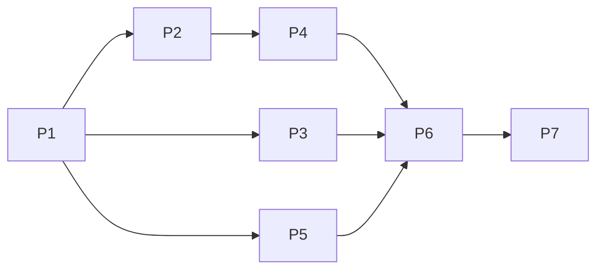

# Headless mode: phased implementation plan

Source plan (main bundle revision 5): `docs/plans/headless-mode/plan.md`, with `docs/plans/headless-mode/spec.md` (build spec) and `docs/plans/headless-mode/acceptance.md` (criteria). The isolation rationale is `docs/plans/headless-mode-install/plan.md`. Those files are authoritative; this index and the phase files only say how to split and order the work. This bundle sits in its own folder so the approved source plan is not re-saved for each phase edit.

## Delivery: one spike branch

This is a spike and alpha code (acceptance section Delivery, AC-DEL-01 to 05). **Every phase commits to a single upstream branch, `feat/headless-mode-spike`.**

- The branch is created by phase 1 from the Phase 0 commits on the local branch `feat/headless`, and pushed to `origin`: `git push origin feat/headless:feat/headless-mode-spike`.
- Each phase starts from the tip of `origin/feat/headless-mode-spike`, does its work, and pushes its commits to that branch. It does not create a phase branch upstream and does not open a pull request. A phase's own working branch in its worktree stays local.
- Pushes are fast-forward only. Before pushing, fetch and rebase your commits on the branch tip. Never force-push, rewrite history or `git reset --hard`.
- Phases 2, 3 and 5 may run at the same time. They touch disjoint files, so a rebase is expected to be trivial. If a rebase conflicts, the phase that is pushing resolves it and re-runs its verification before pushing.
- Nothing merges to `main` and nothing is released. Contracts may change before that is decided; record each change in the phase's report and its commit message.
- **Dependency release.** The scheduled tasks are chained with dependencies, but Mission Control releases a task dependency when the prerequisite's pull request merges, and no phase opens one. After a phase pushes its last commit, the operator releases its dependents with the existing **Unblock dependents** (explicit completion override) action on that task. Every phase task also still waits on the planning session, which releases when the planning pull request for these documents merges to `main`.

## Install isolation: the `spike` instance and spike names

The desktop app already owns a daemon, ten Claude hooks, the `mission-control` MCP server, `mission-*` skills and a status line wrapper (review report: 13 conflicts). So nothing in this feature installs into any of them. Every phase obeys the same rules (spec 9.5, acceptance AC-ISO-01 to 10):

- The only installable instance is `spike`: state `~/.mission-control-instances/spike`, port from 7417, labels `com.mission-control.daemon.spike` and `.foreman.spike`, Claude config `~/.mission-control-instances/spike/claude`.
- Spike names: plugin `mission-control-spike` (marketplace `mission-control-spike-local`), MCP server `mc-spike`, hook `handoff-spike-hook.mjs`, command `/mission-control-spike:mc`. No name may contain the app's recogniser substrings `harness-hook.mjs` or `satellites/hook.mjs`, and no skill name starts with `mission-` or `fleet-`.
- Six guards: G-1 the daemon refuses the default state home; G-2 every `mctl` command needs a non-default instance; G-3 the hook is a no-op outside an instance and never uses port 7317; G-4 setup refuses pooled checkouts and `.app` paths; G-5 workers inherit the instance; G-6 uninstall removes only what the manifest lists.
- To run any of it, use a stable, non-pooled worktree of the branch (for example `~/code/mission-control-spike`), not a pool slot.
- Graduation into the app's owned surfaces (attach, owned hook, reconciler skills, owned `mctl`) is a later plan behind gates (spec 16). No phase builds it.

| Guard | Owning phase |
|---|---|
| G-1 daemon refuses default home (AC-ISO-02) | 1 |
| G-2 instance required for every command (AC-ISO-03) | 5 (all commands), 6 (setup, daemon, claude) |
| G-3 hook no-op outside an instance (AC-ISO-05) | 3 |
| G-4 stable checkout, no `.app` (AC-ISO-06) | 6 |
| G-5 workers inherit the instance (AC-SET-15) | 6 |
| G-6 manifest-only uninstall (AC-ISO-08) | 6 |
| Names (AC-ISO-04, 09) | 3 and 4 build them; 6 checks them |
| Two daemons side by side (AC-ISO-07), no default edits (AC-ISO-01), docs (AC-ISO-10) | 7 |

## Human decisions incorporated

- Opening Claude: the launcher question is asked automatically on the first message of every new session (startup only), with no `/mc`. `mctl claude` submits the launcher command so it appears with no typing. The command is optional.
- Frequency: every new session, never resume, clear or compact; switchable off.
- Repo question: only when the session is not inside a repo.
- Guided questions follow the existing Settings, Dispatch, "Guided dispatch" switch (`ui.guidedDispatch`).
- Grill me first is not offered from the terminal.
- Delivery: spike and alpha code on the single upstream branch `feat/headless-mode-spike`; phases add to it directly.
- Install: isolated as the `spike` instance under different names while this is proven; graduation later.
- Phased implementation requested.

## Repository findings that shape the split

1. **Phase 0 is not on `main` or `origin`.** Contracts, schema 35, seams and `todo` tests exist only on the local branch `feat/headless` (commits `ae01b4e3c`, `457b2335f`, `5e627037c`). Phase 1 publishes that branch as `feat/headless-mode-spike`. If the local ref is missing, rebuild from spec section 2 and push the result as that branch.
2. **Option rules live in the dashboard.** `afterWorkForKind` is inside `src/web/components/DispatchModal.tsx` (about line 1730); the guided steps are in `src/web/lib/guided-dispatch-steps.ts`; `taskDefaultWorkflowId` is in `src/shared/task.ts`; `resolveTaskAgent` is in `src/server/harnesses.ts`. Phase 2 extracts or mirrors them with a parity test.
3. **`create_task` is worker-facing.** It routes to `/mcp/tasks`, `/mcp/v2/tasks` or `/mcp/v3/tasks` (`src/mcp/server.ts`) and its schema omits `grillFirst` and `personaId` on purpose. Phase 4 adds result fields only.
4. **Worker identity.** The MCP server reads `MISSION_SESSION_ID` (`src/mcp/server.ts`, top). Phases 1, 3 and 4 use it so workers never become home sessions or get the launcher.
5. **Guided switch.** `guidedDispatch` is a UI config value (`src/shared/protocol.ts`, `app-config-entries.ts`).
6. **A hook cannot start a turn.** The automatic launcher works through the first `UserPromptSubmit` of a session: the daemon decides (phase 1), the hook injects an instruction (phase 3), the skill asks (phase 4). The interactive value of the entrypoint is spike S-06; until confirmed, only `cli` is accepted and unknown never prompts.
7. **Task dependencies are merge-gated.** See "Dependency release" above.
8. **The app recognises its own hooks by name.** `isMissionHookCommand` matches the substrings `harness-hook.mjs` and `satellites/hook.mjs` (`src/server/harness/claude/hooks.ts`), repairs only the MCP registration named `mission-control`, and its skills reconciler owns every `mission-` and `fleet-` link. The spike names avoid all three.
9. **The updater tolerates only three Node-mode scripts** (`OPERATOR_SATELLITES` in `src/shared/owned-runtime.mjs`). Nothing the spike builds is registered in the app's config, so none needs adding during the spike; graduation must add `mctl` and any new satellite.

## Sizing

Estimated non-test implementation: about 6,500 to 8,000 lines across shared contracts, daemon routes, MCP tools, hook, plugin text, CLI, setup and the isolation guards. That is far above 200 lines and spans separable boundaries, so it is split into seven phases. Complexity drivers: schema migration, security-sensitive answer and approval paths, the once-per-session launcher decision, launchd and plugin installation isolation beside a running app, and parity with dashboard rules.

| Phase | Why it is its own unit |
|---|---|
| 1 | Foundation every other phase consumes: the branch, contracts, schema, API, launcher offer decision, the default-home guard. Cannot be split without dead surfaces. |
| 2 | Independent catalogue logic with a dashboard parity risk; fixed contract from phase 1. |
| 3 | Hook and status line are plain Node scripts that only need the phase 1 routes. |
| 4 | MCP tools and plugin text need the catalogue route from phase 2. |
| 5 | CLI reads and `run` need only phase 1 routes. |
| 6 | Setup touches launchd and Claude config; needs the finished plugin and CLI skeleton, and carries most of the isolation guards. |
| 7 | End-to-end, isolation checks, delivery checks and docs need everything. |

## Phases and dependencies

| # | File | Direct prerequisites |
|---|---|---|
| 1 | phase-1-contracts-and-handoff-api.md | none |
| 2 | phase-2-guided-dispatch-options.md | 1 |
| 3 | phase-3-hooks-and-status-line.md | 1 |
| 4 | phase-4-mcp-tools-and-plugin.md | 2 |
| 5 | phase-5-mctl-commands.md | 1 |
| 6 | phase-6-instances-setup-and-launcher.md | 3, 4, 5 |
| 7 | phase-7-integration-and-docs.md | 6 |

"Prerequisite" means the prerequisite phase has pushed its last commit to `feat/headless-mode-spike`. After phase 1 is pushed, phases 2, 3 and 5 can run together. Phase 4 starts after 2. Phase 6 waits for 3, 4 and 5. Phase 7 is last.

## Cross-phase contracts

- Phase 1 owns the branch `feat/headless-mode-spike`, `src/shared/handoff.ts` (including guided and launcher types), schema 35 (with `start_source`, `entrypoint`, `launcher_offered_at`), `ReviewActor` values, route paths under `/mcp/handoff/`, the `launcher.banner` field, the `launcher.offer` decision in `turns/open`, the `handoff.launcher.prompt` setting, the rename of the Phase 0 hook stub to the spike name, and guard G-1. Later phases consume, never rename.
- Phase 2 owns `src/shared/dispatch-options.ts`, the `dispatch-options` route body and response, and the launcher question (`entry` `first-message`).
- Phase 3 owns the hook script `handoff-spike-hook.mjs` (including the launcher instruction text, `MISSION_HANDOFF_LAUNCHER` and guard G-3), and the status line cache file format `{stateDir}/handoff/statusline/{sha1(repoRoot)}.json`; the API writer of that cache is part of phase 3.
- Phase 4 owns tool names, the plugin layout with the spike names and skill text, including the first-message entry that answers the hook's instruction. Phase 6 copies that layout; it does not change it.
- Phase 5 owns `src/cli/command.ts`, the command table and guard G-2 for every command; phase 6 adds commands through it.
- Phase 6 owns the manifest, guards G-4 to G-6 and the instance install.
- Phase 7 owns the delivery checks AC-DEL-01 to 04 and the isolation rows AC-ISO-01, 07 and 10; every phase owns AC-DEL-05 for its own pushes.
- Test files are named by the acceptance table; each phase removes `todo` only from rows it owns.

## Deferred: v1.1 and graduation

`mctl attach`, desktop notifications and `mctl config set` (spec section 12) are intentionally not scheduled here. Graduation into the desktop app's owned surfaces (spec 16) is also unscheduled. Both need v1 on the branch first, and graduation needs its gates and four decisions. Until `mctl config set` exists, the launcher is switched off with `MISSION_HANDOFF_LAUNCHER=0` or by editing the instance's app config.

## Final verification

After phase 7, on the tip of `feat/headless-mode-spike`: `npm run typecheck`, `npm run lint`, `MISSION_TEST_CONCURRENCY=4 npm test`, `npm run build`, `npm run smoke`, `npm run test:e2e` (guided dispatch specs unchanged), the delivery checks AC-DEL-01 to 04, the isolation rows AC-ISO-01 to 10, and the sandbox walkthrough in plan.md run beside a running desktop app.

## Cross-phase audit

Re-run after the isolation revision: every spec section and acceptance group has one owning phase (contracts, API, branch creation, launcher offer decision, setting and guard G-1: 1; guided and launcher question: 2; hook, launcher instruction, notice, status line and guard G-3: 3; MCP, plugin with spike names, skills including first-message entry, command: 4; mctl and guard G-2: 5; instance setup, manifest and guards G-4 to G-6: 6; integration, isolation and delivery checks and docs: 7). Concurrent phases 2, 3 and 5 touch disjoint files, so pushes to the one branch rebase cleanly. No phase opens a branch or pull request; every phase exits with a verified fast-forward push. No phase edits the app's owned surfaces.
