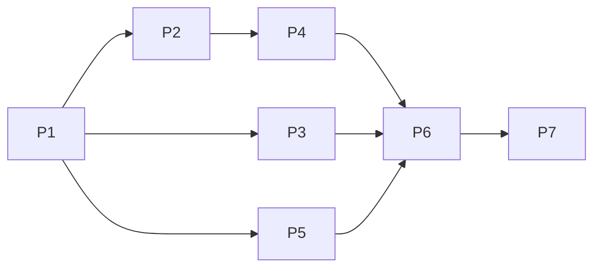

# Headless mode: phased implementation plan

Source plan (approved revision 2): `docs/plans/headless-mode/plan.md`, with `docs/plans/headless-mode/spec.md` (build spec) and `docs/plans/headless-mode/acceptance.md` (criteria). Those three files are authoritative; this index and the phase files only say how to split and order the work. This bundle sits in its own folder so the approved source plan is not re-saved.

## Human decisions incorporated

- Opening Claude: launcher banner on `startup` and `clear`, `/mc` runs the picker, `mctl claude` submits `/mc` unless a prompt or `--no-launcher` is given.
- Repo question: only when the session is not inside a repo.
- Guided questions follow the existing Settings, Dispatch, "Guided dispatch" switch (`ui.guidedDispatch`).
- Grill me first is not offered from the terminal.
- Phased implementation requested; final approval of revision 2 given.

## Repository findings that shape the split

1. **Phase 0 is not on `main`.** Contracts, schema 35, seams and `todo` tests exist only on the local branch `feat/headless` (commits `ae01b4e3c`, `457b2335f`, `5e627037c`). It is not on `origin`. Phase 1 must land that code first (cherry-pick from the shared local ref; if the ref is missing, rebuild from spec section 2).
2. **Option rules live in the dashboard.** `afterWorkForKind` is inside `src/web/components/DispatchModal.tsx` (about line 1730); the guided steps are in `src/web/lib/guided-dispatch-steps.ts`; `taskDefaultWorkflowId` is in `src/shared/task.ts`; `resolveTaskAgent` is in `src/server/harnesses.ts`. Phase 2 extracts or mirrors them with a parity test.
3. **`create_task` is worker-facing.** It routes to `/mcp/tasks`, `/mcp/v2/tasks` or `/mcp/v3/tasks` (`src/mcp/server.ts`) and its schema omits `grillFirst` and `personaId` on purpose. Phase 4 adds result fields only.
4. **Worker identity.** The MCP server reads `MISSION_SESSION_ID` (`src/mcp/server.ts`, top). Phases 1, 3 and 4 use it so workers never become home sessions.
5. **Guided switch.** `guidedDispatch` is a UI config value (`src/shared/protocol.ts`, `app-config-entries.ts`).

## Sizing

Estimated non-test implementation: about 5,500 to 7,000 lines across shared contracts, daemon routes, MCP tools, hook, plugin text, CLI and setup. That is far above 200 lines and spans separable merge boundaries (daemon API, option catalogue, hook, MCP and plugin, CLI reads, setup), so it is split into seven phases. Complexity drivers: schema migration, security-sensitive answer and approval paths, launchd and plugin installation isolation, and parity with dashboard rules.

| Phase | Why it is its own unit |
|---|---|
| 1 | Foundation every other phase consumes: contracts, schema, API. Cannot be split without dead surfaces. |
| 2 | Independent catalogue logic with a dashboard parity risk; fixed contract from phase 1. |
| 3 | Hook and status line are plain Node scripts that only need the phase 1 routes. |
| 4 | MCP tools and plugin text need the catalogue route from phase 2. |
| 5 | CLI reads and `run` need only phase 1 routes. |
| 6 | Setup touches launchd and Claude config; needs the finished plugin and CLI skeleton. |
| 7 | End-to-end and docs need everything. |

## Phases and dependencies

| # | File | Direct prerequisites |
|---|---|---|
| 1 | phase-1-contracts-and-handoff-api.md | none |
| 2 | phase-2-guided-dispatch-options.md | 1 |
| 3 | phase-3-hooks-and-status-line.md | 1 |
| 4 | phase-4-mcp-tools-and-plugin.md | 2 |
| 5 | phase-5-mctl-commands.md | 1 |
| 6 | phase-6-instances-setup-and-launcher.md | 3, 4, 5 |
| 7 | phase-7-integration-and-docs.md | 6 |

Concurrency: after phase 1 merges, phases 2, 3 and 5 can run together. Phase 4 starts after 2. Phase 6 waits for 3, 4 and 5. Phase 7 is last.

## Cross-phase contracts

- Phase 1 owns `src/shared/handoff.ts` (including guided types), schema 35, `ReviewActor` values, route paths under `/mcp/handoff/`, and the `launcher.banner` field. Later phases consume, never rename.
- Phase 2 owns `src/shared/dispatch-options.ts` and the `dispatch-options` route body and response.
- Phase 3 owns the hook script and the status line cache file format `{stateDir}/handoff/statusline/{sha1(repoRoot)}.json`; the API writer of that cache is part of phase 3.
- Phase 4 owns tool names and the plugin layout. Phase 6 copies that layout; it does not change it.
- Phase 5 owns `src/cli/command.ts` and the command table; phase 6 adds commands through it.
- Test files are named by the acceptance table; each phase removes `todo` only from rows it owns.

## Deferred: v1.1

`mctl attach`, desktop notifications and `mctl config set` (spec section 12) are intentionally not scheduled here. They ship in a later release and depend on v1 being merged; phase them separately once phase 7 lands. Phase 1 leaves their seams untouched.

## Final verification

After phase 7: `npm run typecheck`, `npm run lint`, `MISSION_TEST_CONCURRENCY=4 npm test`, `npm run build`, `npm run smoke`, `npm run test:e2e` (guided dispatch specs unchanged), and the sandbox walkthrough in plan.md.

## Cross-phase audit

Full audit completed after writing phase 7: every spec section and acceptance group has one owning phase (contracts and API: 1; guided: 2; hooks and status line: 3; MCP, plugin, skills, command: 4; mctl: 5; instances, setup, launcher spawn: 6; integration and docs: 7); concurrent phases 2, 3 and 5 touch disjoint files (`src/shared/dispatch-options.ts` and its route file; `hooks/` and the status line; `src/cli/`); `AC-HOOK-11` (API cache writer) is owned by phase 3 and `AC-LAUNCH-04` by phase 6.
