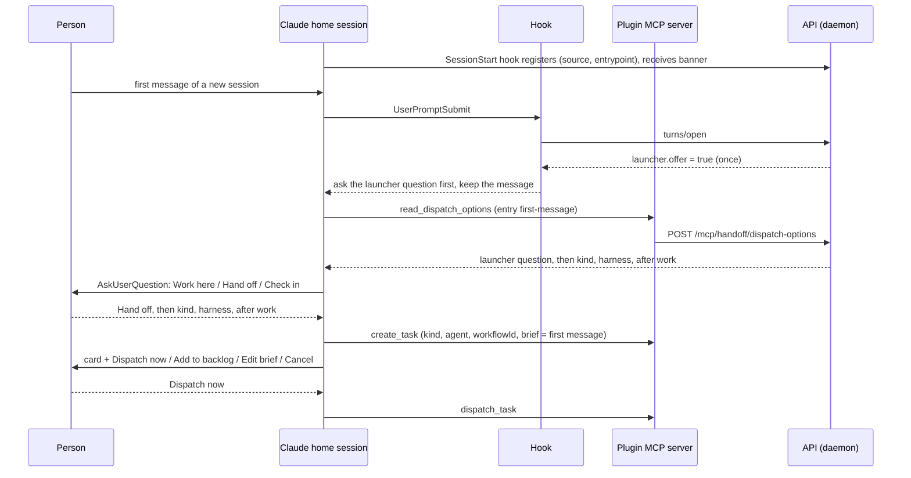

# Headless mode

Hand work to Mission Control from the Claude Code session you already use. Open Claude and you are asked what you want to do, including which kind of Mission Control task to run, with the same questions the dashboard asks (kind, harness, after work). Then keep working. Check in when it suits you. You do not need to open the desktop app, and you do not need to type a command to get the prompt.

This file is the design summary. [spec.md](spec.md) is the detailed build spec, and [acceptance.md](acceptance.md) lists every acceptance criterion with its test. The MVP targets Claude Code. Pi parity comes later.

Revision 2026-11-18 (second): the launcher now prompts automatically when a session opens (section "Guided launcher"), replacing the manual `/mc` requirement. See "Review log" G15 to G17.

## Words used here

| Word | Meaning |
|---|---|
| Home session | The Claude Code session you work in. You hand work off from it, and updates come back to it. |
| Worker | A background agent Mission Control starts for one task, in its own worktree. |
| API (the daemon) | The Mission Control background process. It stores everything and decides what is allowed. |
| Task kind | ship, bugfix, plan, scout, document, chat. The kind picks the review that runs after the work. |
| After work | The review that runs when a worker finishes, such as `no-mistakes-review` or `plan-validation`. |
| Launcher | The prompt asked when a new Claude session gets its first message, and the `/mc` shortcut that asks it any time. |
| Guided questions | Launcher, Kind, Harness, After work (and Repo when needed), asked one at a time as selectable prompts. Kind, Harness and After work are the dashboard's guided dispatch questions. |
| Card | A short box shown in your home session: a brief to confirm, a question, or finished work. |
| Turn | One message you send, plus everything the model does until it stops. |
| Instance | A named, separate copy of Mission Control: its own state folder, port, launchd service and Claude config folder. |

In code, this feature is called `handoff` (`src/server/handoff/`, `src/shared/handoff.ts`). The word "headless" already means something else in the code: `MISSION_HEADLESS` silences hooks during the daemon's own `claude -p` runs.

## Guided launcher

The dashboard's Dispatch dialog asks Repo, Kind, Harness, After work, then the task. The terminal asks the same questions, from the same data, in the same order, and starts asking by itself.

1. **Open.** Claude starts. The `SessionStart` hook prints one line saying Mission Control will ask how to start. A hook cannot make the model ask a question, because the model does not run until a prompt is submitted. So the question is asked on the first prompt of a new session. `mctl claude` removes even that: it submits the launcher prompt for you, so the question appears the moment Claude opens, with no typing.
2. **First message.** The `UserPromptSubmit` hook sees the first prompt of a new session (not on resume, clear or compact) and the daemon says whether to offer the launcher. If so, the model asks the launcher question before doing anything else, and keeps the person's own message. The launcher question has three options: **Work in this session**, **Hand off to Mission Control**, **Check in on my tasks**. The option that fits the message is marked Recommended, using the kind hint words: a message such as "fix the flaky login test" recommends Hand off, a message with no hint recommends Work in this session. Choosing Work in this session dismisses the launcher and the model answers the message normally.
3. **Pick.** Choosing Hand off runs the guided questions with `AskUserQuestion`:
   - **Kind.** Two pages, because a prompt holds at most four options: ship, bugfix, plan, More kinds; then scout, document, chat, Check in on my tasks.
   - **Harness.** Claude Code, Codex, Pi. The kind's configured default is marked Recommended.
   - **After work.** The kind's default, None, or a published workflow. Skipped for scout and chat, which produce no diff.
   - **Repo.** Asked only when the session is not inside a repo.
4. **Brief.** The first message becomes the brief. If it was empty or just a greeting, the model asks the person to describe the task. A mid-conversation request ("fix this, hand it off") works the same way and skips the launcher question.
5. **Confirm.** A card shows kind, harness, after work, repo and brief. A final selectable prompt offers Dispatch now, Add to backlog, Edit brief, Cancel. Typing "go" also works.
6. **Shortcuts.** `/mc` asks the questions any time. `/mc bugfix login times out on retry` answers Kind itself. These are optional now.

The launcher is asked once per new session, never on resume, clear or compact, never for slash commands or non-interactive runs, and never inside a Mission Control worker. It can be switched off with the setting `handoff.launcher.prompt` or the environment variable `MISSION_HANDOFF_LAUNCHER=0`.

The options are not written into the skill. The daemon builds them from the same registries the dashboard uses (`TASK_KIND_INFO`, the harness registry, `taskDefaultWorkflowId`, published workflows), so the terminal and the dashboard cannot drift apart. The skill only asks what the daemon returns.

The flow, as text (the diagram below draws it):



## Decisions

| # | Topic | Decision |
|---|---|---|
| 1 | Main job | Hand off and keep going. The home session starts work; Mission Control runs it. |
| 2 | Who answers workers | You, through your home session. Ordinary answers are accepted as sent and always show a receipt line. |
| 3 | Who owns tasks | You, per repo. Tasks survive `/clear` and closed terminals. Any session in the repo sees them. |
| 4 | Getting your attention | Status line, then a card on your next message, then a desktop notification (v1.1). Never interrupts the model mid-task. Finished work stays quiet. |
| 5 | Starting a task | Guided questions, then a brief saved unstarted, then a selectable confirm. It starts only on Dispatch now or when you type "go". |
| 6 | Where a task stops | The task kind decides, through the existing After work defaults. You can override it in the After work question. |
| 7 | Recommending | The server matches hint words that live next to `TASK_KINDS`. They mark which launcher option and which kind is Recommended. The person still chooses. |
| 8 | Keeping the API running | launchd runs the API and Foreman. The plugin and `mctl` ask launchd to start them when they are down. |
| 9 | How workers run | Agent SDK. `mctl logs -f` to watch, `mctl attach` to take over (v1.1). |
| 10 | Installing | `mctl setup` installs the launchd services, the Claude Code plugin and the status line. |
| 11 | Too many tasks | The task waits in the backlog, and Foreman starts it when a slot frees up. |
| 12 | What `mctl` can do | Start, watch and configure. It never answers, approves, cancels or reorders a task a home session started. |
| 13 | Changing settings | `mctl config set` for a short list of global settings, with a yes/no confirm (v1.1). |
| 14 | Starting from the CLI | `mctl run "{brief}" --kind {kind} --after-work {review}`. Same calls a home session makes. |
| 15 | Answering in `mctl run --watch` | Only for tasks `mctl` started. |
| 16 | Plan approval | A home-session approval counts as the final human approval only when: the plan card for that revision was shown in an earlier turn, a later message you sent contains an approval word, and the approval names that exact revision. |
| 17 | Dashboard | No visible changes. The API stores task origin and answer receipts; the web UI does not show them. |
| 18 | Testing beside a real install | Named instances: `mctl --instance sandbox ...` never touches the default instance, your `~/.claude`, or your desktop app. |
| 19 | Opening Claude | The launcher question is asked automatically on the first message of every new session (startup only), with no `/mc` needed. `mctl claude` submits the launcher prompt so it appears with no typing. Human decisions, 2026-11-18, revised the same day from banner plus `/mc`. |
| 20 | Where the options come from | The daemon, through `read_dispatch_options`, built from shared registries. Never hard-coded in a skill. |
| 21 | Repo question | Asked only when the session is not inside a repo. Otherwise the card names the repo and Edit brief can change it. (Human decision.) |
| 22 | Switching guided questions off | Reuse Settings -> Dispatch "Guided dispatch" (`ui.guidedDispatch`). Off means no Kind, Harness or After work questions: recommended kind and defaults, then the confirm card. (Human decision.) |
| 23 | Grill me first | Not offered from the terminal. `create_task` keeps its worker-facing contract unchanged. (Human decision.) |
| 24 | Picker mechanism | `AskUserQuestion` driven by the skill. Where it is unavailable (`claude -p`, SDK, Pi), the daemon's numbered plain-text version is printed instead. MCP elicitation is a later improvement, pending spike S-04. |
| 25 | Workers are never home sessions | Hooks and the MCP server do nothing when `MISSION_SESSION_ID` is set, and the API refuses to register a Mission-managed session as a home session. |
| 26 | Launcher frequency | Every new session, never resume, clear or compact. Off with `handoff.launcher.prompt` or `MISSION_HANDOFF_LAUNCHER=0`. (Human decision.) |
| 27 | Who decides to ask | The daemon, not the hook: it records the session start source and entrypoint and marks the launcher offered once, so it survives hook restarts and cannot repeat. |
| 28 | Non-interactive runs | No launcher unless the entrypoint is known to be interactive. Unknown means no prompt. Spike S-06 confirms the value to test. |

## Why a turn log, and what it no longer does

An earlier draft required proof that a person typed every answer. Claude Code's `UserPromptSubmit` hook also fires for `/loop` iterations, background subagent reports and messages from other sessions, and its input has no field that tells these apart. So ordinary answers do not require that proof. The turn log keeps two jobs:

1. **Receipts.** Every answer shows "sent X to task Y, from your words Z", so a wrongly relayed answer is visible at once.
2. **Plan approval.** Publishing a plan needs a final human approval. The turn log records which plan revision a card showed, and whether a later message contained an approval word.

The turn log stores a 120-character excerpt and a few flags per turn, never the full prompt, and deletes entries after seven days.

Known limit: starting a task is gated by the skill and by a selectable confirm, not by the server. A misbehaving model could call `dispatch_task` unprompted. The card and the inbox make that visible, and nothing is merged without the normal review.

## Components

| Component | What it is | Owns |
|---|---|---|
| Home session | Your Claude Code session | Your conversation |
| Plugin | Hooks, skills, MCP server and `/mc`, in one versioned Claude Code plugin | Nothing durable |
| `mctl` | Terminal command | Nothing durable |
| launchd services | One for the API, one for Foreman, per instance | Process supervision |
| API (the daemon) | `src/server/index.ts` | Tasks, task origin, turn log, receipts, dispatch options, launcher state, the database |
| Foreman | Separate worker process | Starting queued tasks |
| Workers | Agent SDK sessions | Their worktree |

## Review log (2026-11-18)

Gaps found in the earlier plan and what changed.

| # | Gap | Resolution |
|---|---|---|
| G1 | Skill offered "grill first" but `create_task` cannot set `grillFirst`. | Human decision: drop it from the terminal flow (decision 23). |
| G2 | A prompt holds four options; there are six kinds. | Generic paging helper, two-page Kind question (spec 3.5). |
| G3 | A hook cannot start a model turn, so an open-time menu is impossible from `SessionStart`. | Superseded by G15: prompt on the first message, plus `mctl claude` auto-submit. |
| G4 | AC-HOOK-01 said nothing prints on an empty inbox. | Amended: a launcher banner prints on `startup` and `clear`. |
| G5 | Scout and chat have no after-work; plan depends on plan storage. | Catalogue carries `afterWorkApplies` and uses `taskDefaultWorkflowId`. |
| G6 | Shelved tasks (backlog, not enabled) were invisible in the inbox. | New `shelved` inbox state. |
| G7 | "Go" is only a skill rule. | Documented limit plus a selectable confirm; no server gate in v1. |
| G8 | "Nothing under `src/web/` changes" blocked sharing option rules with the dashboard. | Behaviour-preserving extraction allowed, with a parity test as the fallback (spec 3.5). |
| G9 | No fallback for Pi, `claude -p` or builds without `AskUserQuestion`. | Server returns `fallbackText` per question. |
| G10 | Unknown whether MCP elicitation renders in Claude Code. | Spike S-04; not blocking. |
| G11 | Workers launched under an instance that has the plugin installed would register as home sessions and could then answer reviews, defeating AC-API-17. | Decision 25, AC-API-18, AC-HOOK-12. |
| G12 | After `/clear` the MCP child may carry a stale session id (spike S-01). | The API maps a stale id to the latest registration for the same `claudePid` (AC-API-19). |
| G13 | Spec still said `plugin-dir` mode for named instances although spike S-02 proved isolated install. | Named instances use installed mode; `plugin-dir` is only a manual override. |
| G14 | Spike S-01 to S-03 fallbacks were still written as open. | Resolved in spec section 1 and the spike results. |
| G15 | Requiring `/mc` defeats "prompted when they open Claude". | Automatic first-message launcher (decisions 19, 26, 27). |
| G16 | The first-message prompt could fire in the wrong places: `/loop` and background reports also trigger `UserPromptSubmit`, slash commands, `claude -p`, resumed sessions, workers. | Offered once per session by the daemon, startup source only, skipped for slash commands, non-interactive or unknown entrypoints and workers (AC-LAUNCH-05 to 09). |
| G17 | No off switch in v1 (`mctl config set` is v1.1) for a prompt that appears every session. | Environment variable `MISSION_HANDOFF_LAUNCHER=0` and the setting `handoff.launcher.prompt` (AC-LAUNCH-10, 11). |

## Releases

- **v1:** the whole hand-off loop for Claude Code. Plugin, automatic launcher, guided questions, hooks, skills, status line, turn log, inbox, answers, plan approval, `mctl run`, `get`, `describe`, `logs`, `status`, `config view`, `setup`, `doctor`, `daemon`, `uninstall`, and named instances.
- **v1.1:** `mctl attach` from any terminal tab, desktop notifications, `mctl config set`.
- **Later:** Pi parity (picker through the plain-text fallback first), a true on-open prompt for plain `claude` if Claude Code allows it (spike S-06), MCP elicitation, the pipeline kind in conductor repos, model and effort questions, Slack messages, a daily spending budget.

## Try it without touching your real install

```sh
npm run build
npm run mctl -- --instance sandbox setup
cd ~/code/some-repo
npm --prefix ~/code/mission-control run mctl -- --instance sandbox claude
# Claude opens and shows the launcher question straight away; pick a kind, harness and after work
npm --prefix ~/code/mission-control run mctl -- --instance sandbox get tasks
npm --prefix ~/code/mission-control run mctl -- --instance sandbox uninstall --purge
```

The sandbox has its own Claude config folder, so the first `claude` start asks you to sign in once. Workers the sandbox starts use the same folder and the same sign-in.
