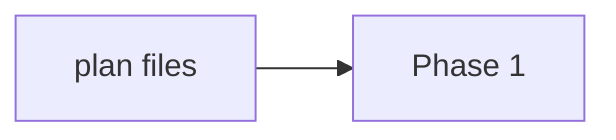

# Hide outside sessions: phased implementation

Source plan: [`docs/plans/hide-outside-sessions/plan.md`](plan.md)

## Incorporated human decisions

- **Upgrade behavior:** off for every install, including upgrades. No migration.
- **Pipeline workers:** stay visible when the setting is off, admitted by observed-run worktree
  containment.
- **Implementation follow-up:** phased plan (this document).

## Repository findings

- `correlate()` in `src/server/discovery/correlate.ts` builds the synthetic id
  (`proc:<tty>:<pid>:<startMs>`) and the cwd before it calls `gitInfo`, and `discover()` runs
  `annotateCodexRollouts` and `annotatePaneState` after `correlate()` returns. An `admit`
  predicate applied inside the `correlate()` loop, right after cwd resolution, therefore skips
  `gitInfo`, pane capture, and the Codex rollout `lsof` for hidden sessions. The batched cwd
  `lsof` that precedes `correlate()` still reads every agent, because admission needs the cwd
  for the pipeline-worktree rule. This is consistent with the source plan.
- `Registry.pipelineLinkFor(cwd)` (`src/server/registry.ts`) already answers "is this cwd inside
  an observed run's worktree" with the deepest-containment rule. Admission reuses it rather than
  adding a second matcher.
- The Registry keys a discovered session by its synthetic id, and dispatch binds
  `task.sessionId` to that id (`adoptTerminalLaunch`, dispatcher). The task-bound fallback can
  therefore match on the synthetic id.
- `TerminalsConfigSchema` is one `app_config` entry with a `terminals` settings-backup domain,
  and `terminalsFields` must list every key (`satisfies Record<keyof TerminalsConfig, ...>`). A
  new boolean field is a compile-time obligation there, which is the desired guard.
- The Terminals family of `SetupPanel.tsx` already owns `useTerminalsConfig`, so the checkbox
  lands beside the existing per-multiplexer chooser.
- `pollOnce(registry, find = discover)` already injects `discover`, so the admission predicate
  can be threaded through without a new seam.

## Sizing

Estimated 180 to 260 non-test implementation lines:

| Area | Estimate |
|---|---|
| Predicate in `launch-process.ts` and export of the disposable root | 40 to 60 |
| `missionLaunched` and the `admit` hook in `correlate.ts` / `discover()` / poller | 40 to 60 |
| `Registry.discoveryAdmission()` | 30 to 50 |
| Schema, patch, field registry, `setTerminalsConfig` merge | 15 to 25 |
| Setup > Terminals checkbox and warning | 40 to 60 |
| Docs prose | not counted |

**One phase.** The estimate sits at the threshold, and the work is one vertical slice. Splitting
the server filter from the setting would ship either a filter with no way to turn it off, or a
checkbox that does nothing. Neither is a valid intermediate state for users, and the combined
change is well within what a single agent can implement and verify.

## Phases

| Phase | File | Depends on | Delivers |
|---|---|---|---|
| 1 | [`phase-1-launch-ownership-admission-and-setting.md`](phase-1-launch-ownership-admission-and-setting.md) | plan files (land in the same PR) | Predicate, admission, setting, UI, tests, docs |

## Dependency graph and merge order

No concurrency: there is one phase.

**Release condition.** Phase 1 has no dependency on another task. The plan files and the
Phase 1 implementation land together in one pull request into `teamupstart/mission-control`
`main`. The work was first drafted on a fork; that arrangement is retired (see the root plan's
publication model).

## Cross-phase contracts

None, because there is only one phase. The durable contracts it creates are:

- `TerminalsConfig.externalSessions: boolean`, default `false`.
- `isMissionLaunchProcess` in `src/server/terminal/launch-process.ts` is the only recognizer of a
  Mission launch wrapper.
- Hidden sessions leave only through `Registry.beginEviction`, via the existing unseen loop.

## Final verification strategy

- Focused unit tests named in the phase file, run with the single-file command from `AGENTS.md`.
- `npm run typecheck`, `npm run lint`, `npm test`.
- `npm run build`, `npm run smoke`, and `npm run test:e2e` including the new
  `e2e/external-sessions-setting.spec.ts`.
- Manual check on a real machine: with the setting off, a hand-started `claude` in tmux does not
  appear, while a dispatched terminal task does. With the setting on, both appear.
