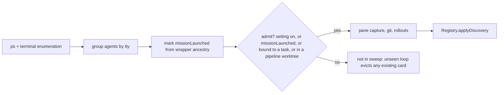

# Hide sessions started outside Mission Control (opt-in setting)

## Problem

Passive discovery cards every `claude`, `codex`, and `pi` process it finds on the machine,
whether or not Mission Control started it. Cards for sessions started by hand in a terminal
lean on the least reliable code we have: process-to-tty-to-pane correlation, pane capture
for the permission-mode line and option menus, and rollout `lsof` reads. For a new user the
first screen then fills with half-working cards for sessions they never asked us to manage.

## Goal

- By default, the dashboard shows only sessions Mission Control launched: dispatched tasks,
  managed resumes, Continue in terminal, and Agent SDK sessions.
- A setting turns the old behavior back on. It is off by default and carries a warning that
  it does not work well for some setups.
- Mission Control's own terminal sessions keep working exactly as they do today, including
  across a daemon restart.

## Non-goals

- No change to the hook installer, the MCP review channel, or telemetry ingest. A hook event
  from a hidden session finds no card and only leaves an in-memory overlay, which is today's
  behavior for an unmatched hook (`Registry.applyHook` only decorates an existing session).
- No change to `MISSION_POLL_MS=0`. That switch turns off all terminal discovery, including
  the sweep that finds Mission Control's own terminal launches, so it cannot stand in for this
  setting.
- No change to SDK sessions. They never pass through discovery.

## How Mission Control already recognizes its own launches

Every terminal launch Mission Control makes runs the agent under a private wrapper, and that
wrapper is visible in the process table the discovery sweep already reads:

| Launch path | Builder | Ancestor process the agent runs under |
|---|---|---|
| Dispatched task (`spawnUniquely`) | `isolatedAgentArgv` | `/bin/sh $TMPDIR/mission-control-agent-state/session-*/launch-and-cleanup.sh` |
| Agent button / terminal chooser (`launchAgentTerminal`, `terminal/targets.ts`) | `isolatedAgentArgv` | same wrapper |
| Managed resume, exited-session resume, Continue in terminal (`spawnManagedResume`, `launchManagedAgentTerminal`) | `prepareResume` in `harness/resume.ts` | wrapper `exec`s `node <resume-guard.mjs> <STATE_DIR resume-lease root> <lease id>`, and the guard spawns the agent as its child, so the guard stays the ancestor |

Ghostty starts the wrapper with `exec -l`, so its argv0 carries a leading `-`. The existing
`readLaunchProcess` already accounts for that.

## Design

### 1. One predicate for "Mission launched this process"

Add `isMissionLaunchProcess(proc)` and `hasMissionLaunchAncestor(pid, procs)` to
`src/server/terminal/launch-process.ts`, beside `LAUNCH_SCRIPT_FILE`, so the file that names
the wrapper is the one source of truth for recognizing it. It accepts exactly:

- `/bin/sh <DISPOSABLE_STATE_ROOT>/session-<id>/launch-and-cleanup.sh`, with or without the
  leading `-`.
- the resume guard, matched on the full command string ending in
  ` <resumeGuardPath()> <resumeLeaseRoot(STATE_DIR)> <lease id>`. It is never split on
  whitespace: the packaged app is `Agent Mission Control.app`, so both the Node runtime path and
  the guard path contain spaces. This is the same string comparison `readLaunchProcess` already
  uses for the wrapper.

`DISPOSABLE_STATE_ROOT` is exported from `agent-subprocess-env.ts` for this, and not
re-derived.

### 2. Discovery marks each session, then admits it before the expensive reads

In `src/server/discovery/correlate.ts`:

- `DiscoveredSession` gains `missionLaunched: boolean`. It is computed from the same process
  snapshot by walking from the representative agent process up through `ppid`, the same way
  `belongsToLaunch` walks today.
- `discover()` takes an `admit(candidate)` predicate. It runs inside `correlate()` as soon as
  the synthetic id and cwd are known, and before `gitInfo`, `annotatePaneState` (pane capture, mode line,
  option menus), and `annotateCodexRollouts` (`lsof`). A hidden session therefore costs no pane
  capture and no Codex rollout `lsof`, and that is where most of the reported bugginess lives.
  One batched `lsof` still reads every agent's working directory, because the pipeline-worktree
  rule needs the cwd to decide admission.
- The poller builds `admit` once per tick from a single config read
  (`Registry.discoveryAdmission()`), so the policy has one reader.

Admission rule when the setting is **off**:

1. `missionLaunched` is true, or
2. the synthetic id is a live task's `sessionId` or holds a `"dispatch"` Foreman invite. This
   is a fallback, so a marker the predicate misses degrades to "card shown" rather than "task
   settled as gone". Work episodes are deliberately not a signal: `mergeDiscovered` calls
   `ensureWorkEpisode` for every discovered session, so an episode says nothing about who
   launched it, or
3. its cwd is inside an observed pipeline run's worktree, using the same deepest-containment
   rule `Session.pipeline` correlation already uses (docs/pipelines.md). Pipeline workers are
   spawned by an external engine, so they fail the ancestry check, but pipelines are already
   an opt-in integration and their workers stay visible.

`Registry.discoveryAdmission()` snapshots the setting, the task-bound and invited ids, and the observed run
worktrees once per tick and returns the predicate.

When the setting is **on**, every candidate is admitted, which is today's behavior.

### 3. Leaving the dashboard uses the existing eviction path

A session that is not admitted is simply absent from the sweep. `applyDiscovery`'s existing
unseen loop then calls `Registry.beginEviction`, so turning the setting off removes
already-shown outside sessions through the one eviction path, with `session_remove` reaching
tasks, workflows, and drafts as usual. Turning it on brings them back on the next sweep, about
1.5 seconds later. No second eviction path is added.

### Flow

Before this change, every grouped agent went straight to annotation and the registry.

### 4. The setting

- **Storage.** Add `externalSessions: z.boolean().default(false)` to `TerminalsConfigSchema`
  and an optional boolean to `TerminalsConfigPatchSchema` in `src/shared/protocol.ts`. Add
  `externalSessions: "setting"` to `terminalsFields` in `src/shared/app-config-entries.ts`.
  This rides the existing `terminals` app-config entry, settings-backup domain, restore, and
  `GET`/`PATCH /api/terminals/config` route, so it needs no migration and no new backup domain.
  An old snapshot without the key restores as off. The schema's doc comment is widened from
  "what a multiplexer's sessions open in" to "terminal settings".
- **Server.** `setTerminalsConfig` merges the boolean. `Registry.discoveryAdmission()` reads
  `getTerminalsConfig().externalSessions` once per tick.
- **UI.** Settings > Setup > Terminals gets a checkbox: **Show sessions started outside Mission
  Control**. Below it, always visible:

  > Off by default. When on, Mission Control also shows Claude, Codex, and Pi sessions you
  > started yourself in a terminal. This works poorly on some setups: cards can show the wrong
  > state, name, or pane, and sending to them can fail. Sessions Mission Control starts are
  > always shown.

  It uses `useTerminalsConfig`'s existing optimistic update and rollback.

### Accepted edge cases

- A `claude` typed into a shell opened by the **Terminal** button, or a nested agent started
  from inside a Mission-launched agent's tool call, runs beneath a Mission wrapper and is
  counted as Mission-launched. This is the conservative direction.
- Another Mission Control daemon on the same machine shares the `$TMPDIR` wrapper root, so its
  dispatched sessions count as "ours" here. Its resume-guard sessions do not, because their
  lease root lives under that daemon's own state directory. This is a known limitation.

## Tests

Unit tests in `test/`, using injected process snapshots:

- **Launch-path coverage.** For each launch path in the table, build the real argv through the
  real builder (`isolatedAgentArgv`, `prepareResume`), synthesize the process chain it
  produces, and assert that `isMissionLaunchProcess` recognizes it. This includes the Ghostty
  `-/bin/sh` form and a packaged-app resume whose runtime and guard paths contain spaces. If a new launch path does not go through these builders, this test is where
  it fails.
- **Negatives.** A hand-started `claude` in tmux. A wrapper path outside the disposable root. A
  look-alike `launch-and-cleanup.sh` in another directory. A resume guard with a foreign lease
  root.
- **Admission.** With the setting off, a Mission-launched session, a task-bound session, and a
  session inside an observed pipeline run's worktree are admitted, and an outside one is not.
  A session in the repository root beside that worktree is not admitted. With it on, all are admitted. A hidden session never
  reaches `annotatePaneState` or `annotateCodexRollouts` (asserted through injected seams).
- **Invite-only admission.** With the setting off, a session that is not Mission-launched, is
  not any task's `sessionId`, and has no pipeline worktree, but holds a `"dispatch"` Foreman
  invite, is admitted. The same session without the invite is not. This isolates rule 2's
  invite clause from the ancestry rule.
- **Eviction.** Flipping the setting off evicts an existing outside card through
  `beginEviction` and emits `session_remove`.
- **Config.** The default is off. A patch round-trips. A settings snapshot without the key
  restores as off.
- **Dispatch.** `waitForSessionAtCwd` still resolves for a dispatched terminal session when the
  setting is off.

The e2e spec, `e2e/specs/external-sessions-setting.spec.ts`, covers the toggle and its effect
on the Board. The admission rules in full are covered by the unit tests above. The browser spec
covers what a person sees:

- With discovery off, as every spec runs by default: the checkbox is unchecked on a fresh state
  home, the warning text is visible, and checking and unchecking it each persist across a
  reload.
- With discovery on for that test's daemon (`MISSION_POLL_MS=400`): two real tmux panes run a
  fake `claude`, one beneath a Mission launch wrapper and one started directly. With the
  setting off only the Mission launch has a Board card; with it on, both do. The test skips
  itself where tmux is not installed.

## Documentation

- `docs/sessions.md` "How it works": the passive discovery row and the sweep paragraph say
  outside sessions are hidden unless the setting is on.
- `docs/overview.md`: the "Discovers every terminal-backed session" bullet.
- `docs/harnesses-and-terminals.md` and `docs/skills-and-settings.md`: document the setting
  under Setup > Terminals.
- `docs/configuration.md`: note the setting beside `MISSION_POLL_MS`, and why the two differ.

## Rollout

The default is off for every install, including upgrades. There is no migration: a stored
`terminals` blob without the key parses as off. On the first sweep after upgrade, outside
sessions leave through the normal eviction lifecycle.

## Publication model

- **Home repository.** `teamupstart/mission-control` is the home repository. Revisions 5 and 6
  were drafted on a fork, because the planning machine could not write to `teamupstart`. That
  arrangement is retired: the plan and Phase 1 land upstream through one pull request into
  `teamupstart/mission-control` `main`.
- **Phase 1 start.** The Phase 1 implementation was written on the fork before upstream review.
  Upstream review covers the plan files and the implementation together.

## Adopted decisions (review of revision 2)

1. **Upgrade behavior:** off for everyone, including upgrades.
2. **Pipeline workers:** kept visible when the setting is off (admission rule 3).
3. **Implementation follow-up:** create a phased implementation plan.

## Repairs in revision 4

- Admission rule 2 no longer treats a work episode as evidence of a Mission launch, because
  discovery creates one for every session it merges.
- The resume-guard match compares the full command string instead of whitespace tokens, because
  packaged-app paths contain spaces.
- The ancestor helper is named `hasMissionLaunchAncestor` everywhere.

## Repairs in revision 5 (plan validation, round 1)

- Added an invite-only admission test, so the `"dispatch"` Foreman invite clause is verified
  on its own rather than through a Mission-launched session.
- Publication changed after the human made their fork `origin`: the plan is published by a
  fast-forward push to the fork's `main`, not by a planning PR merge. Phase 1's release
  condition is that the plan files resolve on `origin/main`, and its task carries no
  dependency on the planning session's PR.

## Repairs in revision 6 (plan validation, round 2)

- Added the publication model above. It records the human's decision to make the fork `origin`,
  explains that pushing to `teamupstart/mission-control` is refused by SSO from this machine,
  and states how upstream publication happens (the human opens PRs from fork branches on their
  work laptop) and why it is not a Phase 1 precondition.

## Repairs in revision 7 (upstream publication)

- The publication model now names `teamupstart/mission-control` as the home repository. The
  fork-as-`origin` arrangement in revisions 5 and 6 is retired, and the plan and Phase 1 land
  upstream in one pull request.
