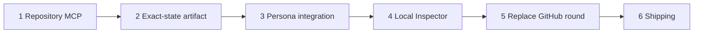

# Local Inspector review - phased implementation

Source plan: `docs/plans/local-inspector-review/plan.md`. The operator approved its design and
decisions on 2026-11-23 as managed plan revision 7. The text beside this index is a later
revision. Revisions 8 and 9 added this index and the phase files, and later revisions corrected
wording after review. None changed a decision, and the source plan's review record lists what
each correction changed. Approval: the operator set a standing approval for this plan on
2026-11-23, so every revision from 9 on was approved when it was filed, the merged one
included. Revision 8 was replaced by revision 9 before approval was requested. Mission Control
holds the record for each exact revision, and the pull request description names the revision
being merged.

Six serial merge units. Phases 1 to 3 are the three phases of the approved repository-access
plan and keep their existing phase files. Phases 4 to 6 are new and have phase files beside
this index.

## Incorporated decisions

| Id | Requirement for the phases |
| --- | --- |
| R1 | The Local Inspector always reads the whole submitted worktree. No diff-only mode. Without access it blocks |
| R2 | Repository access is available to every Persona-based reviewer |
| D1 | A Local Inspector stage runs the Inspector review before the Pull Request action |
| D2 | Shipping accepts a matching local review as merge provenance |
| D3 | The stage's blocking severity is tunable, default major and above |
| D4 | The approved repository-access plan is built first, for Codex and Claude together. No Claude-only step |
| Follow-up | The operator selected "Create phased implementation plan" on 2026-11-23 |

## Repository investigation

Read on 2026-11-23 at `9f4db6308`. `origin/main` was 50 commits ahead at `3b362a751`. Those
commits change `src/server/workflows/manager.ts`, `engine.ts`, `store.ts` and
`src/shared/workflow.ts`, and nothing under `src/server/inspector/`, `src/server/llm/`,
`src/shared/shipping.ts` or `docs/plans/persona-repository-access/`.

### What Phases 4 to 6 build on

- `WORKFLOW_CHECK_SLOTS` and `WORKFLOW_COMMAND_INTERPRETERS` in `src/shared/workflow.ts` are
  the slot registry. `runCheck` in `src/server/workflows/checks.ts` dispatches by interpreter.
- The `coderabbit` slot is the precedent for an owned reviewer slot. It touches the registry,
  `src/shared/protocol.ts`, `checks.ts`, `coderabbit.ts`, `engine.ts`, `context.ts`,
  `commands.ts`, `store.ts`, `command-artifacts.ts`, `src/server/db.ts`, `routes.ts`,
  `settings-backups/restore.ts`, `src/web/workflows/CommandLibrary.tsx`, `WorkflowRuns.tsx`
  and `WorkflowProperties.tsx`.
- The Inspector review is `reviewRound` in `src/server/inspector/worker.ts`, with
  `buildReviewPrompt` in `prompt.ts`, `planReview` in `verdict.ts` and `findings-text.ts`.
- The completion gate is `evaluateInspectorGate` in `src/server/workflows/manager.ts`. It
  already compares the pull request head's Git tree with the submission's publication tree
  through `resolveCommitTree`.
- The merge predicate is `mergeVerdict` in `src/shared/shipping.ts`, with `MergeBlock` reasons.
  Postures are `INSPECTOR_POSTURES` in `src/shared/inspector.ts`.
- Preview flags are declared in `src/shared/feature-flag-registry.ts`.

### Revalidation of the approved repository-access phases

- Every existing path the three phase files cite still exists: 6, 6 and 22 paths. Every path
  or identifier that is missing is one the phase itself creates. None of the plan is
  implemented.
- No backlog task exists for those phases, so this plan schedules them.

The amendments below are controlling for implementation. None alters an approved decision or
requirement of that plan. They record what current `main` and Phase 4 need its implementation
to account for.

| Id | Applies to | Amendment |
| --- | --- | --- |
| A1 | Phases 1, 3 | A Persona node may carry `executionOverride` (runner, model, effort), resolved by `resolveWorkflowNodeExecution` (#1008, #1421). The workload runs with that resolved execution, not the Persona's own |
| A2 | Phase 3 | The Persona attempt now has a durable review-contract loop (`reviewInput`, one correction call, retained rejected verdicts) and a ten-minute provider-retry window with a token-exhaustion block (#1012, #1170). The `read` arm preserves them. `none` stays byte-identical |
| A3 | Phase 2 | Capture now also writes a review snapshot commit (`reviewCommit`) and a publication tree for uncommitted work (#1309). The exact-state artifact is a separate, layered capture taken inside the same stable boundary. It does not replace or alter the review snapshot that Commands and the Inspector gate pin to |
| A4 | Phase 1 | Claude's default one-shot transport is the Agent SDK and Codex has an SDK transport (`src/server/llm/claude-sdk.ts`, `codex-sdk.ts`). The workload adapters build on those |
| A5 | Phase 3 | User-facing features land behind a preview flag (`docs/feature-flags.md`). The Persona access control ships behind one |
| A6 | Phase 1 | The workload's terminal result is a closed, append-only discriminated kind whose only member in Phase 1 is `persona_verdict`. Phase 4 appends `inspector_verdict` without a new transport version |
| A7 | Phase 3 | Whether a submission captures the artifact is one predicate over the pinned graph (a read-enabled Persona). Phase 4 adds the `inspector` Command node to that same predicate |
| A8 | Phases 1 to 3 | The files name the repository `ai-harness`. It is `mission-control` |

## Sizing and phase count

Gross production lines added or materially changed, tests excluded.

| Phase | Estimate | Basis |
| --- | --- | --- |
| 1 to 3 | 4,800 to 6,200 | The approved plan's own estimate |
| 4 | 900 to 1,300 | Review core extraction, slot and interpreter, engine check path, setting, two UI surfaces |
| 5 | 500 to 800 | Built-in version, gate path, worker skip, posture value, chip and Completion states |
| 6 | 200 to 350 | Merge predicate, block reason, merge queue and Prerequisites copy |

Phases 1 to 3 are fixed by the approved plan, which found no safe concurrency between them.
Phase 4 stays apart from Phase 3 because it is a second consumer with its own slot, setting
and UI, and Phase 3 is already 1,500 to 1,900 lines. Phase 5 stays apart from Phase 4 because
Phase 4 is the proving period: the operator measures remaining GitHub rounds before anything
remote is switched off. Phase 6 is small, but it changes the one irreversible action, the
merge, and is reviewed alone.

## Phase map

| # | Phase | Phase file | Depends on | UI |
| --- | --- | --- | --- | --- |
| 1 | Repository MCP and workload foundation | `docs/plans/persona-repository-access/phase-1-repository-mcp-workload-foundation.md` | Planning session | No |
| 2 | Portable exact-state artifact | `docs/plans/persona-repository-access/phase-2-portable-exact-state-artifact.md` | Phase 1 | No |
| 3 | Persona and Workflow integration | `docs/plans/persona-repository-access/phase-3-persona-workflow-integration.md` | Phase 2 | Yes |
| 4 | Local Inspector Command | `docs/plans/local-inspector-review/phase-4-local-inspector-command.md` | Phase 3 | Yes |
| 5 | Local review replaces the GitHub round | `docs/plans/local-inspector-review/phase-5-local-review-gate.md` | Phase 4 | Yes |
| 6 | Shipping on local provenance | `docs/plans/local-inspector-review/phase-6-shipping-local-provenance.md` | Phase 5 | Yes |

Phases 1 to 3 are implemented from the approved phase files, read together with
`docs/plans/persona-repository-access/plan.md`, its `phased-plan.md`, and amendments A1 to A8.
They are not rewritten here, so each has one implementation guide.

## Concurrency and merge order

None of the phases can run concurrently. The merge order is 1, 2, 3, 4, 5, 6. Every task also
depends on the planning session, so no phase starts before these files are on the default
branch.

The graph releases Phase 5 when Phase 4 merges. The proving period between them is the
operator's decision, not something the graph enforces: hold the Phase 5 task in the backlog
until the Phase 4 measurement is in.

## Cross-phase contracts

### From Phases 1 to 3, consumed by Phase 4

- `PersonaWorkloadExecutor` dispatches one isolated provider session with only the repository
  MCP server registered and returns one validated terminal result (A6).
- `WorkflowRepositoryArtifactService` owns the exact-state artifact. A submission has an
  active claim before any workload reads it (A7).
- Repository bodies stay inside the workload. Mission Control receives lifecycle events, safe
  audit metadata and the terminal result.

### Established by Phase 4, consumed by Phases 5 and 6

- The slot id `inspector`, the result kind `inspector_verdict`, and the preview flag id
  `local-inspector` are persisted and never renamed.
- `InspectorConfig.localReview` is the one setting. It reads as off while the flag is off.
- A Local Inspector attempt records its outcome as passed, failed, skipped or blocked,
  together with the submission's publication tree, base ref, merge base, blocking severity and
  retained findings. "Passed" always means the review ran with repository access.

### Established by Phase 5, consumed by Phase 6

- The workflow manager is the single owner of the question "does this pull request head match
  a passed local review". The Inspector worker asks it through the existing gate seam. The
  match is by Git tree and base branch, so a later commit with the same tree still matches.
- The posture value `local` is appended to `INSPECTOR_POSTURES` in Phase 5, because the worker
  and the chip need it. Until Phase 6 the merge predicate keeps refusing it.
- Until Phase 6, a repository holding the merge grant is never treated as locally reviewed:
  the gate and the worker keep the GitHub review for every head there. Phase 6 removes that
  exception in the same change that teaches the merge predicate the `local` posture.
- The posture `local` is recorded only while the Inspector's current posture is `live`. In
  Dry run a matched head is recorded as `dry-run`. Phase 6 keeps the merge predicate's
  current-posture gate first, so nothing merges in Dry run, a matching local pass included.

## Final verification strategy

- Each phase runs its own focused tests, `npm run typecheck` and `npm run lint`. A phase with
  UI adds a Playwright spec and runs `npm run build`, `npm run smoke` and `npm run test:e2e`.
- After Phase 4: in a duplicated No-Mistakes workflow with the stage before the Pull Request
  action, a failing local review returns findings without a push, and a Codex review shows
  repository queries in its audit.
- After Phase 5: a converged change produces one push and one CI run and completes with no
  GitHub review. A binding pinned to version 22 behaves as before. A repository
  holding the merge grant still gets a GitHub review for every head.
- After Phase 6: a locally reviewed head merges under YOLO, and a head whose tree changed
  after the pass does not. In Dry run nothing merges.
