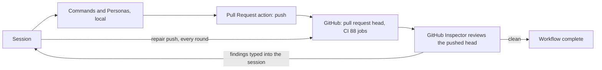
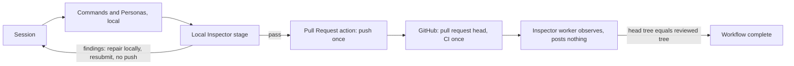

# Run Inspector rounds locally, before the pull request

Status: In review, not approved (revision 3). Decisions D1 to D4 each carry a proposed choice.
None is adopted until the operator selects it and approves the exact revision.

This is an analysis and options plan. Nothing in it is implemented.
Measured on 2026-11-20 and 2026-11-21 against `main` at `9f4db6308` and this machine's
Inspector ledger.

## Summary

You asked three things: how workflow Personas and Inspector differ, what the options are for
moving Inspector's rounds into the workflow, and what a "local only" setting would take. In
review you then asked how to include worktree read access for the Persona judges and a new
Inspector judge.

1. **The difference you named is real in the code but not on this installation.** On Claude,
   Inspector gets `Read`, `Grep` and `Glob` in the session worktree and Personas get no tools.
   Your Inspector has run on Codex since 2026-09-15, and Codex gets no tools at all. All 1,143
   review calls recorded since 2026-09-22 read the diff in the prompt and nothing else.
   Worktree access is not what separates your Inspector from your Personas today.
2. **What separates them is the loop, not the reader.** Inspector keeps a findings ledger in
   which any open finding blocks, reviews the whole diff from scratch on every push, never
   keeps a pass, and may run 100 rounds. A Persona returns one pass or fail and keeps a pass
   for the rest of the run. And an Inspector round can only start from a pushed head, so every
   round costs a push and a full CI run.
3. **A setting that only stops the GitHub comments already exists and saves no CI.** That is
   Dry run. Comments do not burn CI. The push each repair needs does. The setting that solves
   the problem changes what a review starts from (the local snapshot, before the push), not
   where its output goes.
4. **Recommendation: Option A, a Local Inspector stage.** Run the same Inspector review (same
   brief, prompt, model setting and finding fingerprints) as a new workflow stage placed
   before the Pull Request action, on the Command-stage machinery that the Local CodeRabbit
   Command already established. One new Inspector setting turns it on. The review moves: the
   step after the pull request stops reviewing and only checks that what was pushed is what
   was reviewed. That new stage is the Inspector judge.
5. **Read access is worth adding, as a separate lever.** It makes judges more thorough. It does
   not make rounds fewer: the one comparison the ledger holds shows more findings with read
   tools and the same number of rounds. Local rounds are what make that thoroughness
   affordable, so the two belong in one plan. The Inspector judge gets read access from Phase
   1 whenever it runs on Claude. Persona judges get it in a fourth phase (decision D4).

## The problem, measured

`teamupstart/mission-control`, pull requests adopted from 2026-09-22 to 2026-11-20:

| Measure | Value |
| --- | --- |
| Pull requests Inspector reviewed | 245 |
| Review rounds | 1,060 (mean 4.3, median 3, maximum 22) |
| Rounds after the first | 815 |
| Pull requests with 5 or more rounds | 86 (35%) |
| Pull requests with 8 or more rounds | 41 (17%), holding 495 rounds, 47% of all rounds |
| Findings recorded | about 500 on 125 pull requests: 9 blocker, 301 major, 190 minor |
| Findings raised or re-raised in round 2 or later | 376 (75%) |
| Findings raised or re-raised in round 4 or later | 264 (53%) |
| CI per push | 88 jobs, 217 to 226 job-minutes (two sampled runs) |
| Inspector rounds against CI runs, five sampled pull requests | 6/6, 8/9, 6/6, 5/5, 6/6 |
| Estimated CI spent on rounds after the first | about 815 runs x 220 job-minutes = 180,000 job-minutes (3,000 job-hours) |

The last row is an estimate. It assumes every round after the first followed a push whose CI
ran to completion, which the five sampled pull requests support.

Two readings matter for the design:

- **One Inspector round is one push is one CI run.** The sample is one to one.
- **Rounds do not converge on a fixed list.** Three quarters of findings arrive after the first
  review. Each push is reviewed from scratch and usually turns up something new, so the gate
  ends only when a full fresh review happens to return nothing. Moving rounds local makes each
  one cheap. It does not by itself make them fewer. Decision D3 is the lever for that.

## How workflow Personas and Inspector differ

| Aspect | Workflow Persona | GitHub Inspector |
| --- | --- | --- |
| When it runs | On each workflow submission, before the pull request exists | After the pull request exists, on every pushed head, found by a 90 second poll |
| What it reviews | An immutable local snapshot: the branch diff, including uncommitted and untracked work | The diff GitHub serves for the pushed head |
| Repository access | None. The prompt is everything it sees (`src/server/workflows/engine.ts:1226` passes no tool grant) | Claude: `Read`, `Grep`, `Glob` in the session worktree, with deny paths. Codex: none (`src/server/llm/codex.ts:471`, `sandbox: null`; it runs in a temp directory with the shell tool off) |
| Context | Human goal, decisions, acceptance criteria, steering, transcript, upstream Command results, registered evidence and images, repository standards, earlier Persona feedback | `INSPECTOR.md` brief, repository standards (`CLAUDE.md`, `AGENTS.md`, memory index), the pull request title and description, its own open findings |
| Guidance | Persona Markdown frozen into the published workflow version | `INSPECTOR.md` from the reviewed repository, read fresh every round |
| Output | One verdict: pass, or fail with requested changes and evidence quotes | A findings list (path, line, severity, title, body) plus the fingerprints it declares resolved |
| Memory across rounds | A pass is kept for the rest of the run (`skipPassedJudges`) unless the node sets Recheck after repairs. Earlier feedback is history only | A fingerprinted ledger (`inspector_comments`). A finding stays open until a later round names it resolved. Nothing is ever "passed" |
| What ends the loop | Every judge has passed once | A fresh review of the current head returns nothing new and every earlier finding is resolved, minor ones included |
| Round limit | Maximum repair rounds, default 5, up to 20 | 100 reviews per pull request. Gate repairs also draw on the run's repair rounds |
| Cost of one more round | Model calls for the judges that have not passed | A push, a full CI run, GitHub API calls, the poll wait, and the model call |
| Side effects | None outside Mission Control | Live: review comments, replies, thread resolution, a safe-to-merge comment. Dry run: nothing posted |
| Model | Per node. Built-ins pin Codex `gpt-6-sol` | Settings > Models. Yours is Codex `gpt-6-sol` |
| What depends on it | The Pull Request action waits for it | The Inspector completion gate (No-Mistakes version 18 onward), Shipping (needs a Live published review of the exact head), the session chip, Foreman relay |

Three consequences:

- **On this installation the two reviewers have the same reader**: the same model, seeing only
  a diff. Inspector's extra findings come from a different brief, an itemized output in which
  any item blocks, and a fresh sample on every push.
- **Observation is separate from review.** The Inspector worker is also the only thing that
  reads adopted pull requests from GitHub (state, head, checks, CodeRabbit follow-up, stacks,
  Shipping). A local review replaces none of that, so the worker stays.
- **On Claude the remote review is less exact than it looks.** Its tools read the live session
  worktree (`liveDir`, `src/server/inspector/worker.ts:375`), which can be ahead of the pushed
  head it is reviewing. A local stage pinned to the snapshot commit reads exactly what it judges.

## What already exists that this builds on

- **Local CodeRabbit Command** (No-Mistakes version 22, `src/server/workflows/coderabbit.ts`).
  A third-party reviewer running as a Command stage before the Personas, against the review
  snapshot commit, with retained and paged findings, a per-run allowance of 10, a severity
  threshold, and block-or-skip policies. It is the shape a Local Inspector needs. The slot
  registry (`WORKFLOW_CHECK_SLOTS`, `WORKFLOW_COMMAND_INTERPRETERS` in `src/shared/workflow.ts`)
  is the sanctioned extension point.
- **Review snapshot and publication tree.** An uncommitted submission is reviewed as a commit
  of exactly the captured content. The Inspector gate and the Pull Request action already
  compare the pull request head's Git tree with it.
- **Dry run.** Inspector already reviews without posting and relays findings to the session.
- **The Inspector review core.** `buildReviewPrompt` (`src/server/inspector/prompt.ts`),
  `planReview` (`src/server/inspector/verdict.ts`) and the findings text renderer
  (`src/server/inspector/findings-text.ts`) do not depend on GitHub. Only the diff fetch, the
  pull request title and body, line anchoring and posting do.
- **The sandboxed read grant.** `LlmRunner.sandbox` (`src/shared/llm.ts`) and the Inspector's
  `REVIEW_TOOLS` and `DENY_PATHS` (`src/server/inspector/worker.ts`) already give a Claude
  review `Read`, `Grep` and `Glob` in one directory with secret paths denied.
- **The earlier plan** `docs/plans/pre-pr-inspector/plan.md` (August 2026) chose a Code Quality
  Judge Persona. Versions 9 to 17 ran without the Inspector gate. Version 18 (#1043) restored
  it for the High Rigor preset. This plan is that plan's Option C, now far cheaper because of
  the items above.
- **Persona repository access** (`docs/plans/persona-repository-access/plan.md`) was approved in
  September 2026 and is not present in `src/`. Decision D4 says how this plan relates to it.

## Flow change

Today, every Inspector round is a push:

With Option A, the rounds happen before the push:

### Stage order, before and after

The Inspector review does not stay where it is. It moves from after the pull request to a new
stage before it.

| Order | No-Mistakes version 22, today | Version 23, proposed |
| --- | --- | --- |
| 1 | Typecheck, test, lint | Same |
| 2 | CodeRabbit, when the repository enables it | Same |
| 3 | Intent Conformance, Test Coverage | Same |
| 4 | Code Risk, Code Quality, Code Design | Same |
| 5 | Test Evidence, Documentation, Slop Filter | Same |
| 6 | Pull Request action: push | **Local Inspector, a new stage.** It reviews the local snapshot. Findings return to the session, which repairs and resubmits without pushing. Every Inspector round happens here |
| 7 | After the pull request: GitHub Inspector reviews the pushed head. Each finding means repair, push, CI, and another review | Pull Request action: one push, one CI run |
| 8 | None | After the pull request: no review. A check confirms that the pushed content is the content stage 6 passed |

## Options

### Option A: Local Inspector stage (proposed)

Run the real Inspector review as a workflow stage before the Pull Request action, and let a
setting tell the GitHub worker to skip heads that stage already reviewed. Design below.

- Gains: the same reviewer, brief, model setting and fingerprints, moved in front of the push.
  Each round costs one model call and no CI. One push, one CI run, for a converged change.
- Costs: three phases, four with read access for Persona judges. A new owned Command slot, an
  engine seam for an in-daemon review inside the Command runtime, a setting, a new built-in
  version, and gate and Shipping changes.
- Does not by itself reduce the number of rounds. See D3.

### Option B: an Inspector Persona, no new runtime

Author a built-in Persona from the Inspector brief, place it last before the Pull Request
action with Recheck after repairs, publish a No-Mistakes version without the Inspector gate,
and switch GitHub Inspector to Dry run or off.

- Gains: one small pull request. Every existing Persona surface works unchanged.
- Costs: it is a third code-review Persona beside Code Quality Judge and Code Design Reviewer,
  not the Inspector. No findings ledger, severity, fingerprints, or per-repository
  `INSPECTOR.md` read fresh. Its fidelity to today's Inspector is unproven, and versions 9 to
  17 already ran this shape with Code Quality Judge before the gate was restored. Shipping
  still needs a Live GitHub review, so repositories with the merge grant keep remote rounds.

### Option C: keep the rounds on GitHub, stop paying CI for them

Open pull requests as drafts, make each repository's CI skip drafts, let Inspector converge on
the draft, then promote it so CI runs once.

- Gains: almost no Mission Control work.
- Costs: it edits every repository's CI configuration, which is release infrastructure outside
  this product. Rounds are no faster, since push and poll remain. CI failures surface only
  after Inspector converges and can restart the loop. Mission Control would need to promote
  drafts itself, which the draft setting forbids today.

### Option D: Persona repository access first

Build the approved repository-access plan (three phases), then express Inspector as a Persona
with read access.

- Gains: gives every Persona, on Claude and Codex alike, the worktree access you named.
- Costs: the largest option, and alone it does not address the cause. Your Inspector has had
  no repository access since 2026-09-15 and still produced these rounds. Read access is worth
  having for review depth, which is why this plan adds it to Option A as its own phase rather
  than making it a prerequisite. See "Read access for the judges".

## Recommended design (Option A)

### 1. A review core that accepts a local subject

Extract from `reviewRound` (`src/server/inspector/worker.ts`) the part that does not need
GitHub: brief, standards, prompt, runner options, verdict parsing, and planning. Feed it:

| Input | GitHub review today | Local review |
| --- | --- | --- |
| Diff | `gh api` pull request diff | `git diff <merge-base> <review snapshot commit>`, same byte cap |
| Base | The pull request's base | The base ref resolution CodeRabbit already uses, frozen per submission |
| Title and description | Pull request title and body | The run's captured goal, fenced as untrusted, same cap |
| Brief and standards | `readBrief`, `readStandards` | The same calls |
| Open findings | Ledger rows for the pull request | Unresolved findings of this stage's previous attempt in the same run |
| Tools | Claude: read tools in the session worktree. Codex: none | Claude: the same grant and deny paths in a worktree pinned to the snapshot commit. Codex: none |
| Output | Posted or drafted comments | Findings retained on the attempt. Nothing posted |

The output schema, fingerprints, secret scrubber and the rule that a finding must name a
changed file all stay. The policy text changes one sentence: findings go to the author's
session rather than to public comments. Spend is recorded under the existing
`inspector:review` role.

### 2. An `inspector` Command slot: the Local Inspector

Append `inspector` to `WORKFLOW_CHECK_SLOTS` with its own interpreter, owned like `coderabbit`
(no editable argv). In Library > Commands it carries an allowance per run (default 10), a
timeout (default 10 minutes, the Inspector's own), and the exhaustion policy (default Block for
operator action).

- **Passes** when the review returns no blocking finding and every earlier blocking finding is
  resolved.
- **Fails** with a repair packet that lists each unresolved finding in full (severity, path and
  line, title, body), rendered by the existing findings text renderer. The session repairs
  locally and the next submission is reviewed. Nothing is pushed.
- **Skips with a note** when Local review is off, Inspector is off, or the repository lacks the
  Commands consent every Command already needs.
- **Blocks for the operator** on a provider failure, an oversize diff, or a spent allowance.
  None of these spends a repair round or sends a code-fix packet.

Findings are retained as the attempt's normalized findings, read through the existing Load
findings control and `read_workflow_command_output`.

Why a Command stage and nothing else:

- Not a Persona: the Persona path has no findings ledger, severity or fingerprints, and its
  guidance is frozen at publish, while `INSPECTOR.md` belongs to the reviewed repository.
- Not a new node kind: every graph surface (schema, validation, editor, pipeline view, run
  detail, export) would need it. The `check` wire kind already carries one reviewer.
- Not the completion policy: it runs after End, which is after the Pull Request action.

### 3. One setting: review in the workflow before the pull request

Add a boolean to the Inspector config, `localReview`, default off. It lives in the existing
`inspector` config blob, so it needs no migration. Settings > GitHub Inspector shows it as
**Review in the workflow before the pull request opens**. It combines with the existing mode:

| Setting | Before the pull request | After the pull request |
| --- | --- | --- |
| Local review off (today) | Nothing | Every pushed head is reviewed on GitHub. Live posts, Dry run records |
| Local review on, Dry run | Local Inspector rounds | Heads matching a local pass: nothing. Other heads: reviewed, never posted. This is "local only, no GitHub comments" |
| Local review on, Live | Local Inspector rounds | Heads matching a local pass: nothing. Other heads: reviewed and posted as today |

"Other heads" are later pushes whose content differs from what was reviewed locally (CI
repairs, conflict merges, branch updates), pull requests from workflow versions without the
stage, and pull requests opened outside a workflow. They keep the path they have today, so no
pull request silently loses review and no in-flight run is stranded when the setting flips.

The whole feature sits behind a preview feature flag, per `docs/feature-flags.md`. With the
flag off the control is hidden and the stored value reads as off.

### 4. A new built-in version, with the review moved before the pull request

No-Mistakes Review version 23 is version 22 plus one evaluation stage holding the Local
Inspector, placed last before the Pull Request action, so it reviews content every other
reviewer has already accepted. See "Stage order, before and after".

With Local review on, the review no longer happens after the pull request. Version 23 keeps
the `inspector` completion policy for two reasons only: so the step after the pull request can
run the check in item 5, and so that with Local review off the new stage skips with a note and
version 23 behaves exactly as version 22. That makes it safe as the current version for every
installation. Existing bindings keep their pinned version.

### 5. After the pull request: a check, not a review

With Local review on, the Inspector completion gate is satisfied when both hold:

1. the submission's Local Inspector attempt **passed** (not skipped) on publication tree T; and
2. the adopted, open pull request's head has Git tree T, the comparison the gate and the Pull
   Request action already make.

No remote model call and no comment. The step stays for two reasons:

- **Proof of what was pushed.** It catches a session that commits something different between
  the local pass and the push.
- **Fallback.** A run whose stage was skipped, or whose pinned version has no stage, keeps the
  GitHub review path it has today, and the gate says which path it is on.

Alternative, not proposed: give version 23 no step after the pull request at all
(`completionPolicy: none`, as versions 9 to 17 had). The run would then complete when the pull
request opens. Nothing would confirm that the pushed content is the reviewed content, and with
Local review off the version would lose the GitHub gate version 22 has.

### 6. The GitHub worker skips what was reviewed locally

The worker still sweeps every adopted pull request for observation: state, head, checks,
CodeRabbit follow-up, stack lifecycle and Shipping. For a head whose tree matches a passed
local review it starts no review, answers no thread and posts nothing. Existing Inspector
threads on pull requests already open are left as they are.

### 7. Shipping (decision D2)

Shipping today requires a Live, published GitHub review of the exact head. A locally reviewed
head has none. Either Shipping learns to accept a matching local review as merge provenance (a
new review posture, `local`, appended to `INSPECTOR_POSTURES`, valid only while Local review is
on and only for a head whose tree and base match), or repositories holding the merge grant keep
the GitHub review for every head.

### User-visible surfaces

Every one needs a Playwright spec, and the modal inset check where a modal opens:

- Settings > GitHub Inspector: the Local review control and its explanation of the three rows
  above.
- Library > Commands: the Local Inspector row (allowance, timeout, exhaustion policy, blocking
  severity per D3).
- Workflow pipeline view: the new stage in version 23.
- Run detail: the Local Inspector card with findings and whether it ran with read tools, and
  the Completion tab's "reviewed locally" state.
- Session chip and Shipping merge queue: the local posture and its block reasons.
- Persona node Routing panel (Phase 4): the read access control and its provider diagnostic.

### What does not change

- Published workflow versions, bindings, node ids, and the `mission-inspector:v1` marker.
- The adoption rule: only pull requests Mission Control proved it opened.
- One GitHub poller. The daemon is the only database writer.
- Dry run still means dry for the merge.
- Persisted identifiers are appended, never renamed: the `inspector` slot, the `local`
  posture, and the `repository` evidence kind.

## Read access for the judges

Added in revision 2, from the review discussion.

### What the ledger says

Inspector ran on Claude with read tools for one week before it moved to Codex, which has none.
That is the only comparison this installation holds (`teamupstart/mission-control`, all pull
requests with at least one review):

| Inspector configuration | Pull requests | Findings per pull request | Pull requests with any finding | Major or worse per pull request | Rounds per pull request |
| --- | --- | --- | --- | --- | --- |
| Claude `claude-sonnet-5`, read tools (adopted 2026-09-08 to 09-14) | 71 | 2.58 | 79% | 0.93 | 4.1 |
| Codex `gpt-5.6-sol`, no tools (2026-09-15 to 09-25) | 67 | 1.79 | 61% | 1.25 | 3.5 |
| Codex `gpt-6-sol`, no tools (2026-09-26 on) | 226 | 2.13 | 50% | 1.31 | 4.5 |

The model changed along with the tools, and so did the work under review, so this is
suggestive and nothing more. Read with that caution: with read tools Inspector flagged more
pull requests and found about a fifth more per pull request, mostly minor, and the number of
rounds did not move. Read access is a thoroughness lever. It is not a rounds lever.

### Where it helps, and where it does not

| Judge | Expected benefit | Why |
| --- | --- | --- |
| Local Inspector (the Inspector judge) | High | Its brief tells it to open files before it comments. On Codex it cannot |
| Code Design Reviewer | High | "This duplicates a helper that already exists" needs to know what exists |
| Test Coverage Judge | High | Whether a test exists, and whether it reaches the production path |
| Documentation Steward | High | Stale documents are found by searching. Today the author must register document text as evidence |
| Code Risk Reviewer, Code Quality Judge | Medium to high | Callers, error paths and resource lifetimes outside the changed hunk |
| Slop Filter | Medium | It can check that an API or import exists before calling it invented |
| Intent Conformance Judge, Test Evidence Auditor | Low | They judge the goal and the registered evidence, not the repository |

It also removes one ceiling: the Persona prompt truncates a large diff, and a judge with read
access can open what was cut.

### What it costs

- **Provider.** Only Claude can take the sandboxed read grant today. Codex declares no sandbox
  because it cannot restrict reads to one directory. Every built-in judge is pinned to Codex
  `gpt-6-sol`, so a read-enabled judge is a judge routed to Claude until Codex has an
  equivalent.
- **Time and spend.** `docs/inspector-and-shipping.md` records 225 to 272 seconds for a
  tool-using review of a 10 KB diff. A prompt-only judge is one call. Read access belongs on
  the judges that need it, not on all of them.
- **Verdict contract.** A requested change must cite evidence. A file the judge read needs a
  new evidence kind, `repository`, appended to the existing eight.
- **Capacity.** Pinned worktrees come from a pool that runs two Commands at once. Read-enabled
  judges in one stage must share one read-only tree per submission, not take one each.
- **More findings mean more rounds** unless the blocking threshold in D3 is set.

### The Inspector judge

The Local Inspector stage is the Inspector judge. Design item 1 already gives it the read
grant in a worktree pinned to the snapshot commit whenever its provider can sandbox one. On
this installation that means it reads the worktree as soon as Inspector's provider in
Settings > Models is Claude, and it stays diff-only on Codex. No extra build. Its run card
says which of the two it ran with.

### Two ways to give Persona judges read access (decision D4)

**Slim path (proposed): one phase, Claude only.** A Persona node gains an optional
`repositoryAccess: "read"` flag, set in the node's Routing panel and frozen at publish beside
`executionOverride` and `recheckAfterRepair`. An absent flag keeps today's prompt-only
behavior, so no stored graph changes. A flagged node runs with the Inspector's read grant
(`Read`, `Grep`, `Glob`, the same deny paths) in the worktree pinned to the review snapshot
commit, through the lease seam Phase 1 builds. Its prompt, registered evidence, transcript and
verdict are otherwise unchanged. A flagged node routed to a provider that cannot sandbox the
grant is a publish diagnostic, never a silent prompt-only fallback. It ships behind its own
preview flag and is proven in a duplicated workflow. Built-in versions change only after the
measurements below, as a separate decision.

This path departs from the approved repository-access plan in three stated ways: Claude only
rather than provider parity, a clean snapshot commit rather than a layered exact-state
artifact, and the choice stored on the workflow node rather than on the Persona. Choosing it
supersedes those requirements for this work. The approved plan stays the route to Codex parity
later, replacing the executor under the same node flag.

**Full path: the approved plan, three phases.** Both providers through a local repository MCP
server, an exact-state artifact, per-operation audit events. It is independent of Option A and
could later give a Codex Inspector read access too. It is three phases before any judge reads
a file, against a gain the ledger suggests is real but modest.

**Neither.** Persona judges stay prompt-only. Only the Inspector judge reads, and only on
Claude.

Suggested first judges for the duplicated workflow: Code Design Reviewer, Test Coverage Judge,
Documentation Steward, Code Risk Reviewer and Code Quality Judge.

## Phases (outline)

| Phase | Delivers | Proves |
| --- | --- | --- |
| 1. Local Inspector Command | Review core extraction, the `inspector` slot and interpreter with the read grant in a pinned worktree, findings retention and repair packet, the `localReview` setting gating only whether the stage runs, the Library row and run card, preview flag, docs | The stage works in a duplicated workflow while GitHub Inspector still gates. The ledger then shows how many GitHub rounds remain after a local pass, against the 4.3 baseline |
| 2. Local review replaces the GitHub round | No-Mistakes version 23, the gate accepting a matching local pass, the worker skipping matched heads, Settings control copy, Completion tab and chip states | A converged change reaches GitHub with one push and one CI run, and completes with no GitHub review |
| 3. Shipping on local provenance (if D2 says so) | The `local` posture in the merge predicate, merge queue reasons, Trust and Prerequisites copy | YOLO merges a locally reviewed head and holds any head that is not |
| 4. Read access for Persona judges (if D4 says slim) | The node flag and Routing control, the engine path with the grant in the shared pinned tree, the `repository` evidence kind, the publish diagnostic, its preview flag, docs | In a duplicated workflow, read-enabled judges against their prompt-only twins: findings per round, findings later withdrawn, time and spend per review |

Phases 2 and 4 each depend on Phase 1 only. Phase 3 depends on Phase 2.

Phase 1 is deliberately useful alone: it is the proving period. If GitHub rounds after a local
pass stay near zero, Phase 2 is safe. If they do not, the gap is measurable before anything
remote is switched off.

## Risks and open questions

- **Round count.** Local rounds draw on the run's repair budget, default 5, and 35% of pull
  requests took 5 or more Inspector rounds. Read access raises the finding count further.
  Without D3, expect runs to stop for a rounds grant. The budget stays operator-adjustable per
  built-in.
- **Engine seam.** The Command runtime spawns an argv in a leased worktree. The Local Inspector
  and a read-enabled Persona are in-daemon model calls that need a lease only when the provider
  can sandbox read tools. Phase 1 must add that seam without a second lease or execution path.
- **Prompt drift.** A local review sees the goal instead of a pull request description. Phase 1
  measures whether its findings match the GitHub review's on the same content.
- **Base drift.** The local diff is against the base as it was at review time. The tree match
  proves the head's content, not that the base did not move. Personas have the same exposure.
- **Spend.** A local round costs the same review call as a GitHub round, and a read-enabled
  review costs several times a prompt-only one. The saving is CI and waiting, not tokens.
- **Instructions in repository files.** A judge that reads files can read text written to steer
  it. The files are the operator's own repository at the snapshot, the grant is read-only with
  secret paths denied, and a clean checkout holds no untracked `.env`. The exposure matches
  the Inspector's today.
- **Two findings stores.** Local findings are run data on the attempt. The Inspections table
  keeps listing GitHub reviews only. Phase 2 decides whether to mirror them at adoption.
- **Residual GitHub rounds.** A later push that changes the reviewed content (a CI repair, a
  conflict merge) is an "other head" and is reviewed on GitHub as today.

## Verification

- Focused node tests for the review core with a fake runner: local diff, open-finding carry,
  resolution, blocking threshold, off-diff drop, scrubbing, grant present or absent by provider.
- Engine tests: stage ordering before the Pull Request action, the repair loop on fresh
  evidence, allowance and exhaustion policy, skip reasons, restart recovery.
- Gate tests: a matching tree completes, a moved head does not, a skipped stage falls back.
- Worker tests: no review, reply or post for a matched head. Observation continues.
- Shipping tests (Phase 3): refusal for an unreviewed, amended or later-pushed head.
- Persona read tests (Phase 4): an unflagged node is byte-identical to today, a flagged node
  receives the grant in the pinned tree, a flagged Codex node is refused at publish, a
  `repository` evidence reference validates.
- Playwright specs for every surface above. Typecheck, lint, build, smoke.

## Decisions

Every decision is open. Each row is the proposed choice, not an adopted one. A choice is
adopted only when the operator selects it and approves the exact revision that records it.

| Id | Decision | Proposed choice | State |
| --- | --- | --- | --- |
| D1 | Which option | A, Local Inspector stage | Open, in discussion |
| D2 | Whether Shipping accepts a matching local review as merge provenance | Yes, as Phase 3 | Open, in discussion |
| D3 | Which findings block the local stage | Tunable in Library > Commands, default major and above | Open, in discussion |
| D4 | How Persona judges get read access | Slim path, as Phase 4 | Open, in discussion |
| Follow-up | Phase and schedule this plan, or stop | None proposed. Nothing is scheduled without the operator's selection | Open, in discussion |
| Approval | Approve the exact plan bundle | Not given for any revision | Open |

## Review record

- 2026-11-21, revision 1. The operator moved every decision to discussion and asked how to
  include worktree read access for the Persona judges and a new Inspector judge, with the
  tradeoffs and the expected benefit. No option was selected and the revision was not approved.
- 2026-11-23, revision 2. It answered that in "Read access for the judges" and added decision
  D4 and Phase 4. The operator again moved every decision, the phased follow-up and the
  approval to discussion. No option was selected and the revision was not approved. The
  operator then asked how a local round can exist "in the existing place", since in
  No-Mistakes the Inspector runs after the pull request and would need to become a stage
  before it.
- Revision 3 answers that. It adds "Stage order, before and after", rewrites design items 4
  and 5 to say the review moves before the pull request and the step after it becomes a check,
  and records the alternative of having no step after the pull request. It changes no proposed
  choice. Two questions from the discussion remain the operator's and are carried by D4:
  whether read-enabled judges may run on Claude, and which judges to start with.
- No phased implementation plan exists and no implementation task is scheduled.

## Evidence

- Inspector ledger, read-only: `inspector_prs` and `inspector_comments` in this machine's
  Mission Control database, filtered to `teamupstart/mission-control`. The problem table uses
  `adopted_at` within 60 days of 2026-11-20. The read access table uses every reviewed pull
  request, grouped by adoption date.
- Review provider: `usage_ledger` rows with `note_key = 'inspector:review'`. Claude
  `claude-sonnet-5` from 2026-09-08 to 09-15, then Codex `gpt-5.6-sol` to 09-25 and
  `gpt-6-sol` since. Within the 60 day window: 1,094 on `gpt-6-sol` and 49 on `gpt-5.6-sol`.
  Stored Inspector config: `runner: codex`, `mode: live`.
- CI: job durations for runs 44857733861 and 44857661151, and `ci.yml` run counts for pull
  requests 1553, 1550, 1533, 1523 and 1488, read with `gh`.
- Code: `src/server/inspector/worker.ts` (`inspectorRunOptions`, `liveDir`, `processPr`,
  `reviewRound`, `REVIEW_TOOLS`, `DENY_PATHS`), `src/server/inspector/prompt.ts`,
  `src/server/llm/codex.ts`, `src/shared/llm.ts`, `src/server/workflows/engine.ts`,
  `src/server/workflows/prompt.ts`, `src/server/workflows/coderabbit.ts`,
  `src/server/workflows/builtin-workflows.ts`, `src/shared/inspector.ts`,
  `src/shared/workflow.ts`.
- Docs: `docs/inspector-and-shipping.md`, `docs/workflows.md`, `docs/workflow-system.md`,
  `docs/feature-flags.md`, `docs/agent-guides/change-contracts.md`,
  `docs/plans/pre-pr-inspector/plan.md`, `docs/plans/persona-repository-access/plan.md`.
