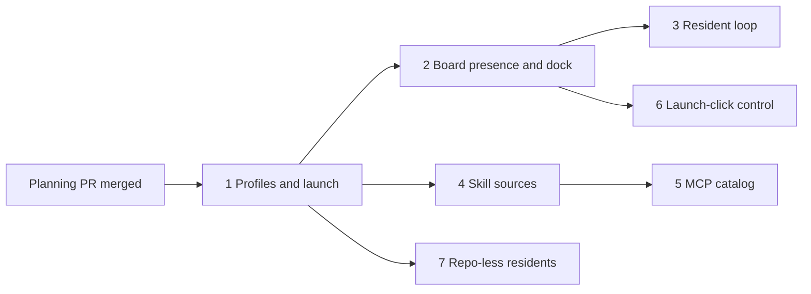

# Residents: phased implementation plan

Source plan: [`docs/plans/persistent-agent-profiles/plan.md`](plan.md) (managed plan
`38fb418e-19ab-4515-946a-a1afcd16524c`, revision 8). Every phase file beside this index is the
proposed route for one pull request; the source plan's outcome and recorded decisions are the
requirements.

## Incorporated decisions

| Decision | Adopted | Owning phase |
|---|---|---|
| Name | Resident | all |
| UI location | Residents dock beside Foreman plus a `#/residents` route page | 1 (page), 2 (dock) |
| Marker | Border glow only; profiles choose color and label | 2 |
| Loop pacing | Daemon cadence plus agent self-pacing within bounds | 3 |
| Spend guardrails | On by default (200 iterations, $20 per rolling 24 hours), editable | 3 |
| Session control | Trusted dispatch click, kept for that run | 6 (after 2) |
| Harnesses | Claude Code and Codex | 1 (launch), 4 and 5 (tools) |
| Workspace | Repository optional | 1 (repository residents), 7 (repo-less) |

## Findings that change the route

- **Every task requires a repository today.** `tasks.repo_root` is `NOT NULL`
  (`src/server/db.ts`) and `DispatchSchema.repoRoot` is required. In `TASK_KIND_BEHAVIOR`
  (`src/shared/task.ts`) every kind declares `repoAvailability: "workspace"` except `pipeline`,
  which declares `"pipeline-enabled"`; neither value allows a task without a repository.
  "Repository optional" therefore needs a deliberate repo-less task path. Phase 1 ships
  residents that require a repository; Phase 7 adds the repo-less workspace behind a new
  `repoAvailability` value, so the riskiest change to a core task invariant gets its own review.
- **No persona seam exists at launch.** Personas are only workflow judges. The resident section
  of standing instructions (Phase 1) is the first launch-time consumer, and it snapshots the
  persona text on the run rather than adding persona versioning.
- **The top-bar Foreman control is `ForemanBar`** (`src/web/components/ForemanBar.tsx`, mounted
  in `src/web/App.tsx`). The dock sits beside it and is not a `PAGE_SEGMENTS` entry, so the
  segment-count guards stay untouched; `#/residents` still joins `MissionRoute` and
  `AppPageShell`'s exhaustive page record.
- **`TurnOrigin`** (`src/shared/types.ts`) is a closed union used to label transcript turns;
  Phase 3 appends `resident`.
- **No per-session spend query exists, and spend is recorded differently per harness.**
  `automationSpendSince` and `recordDriverSessionUsage` (`src/server/db.ts`) are the neighbours;
  Phase 3 adds a session-scoped read beside them.
  - Claude SDK turns are recorded by `recordDriverSessionUsage`, called from
    `src/server/registry.ts`, with the cost Claude Code reports.
  - Codex turns are priced by `estimateStandardApiUsage` against `STANDARD_TOKEN_PRICES`
    (`src/server/harness/codex/pricing.ts`), so a model missing from that table has no spend.
  - Phase 3 verifies both before relying on them.
- **Generated Codex bindings predate `thread/compact/start`.** Phase 3 regenerates them with
  `scripts/codex-app-server-bindings.mjs`; the installed Codex 0.160.0 carries the method.
- **Only `serveDashboardClick` creates trusted clicks** (`src/main/dashboard-click-ipc.ts`,
  registered in `src/main/index.ts` for session control and product issues). Phase 6 adds the
  resident Launch click through the same registrar.
- **Isolation mechanisms exist in the installed binaries.** Claude Code 2.1.310 carries
  `--settings`, the `skillOverrides` and `disableBundledSkills` settings, `--setting-sources`,
  `--plugin-dir`, `--strict-mcp-config` and `CLAUDE_CODE_DISABLE_BUNDLED_SKILLS`. Codex 0.160.0
  carries `skills.config`, `env_vars`, `bearer_token_env_var` and `env_http_headers`.
  `node_modules` is absent in this checkout, so the pinned Claude Agent SDK's typed options are
  unverified. Phases 4 and 5 probe each primary mechanism and its named
  fallback, build whichever passes, and stop to ask the operator only if both fail.
- **A live run must not drift with its profile.** The approved plan applies profile edits at the
  next launch, so every runtime reader (Phases 2, 3, 4, 5 and 6) reads the run's pinned revision.
  Phase 1 owns that rule.

## Sizing

Estimated gross production lines added or materially changed, excluding tests, generated
bindings and documentation: **7,000 to 9,800**. Assumptions: the task, dispatch, SDK
supervisor, standing-instructions, Registry grant, settings-backup and Library rail owners are
reused as inspected; no new harness driver is written; Pi is out of scope. This is a planning
signal, not a diff-size promise.

| Phase | Estimate | Why it is a separate merge unit |
|---|---|---|
| 1 Profiles and launch | 1,700-2,300 | The smallest vertical slice that authors and launches a resident; schema, store, task kind, launch composer, Dispatch tab and editor only work together. |
| 2 Board presence and the dock | 900-1,300 | The chosen UI location and marker are visible-surface work with their own e2e and geometry checks; nothing in Phase 1 depends on them. |
| 3 The resident loop | 1,500-2,100 | The daemon-owned state machine, compaction and guardrails are the highest-concurrency risk; combining with Phase 2 would exceed a reviewable unit. |
| 4 Skill sources and selection | 900-1,300 | A new index, a new setting and per-harness skill delivery with measured isolation; independent of the loop. |
| 5 MCP catalog and selection | 1,100-1,500 | Custom servers, write-only secrets and per-harness MCP rendering form one security-relevant slice; it reuses Phase 4's launch extension seam. |
| 6 Session control via the Launch click | 400-650 | Amends a documented security contract; it deserves its own focused review. |
| 7 Repo-less residents | 500-850 | Relaxes the task repository invariant; isolating it keeps every other phase on the existing, proven task path. |

## Phase table

| Phase | File | Direct prerequisites | Mergeable intermediate behavior |
|---|---|---|---|
| 1 | [phase-1-profiles-and-launch.md](phase-1-profiles-and-launch.md) | planning merge | Profiles can be authored on `#/residents` and launched from Dispatch > Resident into a repository; the resident runs turn one in the SDK with its persona and idles like `chat`. |
| 2 | [phase-2-board-presence-and-dock.md](phase-2-board-presence-and-dock.md) | 1 | Residents glow, pin to the top of their column, carry a Console band, and are reachable from the Residents dock. |
| 3 | [phase-3-resident-loop.md](phase-3-resident-loop.md) | 2 | Residents loop forever with self-pacing, compaction, guardrails, and Pause, Resume, Run now and Restart on new profile. |
| 4 | [phase-4-skill-sources-and-selection.md](phase-4-skill-sources-and-selection.md) | 1 | Skill sources are indexed and a profile's skill subset reaches Claude and Codex launches. |
| 5 | [phase-5-mcp-catalog-and-selection.md](phase-5-mcp-catalog-and-selection.md) | 4 | Global and custom MCP servers are selectable per profile, with secrets kept out of argv, backups and the browser. |
| 6 | [phase-6-session-control-launch-click.md](phase-6-session-control-launch-click.md) | 2 | A desktop Launch click grants control to that run and the grant survives a daemon restart. |
| 7 | [phase-7-repo-less-residents.md](phase-7-repo-less-residents.md) | 1 | A resident can launch without a repository into a Mission-owned workspace. |

## Concurrency and merge order

- After Phase 1 merges, Phases 2, 4 and 7 may run concurrently.
- Phases 3 and 6 start after Phase 2: both render in the Console band and dock rows that Phase 2
  builds. Phase 5 starts after Phase 4.
- Concurrent phases touch shared registries only through one-line additions that Phase 1
  creates for that purpose: `RESIDENT_PROFILE_SECTIONS` (profile revision schema),
  `RESIDENT_EDITOR_SECTIONS` (editor), `RESIDENT_LAUNCH_CONTRIBUTORS` (launch composer), and
  `migrate()` additions in `src/server/db.ts`. Whichever phase merges second rebases those lines;
  no phase changes another's section, contributor or columns.
- Any merge order consistent with the graph is valid; every phase leaves `main` operable.

## Cross-phase contracts

1. **Profile revisions are immutable and sectioned.** `src/shared/residents.ts` owns
   `ResidentProfileRevisionSchema`, composed from `RESIDENT_PROFILE_SECTIONS`. A section added by
   a later phase is optional with defaults, so revisions saved before it parse unchanged.
2. **One launch path.** Every launch goes through `ResidentManager.launch` and the
   `POST /api/residents/profiles/:id/launch` route; every browser Launch affordance calls
   `launchResident()` in `src/web/residents/launch.ts`. Phase 6 arms the trusted click there.
3. **One launch composer.** `src/server/residents/launch.ts` builds the SDK launch from ordered
   `RESIDENT_LAUNCH_CONTRIBUTORS`; phases add contributors and never branch on harness ids.
4. **Persona and instructions travel as standing instructions**, appended after repository
   standing instructions, recorded in `session_standing_instructions`, and replayed on resume.
5. **The run is the resident's durable identity.** `resident_runs` rows are written only by the
   daemon; later phases add columns through `addColumn` with upgrade tests.
6. **Append-only identifiers:** task kind `resident`, turn origin `resident`, the MCP tool
   `schedule_next_iteration`, marker color ids, skill source ids, and backup domain ids.
7. **A live run reads only its pinned revision.** Marker and pin, loop settings, guardrails,
   compaction, skill and MCP rendering at launch and on resume, and authority all come from the
   run's pinned revision. The daemon reads it through `ResidentStore.revision(profileId,
   revision)`; the browser reads it from the run's `settings` in the `residentRuns` collection.
   Only a new launch or **Restart on new profile** adopts a newer revision.

## Final verification

After the last phase: `npm run typecheck`, `npm run lint`, `npm test`, `npm run build`,
`npm run smoke`, and `npm run test:e2e`. Then follow one resident end to end with the fake
agents: author, launch from Dispatch and from the dock, observe the glow and pin, let it loop
and compact, hit a guardrail, resume, grant control by desktop click, edit the profile and confirm
the live run is unchanged until **Restart on new profile**, restart the daemon, and
**Complete & close**.
