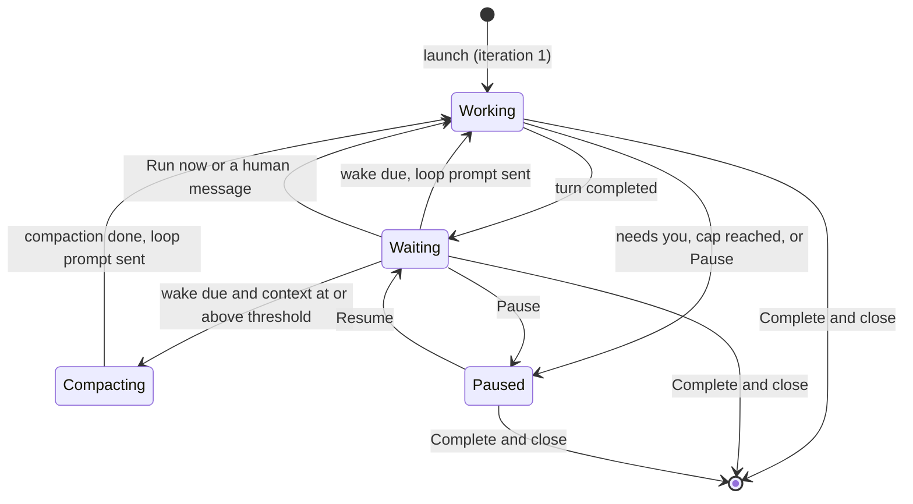
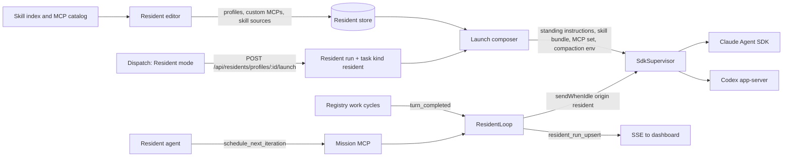

# Residents: long-running, profile-driven agents

Status: decisions recorded (revision 15, repaired after plan validation and review). Implementation is split into seven phases in
[phased-plan.md](phased-plan.md), which also holds the detailed repository findings.

## Outcome

A new first-class resource, the **resident profile**, and a third Dispatch mode beside
**Single agent** and **Ensemble**: **Resident**. A resident runs indefinitely in an Agent SDK
session, on a loop, with everything decided by its profile:

- **Persona**: a Library Persona whose Markdown becomes the agent's standing role, plus
  profile instructions and optional per-launch instructions.
- **Harness, model and effort**: Claude Code or Codex, through the existing registries.
- **Skills**: a subset of an index of every global skill plus operator-registered folders,
  added to the harness defaults or used instead of them.
- **MCP servers**: the harness's global servers plus custom servers defined in Mission
  Control, added to the defaults or used instead of them.
- **Loop and compaction**: cadence, loop prompt, guardrails, and the context threshold.
- **Board presence**: a border-glow marker in a chosen color and label, and pin-to-top.
- **Authority**: an off-by-default setting to control other sessions, granted by the trusted
  desktop Launch click.

Author a profile once and launch it from **Dispatch > Resident** or the Residents dock. It
appears as a normal session, glowing and pinned. It works, waits for its next wake, and compacts
as its context fills, until you pause it or choose **Complete & close**.

## Why a new resource

Nothing bundles persona, model, skills and MCPs for reuse:

- `ScheduleTemplate` files backlog tasks and never prompts a live session.
- Per-kind harness defaults are one machine-wide answer per kind.
- Library Personas are only workflow judges, with no launch seam.
- Foreman's System profile is a singleton.

The resident profile gets its own store, routes, SSE collection, backup domain, UI location and
settings. It reuses those precedents rather than copying them.

## The resident profile

Profiles are named and revisioned. Every save writes an immutable revision, and every run pins
the revision it launched from, following `mission_schedules` and `mission_schedule_revisions`.

**A live run reads every setting from its pinned revision**: marker, label and pin, loop prompt,
cadence and bounds, guardrails, compaction, skills, MCP servers and authority, including when the
run is restored after a daemon restart. The profile's current revision is used only for new
launches and to show that a run's profile has changed since launch. Skills and MCP servers are
also snapshotted per run at launch, including resolved server definitions and their secrets.
A run's skill snapshot is its effective set: with inherit on, the inherited default skills
present at launch plus the selected ones; with inherit off, only the selected ones. A later
addition, edit or deletion of a skill, a global or custom server, or a secret therefore never
changes or breaks a live run.

| Field | Meaning | Default |
|---|---|---|
| Name, description | Identity; name unique among live profiles | required |
| Persona | A Library Persona, built-in or authored | required |
| Instructions | Markdown added after the persona | empty |
| Harness, model, effort | Claude Code or Codex; existing registries | Claude Code, harness defaults |
| Skills | Inherit harness defaults, plus selected indexed skills | inherit on, none selected |
| MCP servers | Inherit harness defaults, plus selected global or custom servers | inherit on, none selected |
| Loop prompt | Words sent at each wake | built-in text below |
| Wake cadence | Delay after an iteration, and the bounds the agent may request | 5 min; 1 to 60 min |
| Guardrails | Iteration and recorded-spend caps per rolling 24 hours; reaching one pauses | on: 200 iterations, $20; editable, clearable |
| Compaction | Threshold and optional focus words | 70% |
| Marker | Border glow in a palette color, plus a short label | first color, label from name |
| Pin to top of column | Sort this profile's sessions first in their column | on |
| Control other sessions | Granted by the desktop Launch click | **off** |
| Default repository | Pre-filled at dispatch; may be none | none |

Built-in loop prompt: "Continue your standing task. Check what has changed since your last
iteration, act on it, and end with a one-line status. Call `schedule_next_iteration` if you need
to wake sooner or later than usual."

**Persona and instructions travel as standing instructions, never as turn one.**

- They compose into one resident section appended after repository standing instructions.
- They are delivered by `systemPrompt.append` (Claude) or `developerInstructions` (Codex).
- They are recorded in `session_standing_instructions` and replayed on resume.

As a result, compaction, a clear or a restart never loses who the agent is. Runs snapshot the
persona text at launch.

**Profile edits apply at the next launch.** A run on an older revision offers **Restart on new
profile**.

## Skills and MCP servers

**Skill sources.** The predefined sources are:

- Mission Control's `skills/`;
- `~/.claude/skills`, skipping Mission's own `mission-*` links;
- `~/.agents/skills`;
- the Codex home's `skills/`: `$CODEX_HOME/skills`, or `~/.codex/skills` when `CODEX_HOME` is
  unset;
- the skills built into each harness.

Operators add folders of `<skill>/SKILL.md`, validated like indexed repository directories. The
index is read on demand and on **Rescan**, and is never pushed over SSE.

**MCP catalog.** The picker offers two kinds of server:

- each harness's global servers: user-scope `mcpServers` in `~/.claude.json` for Claude, and
  `codex mcp list --json` for Codex;
- custom servers, each a stdio command or an HTTP URL, with the harnesses it applies to.

Mission Control's own server is always attached and hidden from the picker. Secret values live in
a write-only table. They never reach the browser, backups, a command line, a configuration file
or the agent's environment. Each reaches only its own server process, through a Mission-owned
launcher.

| Profile setting | Claude Code (Agent SDK) | Codex (app-server) |
|---|---|---|
| Extra skills | The run's skill snapshot (inherited defaults at launch plus selections) in a per-run `CLAUDE_CONFIG_DIR` overlay; fallback: wholesale native-skill switches with the snapshot through `--plugin-dir` | The run's skill snapshot in the per-run `CODEX_HOME` overlay's `skills/`; fallback: wholesale native-skill switches with the snapshot through `skills.config` path entries |
| Use only selected skills | The same, with only the selected skills in the snapshot | The same, with only the selected skills in the snapshot |
| Extra MCP servers | The run's MCP snapshot, inherited globals included, in `options.mcpServers` with `--strict-mcp-config` | The run's MCP snapshot as the only MCP servers in a per-run `CODEX_HOME` overlay's generated `config.toml`, secrets only through Mission's scoped launcher |
| Use only selected MCPs | The same, with only the selected servers in the snapshot | The same, with only the selected servers in the snapshot; offered only once an exact-set probe passes |
| Compaction backstop | `CLAUDE_AUTOCOMPACT_PCT_OVERRIDE` | `model_auto_compact_token_limit` |

The installed Claude Code 2.1.310 carries every Claude flag named above, and the installed Codex
0.160.0 carries `skills.config`, `env_vars` and `bearer_token_env_var`.

Isolation never drops user settings, repository instructions, authentication, Mission's MCP
server, or the session files Mission Control reads. Each mechanism is probed against a real
installation before it is built. Where the primary mechanism fails, the named fallback is built
instead. The Codex overlay links `auth.json` and `sessions/` back to the operator's `CODEX_HOME`
and generates `config.toml` from the operator's configuration.

If both the primary and the fallback fail for a cell, the phase stops before building that cell.
It asks the operator to choose between shipping that harness without that capability, or
approving a wider mechanism. A weaker mode, such as inherited skills that refresh on resume,
never ships without that answer. The editor never offers a switch that the launch cannot honor.

## Launch

The Dispatch toggle becomes **Single agent | Ensemble | Resident**. The Resident mode shows
profile cards, an optional repository, optional run instructions, a read-only launch summary and
**Edit profile**.

A launch is a task of a new appended kind, `resident`, bound to a **resident run**. It reuses
the task lifecycle for board placement, worktrees, **Complete & close**, and eviction through
`Registry.beginEviction`.

| Contract | `resident` answer |
|---|---|
| Availability | Manual launch only; no backlog, dependencies, schedules, autopilot or MCP `create_task` |
| Runtime | Agent SDK only; Claude Code and Codex in the first release, Pi not offered |
| Completion | Never automatic; an explicit Workflow is required, like `chat` |
| Mission MCP tools | `schedule_next_iteration`, plus session-control tools when granted |
| Diff, contract, capture | none; **After work** starts at None |
| Workspace | Repository optional: a task worktree with one, a Mission-owned run directory without |

**Continue in terminal** is unavailable for a live resident.

## The loop

A daemon-owned `ResidentLoop` subscribes to the Registry like `PendingTurnManager`. It delivers
each wake through `SdkSupervisor.sendWhenIdle()` with a new appended turn origin, `resident`.



1. **One wake per completed generation**, consumed in the same write that schedules it.
2. **The human always wins**: a human message cancels the pending wake, and `needs-you` pauses.
3. **Self-pacing within bounds**: `schedule_next_iteration({ delaySeconds, reason })` sets the
   next wake, clamped to the profile, with the reason shown on the card. A request made during a
   turn takes effect when that turn completes, in place of the default cadence for that one
   wake.
4. **Guardrails pause, never stop.** The launch turn is iteration 1, and every wake or **Run now**
   that is delivered, or whose delivery cannot be confirmed, is the next. A wake the session
   refuses before accepting it is not an iteration. Before each wake the loop counts the
   iterations in a durable, timestamped iteration log, and the spend in the existing usage
   ledger, over the 24 hours before that wake. A capped run stays paused until the operator
   resumes it. Resume is accepted once the window has room, and the refusal names when that will
   be. The spend cap is enforced for both harnesses: Claude Code turns carry the cost Claude Code
   reports, and Codex turns are priced from their token usage. A profile whose model cannot be
   priced cannot keep a spend cap. Save and launch refuse it with that reason, and the operator
   either picks a priced model or clears the cap themselves.
5. **Durable**: `resident_runs` holds loop state. After a restart the loop re-arms once SDK
   restore settles, and a missed wake fires once. Each wake is claimed in the database before it
   is sent, following the repository's claim-before-inject contract. After a crash, a wake
   continues normally only when its own marker appears in the transcript after the point where
   it was claimed. Any other outcome, including an unrelated turn, is never resent: the wake is
   recorded as unconfirmed, still counts toward the caps for 24 hours from its claim, and the run
   pauses and asks for attention.
6. **Controls**: Pause, Resume, Run now and Restart on new profile on the card menu, Console band,
   dock and page.

**Compaction** runs at two layers:

- **Before a wake**: when context is at or above the threshold, Mission Control sends
  `/compact <focus>` (Claude) or `thread/compact/start` (Codex, after regenerating bindings).
- **During long turns**: the native setting in the table above is the backstop.

Compaction does not count as an iteration. Both layers are probed against real installations of
both harnesses before they are enabled. Each probe must show compaction triggering at the
profile's threshold. If a layer cannot honor the threshold for a harness, Phase 3 stops before
enabling that layer for that harness and asks the operator how to proceed.

## Request and data flow



The daemon is the only writer.

- **New stores**: `resident_profiles`, `resident_profile_revisions`, `resident_runs`,
  `resident_mcp_servers`, write-only `resident_mcp_secrets`, and a `residents.skillSources`
  setting.
- **SSE** gains bounded `residentProfiles` and `residentRuns` collections. The browser joins
  session, task, run and profile, so nothing is added to `Session`.
- **Settings backup** covers profiles, custom MCP definitions (without secrets) and skill sources.

## Where it lives in the UI

You chose the **Residents dock beside Foreman** over a top-bar page, a Fleet board lane and a
Library shelf.

- The button shows the live count.
- It opens a dock listing live residents (state, next wake, Pause, Run now, Open) and profiles
  (Launch).
- **Manage residents** opens `#/residents`, a route rather than a top-bar segment, with a rail of
  profiles, custom MCP servers and skill sources beside the editor.

```figure:mock-b
[Fleet][Library][Runs][Scouts]        (Foreman) (Residents 2 v) (+ Dispatch)
                                        | LIVE                          |
                                        | [cyan] Triage Bot  waiting 3m |
                                        |        [Pause][Run now][Open] |
                                        | [violet] Docs Gardener working|
                                        | PROFILES   Release Watch [Launch]
                                        | Manage residents ->           |
```

```figure:mock-dispatch
Dispatch an agent             [Single agent][Ensemble][*Resident*]   (x)
Profile:  (*Triage Bot*)  (Docs Gardener)  (Release Watch)
Repo (optional): [ mission-control ]
Instructions for this run (optional): [ Focus on the release branch today ]
Launches: persona + instructions | +defaults | compact at 70% | control: off  [Edit profile]
[Cancel]                                                        [Launch resident]
```

```figure:mock-editor
Triage Bot                                             [Save] [Launch]
Persona [Fleet Triage v]  Harness [Claude v]  Model [opus v]  Effort [high v]
Instructions: [ Watch the fleet; summarize blockers... ]
SKILLS  [x] Inherit harness defaults   Selected: html-report, triage-notes  [+ Add]
MCP     [x] Inherit harness defaults   Selected: github (global), linear (custom) [+ Add]
LOOP    Wake every [5] min, agent may ask [1]-[60] min   Caps: iterations, spend
COMPACT At [70]%  Focus: [ keep open blockers and decisions ]
BOARD   Color (o cyan)(o violet)(o amber)...  Label [TRI]  [x] Pin to top
AUTHORITY [ ] Control other sessions (off by default)
```

## Session marker and pinning

There is one marker style, **border glow**: a full outline and soft glow in the profile color,
with a label chip.

- It is drawn through one custom property, `--resident`, like `--kind`.
- It never replaces the tone spine, which is the session's state.
- It is a `DISPLAY_ITEMS` entry, so Settings > Display can hide it.

`orderSessions` gains a pinned partition ahead of free and held, so keyboard order follows the
pin. In the Console, the row carries the accent and the header carries a resident band with loop
state and controls.

```figure:mock-markers
[Border glow]      full outline + soft glow in the accent, label chip "TRI", pin mark
Console rail row:  accent edge + label chip; Console header: band with Pause / Run now
```

## Session control

`docs/security.md` says today that "Neither dispatch defaults nor a session-control tool can
create a grant." You chose a narrow amendment:

1. In the desktop app, the **Launch** click for a profile with control on is a trusted click,
   registered through `serveDashboardClick`.
2. That click arms a single-use authorization bound to the launch, the profile and its revision.
3. The daemon consumes the authorization, records it on the run, and applies the existing
   Registry grant once the session registers.
4. The grant survives a daemon restart for the same conversation and task. A clear, a new
   conversation or a restart on a new profile needs a new click.
5. Launches from any other surface start without control and say so. Turning control off clears
   the record.

The existing grant machinery is reused unchanged.

## Decisions recorded

| Decision | Adopted |
|---|---|
| Name | **Resident** |
| UI location | **Residents dock beside Foreman**, with a `#/residents` route page |
| Marker | **Border glow** only; profiles choose color and label |
| Loop pacing | **Daemon cadence plus agent self-pacing** within profile bounds |
| Spend guardrails | **On by default, editable per profile** |
| Skill pinning | **Freeze inherited and selected skills**: with inherit on, the inherited defaults present at launch are captured with the selections, and resumes use that snapshot |
| Session control | **Trusted dispatch click, kept for that run** |
| Harnesses | **Claude Code and Codex** |
| Workspace | **Repository optional** |
| After approval | **Phased implementation plan** |

## Non-goals

- Built-in resident profiles.
- Terminal-runtime residents.
- Pi residents.
- Backlog, schedules or autopilot for `resident`.
- Writing global harness configuration.
- Persona versioning.

## Risks and assumptions

| Assumption | Confidence | If wrong |
|---|---|---|
| The pinned Claude Agent SDK exposes typed options for strict MCP and local plugins | medium | The verified CLI flags are passed through the SDK's extra-arguments option |
| Per-run configuration overlays pin the exact skill and MCP sets for each harness | medium | The measured fallback is built; if neither holds the exact set, Phase 4 or 5 stops and asks the operator |
| Mission's scoped launcher delivers each secret only to its own stdio or HTTP server, on both harnesses | medium | Phase 5 stops and asks the operator before offering secret-bearing servers for that harness |
| A fallback also fails its probe | low | The phase stops and asks the operator before building that cell |
| `/compact` as a user turn compacts an SDK Claude session | medium to high | Phase 3 stops and asks the operator before shipping that harness with one layer |
| Default caps suit a 5-minute cadence | medium | Caps are editable and shown on every card |
| Recorded spend exists per run for both harnesses | medium to high | A spend cap on an unpriced model is refused at save and launch; any wider reduction goes to the operator |

## Documentation and verification

- **Documentation**: a new `docs/residents.md`, plus updates to the dispatch, skills and settings,
  UI, sessions, security and glossary docs, the README, the architecture guide and the change
  contracts.
- **Verification**: each phase carries focused `node:test` suites and Playwright specs that use
  the fake agents, so no model tokens are spent.
- **Commands**: `npm run typecheck`, `npm run lint`, `npm test`, `npm run build`,
  `npm run smoke` and `npm run test:e2e`.
