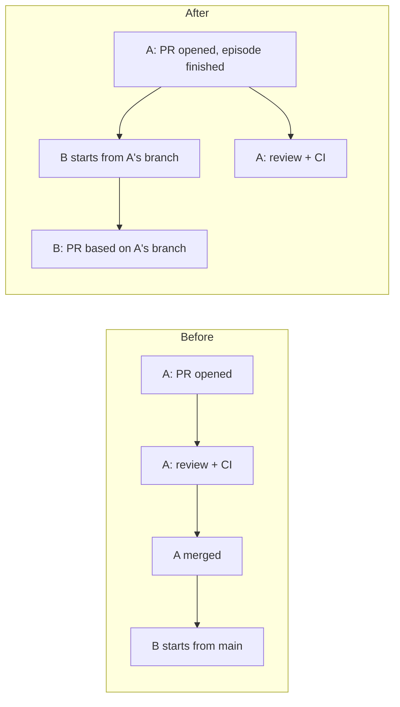
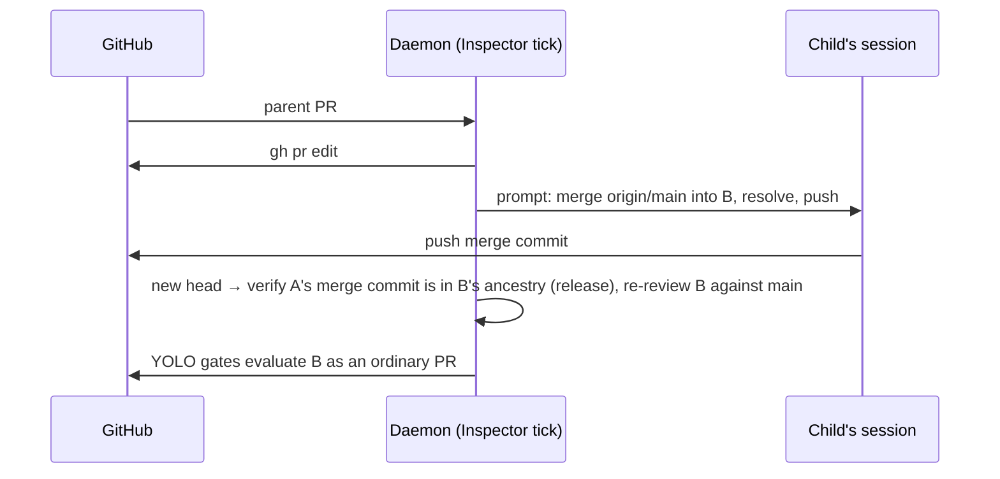

# Stacked pull requests (Settings → Shipping)

Status: approved design. Decisions from the first review are adopted below. Revision 3 corrected repository facts found while phasing (see `phased-plan.md`). Revision 4 makes the stack hold durable: it follows the child's recorded lineage and is released only by a verified ancestry check (§7), and it applies to already-stacked children regardless of the setting. Revision 5 checks a closed parent against the commit the child was cut from, defines how a replacement parent takes over the lineage, gives each parent state its own manual release action, and gives the base-relative review diff an owner. Nothing here is implemented.

## The short answer

**Stack along declared task dependencies, never across a whole repository.** A stack
means "this change builds on that change". Mission Control already records exactly that
fact: it is a dependency edge, and phased plans create chains of them in one repository
every day. Stacking every pull request in a repository would chain unrelated work
together. The first one that stalls would hold up every pull request behind it, and
nothing in the code says those pull requests needed each other.

The adopted design is dependency-based stacking with a default and an override:

- **Settings → Shipping → Stacked pull requests** sets the default for same-repository
  dependencies: *wait for merge* (today's behavior) or *stack on the prerequisite's
  branch*.
- Each dependency can override that default from the existing dependency chips, so one
  task can stack on A while still waiting for B to merge.

What stacking buys: a dependent task starts as soon as its prerequisite has an open pull
request. Today it waits for that pull request to merge. For a four-phase plan, review
latency is paid once per phase across the whole chain instead of in series.

## What Mission Control does today

| Fact | Where |
|---|---|
| Dependencies are durable edges stored as JSON on the task row (`tasks.dependencies`), so a new field on an edge needs no migration | `src/server/db.ts` (`tasks` table), `TaskDependencyInputSchema` in `src/shared/protocol.ts` |
| An edge is released only when the prerequisite's pull request is observed **merged**. Opening a pull request does not release dependents | `docs/dispatch-and-backlog.md` (Dependencies), `TaskManager.dependencyBlockers` in `src/server/tasks.ts` |
| An edge already records the prerequisite's `branch`, `prUrl` and work episode | `TaskDependency` in `src/shared/protocol.ts` |
| A dispatch starts from the freshly fetched remote default-branch SHA, unless a caller pins a full 40-character `baseSha` (today only ensembles do). Native worktree leases are detached at that commit | `resolveDispatchBase`, `TaskDispatchOptions.baseSha` and `verifyPinnedBase` in `src/server/dispatcher.ts`; `freshRemoteDefaultSha` in `src/server/git/remote-default.ts` |
| Agents open pull requests themselves with `gh pr create`, which a hook observes and the Inspector adopts. Nothing names a `--base` | `announcePrOpened` in `src/server/registry.ts`, `onPrOpened` in `src/server/inspector/worker.ts`, `actions/pull-request.md`, `skills/pull-request/SKILL.md` |
| YOLO mode merges adopted pull requests behind ordered gates (`mergeVerdict`), compare-and-swap on the head SHA, squash by default | `mergeVerdict` in `src/shared/shipping.ts`, `maybeMerge` in `src/server/shipping/merge.ts` |
| No code reads a pull request's base branch or whether it is behind (`baseRefName`, `mergeStateStatus`). The Inspector snapshot already reads `headRefName` | `PR_QUERY` and `PrSnapshot` in `src/server/inspector/github.ts`; `docs/plans/pr-behind-base/plan.md` §1 (planned, not built) |

## Three ways to decide what stacks

| | Repository-wide | Dependency-based, setting only | **Dependency-based, setting plus per-edge override** (adopted) |
|---|---|---|---|
| What stacks | Every new pull request stacks on the newest open pull request in the repository | Every same-repository dependency, while the setting is on | Same-repository dependencies whose edge is in stack mode. The setting picks the default |
| Unrelated work coupled | **Yes.** One red CI run or open finding blocks every pull request above it | No | No |
| Shape | One long line per repository, ordered by when pull requests happened to open | A tree that follows declared intent | Same |
| Merge order | Strictly serial across the whole repository | Bottom-up within each stack | Same |
| Restack work after a squash merge | Every open pull request in the repository | Only the merged pull request's direct children | Same |
| Parallel agents | Race to be "newest". The base depends on timing | Unaffected | Unaffected |
| Fits existing model | No source of truth to build on | Reuses dependency edges | Same, plus one field per edge |
| Escape hatch for one risky edge | None | Turn stacking off globally | Flip that edge to *wait for merge* |

Repository-wide stacking solves a different problem: getting many independent pull
requests merged in order. That is a merge queue (GitHub's merge queue, or keeping branches
current per `pr-behind-base`), not a stack. It is a non-goal here.

## How a stack works

### 1. Which edges can stack

An edge stacks only when all of these hold. Otherwise it waits for merge as it does today,
and the board says why.

- The edge is in stack mode, set explicitly or inherited from the Shipping default.
- Prerequisite and dependent are in the same repository. For a multi-repository task, the
  check is per repository. A repository the prerequisite never changed has nothing to
  stack on.
- At most one prerequisite in that repository is unmerged. A pull request has one base,
  so with two unmerged same-repository prerequisites the dependent waits until only one
  remains, then stacks on it.
- Every prerequisite in another repository has merged. Cross-repository edges keep the
  merge rule.
- The stack under the dependent is shorter than the depth cap (Shipping setting, default
  3). A deeper stack waits for its bottom to merge.

### 2. When the dependent is released to start

The stack edge gets a new intermediate state, `stackable`, between *waiting* and
*satisfied*. The dependent is released when the prerequisite has an open, non-draft pull request **and** its agent has finished
the episode (idle, nothing queued). That is the same "appears finished" test task
completion already uses. Releasing earlier starts the child on a branch that is still
being written.

`satisfied` keeps its meaning: the prerequisite's pull request merged. Task completion,
**Mark done**, **Unblock dependents** and the stopped-dependency recovery are unchanged.
Stacking moves the dependent's start, never the prerequisite's completion.

### 3. Cutting the dependent's worktree

When a stacked edge releases a dispatch, the worktree reset target is the prerequisite's
pull request head instead of the default branch. The dispatcher already accepts a pinned
full-SHA base (`TaskDispatchOptions.baseSha`, verified by `verifyPinnedBase`), so a
stacked dispatch fetches the parent branch and pins its current head SHA rather than
adding a second base path. The task records three
facts: `stackParentTaskId`, `stackBaseBranch` and the `stackBaseSha` it was cut at. These
sit beside the existing cut-commit column, so a restart, a Line card or a retro can
always answer "what is this built on".

### 4. Opening the pull request

The task contract and the pull-request packet name the base: *open this pull request with
`--base <parent branch>` and say "Stacked on #N" at the top of the description.* Agents
do not reliably follow instructions, so the daemon enforces the result: when the
`pr_opened` hook fires, it reads the new pull request's `baseRefName`. If the base is
wrong, the daemon corrects it with `gh pr edit --base`, which changes metadata only and
writes no code.

### 5. When the parent moves before it merges

Review repairs push to the parent, so the child falls behind its base. This is the
`pr-behind-base` problem with a base that is not the default branch. The plan builds that
plan's missing signal once, in a form both can use. The Inspector's pull request
snapshot gains `baseRefName` and the base comparison (`mergeStateStatus`, behind-by
count). A stacked child that is behind its parent gets one prompt to its owning session:
merge the parent branch in and push. The prompt travels the same Foreman review-follow-up path as the
CodeRabbit follow-up: claim before send, no prompt to a busy session, no restart of an
absent one. With Foreman off, the merge queue says so and offers a manual send. `pr-behind-base` can later reuse the same signal for the default branch.

### 6. When the parent merges: retarget, then restack

1. When the parent merges, the daemon sees it on its next poll. It retargets each child to
   the parent's base. If the repository auto-deletes merged branches, GitHub may already
   have retargeted the child. The retarget is idempotent either way, and a child GitHub
   *closed* is treated as a broken stack (table below).
2. With squash merges, the child still carries the parent's original commits. The child
   restacks by merging the new base into its branch and pushing. It needs no force-push, and the child is squash-merged later anyway,
   so the merge commit never reaches `main`. Identical hunks from the parent resolve
   cleanly. Real conflicts go to the session like any other repair.
3. The new head resets the Inspector's review gate exactly as any push does. Being on
   the default branch is not enough to release the child. It stays held by the stack hold
   (§7) until the daemon verifies that the restack actually happened: the parent's merge
   commit is an ancestor of the child's current head. Only then is the child an ordinary
   pull request against the default branch.

### 7. Merge order and YOLO mode

Shipping gets two new gates. They sit after the consent and open/draft gates and before
the review and CI gates:

| Gate | Why |
|---|---|
| **Base is the default branch** (`stacked-base`) | Merging a child into its parent's branch would fold it silently into the parent's pull request and skip its own review |
| **Stack released** (`stack-hold`): a pull request with recorded stack lineage stays held until the release check passes for its current head | A base change alone proves nothing. GitHub can retarget a child by itself when the parent's branch is auto-deleted, and an unrelated push changes the head without bringing in the new base |

The lineage is recorded on the pull request's row when it is adopted for a stacked task:
the **current parent** pull request and the **stack base**, the parent commit the child
was cut at (`stackBaseSha`). It survives the session going away, a restart and the
setting being switched off. The current parent changes in exactly one case, a
replacement parent (§9), and every change is appended to the row's lineage history. The
stack base never changes. The release check is one rule with two branches, evaluated on
the Inspector tick against the *current* parent, from GitHub data only, with no git run in
a worktree:

- **Parent merged:** the base is the default branch **and** the parent's merge commit is an
  ancestor of the child's current head (GitHub's compare API reports `ahead` or
  `identical`).
- **Parent closed without merging:** the base is the default branch, **and neither** the
  stack base **nor** the parent's last observed head is an ancestor of the child's current
  head. In other words, the child no longer carries the parent's unmerged code. The stack
  base is what makes this safe: a parent that pushed again before closing has a last head
  the child never contained, but the child still contains the commit it was cut from.

The release is recorded against the head it was verified for, and a new head is checked
again. Anything the daemon cannot read (a failed compare, an unknown parent state or
merge commit) keeps the hold.

A person can satisfy the check by hand. The action depends on the current parent's state,
and the next tick releases the child:

| Current parent | Manual action that satisfies the check |
|---|---|
| Merged | Merge the default branch, which now contains the parent's merge commit, into the child and push |
| Closed without merging | Cherry-pick only the child's own commits onto a fresh branch cut from the default branch and open a replacement pull request (it inherits the lineage). Merging the default branch into the old child does **not** help, because the parent's commits stay in its ancestry |
| Open | Nothing releases it yet. The parent has to merge or close first |

Releasing after a merged parent is safe even when the child still carries the parent's
original (pre-squash) commits. After the release the child is reviewed against the
default branch, so any parent code that did not land in the squash shows up in the
child's own diff and is reviewed as the child's change.

With YOLO on, a stack therefore lands bottom-up with no extra machinery: parent merges,
child retargets, restacks, passes the release check, is reviewed clean and merges. The soak is still measured from
when the child opened. The child was visible the whole time, so the soak does not restart.
The merge queue row reads *Stacked on #A (waiting for it to merge)* or *Restacking onto
main*, so "why did this not merge" has an answer.

### 8. Review while stacked

The Inspector reviews a stacked pull request against its parent branch, which is the diff
the author actually wrote and the smallest one. The reviewed-head record gains the base
it was reviewed against. A changed base with an unchanged head (retarget without restack)
is then re-reviewed rather than trusted. Workflow Personas receive the same base-relative
diff. Today the workflow context diffs every session against the default branch
(`computeSessionDiff(cwd)` in `src/server/workflows/context.ts`). For a stacked task it
will diff against the pull request's current base, or against the parent branch before a
pull request exists. The CodeRabbit command's pinned merge base follows the same rule.
Phase 1 owns this.

### 9. When a stack breaks

| Event | What happens |
|---|---|
| Parent pull request closed without merging | Child is held by the stack hold, because its branch still carries the parent's unmerged code. The dependent card and merge queue show **Stack broken: #A closed**. Actions: *Move onto main* (prompt the session to cherry-pick only its own commits onto a new branch cut from the default branch, open a replacement pull request and close the old one; no force-push) or *Wait for a replacement*. A child replacement inherits the lineage and is released only when the closed-parent branch of the release check passes. With *Wait for a replacement*, a replacement **parent** pull request found by the existing branch discovery on the parent task's same episode takes over the lineage: it becomes the current parent (the old one is kept in the lineage history), the child is retargeted to its branch and caught up, and the child is released by the merged-parent branch once the replacement merges and the child restacks |
| Parent task rescheduled or cancelled | Same hold. The existing stopped-dependency warning button names the stack |
| GitHub closed the child because its base branch was deleted before a retarget | Same hold and actions as a closed parent, with GitHub's reason shown |
| Child's session is gone when a restack is needed | No restart. The merge queue says *Restack needed: no session*, and the task's **Resume** offers it |
| Edge flipped from stack to merge, or the Shipping default switched off, after the child started | The edge mode and the default only decide whether a dependent *starts* early. A child already cut on the parent keeps its lineage, its hold and the full lifecycle (catch-up, retarget, restack, broken-stack handling) until it is released |

## Settings surface

A **Stacked pull requests** card on **Settings → Shipping**, after the YOLO mode cards:

- **Same-repository dependencies**: segmented control *Wait for merge* (default) / *Stack
  on its branch*.
- **Maximum stack depth**: number, 1 to 5, default 3.
- Copy that says what it does not do: it never merges into a non-default branch, never
  force-pushes, and never stacks across repositories.
- Included in settings snapshots, like the other Shipping keys.
- Says that switching it off stops new stacks only. Pull requests that are already
  stacked keep their hold and lifecycle until they are released.

The setting is one switch for all repositories. Stacking only changes branch bases and
never writes to a default branch, so it needs no Trust column. Per-dependency overrides
cover the exceptions.

In the dispatch form and backlog editor, each same-repository dependency chip gains a
small toggle: **Stack** / **After merge**. It shows the inherited default until changed.
The board card and Line row of a stacked task show *Stacked on #A*. The pull request link
in the session header shows its base.

## Changes by area

| Area | Change |
|---|---|
| `src/shared/protocol.ts` | `ShippingConfigSchema` gains `stacking: "merge" \| "stack"` (default `"merge"`) and `maxStackDepth` (default 3). `TaskDependencyInput` and `TaskDependency` gain optional `mode`. Zod defaults keep stored blobs and edges readable |
| `src/shared/backlog.ts`, `src/server/tasks.ts` | `declaredBlockersIn` treats a stack-ready edge as non-blocking for start. The daemon stamps stack readiness on the edge. Eligibility is a pure function in `src/shared/` so the board, Sitrep, autopilot and server agree |
| `src/server/db.ts` | `tasks` gains `stack_parent_task_id`, `stack_base_branch`, `stack_base_sha` via `addColumn` in the upgrade path |
| `src/server/dispatcher.ts` | A stacked dispatch passes the parent head as the existing `baseSha` pin |
| `src/server/inspector/github.ts` | Snapshot reads `baseRefName`, the default branch, the merge commit, `mergeStateStatus` and behind-by. A compare helper answers ancestry questions. The reviewed-head record includes the base. PR rows record stack lineage and the head the release was verified for |
| `src/shared/shipping.ts`, `src/server/shipping/` | New `stacked-base` and `stack-hold` gates in `mergeVerdict`, with the release check fed from the Inspector tick. Retarget-on-parent-merge step on the Inspector tick |
| New `src/server/stacking/`, `src/server/foreman/` | Child-behind-parent and restack prompts, delivered through the existing Foreman review-follow-up claim-before-send path |
| Task contract, pull-request workflow prompt | Name the base branch and the "Stacked on" line when the task is stacked (regenerate generated prompt files from source) |
| `src/server/workflows/context.ts` | The Persona diff and the CodeRabbit merge base use the stacked pull request's current base |
| `src/web/components/ShippingSettingsPanel.tsx`, dependency chips, board card | UI above |
| Docs | `docs/inspector-and-shipping.md` (new Stacked pull requests section and gate row), `docs/dispatch-and-backlog.md` (edge modes), `docs/configuration.md` |

## Verification

- `test/`: eligibility table (same repository, cross repository, two unmerged
  prerequisites, depth cap, multi-repository task), release-state transitions, the merge
  gate refusing a non-default base, the stack hold surviving an automatic retarget and an
  unrelated push, release only on verified ancestry, a parent that pushes again before
  closing, a replacement parent taking over the lineage, the Persona diff against the
  stacked base, retarget idempotence, Shipping config defaults over an
  old blob, edge `mode` defaulting on stored rows.
- Git-level fixture test: cut from parent branch, parent squash-merged, merge-based restack
  produces a child whose diff against `main` is only its own change.
- `e2e/`: the Shipping card sets the default and survives reload. A dependency chip
  toggles mode and the backlog card shows *Stacked on #N*. The merge queue shows the
  stacked-base hold. Fake agents and a fake `gh` keep it free of model tokens and GitHub.
- `npm run typecheck`, `npm run lint`, `npm run build`, `npm run smoke`, `npm run test:e2e`.

## Non-goals

- Stacking every pull request in a repository, or ordering independent pull requests
  (a merge queue).
- Stacking across repositories.
- Force-pushing, or any git operation the daemon performs inside a worktree. The daemon only reads pull requests, edits their base, and prompts sessions.
- Third-party stack tools (Graphite, `git-town`, `spr`). The design uses only branches
  and `gh`, so a person can still use one by hand.

## Risks

- **Agents ignore the base instruction.** Mitigated by the daemon's post-open base check
  and correction.
- **Restack conflicts on a squash merge** when the child holds an older version of the
  parent. Mitigated by keeping the child current while stacked (§5). A conflict that is
  left over is an ordinary repair prompt.
- **Long stacks amplify a late parent change.** Bounded by the depth cap.
- **Branch protection on the default branch** cannot see the stack. A refused merge still
  shows GitHub's own message verbatim, as today.

## Adopted decisions

Submitted in the first review of revision 1:

| Decision | Adopted |
|---|---|
| Stacking model | Dependency-based: Shipping default plus per-dependency override |
| When a stacked dependent may start | Prerequisite pull request open and its agent finished the episode |
| Restack after a parent squash-merges | Merge the new base into the child and push (no force-push) |
| Where the default applies | One switch for all repositories |
| Follow-up | Create a phased implementation plan |

Repository-wide stacking, rebase-and-force-push restacking, and a per-repository opt-in
list were considered and rejected.
