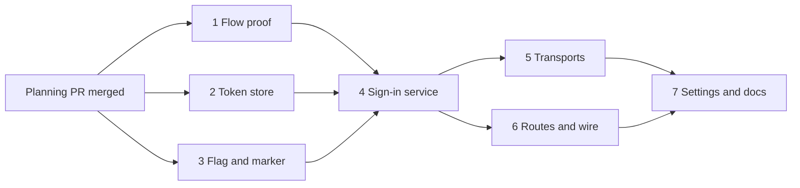

# Shaper sign-in: phased implementation plan

Source plan: `docs/plans/shaper-oauth-sign-in/plan.md`. Its constraints S1 to S10 and the
decisions D1 to D8, submitted by the operator on 2026-11-24, are requirements here, not open
questions. Seven phases, one pull request and one backlog task each. The tasks are created
switched off for autopilot and are released when the planning pull request merges.

## What the repository looks like today

Read at `3203ca8d0`. `plan.md` lists the findings about the transport, the schema, the routes
and the SDK. These shaped the split:

- **Settings has no shaper editor.** A shaper is registered by importing a manifest
  (`ShapingImportDialog` and `ShaperReview` in `src/web/components/TaskShapingDialogs.tsx`).
  What a shaper calls and is sent is stated by `shaperReach` and `shaperReceives` in
  `src/web/lib/shaping-settings.ts`. A row offers Dry run only for a registered shaper
  (`src/web/components/TaskShapingView.tsx`).
- **Wire.** The `shaping_config` event is emitted by `registry.emitShapingConfig`
  (`src/server/registry.ts`), follows the flag in `src/server/shaping/events.ts`, and is
  handled in `src/web/useEventStream.ts`, whose handling of `ServerEvent` is exhaustive.
- **Routes.** `registerShapingRoutes` in `src/server/shaping/routes.ts` puts the flag gate
  first, then `trustedLoopbackJsonRequest`, then a body limit. `test/fixtures/route-surface.json`
  pins each gated route's 404, and `test/request-collection-bounds.test.ts` lists the file.
- **Flags.** Every flag is `preview` today. `docs/feature-flags.md` sets three pull requests
  per flag and a "Shipped flags" table.
- **`app_config`.** `wholeEntry(key, schema, "operational", null)` keeps a key out of every
  settings backup, as `keepAwake` is (`src/shared/app-config-entries.ts`).
- **Native addons.** `scripts/build-native.mjs` runs each builder. A builder publishes through
  `publishNativeAddon`, and `test/native-addon-publish.test.ts` refuses one that copies.
  `electron-builder.yml` packs `dist/**/*`, so a new addon needs no packaging change.
- **Background work.** `startDatabaseBackupLoop` (`src/server/database-backups/loop.ts`)
  takes its timers as arguments, and tests pass fake ones. It is started and stopped in
  `src/server/index.ts`.
- **Browser suite.** The daemon's environment is set in `e2e/fixtures/daemon.ts`. No spec
  starts an MCP or HTTP fixture server today. Specs may import fixtures from
  `test/fixtures/`, as the settings spec imports `fake-shaper.mjs`.
- **CI is Linux.** A test that needs macOS is skipped there and runs on a developer's Mac.
- **A stale line.** `docs/agent-guides/change-contracts.md` still says the `shaping` backup
  domain is on the `runtime` surface. It is `settings`
  (`src/shared/settings-backup-domains.ts`). Phase 3 corrects it.

## Decisions made while phasing

1. **Seven phases.** The operator asked for phases under about 500 non-test lines, and the
   total is four to five times that. "Size and phase count" says why each boundary exists.
2. **Sign-in drives the SDK directly, and dispatch never does.** `auth()` runs the sign-in,
   `refreshAuthorization()` runs the refresh, and the transport is never given an auth
   provider. `plan.md` gives the reasons under "Signing in".
3. **The store is asynchronous.** A Keychain write took about 200 ms in the planning spike,
   so every store call returns a promise and the addon does its work off the event loop.
4. **The marker arrives in a manifest.** There is no editor to extend. Phase 3 makes the
   import review and the row state the sign-in, and Phase 7 adds the controls.
5. **The client registration has its own `app_config` key**, `shaping.signIn`, because
   `ShapingConfigSchema` drops unknown keys and an older build would delete it.
6. **One place decides whether a call may carry a token.** The service answers by flag and
   by state, and a transport only asks it. Phase 3's temporary guard uses the same reasons.
7. **The event's handler lands with the event.** `useEventStream.ts` is exhaustive, so Phase
   6 adds the event, the snapshot field and the dashboard state. Phase 7 renders it.
8. **The browser suite never reaches a Keychain.** Phase 4, which first wires the service
   into the daemon, sets `MISSION_SHAPER_SIGN_IN_STORE=memory` in `e2e/fixtures/daemon.ts`.
9. **Two focused browser specs.** The callback page is a page a person sees, so Phase 6
   covers it. Phase 7 covers Settings.
10. **`SignInTarget` has one shape**, `{ url, scope, issuer }`. Phase 1 declares it beside
    the flow, Phase 3 in the shared schema, and Phase 4 keeps only the shared one.
11. **"In use" is what the service was last told, plus what was asked for.** The daemon
    tells the service which connections known shapers name, at start, on a config change and
    when Settings reads the folder. A token a transport asks for counts as in use too.
12. **No full suites locally.** Every phase runs its own test files and focused specs, with
    `npm run typecheck` and `npm run lint`, and relies on CI for the rest.
13. **Stored is not the same as passing through.** Tokens and the PKCE verifier never reach
    the browser. The `state`, the code and the client id pass through it, in the
    authorization URL and the callback redirect, as OAuth requires. The `state` and the code
    are held in the daemon's memory only and persisted nowhere. The client id is persisted
    in `app_config`. `plan.md` has the table, and phases 4 and 6 test both halves.
14. **A stored record names its connection.** A connection id is a one-way hash, so the
    record keeps the target beside the tokens. After a restart a sign-in that no shaper
    names is still listed and can be signed out.
15. **A pending sign-in's link exists only where it was started.** The sign-in list never
    carries the authorization URL. A window without the link offers Sign in, which starts
    again and replaces the pending one, and Cancel sign-in.
16. **One registration per authorization server, redirect URI and scope.** The SDK sends
    the scope at registration, so a client registered for one scope is not reused for
    another. Phase 1's fixture enforces it, and Phase 4 tests two connections on one
    authorization server with different scopes. A record names the client that obtained
    its tokens, and every refresh uses that client.
17. **A registration that a sign-in names is never dropped to make room.** At most 16 are
    kept. When a sign-in needs another and 16 are held, the oldest that no held record and
    no pending sign-in names is dropped. When every one is named, `begin` refuses with a
    fixed reason before any registration request, and the sign-in works once a sign-out
    leaves a registration that nothing names. When 16 are held and the store could not be
    read, `begin` drops nothing and refuses with a reason that says to restart. One
    `begin` runs at a time, so two sign-ins started
    together cannot register twice for the same three values. A client the authorization
    server rejects ends every sign-in that names it before its registration is removed.
    A database restore can take the key back to before a registration that a record
    names. That record still refreshes, because it carries its client's id.
    Phase 4 owns the rule and tests the limit.
18. **One order per connection, and a bound on refreshes that calls ask for.** A removal
    clears memory at once and the store follows, one call at a time in the order asked
    for. A refresh that finishes after its sign-in was signed out, removed or replaced
    keeps nothing and revokes what it received. A call starts no refresh while a later
    try is set, and refreshes that refusals ask for follow the same 1, 2, 4, 8 and 15
    minute waits as failed ones. A refusal does not end a sign-in that has a refresh
    token. Phase 4 owns both rules and tests them, and Phase 1's fixture can hold a
    `/token` reply for the first.

## Size and phase count

Estimated non-test production lines, counting native, shared, daemon and dashboard code.

| Phase | Estimate |
| --- | --- |
| 1. Flow proof | 260 to 340 |
| 2. Token store | 380 to 480 |
| 3. Flag and marker | 170 to 240 |
| 4. Sign-in service | 420 to 510 |
| 5. Transports | 170 to 240 |
| 6. Routes and wire | 300 to 380 |
| 7. Settings and docs | 240 to 320 |
| Total | 1,940 to 2,510 |

Why each boundary exists, and why its neighbour is not merged into it:

- **1 is first and alone.** The operator required a phase that runs the SDK's flow against a
  mock before anything is built on it. It also owns the fixture every later phase tests with.
- **2 is separate from 1.** A native addon and a network client share no code or risk, and
  together they pass 600 lines. The Keychain is the security-sensitive part and is reviewed
  alone.
- **3 is separate from 4, 5 and 6.** It fixes the schema, the tuples and the flag that all
  three consume. Merged into any one of them, the other two would wait behind it.
- **4 is separate from 5 and 6.** The service is the largest unit and has the hardest tests
  (time, rotation, single-flight). With either consumer it passes 550 lines. Its upper
  estimate is at the 500-line target, so nothing more is added to it.
- **5 and 6 are separate.** One edits the transports, the other the routes and the wire.
  They share no file, and together they pass 500 lines.
- **7 is separate from 6.** Settings has its own tests and its own browser spec, and with
  the routes it passes 550 lines.

## Phases

| Phase | File | Depends on | Target |
| --- | --- | --- | --- |
| 1. Flow proof | `phase-1-flow-proof.md` | This plan merged | 2026-12-04 |
| 2. Token store | `phase-2-token-store.md` | This plan merged | 2026-12-04 |
| 3. Flag and marker | `phase-3-flag-and-marker.md` | This plan merged | 2026-12-04 |
| 4. Sign-in service | `phase-4-sign-in-service.md` | 1, 2 and 3 | 2026-12-09 |
| 5. Transports | `phase-5-transports.md` | 4 | 2026-12-14 |
| 6. Routes and wire | `phase-6-routes-and-wire.md` | 4 | 2026-12-14 |
| 7. Settings and docs | `phase-7-settings-and-docs.md` | 5 and 6 | 2026-12-17 |

- **Concurrency.** Phases 1, 2 and 3 together. Then 4. Then 5 and 6 together. Then 7.
- **Merge order.** Any order that respects the table's third column.
- **Why concurrent phases do not collide.** Phase 1 owns `sign-in/flow.ts`, `sign-in/egress.ts`
  and the fixture. Phase 2 owns `native/keychain/`, its build script, `sign-in/store.ts` and
  `sign-in/keychain-native.ts`. Phase 3 owns the shared schema, the registries and a guard in
  the two transports. Phase 5 owns the transports after that. Phase 6 owns the routes, the
  registry's emit, the shared event types and `useEventStream.ts`. `docs/task-shaping.md` is
  edited by phases 3, 5, 6 and 7, each in the section this plan names for it.

## Cross-phase contracts

| Contract | Owner | Shape |
| --- | --- | --- |
| Flag | 3 | `shaper-sign-in`, stage `preview` |
| Registry data | 3 | In `src/shared/shaping-registry.ts`: `SHAPING_AUTH_KINDS` (`oauth`), `SHAPING_SIGN_IN_STATES` (`signed_out`, `pending`, `signed_in`, `renewing`), `SHAPING_SIGN_IN_STORAGE` (`keychain`, `memory`). Append-only. |
| Marker | 3 | `auth: { type: "oauth", scope, issuer? }` on the `mcp` transport's `http` server and on the `http` transport. With it, a configured `authorization` header is refused. |
| Target | 3 | `shaperSignInTarget(shaper)` in `src/shared/shaping.ts` returns `SignInTarget`, `{ url: string; scope: string; issuer: string or null }`, or null for a shaper with no marker |
| Reasons | 3 | `SIGN_IN_REASONS` in `src/shared/shaping.ts`: `flagOff`, `signedOut`, `renewing`, `refused`. Fixed sentences. Each names Settings > Task shaping, and `flagOff` names the flag. |
| View | 3 (type), 4 (values), 6 (wire) | `ShapingSignInView`: `{ id, url, scope, issuer, state, storage, expiresAt, reason, shapers }`. It never holds a token, a code, a `state`, a verifier or an authorization URL. |
| Flow | 1 | `src/server/shaping/sign-in/flow.ts`: `discover`, `begin`, `exchange`, `refresh`, `revoke`. Stateless. A failure is a returned value with a reason, never a throw, and no reason holds a code, a verifier or a token. `refresh` answers `sign_in_again`, `client_rejected` or `retry`. |
| Sign-in fetch | 1 | `src/server/shaping/sign-in/egress.ts`: `signInFetch`, the egress rules of `plan.md` |
| Fixture | 1 | `test/fixtures/fake-oauth-server.mjs`: `startFakeOAuthServer(options)`. Two protected resources: `/mcp`, an MCP server with `get_guidance`, and `/shape`, which answers a shaping result to a `POST`. A token is accepted only by the resource it was issued for. Fake values only. |
| Store | 2 | `src/server/shaping/sign-in/store.ts`: `SignInStore` with `kind`, and `read`, `write`, `remove` and `ids`, all returning promises. `createSignInStore` picks `memory` when `MISSION_SHAPER_SIGN_IN_STORE` is `memory`, off macOS, or when the addon does not load. |
| Stored record | 2 | `{ v: 1, target, issuer, clientId, accessToken, refreshToken, expiresAt, scope, obtainedAt }`, as JSON in one Keychain item per connection. `target` is the connection's `{ url, scope, issuer }`: not a secret, and what names the sign-in after a restart. `clientId` is the client that obtained the tokens, and every refresh uses it. |
| Keychain item | 2 | Service `Mission Control shaper sign-in`. Account: a 16-character tag of the state home, `/`, the connection id. |
| Client registration | 4 | `app_config` key `shaping.signIn`: `{ clients: [{ issuer, clientId, redirectUri, scope, registeredAt }] }`, at most 16, value class `operational`, no backup domain. A registration is reused only for the same issuer, redirect URI and scope. One that a held record or a pending sign-in names is never dropped to make room. At 16, `begin` drops the oldest that nothing names, or refuses: with the code `registration_limit` when every one is named, and `store_unread` when the store could not be read. |
| Connection id | 4 | `connectionId(target)` in `src/server/shaping/sign-in/connection.ts`: the first 32 hex characters of the SHA-256 of the target's canonical JSON |
| Service | 4 | `shaperSignIns` in `src/server/shaping/sign-in/index.ts`: `accessToken(target)` (synchronous, memory only), `noteRefused(target, accessToken)` (ignored unless it is the token held now), `begin(target)`, `complete({ state, code, error, iss })`, `signOut(id)`, `setInUse(list)`, `view()`, `onChanged(listener)`, `start()`, `stop()`. One `begin` runs at a time. |
| Redirect URI | 4 | `http://127.0.0.1:<PORT>/api/shaping/sign-in/callback`, with `PORT` from `src/shared/harness-runtime.mjs` |
| Call | 5 | A marked shaper's request carries `Authorization: Bearer <token>`, and the token is in the call's resolved values as `sign-in token` |
| HTTP | 6 | `POST /api/shaping/sign-in` `{ shaper }` answers `{ authorizationUrl, expiresAt, connection }`. The URL carries the client id, the `state` and the PKCE challenge, and appears in this reply only. A `begin` refused with `registration_limit` or `store_unread` is 409, and any other failed `begin` is 502. `POST /api/shaping/sign-out` `{ connection }` answers `{ signIns }`. `GET /api/shaping/sign-in/callback` answers a static page. `GET /api/shaping` gains `signIns`. |
| Event | 6 | `shaping_sign_ins` with `signIns`, and the snapshot field `shapingSignIns`. Both only while both flags are on. `useEventStream` exposes `shapingSignIns`. |
| Guide | 3, 5, 6, 7 | `docs/task-shaping.md`: the marker (3), what a call does (5), the API (6), signing in from Settings (7) |

## Who owns each requirement

| Requirement | Phase |
| --- | --- |
| S1 generic, no company name | Every phase. Fixtures use `example` hosts and fake values. |
| S2 explicit sign-in, never at dispatch | 4 (service), 5 (`unavailable`), 7 (the control) |
| S3 and D1 where tokens live | 2 (store), 4 (store first, memory fallback), 6 (never on the wire) |
| D2 native addon | 2 |
| S4 registration, loopback redirect, `client_id` in `app_config` | 1 (registration), 4 (key, its limit and redirect URI), 6 (callback route) |
| S5 scope | 1 (always passed), 3 (required in the marker) |
| S6 background single-flight refresh | 4 |
| S7 redaction | 5 |
| S8 flag, Playwright spec, documentation | 3 (flag), 6 and 7 (specs), 2 and 7 (where the token lives) |
| S9 carriers unchanged | 5, with a test |
| S10 direct path unchanged | 3 and 5, with a test that pins an unmarked shaper's request headers |
| D3 the dashboard opens the URL | 7 |
| D4 residents' bridge out of scope | No phase touches `src/server/residents/` |
| D5 `http` shapers | 3 (schema), 5 (transport) |
| D6 issuer origin | 1 (rule), 3 (`auth.issuer`) |
| D7 marker form | 3 |
| D8 dates | The table above |

## Hard rules for every phase

`plan.md` states five hard rules under "Hard rules for every session this plan creates":
no real credentials, fake values and a loopback mock only, no real login, unique Keychain
item names that tests remove and verify, and no full suites locally. Every phase file
repeats them in full. A phase that cannot meet one stops and reports.

## Final verification

Each phase's pull request is green in CI, which runs the full unit and end-to-end suites.
After Phase 7 merges, one walkthrough against the fixture, with both flags on: import a
manifest that carries `auth`, sign in from Settings, see "Signed in" without a reload, dry-run
the shaper and read guidance from the protected tool, restart the daemon and see the sign-in
still held (macOS), sign out, and see an unmarked shaper's dry run unchanged. Then switch
`shaper-sign-in` off and see the controls go and the marked shaper answer `unavailable`.

The real sign-in against the gateway is the operator's step with Tom, after the four outside
items in `plan.md`. No task does it.
