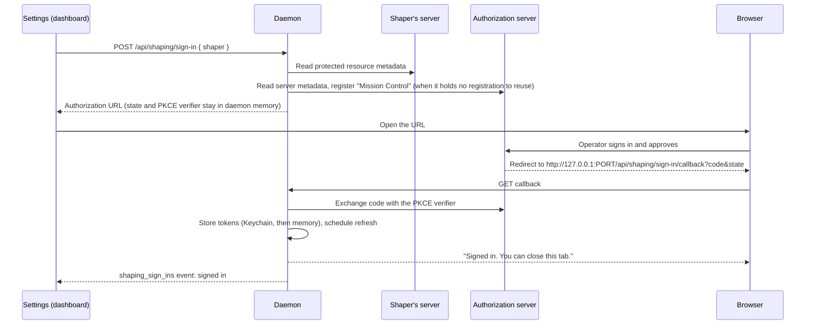
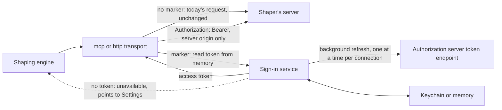

# Shaper sign-in: OAuth for remote shapers

## Goal

A remote shaper can call a server that requires an OAuth sign-in. The operator signs in once,
in **Settings > Task shaping**, and from then on the shaper's calls carry the access token.
The first use is an MCP gateway that sits in front of a context MCP server, but nothing in
the build names it: the server is any OAuth 2.1 server that publishes RFC 9728 and RFC 8414
metadata, accepts RFC 7591 dynamic registration, and takes a public client with S256 PKCE.

Today this cannot work. The `mcp` transport builds its client with no auth provider
(`src/server/shaping/transports/mcp.ts:586-592`), keeps no token, and never refreshes. The
scout report "MCP gateway OAuth from Mission Control" (revision 3, 2026-11-23) proved it: a
`401` challenge from a mock produced no discovery request and the shaper ended `failed`.

Planned for Q4 2026 by the operator's decision of 2026-11-24.

## What stays the same

- A shaper with no sign-in marker sends exactly the requests it sends today, with the flag
  on or off. The demo and the first engine run direct over the engineering VPN, with no auth
  and a declared identity, and that path is not touched. This plan adds an option.
- Shaping never blocks a launch and never asks first. A shaper that cannot be called is
  `unavailable`, the launch shows `degraded`, and dispatch continues.
- The carriers do not change: `traceparent`, `tracestate`, `x-work-unit-id` and
  `params._meta` are sent as they are today.
- `{env:NAME}` and `{caller.*}` references work as they do today, beside a sign-in or
  without one.

## Constraints already decided

These came with the task on 2026-11-24 and are not reopened here.

| # | Constraint |
| --- | --- |
| S1 | Generic and open source. No company name in code. The server is any RFC 9728, RFC 8414 and RFC 7591 OAuth 2.1 server with S256 PKCE and a public client. |
| S2 | Sign-in is an explicit action in Settings > Task shaping, never at dispatch. A missing token, or one that cannot be refreshed, makes the shaper `unavailable` with a reason that points to Settings. |
| S3 | Tokens live in the macOS Keychain or in memory only. Never in a file, `app_config`, a backup, the browser or a settings snapshot. The config holds only a marker that names no value. |
| S4 | The client registers by dynamic registration with the fixed `client_name` "Mission Control", never a Claude or Codex name, and a `127.0.0.1` loopback redirect that the daemon serves. The `client_id` is kept in `app_config`. |
| S5 | The scope requested is the one connection's own scope (`mcp:<slug>` on the gateway), never the coarse `mcp`. |
| S6 | Refresh runs in the background and is single-flight, because the refresh token is single-use. |
| S7 | The access token is added to the call's redaction set. |
| S8 | The work ships behind a preview flag, with a Playwright spec for the Settings sign-in and documentation of where the token lives. |
| S9 | The trace and work unit carriers do not change. |
| S10 | The direct path keeps working unchanged. |

## Decisions adopted

The operator submitted these on the first review of this plan, on 2026-11-24.

| # | Decision | Choice |
| --- | --- | --- |
| D1 | Where tokens are kept | The Keychain on macOS, and daemon memory where there is no Keychain |
| D2 | How the daemon reaches the Keychain | A native addon that calls the Security framework |
| D3 | Who opens the authorization URL | The dashboard |
| D4 | The residents' MCP bridge (`src/server/residents/mcp-launcher.ts`) | Out of scope |
| D5 | Whether `http` shapers get the marker | Yes, the same marker as `mcp` shapers |
| D6 | An authorization server on another origin than the shaper's server | Same origin unless the shaper's config names another |
| D7 | The form of the marker | An `auth` field on the remote server |
| D8 | Target dates | The dates in this plan |
| Follow-up | After this plan | A phased implementation plan, with one scheduled task per phase |

What each choice rules out:

- **D1.** Memory-only was not chosen, so a daemon restart on macOS does not end a sign-in.
  Keychain-only was not chosen, so a daemon with no Keychain can still sign in, until it
  restarts.
- **D2.** `/usr/bin/security` is not used. The measurements below are why.
- **D3.** The daemon never starts a browser.
- **D4.** Nothing in the resident bridge changes. Claude Code residents keep reaching such a
  server through Claude Code's own login.
- **D6.** The server's metadata alone never sends a sign-in to another origin.
- **D7.** `SHAPING_REFERENCE_KINDS` does not change.

## What the repository and the SDK look like today

Read for this plan at `3203ca8d0`. The scout report holds the gateway-side evidence.

Neither Common Room spec was read for this plan, by the operator's decision of 2026-11-24.
What the plan says about the gateway and its contract comes from the scout report, which
quotes version 3 of the contract spec. What it says about the shaper interface comes from
`docs/plans/task-shaping/plan.md`. Either spec may have changed since 2026-11-23.

- **No auth on the transport.** `StreamableHTTPClientTransport` is built with `fetch`,
  `requestInit` and `reconnectionOptions` only (`mcp.ts:586-592`). Configured headers go to
  the server's origin through `fetchOnOrigin`, which refuses any other origin
  (`src/server/origin-fetch.ts:38-40`) and sets configured headers over the client's own
  (`origin-fetch.ts:41-42`).
- **The shaper schema is strict.** The `mcp` server's `http` shape is
  `z.strictObject({ type, url, headers })` (`src/shared/shaping.ts:259-267`) and so is the
  `http` transport (`shaping.ts:283-287`). A stored entry that fails the strict schema is
  listed as unsupported and never called (`classifyShaper`, `shaping.ts:959`).
- **`app_config.shaping` drops unknown top-level keys** (`ShapingConfigSchema` is a plain
  object), so nothing new can be stored inside it without an older build deleting it on its
  next write. An `app_config` key can sit outside every backup domain, as `keepAwake` does
  (`src/shared/app-config-entries.ts:460`).
- **Routes have no API token.** `/api/*` is guarded by a loopback `Host` check
  (`requireLoopback`, `src/server/routes.ts:1915-1926`), and writes by
  `trustedLoopbackJsonRequest`. The daemon binds `127.0.0.1` only, on `MISSION_PORT`, 7317
  by default (`src/shared/harness-runtime.mjs:41-44`).
- **The dashboard already opens external links.** `openExternal` uses the desktop bridge
  when there is one and `window.open` otherwise (`src/web/components/ContextMenu.tsx:136-142`).
  The bridge itself checks nothing about the URL (`src/main/index.ts:231`).
- **Nothing uses the Keychain.** There is a native addon that calls an Apple framework,
  `native/keep-awake/`, built on macOS only and published by rename.
- **The event and the snapshot carry only the config view.** `references` travels only in
  the `GET /api/shaping` reply, which the panel reads again after a config write. A sign-in
  changes without a config write, so it needs an event of its own.
- **CI is Linux.** Tests that need macOS are skipped there.

What SDK 1.32.1 does, read from `node_modules/@modelcontextprotocol/sdk/dist/esm/client/`:

- `auth(provider, { serverUrl, scope, authorizationCode, fetchFn })` does discovery, dynamic
  registration, S256 PKCE, the RFC 8707 resource indicator and the code exchange.
- With no `scope` argument it asks for every scope the server advertises
  (`auth.js:274`). Mission Control must always pass the configured scope.
- It does not check that the authorization server's metadata names the server it was read
  from (`auth.js:258-262`). Mission Control must.
- A refresh that fails for a network reason is swallowed and `auth()` starts a new
  authorization instead (`auth.js:351-389`). So background refresh must not go through
  `auth()`. `refreshAuthorization()` is exported and throws typed errors.
- A transport given an auth provider runs `auth()` inline on a `401`, through the
  transport's own `fetch` (`streamableHttp.js:47-58`). In Mission Control that fetch is
  locked to the shaper's origin and adds the shaper's headers and the carriers.

Two measurements were made for this plan, on macOS 26 with Node 24.19.0. Each used fake
values and one uniquely named Keychain item, which was deleted and verified gone.

- `/usr/bin/security -i` takes a command on stdin, so a value need not appear in any
  argument list. It works up to a 3,904-byte command line, which is 1,900 bytes of value. A
  4,184-byte line stored a cut-off value and printed the rest of the line in its error
  output.
- A throwaway Node addon calling the Security framework (`SecItemAdd`, `SecItemUpdate`,
  `SecItemCopyMatching`, `SecItemDelete`) wrote a 16 KiB value, read it back unchanged,
  replaced it with 64 KiB, listed the item's account, deleted it, and then found nothing.
  macOS showed no prompt, because one program did all of it. The first write took about
  200 ms, so the store's calls must not run on the daemon's event loop. Not measured: the
  prompt macOS shows when a different program reads the item.

## Design

A mark like (D1) names the adopted decision a rule comes from.

### Names

The feature is **shaper sign-in**. The flag id is `shaper-sign-in`. A **connection** is what
one sign-in covers: a server URL, a scope and an authorization server. The code lives in
`src/server/shaping/sign-in/`.

### The marker

A remote server may carry one new field, `auth` (D7). It names no value.

```json
{
  "type": "mcp",
  "server": {
    "type": "http",
    "url": "https://tools.acme.example/mcp",
    "headers": { "x-acme-user-id": "{caller.user}" },
    "auth": { "type": "oauth", "scope": "mcp:context" }
  },
  "tool": "get_guidance"
}
```

- `auth.type` is an id from a new append-only tuple, `SHAPING_AUTH_KINDS`, which holds
  `oauth`.
- `auth.scope` is required: 1 to 256 characters, space-separated scope tokens. It is sent as
  written. There is no default and no fallback to what the server advertises (S5).
- `auth.issuer` is optional (D6): the authorization server's URL when it is not on the
  server's own origin.
- The same field is accepted on an `http` shaper (D5). A `stdio` server and a `command`
  shaper cannot carry it, so the token never enters a child process's environment or
  arguments.
- With `auth` present, a configured header named `authorization`, in any letter case, is
  refused by the schema, because the sign-in sets that header.
- The URL rule is the existing one: HTTPS, or plain HTTP to loopback.

The task-shaping plan expected verified identity to arrive as "a new reference kind". This
plan uses a field on the server instead, because a sign-in belongs to the connection: it has
a scope, an authorization server and a lifetime, and the header it produces is fixed by the
protocol. The token is still treated as a resolved value everywhere a reference's value is:
it fails closed, it is scrubbed from replies, and it is never stored in config.
`SHAPING_REFERENCE_KINDS` does not change. The operator chose this form (D7).

### One sign-in per connection

Two shapers that name the same URL, scope and issuer share one sign-in, so a selector and a
router on one server need one browser visit. The daemon derives a connection id from those
three values. A connection that no known shaper names any more is listed as unused, is not
refreshed, and can be signed out. The stored record keeps the connection's URL, scope and
issuer beside the tokens. None is a secret, and they name a stored sign-in after a daemon
restart, when no shaper may name it any more.

One registration serves one authorization server, redirect URI and scope. The SDK sends the
connection's scope when it registers as well as when it asks for authorization, and a server
may hold a client to the scope it registered with. So a second connection with another
scope registers its own client, and two connections with the same scope on one
authorization server share one. The record names the client that obtained its tokens, and
every refresh uses that client.

The daemon keeps at most 16 registrations. One that a held sign-in or a pending one names
is never dropped to make room. When a sign-in needs another and 16 are held, the oldest
that nothing names is dropped. When every one is named, the new sign-in is refused
before any registration request, with a reason that says to sign out of one in
Settings > Task shaping. It works once a sign-out leaves a registration that nothing
names. If the daemon could not read its stored sign-ins, it cannot tell which
registrations they name, so at 16 it drops none and refuses with a reason that says to
restart. Nothing already held is lost either way.

### Signing in



1. **Start.** Settings sends `POST /api/shaping/sign-in` with the shaper's id. The daemon
   reads the server's metadata, checks it against the egress rules below, registers a client
   if it holds none for that authorization server, redirect URI and scope, and returns the
   authorization URL. When it already holds 16 registrations it first makes room, or
   refuses, as "One sign-in per connection" says. The
   URL carries the client id, the `state` and the PKCE challenge, because the browser must
   present them, and never the verifier. This is the operator's own click, so it may take
   network time. It is bounded at 20 seconds.
2. **Browser.** The dashboard opens the URL (D3) and also shows it as a link to copy. The
   daemon never starts a browser.
3. **Callback.** The authorization server sends the browser to
   `http://127.0.0.1:<port>/api/shaping/sign-in/callback`. The route is under `/api`, so it
   has the loopback `Host` check. A browser redirect carries nothing else that proves who
   sent it, so the route accepts only a `state` it issued: 256 random bits, kept in memory,
   compared in constant time, used once, and dropped after 10 minutes. The PKCE verifier is
   kept beside it and leaves the daemon only for the token endpoint. The `state` and the
   code arrive in the browser's redirect. The daemon holds each in memory only, the `state`
   until it is used or 10 minutes pass and the code for the one exchange, and persists
   neither. When the reply carries `iss`, it must name the pinned issuer.
4. **Exchange.** The daemon exchanges the code through the SDK's `auth()`, stores the
   tokens, schedules the refresh and emits the new status. The page it answers with is
   static HTML with no script: it says the sign-in finished, or that it did not and where to
   start again. It never shows a code, a token or the server's own error text.

Sign-in uses the SDK's `auth()` directly, with Mission Control's own provider and its own
fetch. The transport is never given an auth provider. With one, a `401` at dispatch would
run discovery, a refresh or a new authorization inside the call's 5 second budget, through
the shaper's origin-locked fetch with the shaper's headers attached, and two launches at
once could each spend the single-use refresh token. That breaks S2 and S6.

### What a call does



The token read is a memory read. A call never waits on the network or the Keychain for it.

| The shaper's connection | What the call does | Outcome |
| --- | --- | --- |
| No marker | Today's request, with today's headers. The sign-in service is not asked. | As it is today, a `401` included |
| Marker, flag `shaper-sign-in` off | No request | `unavailable`: sign-in is switched off, naming the flag |
| Marker, `signed_in` | Sends `Authorization: Bearer <token>` to the server's origin only. The token joins the call's redaction set under the name `sign-in token`. | By the reply |
| Marker, `signed_out` or `pending` | No request | `unavailable`: not signed in, sign in at Settings > Task shaping |
| Marker, `renewing` | No request | `unavailable`: the sign-in is being renewed |
| Marker, `signed_in`, the server answers `401` | The request was sent. The service is told and starts one background refresh. No retry inside the call. | `unavailable`: the server refused the sign-in |

In every row dispatch continues. The dry run in Settings takes the same path, so a dry run
proves a sign-in end to end.

### Refresh

- **When.** At 75% of the access token's lifetime, which is 6 hours of the gateway's 8. With
  no `expires_in`, only after a server refuses the token. Also at daemon start for a stored
  token that has expired.
- **Single-flight.** One refresh at a time per connection, inside the daemon, which is the
  only process that holds tokens. Anything that asks while one is running shares it.
- **Store first.** The rotated pair is written to the store before it replaces the pair in
  memory. If the write fails, the new pair is used from memory, the status says it is kept
  in memory only, and a restart will need a new sign-in.
- **Failures.** `invalid_grant`: the tokens are deleted and the connection is `signed_out`
  with "sign in again". `invalid_client` or `unauthorized_client`: the server no
  longer accepts the client, so every sign-in that client obtained ends the same way, and
  then its stored registration is deleted. A network error, a timeout, a 5xx,
  `temporarily_unavailable` or a 429: retried after 1, 2, 4 and 8 minutes, then every 15.
  The connection is `renewing` once the access token has expired.
- **No refresh token.** A server that issues none gives a sign-in that ends when its access
  token expires. The connection is then `signed_out`.
- **Scope.** Only connections that a known shaper names are refreshed, and only while both
  flags are on.
- Refresh calls `refreshAuthorization()`, not `auth()`, so a network failure is never taken
  for a reason to open a browser.

### Where each thing is kept

Three words have one meaning each here. **Held in memory** means the daemon keeps the value
in its own memory, and it is gone when the daemon stops. **Persisted** means written where
it survives a restart, which for this feature is the Keychain and `app_config` and nowhere
else. **Passes through** means the value is in a request or a redirect because the protocol
puts it there, and whatever it passes through does not keep it.

| Thing | Held in daemon memory | Persisted | Passes through, and is not kept there | Never reaches |
| --- | --- | --- | --- | --- |
| Access token | While signed in | The connection's Keychain item on macOS (D1, D2). Not persisted where there is no Keychain. | The shaper's server, on each call | A file, SQLite, `app_config`, a backup, a settings snapshot, an event, an API reply, a log, a task record, a child process, the browser |
| Refresh token | While signed in | The same item | The authorization server's token endpoint, on a refresh | The same places, and the shaper's server |
| PKCE verifier | At most 10 minutes, single use | Never | The token endpoint, once, at the exchange | The browser, an API reply, an event |
| `state` | At most 10 minutes, single use | Never | The authorization URL, so the sign-in reply and the browser, and the browser's redirect to the callback | The sign-in list, an event, the snapshot, the callback page |
| Authorization code | For the one exchange | Never | The browser's redirect to the callback, then the token endpoint, once | An API reply, an event, the snapshot, the callback page |
| `client_id`, with its issuer, redirect URI, scope and registration time | While the daemon runs | `app_config` key `shaping.signIn`, at most 16 registrations, value class `operational`, in no backup domain. One that a sign-in names is never dropped to make room. The id alone is also in each record that client obtained, beside the tokens. | The `client_id` only: the authorization URL, so the sign-in reply and the browser, and requests to the authorization server | A backup, a settings snapshot, the sign-in list, an event, the snapshot. It is not a secret. |
| The connection's URL, scope and issuer | While the daemon runs | The shaper's definition, and the record in the Keychain item beside the tokens | The sign-in list: the API reply, the event and the snapshot | They are not secrets |
| The marker | While the daemon runs | The shaper's definition, in `app_config.shaping` or a manifest | The config view, as any definition | It names no value |
| Server metadata | Until the daemon stops, and read again after a restart | Never | | |

The browser sees the authorization URL and the callback URL, as in every OAuth sign-in. It
never sees a token or the verifier, and without the verifier a code or a `state` seen in
the browser cannot be used.

- The daemon reaches the Keychain through a native addon, `native/keychain/`, that calls
  the Security framework (D2). It is built on macOS only, as `native/keep-awake/` is, and
  published by rename. A token is never in an argument list or in a tool's output.
- Where there is no Keychain, where the addon cannot load, and where the Keychain refuses
  (it is locked, or macOS denies access), the sign-in is kept in memory and its status says
  so (D1). It then lasts until the daemon restarts.
- The Keychain item's service name is `Mission Control shaper sign-in`. Its account is a
  tag of the state home followed by the connection id, so a test home or a second
  installation never reads another's items.
- The item belongs to the program that wrote it. After that program changes, such as a Node
  upgrade for a daemon run from a checkout, macOS asks the operator once before the daemon
  may read it.
- A registration response that carries a `client_secret` is refused. Mission Control is a
  public client, and `app_config` holds no secret.
- `MISSION_SHAPER_SIGN_IN_STORE` set to `memory` forces the memory store. The browser suite
  sets it, so no end-to-end run writes to a login Keychain.

### Egress rules for sign-in requests

Sign-in requests do not go through the shaper's fetch. They use their own, which:

- sends none of the shaper's configured headers, no carrier, and no cookie;
- reaches two origins only: the shaper's server, for its protected resource metadata, and
  the authorization server. By default the authorization server must be on the server's own
  origin. Another origin is allowed only when `auth.issuer` names it, and metadata that
  names any other is refused (D6);
- requires HTTPS, or plain HTTP to loopback, for every URL, the authorization endpoint the
  browser opens included;
- requires every endpoint the metadata names to be on the authorization server's origin,
  the metadata's `issuer` to name that server, and S256 to be offered;
- follows no redirect to another origin, reads at most 64 KiB per reply, and gives each
  request 10 seconds.

So an access token goes to the shaper's server and nowhere else, and a code or a refresh
token goes to the authorization server's token endpoint and nowhere else.

### Status, and where it shows

A connection is `signed_out`, `pending`, `signed_in` or `renewing`. The daemon publishes a
list with, per connection: its id, URL, scope, issuer, state, whether it is kept in the
Keychain or in memory, when the access token expires, a reason, and the ids of the shapers
that use it. The list never holds a token, a code, a `state`, a verifier or an
authorization URL.

- `GET /api/shaping` gains `signIns`. A new event, `shaping_sign_ins`, and a snapshot field
  carry the same list, so the panel follows a sign-in that finishes in another tab, a
  refresh that fails, and an expiry.
- In Settings, each shaper with the marker shows its connection's state, with **Sign in**
  or **Sign out**. Settings has no field-by-field shaper editor: a shaper is registered by
  importing a manifest, so the marker arrives in the manifest. The import review and the
  shaper's row state the sign-in, with its scope and the authorization server's origin, and
  "What it is sent" names the access token and where it goes. A window that did not start a
  pending sign-in, or that was reloaded, has no link to offer: it shows the sign-in as
  waiting, with Sign in to start again and Cancel sign-in.
- On a task, nothing new: an `unavailable` shaper already makes the launch `degraded`, with
  its reason in the viewer.

### Feature flag

```ts
{
  id: "shaper-sign-in",
  label: "Shaper sign-in",
  description: "Sign a remote shaper in to an OAuth-protected server from Settings > Task shaping.",
  stage: "preview",
  keywords: ["shaping", "shaper", "oauth", "sign-in", "login", "token"],
}
```

| Surface | Gate |
| --- | --- |
| `POST /api/shaping/sign-in`, `POST /api/shaping/sign-out`, `GET /api/shaping/sign-in/callback` | `task-shaping`, then `shaper-sign-in`. 404 while either is off. |
| `signIns` in `GET /api/shaping` | An empty list while `shaper-sign-in` is off |
| The `shaping_sign_ins` event and the snapshot field | Sent only while both are on. Switching either off sends an empty list to open windows. |
| Transports | A marked shaper is `unavailable` while the flag is off, and is not called. |
| Background refresh | Runs only while both are on. |
| Settings | A marked shaper's sign-in state and its controls follow the flag live. |
| The schema | Not gated. The strict schema knows `auth` whatever the flag says, so a marked shaper is a known shaper that is not called, never an unsupported entry. |

Switching the flag off deletes nothing. Stored tokens stay where they are and are not
refreshed, so they may lapse.

### Compatibility

- **Shapers stored before this plan** have no marker and are not affected. A test pins the
  exact request headers an unmarked `mcp` and `http` shaper send, with the flag on and off.
- **An older build that reads a marked shaper** lists it as unsupported, keeps it on every
  write and never calls it, because its schema is strict. It does not read `shaping.signIn`
  or the Keychain items.
- **A changed URL, scope or issuer** is a different connection and needs its own sign-in.
  The old one becomes unused.
- **A changed daemon port** changes the redirect URI. The stored registration no longer
  matches, so the next sign-in registers again. Held tokens keep refreshing, because a
  refresh does not use the redirect URI. The registration that a held sign-in names stays
  in `app_config` however many sign-ins register under the new port.
- **A crash between a refresh reply and the store write** loses the rotated pair. The stored
  refresh token is then already spent, and the next start ends in "sign in again" unless
  the server's reuse grace still covers it.

## Phases

Seven phases, one pull request and one backlog task each, released when the planning pull
request merges, with autopilot off. Estimates are non-test lines. `phased-plan.md` has the
findings, the dependencies and the contracts between phases, and each `phase-<n>-*.md` file
is that phase's guide.

| Phase | What it delivers | Lines | After | Target |
| --- | --- | --- | --- | --- |
| 1. Flow proof | Mission Control's OAuth client core, run end to end against a loopback mock authorization server with fake values: discovery, registration, PKCE, exchange, refresh, rotation, every refusal. Go or no-go for the rest. | 260 to 340 | Planning PR | 2026-12-04 |
| 2. Token store | The native Keychain addon, the Keychain store and the memory store, behind one interface | 380 to 480 | Planning PR | 2026-12-04 |
| 3. Flag and marker | The `shaper-sign-in` flag, the `auth` field, the target accessor, the Settings text for a marked shaper, and a marked shaper answering `unavailable` | 170 to 240 | Planning PR | 2026-12-04 |
| 4. Sign-in service | Start, finish, sign out, background refresh, status, the client registration key and its limit | 400 to 490 | 1, 2, 3 | 2026-12-09 |
| 5. Transports | `mcp` and `http` send the token, redact it, and handle a `401` | 170 to 240 | 4 | 2026-12-14 |
| 6. Routes and wire | The three routes, the callback page, `signIns`, the event and the snapshot field | 300 to 380 | 4 | 2026-12-14 |
| 7. Settings and docs | The sign-in control, the Playwright spec, the documentation | 240 to 320 | 5, 6 | 2026-12-17 |

Phases 1, 2 and 3 run together, and so do 5 and 6. The first phase exists because the scout
read the SDK's flow and did not run it.

## Outside Mission Control

None of these blocks building or testing, which use the mock. All four must be true before a
real sign-in means anything.

| # | What | Who | Why |
| --- | --- | --- | --- |
| 1 | The gateway's forwarding of `traceparent`, `tracestate`, `x-work-unit-id` and `params._meta` (mcp-gateway PR #117) confirmed live | Gateway owner | Without it a signed-in call loses the trace and the work unit |
| 2 | The decision on the context MCP's caller identity, hybrid or token-only (FR-01 question e) | Deepak | The gateway forwards no identity header, so the server must take the user from the token or stop requiring one |
| 3 | A gateway admin approves the `mission-control` client kind | Gateway admin | Until then the authorization endpoint answers `unauthorized_client` |
| 4 | The context MCP is registered on the gateway | Tom | There is nothing to call until it is |

**The real sign-in check is a human step.** After phase 7 has merged and the four rows are
done, the operator and Tom sign in from Settings against the real gateway and dry-run the
shaper. No task or agent session ever does this. Earliest date: 2026-12-18.

## Hard rules for every session this plan creates

Each phase file repeats these.

- No reading, copying, exporting or passing of real credentials: no Keychain reads of other
  applications' items, no `auth.json`, no OAuth tokens or API keys other than this
  feature's own fake-valued test fixtures, and nothing under `~/.claude*` or `~/.codex*`.
- Tests use a loopback mock authorization server and fake values only.
- No real login against Okta or the gateway, and no request to either.
- The feature's own Keychain item names are unique. A test that writes an item removes it
  and verifies it is gone.
- No session runs the full unit suite or the full end-to-end suite locally. A phase runs
  its own test files and its focused specs, with `npm run typecheck` and `npm run lint`,
  and relies on CI for the full suites. This is the operator's standing instruction. If a
  reviewer asks for a full-suite result, the session gives the targeted results and says
  that CI covers the full suite.

## Tests and proof

- A fixture, `test/fixtures/fake-oauth-server.mjs`: a protected `/mcp` with a `401`
  challenge and a `get_guidance` tool for the `mcp` transport, a protected `/shape` that
  answers a shaping result for the `http` transport, the metadata documents, `/register`,
  `/authorize` that approves at once, `/token` with single-use rotation, and `/revoke`. It
  records every request, can put the authorization server on a second loopback origin, and
  can be told to refuse, stall or rotate.
- Unit tests in `test/` for each phase, on Linux CI, with an injected clock and store.
- The Keychain store's own test runs on macOS only, under a unique service name.
- Playwright specs for the callback page (Phase 6) and for the Settings sign-in (Phase 7),
  against the same fixture, and one added test for the import review (Phase 3).
- Proof that no token leaves its place: the fixture's recorded requests show the access
  token only on requests to the protected resource, and tests search the stored
  `app_config` value, a settings snapshot, every event and API reply, the dashboard
  snapshot, and the summary and section a task record stores, for the fake token values.

## Non-goals

- Signing in at dispatch, or any prompt, dialog or attention item raised by a launch.
- Client secrets, confidential clients, device flow.
- A notice when a sign-in lapses, beyond the `degraded` marker and the Settings status.
- Reconciling the declared identity with the signed-in user.
- The residents' MCP bridge (D4).
- `/usr/bin/security`, a client ID metadata document, or any store other than the Keychain
  and memory.
- A Mission Control `User-Agent` on shaper calls. The direct path stays byte-identical.
- Moving the flag to `default-on`, which is the flag lifecycle's next pull request.

## Risks

- **The first credential the daemon holds.** A process running as the operator can read
  what the daemon can. The Keychain keeps the token out of files, backups and searches, and
  is not a boundary against such a process. The documentation says so.
- **Rotation.** A crash at the wrong moment, or two daemons on one state home, can spend a
  refresh token and force a new sign-in. The state lock already prevents the second.
- **SDK drift.** The flow leans on the SDK's `auth()` and `refreshAuthorization()`. Phase 1
  pins what they send with tests, so an SDK upgrade that changes it fails there.
- **A hostile server.** The server's metadata chooses URLs. The egress rules bound where a
  token, a code or the browser can be sent.
- **Dates.** They assume each phase merges within two working days of its dependency.

## Effect on other plans and specs

| Document | Change |
| --- | --- |
| `docs/plans/task-shaping/plan.md`, lines 482-483, 515-516 and 753 | Superseded for signed-in connections only. Mission Control now holds tokens for a shaper that carries the marker, in the Keychain or in memory. References are unchanged. Verified identity arrives as the marker, not as a reference kind (D7). |
| `docs/task-shaping.md`, `docs/security.md`, `docs/configuration.md`, `docs/event-stream.md`, `docs/feature-flags.md`, `docs/agent-guides/change-contracts.md` | Updated by the phase that changes the behaviour each describes |
| Common Room spec "MC task shaping: the shaper interface", section 8 | Should gain the link to this plan once it is approved. The operator makes the edit: the planning session hands over the text and makes no Common Room call. |
| Common Room spec "MCP Gateway: internal MCP server auth contract", open question 2 | Answered by this plan: Mission Control's client will complete the login, on the dates above. The operator posts the note on the Common Room thread, from text the planning session hands over. |
