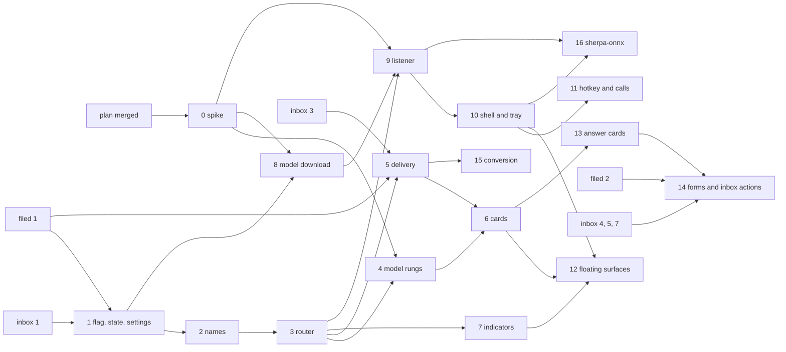

# Voice addressing for agents: phased implementation

Source: `docs/plans/voice-addressing-for-agents/plan.md` (managed plan
`deccc636-b913-4507-b2cc-17f89d5b6581`). Its adopted decisions are requirements here. This task
writes the plan and schedules the phases. It ships no product code.

## Findings that shaped the phases

- The daemon owns the decisions and needs no audio. Names, routing, delivery, cards and answering
  can be built and tested by posting text, so they do not wait for the listener.
- The audio path carries the unproven parts: the recognizer's timings, microphone permission on a
  hardened build, key release, call detection. A spike proves them before those phases start.
- A spoken message must be operable at each merge. Phase 3 delivers it as a plain queued message;
  Phase 5 replaces that with the spoken turn and its notes.
- The settings store has one owner. Phase 1 declares the settings later phases read, so no later
  phase adds a field.
- A test must be able to reach the mode `listening` with no microphone. Phase 1 owns the
  listener's hello route and a fixture that sends it.
- Shell work needs a listener to supervise, and floating windows need the card component, so the
  shell phases follow both.

## Plan validation round 1

Five findings were accepted and applied across the bundle:

- **One rule for a card that is not open.** V23 said speech does not fill a card that is not
  open, while V26 and Phase 13 let an explicit answer phrase do so. The rule is now stated once,
  in V23: speech reaches a card through the open-card signal or through an explicit answer
  phrase, and through nothing else. V26 names the two signals, and Phase 13's step 3, tests and
  exit criterion refer to them.
- **Phase 9 is verified through what its prerequisites built.** Its manual check asked for a
  toast, which is Phase 6's. It now checks the queued message in the agent's conversation and
  the Recently heard route, both from Phase 3. Phase 16's manual check was corrected the same way.
- **Phase 16 follows Phase 10.** It changes the shell's listener supervisor, which Phase 10
  creates, so Phase 10 is now a direct prerequisite in the table, the graph and the task.
- **A spoken turn's notes are composed once, at delivery.** Phase 5 said both that the turn is
  created with the full text and that its notes are computed at delivery. Now the words are
  stored at submit, the notes are composed when the outbox claims the turn, and `composed_at`
  stops a retry or restart composing twice. Contract F carries the two columns and the
  signature. Phase 5 gains a migration and three tests.
- **A model is hashed again before it reads ready.** Phase 8's start-up check compared sizes and
  a stored record, which a same-size change passes. It now hashes each file against the manifest
  before reporting `ready`, with a same-size tampering test.

The same pass checked each phase's verification against what its prerequisites built, and found
two more of the second kind: the unsure card's Recently heard link sat in Phase 6, which does not
follow Phase 7, so it moved to Phase 12; and Phase 11's spec read a "status line" that could be
taken for Phase 7's indicator, so Phase 1's line at the top of Voice settings is now called the
mode line in both phases.

## Plan validation round 2

One finding was accepted and applied:

- **Phase 16's Linux claim has a required test.** The phase said the listener runs on Linux, but
  its real-recognizer test could be skipped and its Linux manual check was conditional. Phase 16
  now pins a small recognizer test model (chosen by the spike's S2) and a fixture recording, adds
  a file-input mode to the listener, and requires on Linux CI a test that loads the addon and
  transcribes the recording through the listener. Its outcome and exit criterion claim what that
  test proves. Microphone capture on a Linux desktop is stated as unverified and belongs to the
  follow-on plan, which the source plan's "Linux path" now says too.

## Sizing and phase count

Estimated 8,800 to 11,400 non-test implementation lines across shared contracts, the daemon, the
MCP child, the dashboard, the Electron shell, two native addons and a Swift helper. One reviewable
pull request holds a few hundred. A spike and sixteen phases:

| Phase | File | Delivers | Depends on | Runs on | Est. lines |
| --- | --- | --- | --- | --- | --- |
| 0 | `phase-0-spike.md` | Measured answers for the audio, permission, hotkey, call and model-step unknowns | this plan merged | Astra | 300 to 500 |
| 1 | `phase-1-flag-state-and-settings.md` | Flag, voice config, voice state, Voice settings, Setup family | inbox 1, filed 1 | Opus | 500 to 650 |
| 2 | `phase-2-spoken-names.md` | Call sign, reference name, validation, registry, roster panel | 1 | Opus | 600 to 750 |
| 3 | `phase-3-utterance-router.md` | Utterance route, deterministic router, cancel window, Recently heard buffer | 2 | Astra | 650 to 800 |
| 4 | `phase-4-model-rungs.md` | Decision providers, key entry, Haiku or Luna rung, split or mention | 0, 3 | Opus | 550 to 700 |
| 5 | `phase-5-spoken-delivery.md` | Spoken turn with notes, delivery outcomes, stop, Foreman hold | 3, inbox 3, filed 1 | Opus | 600 to 750 |
| 6 | `phase-6-confirmation-and-outcome-cards.md` | Confirmation toast, outcome cards, placement setting | 4, 5 | Opus | 500 to 650 |
| 7 | `phase-7-indicators-and-recently-heard.md` | Five in-window indicators, Recently heard table | 3 | Opus | 500 to 600 |
| 8 | `phase-8-model-download-and-setup.md` | Model manifest, download and verify, Setup rows, input device | 0, 1 | Opus | 500 to 650 |
| 9 | `phase-9-listener-helper.md` | Listener directive and the FluidAudio backend | 0, 3, 8 | Astra | 600 to 800 |
| 10 | `phase-10-shell-and-tray.md` | Supervision, microphone permission, signing, tray glyphs | 9 | Opus | 550 to 700 |
| 11 | `phase-11-hotkey-and-calls.md` | Hotkey, call auto-mute, push-to-talk | 10 | Opus | 500 to 650 |
| 12 | `phase-12-floating-surfaces-and-ask-aloud.md` | Pill, tray popover, Recently heard popover, ask aloud | 6, 7, 10 | Opus | 450 to 600 |
| 13 | `phase-13-answer-cards-by-voice.md` | Open-card report, voice answers, countdown footer, hints | 6 | Opus | 650 to 800 |
| 14 | `phase-14-plan-forms-and-inbox-actions.md` | Plan forms by voice, spoken inbox actions | 13, filed 2, inbox 4, 5, 7 | Opus | 650 to 800 |
| 15 | `phase-15-question-conversion.md` | Converting a blocking question | 5 | Astra | 300 to 400 |
| 16 | `phase-16-sherpa-onnx-backend.md` | The portable listener backend | 9, 10 | Astra | 400 to 550 |

"Inbox n" and "filed n" are phase tasks of the two prerequisite plans. "Opus" is Claude Opus 5.5
at extra-high effort, for a phase with a UI part. "Astra" is GPT-6 Astra at extra-high effort.

Why not fewer:

- 0 stands alone because its output is numbers and choices, not product code.
- 1 and 2: a flag and settings store against a migration, two forms and a registry.
- 3, 4 and 5 are the router's three risks: the pause rule, outside model calls with a stored key,
  and the pending-turn outbox. Each needs its own review.
- 6 and 7 are both dashboard work with no shared code; together they pass 1,000 lines.
- 8 and 9: a download the Linux CI can test, against a Swift program that builds on macOS alone.
- 10, 11 and 12 are shell work split by risk: signing, native addons, new windows.
- 13 and 14: single cards auto-submit and forms do not; 14 also waits on five prerequisite tasks.
- 15 changes the MCP child and the review channel and would hold delivery behind that review.
- 16 is a second backend that the first release does not need.

Why not more: each phase is one slice with its own storage, routes, UI and specs.

## Concurrency and merge order

- 0 runs beside 1 and 2. 8 runs beside 2 to 7 once 0 and 1 have merged.
- After 3: phases 4, 5 and 7 may run together.
- After 6: phase 13 runs beside the shell phases 10 to 12.
- 15 runs beside anything that is not its prerequisite. 16 runs beside 11 to 15 once 10 has
  merged.
- Phases that run together edit `src/server/routes.ts`, `src/shared/types.ts`,
  `src/web/useEventStream.ts`, `src/web/components/SettingsPage.tsx` and `docs/voice.md` in
  different places; the later one rebases. A phase that adds a migration (2 and 5) takes the
  next schema number at merge time, as the sibling plans do.

## Cross-phase contracts

Names are fixed here. A phase file refers to a contract by its letter and does not restate it.
Where a phase file and a `mockup-*.html` page differ, the mock-up shows the adopted look and the
phase file decides behaviour.

**A. Flag and settings (Phase 1).** `VOICE_FLAG = "voice"` and `VOICE_REQUIRED_FLAGS` (the
`async-input`, `inbox` and `filed-plan-decisions` ids) in `src/shared/voice.ts`. `VoiceConfig`, the
`voice` app-config entry: `muted`, `hotkey`, `autoMuteDuringCalls`, `cancelWindow { enabled,
seconds }`, `whenUnsure` (`show` or `ask`), `planFormsByVoice`, `inputDevice`, `decisionProvider`,
`backend`. Routes `GET` and `PUT /api/voice/config`. `ui.voice` in the UI config: `confirmation`
(`pill`, `toast` or `popover`) and `indicators` (a list of indicator ids). Later phases read and
write these fields and add none.

**B. Voice state (Phase 1).** `VoiceState { mode, reasons, capabilities, model, roster }`. Modes:
`off`, `unavailable`, `listening`, `muted`, `auto-muted`, `push-to-talk`. Reasons: `flags` (a
required flag is off), `listener` (no hello in the last 30 seconds), `model` (the listener's hello
says no model is loaded), `microphone` (a hello or a shell report says access is denied).
Capability ids: `listener`, `microphone`, `hotkey`, `call-detection`, `speech-output`, `tray`,
`floating-windows`. `model` is a `VoiceModelState` with statuses `missing`, `downloading`,
`verifying`, `ready`, `failed`. The pure rule `voiceMode(inputs)` decides the mode. The snapshot
field `voice` and the event `voice_state` exist while the flag is on. `POST /api/voice/mute {
muted }`. `POST /voice/listener/hello { backend, version, devices, modelLoaded, microphone }`
(token), sent every 10 seconds by a listener. `POST /voice/shell-report` (token) carries
capabilities, microphone permission, `callActive`, `pushToTalk` and `hotkeyError`; a report lapses
15 seconds after the last one. `e2e/fixtures/voice.ts` exports `beListener`, which sends hellos
so a spec sees the mode `listening` on any platform.

**C. Names (Phase 2).** `Task.callSign` and `TaskSummary.callSign`; `identity.referenceName` on a
resident profile; `validateSpokenName(name, roster)`, `phoneticKey(name)` and
`VOICE_CONTROL_WORDS` in `src/shared/voice-names.ts`; `SpokenName { key, name, kind, taskId,
sessionId, role, colorId, agent, state }` with key `resident:<profileId>` or `task:<taskId>` and
state `running`, `hibernated` or `not-running`. Phase 2 fills `VoiceState.roster` and emits
`voice_roster`.

**D. Utterances, routing and cards (Phase 3).** `POST /voice/utterances` (token) takes
`VoiceUtterance { id, text, words: [{ text, startMs, endMs }], capturedAt, backend }` and accepts
it while the mode is `listening` or `push-to-talk`. `routeUtterance(utterance, context)` in
`src/shared/voice-routing.ts` returns `control`, `addressed`, `needs-model` or `ignored`.
`VoiceCard { id, state, parts, deadline, candidates, reason, openQuestions }` with states
`pending`, `resolving`, `unsure`, `sent`, `queued`, `held`, `not-running`, `cancelled`, `failed`;
a part is `{ target, text }` and a split has two. Event `voice_card`. Routes `POST
/api/voice/cards/:id/cancel`, `/send-now` and `/pick`. The `VoiceDeliverer` interface. `GET` and
`DELETE /api/voice/heard` with `HeardEntry`. `say` in `e2e/fixtures/voice.ts`.

**E. Model step (Phase 4).** `VoiceDecider.ask(questions)` with question kinds `who`, `split` and
`option`, each answered with a choice and a confidence. Rungs in order: the configured decision
provider, the `voice-routing` background job, none. Key routes `GET`, `PUT` and `DELETE
/api/voice/decision-key`; `GET` reports the source (`settings`, `environment` or none) and does
not return the key.

**F. Spoken turns (Phase 5).** `VOICE_TURN_PREFIX`, `spokenMessageText(words, notes)` and
`openQuestionsNote(asks)` in `src/shared/voice-delivery.ts`;
`PendingTurnManager.submitSpoken(sessionId, words, utteranceId)`, which stores the words and
composes the notes once, when the turn is claimed for delivery; the `pending_turns` columns
`spoken_words` and `composed_at`; the delivery outcomes `sent`, `queued`, `held`, `not-running`,
`failed`; `voiceHold(sessionId)`.

**G. Card component (Phase 6).** `VoiceCardView` draws one `VoiceCard`. `VoiceCardHost` shows it
as a toast when `ui.voice.confirmation` is `toast` or the `floating-windows` capability is
unavailable. The dashboard routes `#/voice/pill` and `#/voice/popover` are reserved for Phase 12.

**H. Models and setup (Phase 8).** `VOICE_MODELS` in `src/shared/voice-models.ts`, keyed by
backend (`fluidaudio`, `sherpa-onnx`); the manager that drives contract B's `VoiceModelState`;
files under `<state home>/voice/models/<backend>/<revision>/`; routes `POST` and `DELETE
/api/voice/model/download`; Setup ids `voice-previews` (Phase 1), `voice-model` and
`voice-microphone`.

**I. Listener protocol (Phase 9).** A listener is a standalone program given
`MISSION_VOICE_DAEMON_URL`, `MISSION_VOICE_TOKEN_FILE` and `MISSION_VOICE_MODEL_DIR`. It sends
contract B's hello, long-polls `GET /voice/listener/directive` for `{ capture, roster,
inputDevice, pauseMs, revision }`, and posts contract D's utterances.

**J. Open cards and voice answers (Phase 13).** `PUT /api/voice/open-cards { windowId, focused,
cards: [{ kind, id, focused }] }`; `VoiceAnswer` and the event `voice_answer`;
`optionLetter(index)`; `CardVoiceFoot`.

**K. Conversion (Phase 15).** The wait poll's `convertible=1` query, the response field
`converted { receipt }`, and `ReviewManager.convertToFiled(reviewId)`.

Token routes live under `/voice/` and check `x-harness-token`. Dashboard routes live under
`/api/voice/` behind the loopback gate. Both answer 404 while the flag is off.

## Requirement ownership

| Phase | Requirements |
| --- | --- |
| 1 | V38, V39 |
| 2 | V1, V2, V3, V32 |
| 3 | V5, V9, V11, V12, V36 |
| 4 | V13, V15, V44 |
| 5 | V17, V18, V19, V20, V21, V22, V24, V30 |
| 6 | V16, V40 (toast and the setting) |
| 7 | V41, V43 (table) |
| 8 | V35, V46 |
| 9 | V10, V34 |
| 10 | V4, V8 |
| 11 | V6, V7, V37 |
| 12 | V14, V40 (pill and popover), V43 (popover) |
| 13 | V23, V26, V27, V28, V33 |
| 14 | V29, V42 |
| 15 | V25 |
| 16 | V45 |

V31 needs no work: nothing in this plan reads a report aloud or switches the dashboard. Phase 0
owns no requirement; it supplies the measured values phases 4, 8, 9, 10, 11, 12 and 16 read from
`docs/voice-spike-findings.md`.

## Not scheduled here

- **Voice on Linux.** A follow-on plan task, "Voice Addressing on Linux Phased Plan", is created
  in the backlog behind Phase 16. It covers a daemon-run listener, microphone capture on a Linux
  desktop, a hotkey and call detection.
- Moving `voice` to `default-on` and retiring it, which `docs/feature-flags.md` makes separate
  pull requests.

## Final verification

With the phases merged and the four flags on: `npm run typecheck`, `npm run lint`, `npm run
build`, `npm run smoke`, `MISSION_TEST_CONCURRENCY=4 npm test`, `npm run test:electron` and `npm
run test:e2e`. Then the manual checklist in `docs/voice.md` on a signed build: speak to a
resident, cancel, mute by hotkey and tray, join a call, push to talk, answer a card. With the
`voice` flag off, specs that predate this work pass unchanged.

## Final cross-phase audit

- Each requirement V1 to V46 has one owner above, except V40 and V43, which name two surfaces and
  give each surface one owner.
- Each contract A to K has one owning phase, and its consumers depend on that phase directly or
  through the graph.
- Phases that may run together (4, 5, 7; 13 beside 10 to 12; 15; 16 beside 11 to 15) consume no
  contract owned by one another.
- Phase 3 leaves spoken messages working as plain queued messages, so phases 4 to 7 each merge
  onto an operable repository in any order the graph allows.
- The settings fields in contract A cover what phases 4, 6, 7, 8, 11, 12, 14 and 16 read.
- A spec reaches the mode `listening` through `beListener` from Phase 1 on, so no spec depends on
  a microphone, a model or macOS.
- After the final approval round: the not-running card for a resident carries a Relaunch button,
  stated in the source plan's adopted decisions and in Phase 6.
- After plan validation round 1: each of the five rules above reads the same in the source plan,
  the contracts and the phase that owns it, and each phase's verification uses surfaces its own
  prerequisites built.
