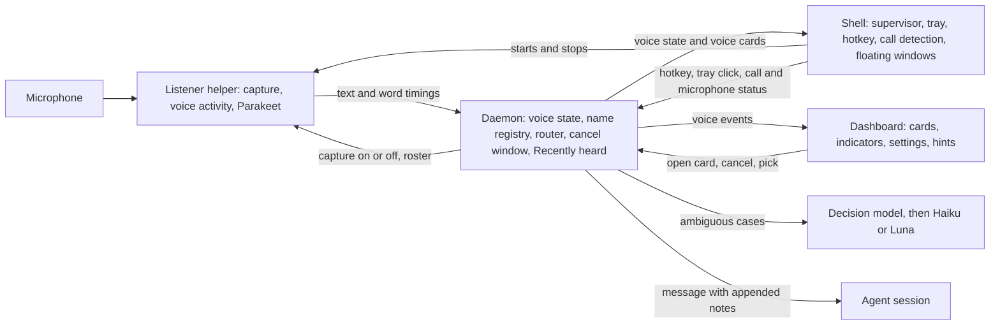

# Voice addressing for agents

Status: decisions adopted from the operator's reviews of 2026-11-22; phased in `phased-plan.md`.
This task delivers the plan and its phases only. No product code changes here.

## Goal

An always-listening, local voice layer for Mission Control on macOS. The operator says an agent's
name, pauses, and speaks. The message reaches that agent with no typing, and the same voice can
answer the agent's cards. It ships behind a new `voice` preview flag.

## Source and scope

- Source spec: "Feature request: Voice addressing for agents",
  https://claude.ai/artifact/MHs47NN2d25hdqTpc4JVvE (doc id
  `a4518529-08f0-4557-8aa5-0c7fe343b377`), read at doc revision 17 on 2026-11-22.
- Companion: "Feature request: Agent reports and inbox upgrades",
  https://claude.ai/artifact/SbAVfCNfQ4NNUMjM5BvqBu, for the naming rule, reports and the
  voice-compatibility table.
- Code references were checked at commit `2088bd522`, the head of `main` when this was written.
- Prerequisite plans, merged as documents with their phase tasks in the backlog:
  `docs/plans/agent-reports-and-inbox-upgrades/phased-plan.md` (the inbox plan) and
  `docs/plans/filed-plan-decisions/phased-plan.md` (the filed plan).

Out of scope:

- The spec's non-goals: reading reports aloud, switching the dashboard to an agent that reports
  back, and meeting transcription.
- Reports, Stuck rows, the naming rule and report notifications, which the inbox plan builds.
- Filed plan forms, which the filed plan builds.
- Voice on Linux. The design keeps it open (see "Linux path") and a follow-on plan task holds it.
- macOS 12 and 13. Voice needs macOS 14.

## Requirements

Each requirement has an id so a phase can own it. V1 to V39 come from the spec. V40 to V46 come
from the operator's reviews.

| Id | Requirement |
| --- | --- |
| V1 | A resident is addressed by its profile name, or by an optional reference name set on its profile. |
| V2 | A session is addressable only when it has a call sign, set in the dispatch form's Advanced box. Task titles are not spoken names. Any other agent is answered through its open card by starting with "reply". |
| V3 | Name validation warns and does not block: a common English word, a name that sounds like another agent's, a very short single-syllable name, or a clash with a control word. The warning encourages a more distinctive name. |
| V4 | Listening continues while Mission Control is minimized. |
| V5 | An utterance addresses an agent when it starts with a known name followed by a short pause, read from the recognizer's word timings. |
| V6 | Mute by a configurable system-wide hotkey and by a click on the tray icon. |
| V7 | While another app uses the microphone, voice auto-mutes by default. During auto-mute, holding the hotkey is push-to-talk and a tap still toggles mute. |
| V8 | The existing tray icon shows four states: listening, muted, auto-muted for a call, push-to-talk active. |
| V9 | Audio stays in the listener process. Routed utterances are kept as the delivered message. Everything else is discarded and not written to disk. A short in-memory Recently heard list shows recent utterances and why each did or did not route. |
| V10 | The recognizer is primed with the live roster of names. |
| V11 | An utterance that starts with a known name and a pause sends the rest of the utterance to that agent verbatim. |
| V12 | Phonetic near-misses ("Steven", "Steve's") resolve to the name at once. |
| V13 | When matching is still ambiguous, one stateless model call takes the roster (names with a one-line role) and the utterance and returns one agent or "not sure". |
| V14 | When unsure, Mission Control asks aloud or shows the ambiguity on screen. Which one is a setting. |
| V15 | A second known name later in the utterance: the model decides whether to split the utterance across agents or treat the name as a mention. |
| V16 | A routed command plays a soft chime and shows a card ("To Steve: check the build"). The operator has a few seconds to say "cancel". A setting skips the window. |
| V17 | A busy agent's message is queued and delivered when its turn ends, on the existing queue. |
| V18 | "<name>, stop" interrupts at once. No other phrase interrupts. |
| V19 | An idle agent's message starts a new turn. |
| V20 | A hibernated session is resumed, then the message is delivered. |
| V21 | A closed or exited agent: the card says "<name> isn't running" with a hint, relaunch for a resident or Start a follow-up task for a finished session. Completed sessions are not resumed. |
| V22 | A spoken message gets one appended line: "When you have finished this, post a report." Typed messages do not. |
| V23 | Speech addressed to an agent is an ordinary message. It fills or submits a card in two cases and no other: one of the agent's cards is open on screen and the utterance carries V26's open-card signal; or the utterance is one of V26's explicit answer phrases, which reach the agent's pending question whether or not its card is open. "Steve, do X" with no card open is delivered as a message and touches no card. |
| V24 | When the agent has open questions, a note listing them is appended at delivery, asking the agent to withdraw, with a reason, any question the message settles. |
| V25 | A question that still blocks its agent is converted to a filed question so the message can be delivered. A session on an older MCP bundle cannot be converted: the message waits behind the question and the card says so. |
| V26 | Answering needs an explicit signal, and there are two. The open-card signal: the card is open on screen and the utterance starts with the agent's name or "reply". The explicit answer phrase, which works from anywhere, card open or not: "Steve, answer: Postgres", "Steve, option two", "Steve, go with your recommendation". The model maps a loosely worded reply to the card's options. |
| V27 | With the card open, a reply that matches an option ticks it and anything else goes into the text box. Naming a different agent routes to that agent. Speech with no name does not touch a card unless it starts with "reply". From anywhere, an explicit answer that matches no option is delivered as a message. |
| V28 | A single `request_input` card: the tick or text appears visibly and Submit counts down on the routing cancel window. "Cancel" stops it. "No, A" switches the choice and restarts the countdown. With the window off it submits at once. |
| V29 | A `request_plan_decisions` form is fill-only by voice. It waits for "<name>, submit", "reply, submit" or a click. A half-filled form cannot be submitted. |
| V30 | A voice message wins over Foreman: Foreman leaves the agent's open questions alone until the agent has handled the message. |
| V31 | Reports are not read aloud, and the dashboard does not switch to the agent. |
| V32 | Voice cards name the agent by the display name the inbox plan defines. |
| V33 | A surface that accepts a voice response carries a short, visible hint in lighter text. |
| V34 | The listener is a separate local helper process, supervised by the Electron shell the way Foreman is. The daemon receives text and word timings. Voice activity detection gates transcription. |
| V35 | NVIDIA Parakeet. The model is downloaded the first time voice is enabled, with progress, a verified checksum and storage in the state home. Setup checks report a missing or broken model. |
| V36 | The daemon holds the name registry, the router, delivery through the message queue with appended notes, question conversion and the Recently heard buffer. |
| V37 | Call detection enters auto-mute. Push-to-talk overrides it while held. |
| V38 | A preview flag. Voice requires its prerequisite flags and offers to turn them on. |
| V39 | Settings: mute hotkey, auto-mute during calls (on), cancel window (on), what to do when unsure, resident reference name, session call sign. |
| V40 | The operator picks where the confirmation card appears: floating pill (default), corner toast or tray popover. Each choice has a preview. |
| V41 | In-window voice state is offered in five styles, chosen by checkboxes with previews. The status line is on by default. |
| V42 | A setting turns off voice filling of plan-decision forms while voice stays on elsewhere. It is on by default. |
| V43 | Recently heard appears in a tray popover and as a diagnostic table. |
| V44 | The model step tries a decision model first when a key is configured (OpenAI Decisions API or Jev), then Haiku or Luna. A missing key is not an error. The key is entered in Voice settings or read from the environment. |
| V45 | The listener has two backends behind one protocol: FluidAudio by default on Apple silicon, and sherpa-onnx as the portable one. |
| V46 | Voice prefers the built-in microphone, with a picker. |

## Adopted decisions

Mock-up review. The selected variants are committed beside this plan as `mockup-*.html`.

| Surface | Adopted |
| --- | --- |
| Confirmation card | Three placements behind a setting, each with a preview: corner toast, floating pill, tray popover. |
| Unsure routing and other outcomes | Roster rows: each candidate is a row with its role and live state, and the same row serves not running, held and split. A resident that is not running gets a Relaunch button. |
| Tray icon | Glyph swap: template images. Left click mutes and right click opens the menu. |
| In-window voice state | Five styles (top-bar segment, status line, floating button, edge light, composer mic) as checkboxes with previews. Status line on by default. |
| Call sign field | Heard-as preview: the sentence the operator would say, with a four-step distinctiveness meter. |
| Answering a question card | Countdown footer: the action row becomes Cancel and Submit now for the window. |
| Plan-decision forms | Ordinal badges (1st, 2nd, 3rd) and option letters. The surface can be turned off in settings. |
| Inline hints | Foot line: one sentence at the foot of each card. |
| Recently heard | A tray popover and a diagnostic table. |
| Voice settings | Roster first: who can be addressed, their spoken names and warnings, then behaviour. |
| Turning voice on | Setup checks: a Voice family in the Setup panel with Fix buttons. |

Root plan review and the conversation that followed it.

| Decision | Adopted |
| --- | --- |
| Speech runtime | Two backends behind one listener protocol. FluidAudio is the default on Apple silicon with macOS 14 or later. sherpa-onnx is the portable backend, built last, and is the Linux path. |
| Model | Parakeet TDT 0.6B v2, English. |
| Model source | Hugging Face URLs pinned to a commit, verified against SHA-256 digests in a manifest in this repository. |
| Hotkey | A native addon on the Carbon hot-key API. |
| Call detection | Per-process CoreAudio on macOS 14.2 or later; reported unavailable below that. |
| Signing | The shell phase may add the microphone entitlement and usage string and extend the distribution verifier. |
| Conversion signal | The MCP child states the capability on each wait poll. |
| Model step | V44. Haiku when the candidate agents are Claude sessions, Luna when they are GPT sessions, otherwise the provider chosen for background jobs. |
| Decision-model key | Entered in Voice settings. `OPENAI_API_KEY` or `TYPESAFE_API_KEY` in the environment is used when present; a key saved in Settings overrides it on that machine. |
| Ask aloud | Built, with the macOS system voice. |
| Default confirmation placement | Floating pill. |
| Plan forms by voice | On by default, with a setting to turn it off. |
| Input device | Prefer the built-in microphone, with a picker. |
| Spike | A spike phase gates the audio and shell phases. |
| Linux | Not built here. Decisions must not block it; a follow-on plan task holds the Linux work. |
| After this plan | Phase and schedule the work. |

## Reference verification

| Spec reference | At `2088bd522` | Verdict |
| --- | --- | --- |
| `src/main/tray.ts` shows the need-you count and a summary menu | `render` at `:45-71` sets the tooltip, `setTitle` and a context menu; `createTray` at `:94-101` polls `/api/report` every 3 seconds | Matches. Finding 1 |
| `addContinuationAddendum`, `src/server/reviews.ts:177`, covers review continuations | Defined at `:177`, applied in `continuationText` at `:181-201`; one caller, `src/server/routes.ts:1879` | Matches. Finding 4 |
| `attachCall`, `src/server/reviews.ts:723` | Line 723 is the call site inside `wait` (`:695`); the function is defined at `:406` and also called at `:329` | Matches as a call site. Finding 3 |
| Dispatch Advanced box holds Persona and Plan storage | `src/web/components/DispatchModal.tsx:3377-3441`; Plan storage is drawn for plan tasks; the box is hidden in the tour's demo dispatcher | Matches |
| "Nothing in the app registers a global hotkey today" | No `globalShortcut` in `src/` | Matches. Finding 11 |
| "Only Remind me later releases a blocked call today" | `snooze` at `src/server/reviews.ts:472` releases waiters; the MCP child loops in `waitForResolution`, `src/mcp/server.ts:220` | Matches |
| `withdraw_question` exists | `src/mcp/server.ts:1102`, `ReviewManager.withdrawQuestion` at `src/server/reviews.ts:385` | Matches |
| Supervised "the way it supervises Foreman" | `startForeman`, `src/main/foreman.ts:23-33`, on `superviseUtilityProcess`, `src/main/utility-supervisor.ts:37-118` | Matches |
| "Existing headless model path", fast and Haiku-class | `runJobStructured`, `src/server/llm/jobs.ts:126`; jobs fall back to `claude-haiku-4-5` (`src/shared/llm-jobs.ts:71`) | Exists; slow as called today. Finding 5 |
| "The existing setup checks cover it" | `SETUP_DEPENDENCY_INFO`, `src/shared/setup-catalog.ts:315`; probes in `src/server/setup/index.ts:488` | Exists; needs a new family and new remedy kinds. Finding 9 |

## Drift and findings that change the design

1. **A tray click cannot mute today.** `createTray` binds click to Open Dashboard, and a context
   menu set with `setContextMenu` opens on a click on macOS (`src/main/tray.ts:71`, `:96`). The
   glyph design needs separate click and right-click handlers while voice is on.
2. **The tray learns state by polling every 3 seconds** (`src/main/tray.ts:99`). Mute has to show
   at once, so the shell needs a push path for voice state.
3. **A blocked call cannot be told it was filed.** The wait route returns the review row
   (`src/server/routes.ts:5528`) and the child loops while the row is pending
   (`src/mcp/server.ts:220-232`). A row switched to message mode is turned back into a call by the
   child's next poll (`attachCall`, `src/server/reviews.ts:723`). The daemon keeps no record of
   which bundle a session's child runs; it has a per-request `asyncCapable` flag
   (`src/mcp/server.ts:139`, `:1072`). The filed plan's wait-mode contract says no path turns a
   call into a filed ask and leaves that conversion to this plan.
4. **No hook adds text to an operator's message.** `PendingTurnManager.submit` takes text verbatim
   (`src/server/pending-turns.ts:355`). Daemon authorship is known by a turn-id prefix
   (`daemonAuthorOf`, `:167`), and an echo is matched by exact text
   (`src/shared/message-delivery.ts:95-130`, `src/server/injections.ts:455`). Review answers already
   show one text and send another (`src/server/review-deliveries.ts:109`, `:296`); a spoken message
   follows that model.
5. **The model step is slow as background jobs call it, not in itself.** Measured on 2026-11-22: a
   Haiku job call takes 4.1 to 6.3 seconds. Of that, 2.5 to 4.9 is the model writing thinking
   tokens and 1.2 to 1.8 is starting a `claude` process for the call
   (`src/server/llm/claude-sdk.ts`). With thinking off and a short system prompt Haiku answers in
   about 0.6 seconds. Luna through `codex exec` takes 3.4 to 4.1 seconds.
6. **Nothing tells the daemon which card is open.** Inbox and review modal state live in the
   browser (`src/web/App.tsx:454`, `:458`). Voice answering needs the dashboard to report it.
7. **Flags cannot require one another**, and the filed plan requires voice to depend on three
   flags: `async-input`, `inbox` and `filed-plan-decisions`. The spec names two.
8. **The shell reads no feature flag.** `docs/feature-flags.md` puts Electron startup outside the
   flag system, so the shell learns that voice is on from the daemon's voice state.
9. **Setup has no family or remedy for this.** Families are a fixed list
   (`src/shared/setup-catalog.ts:46-55`) and remedies are link, command, provider-installer, skill,
   service or integrations (`:215-230`).
10. **The app has no microphone entitlement or usage string.** `build/entitlements.mac.plist` holds
    three entitlements. The signed build turns on the hardened runtime
    (`scripts/package-distribution.mjs:27-35`), which blocks the microphone without
    `com.apple.security.device.audio-input` and fails silently. `scripts/verify-distribution.mjs`
    checks neither.
11. **Electron's `globalShortcut` reports a press and no release.** Hold-to-talk needs native code.
12. **Knowing that another app has the microphone needs macOS 14.2.** The older device-level signal
    is true whenever our own listener holds the microphone.
13. **No third-party native dependency ships today.** `node_modules` is excluded from the package
    and esbuild inlines JavaScript. Two native addons exist as precedent (`native/keep-awake`,
    `native/state-lock`), published through `scripts/native-addon-publish.mjs`.
14. **A resident's one-line role exists**: `identity.description` (`src/shared/residents.ts:81-84`).
    A session's role is its task title.
15. **Storage.** Resident settings are revision JSON (`src/server/db.ts:2352`), so a reference name
    needs no SQL column. A call sign needs a `tasks` column (`addColumn`, `src/server/db.ts:5406`).
    The schema is at version 42 (`:299`). A spoken turn adds two nullable columns to
    `pending_turns` (Phase 5).
16. **`agentDisplayName` is not on `main` yet.** It arrives with the inbox plan's Phase 1.
17. **Cards print no option letters.** "Steve, option B" needs them
    (`src/web/components/PlanDecisions.tsx:218-249`). The adopted mock-ups add a letter per option.
18. **"Ask aloud" needs speech output**, which the app does not have.
19. **Foreman has no hold.** The nearest thing is the composer-activity lease
    (`src/server/composer-activity.ts:43`, read by `foremanWriteRefusal`, `src/server/routes.ts:1022`).
20. **The tray, hotkeys and the microphone are outside Playwright** (`e2e/README.md`). Specs speak
    by posting text to the utterance route.
21. **An open microphone has side effects.** macOS shows its orange dot while voice listens, and a
    Bluetooth headset drops to call quality while its microphone is open.
22. **The app stores no provider API key.** Background jobs run through the CLIs' own logins. A
    decision-model key needs new storage, kept out of SQLite and settings backups.
23. **There is no Linux desktop app.** `npm run package` builds for macOS; on Linux the daemon
    serves a browser.

## Design

Three owners:

- **The listener owns audio.** It captures, detects speech, transcribes and posts text with word
  timings to the daemon under the state-home token. It keeps nothing. While voice is muted it
  closes the microphone. It is a standalone program: it does not depend on Electron.
- **The shell owns hardware and windows.** It starts the listener, asks for the microphone,
  registers the hotkey, watches for calls, draws the tray glyphs and hosts the floating pill and
  tray popover. Each of these is a capability the shell reports as available or not.
- **The daemon owns the decisions.** Voice state, the name registry, routing, the cancel window,
  delivery and Recently heard live there, so the dashboard, the shell and the tests see one truth.

### Names

- A session's call sign is a new task field, set in the dispatch Advanced box and carried on the
  session's task summary. A resident's reference name is a new identity field on its profile.
- The registry lists each resident profile and each task with a call sign: a key, the spoken
  name, a one-line role, the board colour, and whether the agent is running, hibernated or not
  running.
- One pure function validates a name against the roster and returns the four warnings. The
  heard-as meter shows the count of warnings as four steps.
- Both fields feed the inbox plan's display-name resolver as its first rank.

### Listening and state

- Voice state is one value: off, unavailable (with reasons), listening, muted, auto-muted or
  push-to-talk. The daemon publishes it; the tray, the indicators and the listener follow it.
- The name-and-pause rule: the first words match a roster name, exactly or phonetically, and the
  gap before the next word is at least a threshold the spike measures.

### Routing

In order: a control phrase; an exact name; a phonetic match; the model step when a second name or
a weak match leaves doubt; otherwise unsure. The model step is a ladder: a decision model when a
key is configured, then Haiku or Luna with thinking off and a short system prompt, then unsure.
Unsure shows roster rows, and the operator answers by saying a row's name or clicking it. What was
heard, and why it did or did not route, goes to the Recently heard ring buffer in memory.

### Confirmation and cancel

A routed message is held for the cancel window. The daemon publishes a card and delivers at the
deadline unless cancelled by voice, click or Send now. The card is one React component shown as a
toast in the dashboard, or in a frameless shell window as a pill or a tray popover.

### Delivery

- A spoken message is an operator turn in the pending-turn outbox. Its text is the operator's
  words followed by daemon-written notes: the post-a-report line, the open-questions note and the
  inbox plan's unseen-reports note. The conversation shows the words, with the exact text the
  agent received behind a disclosure. The notes are written when the turn is delivered, so they
  describe the agent at that moment; the row keeps the operator's words beside the composed text.
- Idle starts a turn; busy queues; hibernated resumes then delivers. Not running sends nothing and
  shows the hint. "<name>, stop" calls the interrupt path.
- Foreman is refused on that session's reviews from routing until the spoken turn has ended.

### Answering cards

- The dashboard reports which cards are open on screen. The voice target is the agent's one open
  card, or the focused one when it has several. An explicit answer phrase (V26) reaches the
  agent's one pending question even when no card is open; the countdown is then drawn on a voice
  card.
- The daemon holds a pending voice answer and resolves it through the route a click uses. The
  dashboard mirrors it into the card: the tick or text, the countdown footer, the voice mark.
- A plan form fills and waits. "Submit" is refused while a decision is unanswered, and the refusal
  names the decision.
- Spoken inbox actions ("Steve, mark read", "Steve, nudge") come from the inbox plan's action
  registry and run its action functions.

### Converting a blocking question

The MCP child states on each wait poll that it understands conversion. For such a waiter the daemon
files the question and answers the poll with a receipt; the child returns the receipt and stops
polling. A waiter that did not say so is left alone and the message waits.

### Model and setup

A manifest keyed by backend pins the model files, their sizes and SHA-256 digests. The daemon
downloads into `<state home>/voice/`, verifies, and reports progress. The Setup panel gains a Voice
family with three rows: previews on, microphone allowed, model ready.

### Linux path

Linux has no desktop shell, so the shell's capabilities read as unavailable there and the
in-window indicators and the toast are the whole interface. What Linux still needs is a daemon-run
listener, a hotkey and call detection. The sherpa-onnx backend in this plan runs on Linux and
macOS. The rest is a follow-on plan.

## Defaults adopted without a question

- Voice requires three flags (finding 7). The voice flag can be on while a check is unmet; voice
  then reads as unavailable and the Setup row offers the fix.
- The cancel window is on at 4 seconds and its length is a setting.
- A message to an agent that is not running is not kept. The card says nothing was sent.
- "Cancel" in a split stops both halves.
- Control words a name is warned against: cancel, stop, reply, answer, submit, option, no.
- A hotkey that cannot be registered keeps the previous one and shows a warning.
- A cancelled utterance is listed in Recently heard. Nothing is listed while muted.
- Chat about it, Remind me later, Dismiss and a single question's Submit stay click-only.
- A finished session keeps its call sign in the roster, marked not running, for 24 hours or until
  another agent takes the name.
- Scheduling: phases with a UI part run on Claude Opus 5.5 at extra-high effort; the others on
  GPT-6 Astra at extra-high effort.

## Prerequisites and coordination

- `async-input` has shipped as a preview flag.
- The inbox plan supplies the `inbox` flag, the display-name resolver, the action registry with
  spoken forms and the report text builders. The filed plan supplies filed plan forms and the
  withdraw path. `phased-plan.md` names the exact prerequisite task per phase.
- Voice changes one sentence of the filed plan's wait-mode contract: Phase 15 adds the one path
  from a call to a filed ask, for a child that asked for it.

## Verification

A phase that changes the dashboard adds a Playwright spec under `e2e/`, turns the real flags on
through `PUT /api/feature-flags`, keeps the agents faked, and speaks by posting text to the
utterance route. A spec that opens a new modal calls `expectContentClearsBorder`. Shell behaviour
is covered by `test/*-electron.test.ts`. The microphone, the hotkey and call detection end in a
short manual checklist on a signed build. With the flag off, existing specs pass unchanged.
