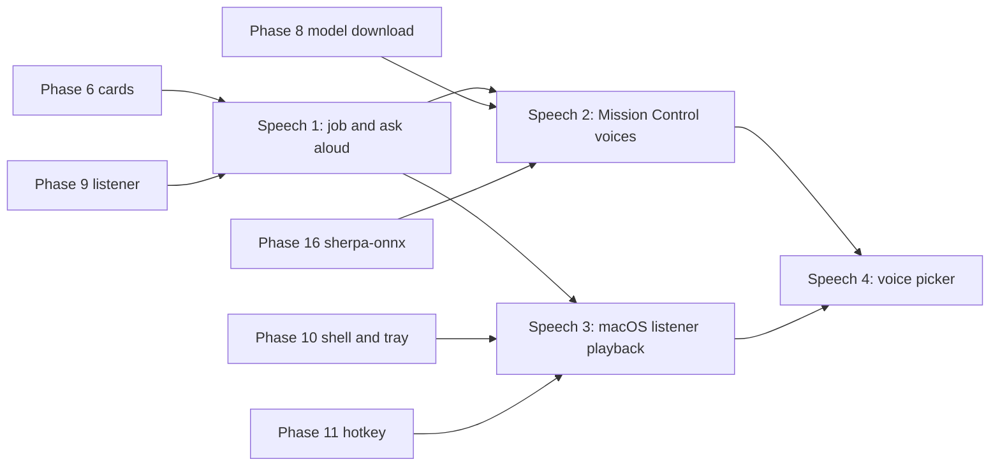

# Spoken responses for voice: phased implementation

Source: `docs/plans/voice-spoken-responses/plan.md` (managed plan
`ed4a2b53-d9b2-4532-9e90-fa10045da9f5`). Its adopted decisions are requirements here. This task
writes the plan and schedules the phases. It ships no product code.

This plan extends `docs/plans/voice-addressing-for-agents/phased-plan.md`, called the voice plan
below. "Phase n" means a phase of the voice plan. "Speech n" means a phase of this one.

## Incorporated decisions

From the interview and the plan review of 2026-11-23, recorded in full in `plan.md`:

- Ask aloud is the only thing spoken, on an engine that can say any short sentence later.
- A natural voice wins over speed and size. English only. One voice, stored so per-agent voices
  can be added.
- Supertonic 3 through sherpa-onnx is the Mission Control voice. Its OpenRAIL-M licence is
  accepted. The default voice is F4.
- The default is Automatic: the Mission Control voice once downloaded, the Mac's best system
  voice until then, the on-screen card otherwise.
- 150 MB download budget. The model is fetched only when the operator chooses a Mission
  Control voice in the picker or presses Download in the same group.
- No hosted option. No Linux system-speech floor. No talking over speech; the hotkey or a click
  cuts speech off.
- Ask aloud moves out of Phase 12. The listener plays.
- Speech 2 may extend Phase 16's dedicated recognizer CI job with a cached speech model.
- Linux: the daemon and the browser on one machine. No Linux listening check is available, so
  audible playback on Linux is stated as unverified and left to the Linux follow-on plan.

## Findings that shaped the phases

- **Two of the contracts this plan changes are merged and two are not.** Contracts A and B
  are on `main` (Phase 1, merged as #1671). Contract H is in Phase 8's working tree. Contract I
  and the listener do not exist. Each change is an addition with a default, made by the Speech
  phase that needs it after the owning phase merges, so nothing shipped breaks.
- **The config field moves earlier than the plan's table first said.** The first revision put
  the `speech` field in the picker phase. The speech job has to resolve a voice from it, so
  Speech 1 owns the field with its default, and Speech 4 owns only the picker that writes it.
  `plan.md` now says the same.
- **The voice config is tolerant on read and strict on write** (`VoiceConfigSchema` and
  `VoiceConfigPatchSchema` in `src/shared/voice.ts`). A new key with a default needs no
  migration. The patch schema must gain the key or a write is a 400.
- **A capability the daemon owns has a precedent.** `VoiceStateStore.state()` deletes a shell's
  `listener` claim and writes its own (`src/server/voice/state.ts:69-75`).
  `speech-output` follows the same lines.
- **The listener hello is not strict**, so an older daemon accepts a hello that carries a
  `speech` part and drops it. The protocol stays at major version 1.
- **Phase 8's manifest accepts only a Hugging Face URL pinned to a commit.** Supertonic 3's
  files are all in one such repository, so the speech model is an ordinary second entry.
- **The "When routing is unsure" row offers Ask aloud unconditionally today**
  (`src/web/components/VoiceSettingsPanel.tsx`). Speech 1 makes the choice follow
  `speech-output`.
- **The daemon is tested on Linux CI and the Swift helper builds only on macOS.** The speech
  job, its limits and the capture rules are therefore proven with a fake listener that plays,
  as the voice plan proves routing with `beListener`.
- **The earlier plan's documents are not rewritten.** They are pinned revisions of another
  managed plan. What this plan supersedes is listed below and carried by the affected tasks.

## What this plan supersedes in the voice plan

| Voice plan text | Superseded by |
| --- | --- |
| `plan.md`, adopted decision "Ask aloud: built, with the macOS system voice" | Ask aloud is built by Speech 1 to 4 with a chosen voice |
| Phase 12 step 5 (ask aloud), the first clause of step 6 (the Ask aloud choice in the setting; the placement previews in the same step stay), its `test/voice-ask-aloud.test.ts`, the ask-aloud line of its manual check, and the exit sentence "Ask aloud speaks once per unsure card and does not hear itself" | Speech 1 and Speech 3. Phase 12 builds no speech and reports no `speech-output` |
| Phase 9's audit note "After Phase 12: capture is paused through the directive while the system voice speaks" | Speech 1 adds `speak` to the directive |
| Contract A, "Later phases read and write these fields and add none" | One field is added: `speech`, by Speech 1 |
| Contract B, `speech-output` listed among the capabilities a shell reports | The daemon computes it. A shell's claim is dropped |
| The Linux follow-on's open item "speech output for ask-aloud" | Settled here. The follow-on owns only the Linux listener's playback of an audio job |

Requirement V14 ("when unsure, Mission Control asks aloud or shows the ambiguity on screen")
keeps its two halves: the card is Phase 6's, and asking aloud is now Speech 1's.

## Sizing and phase count

Estimated 1,700 to 2,300 non-test implementation lines across shared contracts, the daemon, a
Node helper, the Swift listener, the shell and the dashboard. Four phases:

| Phase | File | Delivers | Depends on | Runs on | Est. lines |
| --- | --- | --- | --- | --- | --- |
| Speech 1 | `phase-1-speech-job-and-ask-aloud.md` | Contract L, the `speech` config field, the speech job, capture rules, the stop handshake, the audio, events, stop and audition routes, ask aloud, the asking mark, the setting rule, a fake listener that plays | Phase 6, Phase 9 | Opus | 500 to 650 |
| Speech 2 | `phase-2-mission-control-voices.md` | The speech model entry and its download routes, the synthesizer helper, attribution, the Linux CI synthesis test | Phase 8, Phase 16, Speech 1 | Astra | 450 to 600 |
| Speech 3 | `phase-3-macos-listener-playback.md` | The macOS listener plays audio and system voices, confirms every stop and lists the voices; the hotkey tap stops speech; the shell restarts a listener that does not confirm; the leak check | Phase 10, Phase 11, Speech 1 | Astra | 350 to 500 |
| Speech 4 | `phase-4-voice-picker.md` | The picker, the Play sample button, the download row, the unavailable states, docs | Speech 2, Speech 3 | Opus | 400 to 550 |

"Opus" is Claude Opus 5.5 at extra-high effort, for a phase with a dashboard part. "Astra" is
GPT-6.2 Astra at extra-high effort, the model the voice plan's Astra tasks now run on.

Why not fewer:

- Speech 1 is the part Linux CI can prove with no audio, no model and no Mac. It has to merge
  before either of the two things that plug into it.
- Speech 2 and Speech 3 share no code and wait on different voice phases: Speech 2 on the
  packaged sherpa-onnx addon (Phase 16) and the download manager (Phase 8), Speech 3 on the
  shell and the hotkey (Phases 10 and 11). Joined, ask aloud with a system voice on a Mac would
  wait for the second recognizer backend, which it does not need.
- Speech 3 is Swift that builds on macOS alone and ends in a manual leak check. Speech 2 ends in
  a Linux CI job. Each needs its own review.
- Speech 4 is the only phase that needs both engines present to check by hand, and it is all
  dashboard work.

Why not more: each phase is one slice with its own contract, tests and exit.

Phase 9 is a prerequisite of Speech 3 through Speech 1 and Phase 10, so it is not drawn twice.

## Concurrency and merge order

- Speech 1 runs beside Phases 7, 8, 10 to 16 once Phases 6 and 9 have merged.
- Speech 2 and Speech 3 may run together and merge in either order. Neither reads a file or a
  contract the other owns: Speech 2 fills the synthesizer interface, Speech 3 fills the
  listener side of the directive, and both are fixed by Speech 1.
- Phase 12 no longer waits on speech work. It keeps its dependency on this planning task, which
  the plan's merge satisfies, and runs beside Speech 1 to 3.
- Phases that run together edit `src/shared/voice.ts`, `src/server/voice/`,
  `src/web/components/VoiceSettingsPanel.tsx`, `e2e/fixtures/voice.ts` and `docs/voice.md` in
  different places; the later one rebases.
- No Speech phase adds a database migration.

## Cross-phase contracts

Names are fixed here. A phase file refers to a contract by its letter and does not restate it.

**L. Speech (Speech 1).** In `src/shared/voice-speech.ts`, browser-safe:

- `VoiceSpeechVoice { engine, id }` with `engine` `neural` or `system`. A neural id is
  `<family>/<voice>`, for example `supertonic-3/F4`. A system id is the operating system's own
  voice identifier.
- `VoiceConfig.speech { voice }`, where `voice` is a `VoiceSpeechVoice` or null for Automatic.
  The default is `{ voice: null }`. The patch merges `speech` per key, as it does
  `cancelWindow`.
- `VoiceSpeechCatalog { neural, system }`: the voices that are ready now. Each entry is
  `{ id, name, detail }`. `neural` is empty until Speech 2. `system` comes from the hello.
- `resolveSpeechVoice(config, catalog, defaults)`: the pure Automatic rule. It returns the voice
  to use or the reason there is none.
- `VOICE_SPEECH_DEFAULT_NEURAL`: `supertonic-3/F4`.
- `askSentence(names)`: "A or B?" for two names, "A, B or C?" for three, null otherwise.
- `VoiceSpeechJob { id, purpose, text, voice, cardId, state, durationMs }`. `purpose` is `ask`
  or `audition`. States: `preparing`, `ready`, `speaking`, `stopping`, `finished`, `stopped`,
  `failed`, `timed-out`. The last four are final. `stopping` means the daemon has asked the
  listener to stop the job and is waiting for its `ended`.
- `VoiceState.speech { voice, reason, job, catalog, model }`: the resolved voice or the reason
  there is none, the live job's `{ id, purpose, state, cardId }` or null, the catalog, and the
  speech model's `VoiceModelState` (`missing` until Speech 2). It travels in the existing
  `voice_state` event. No event is added.
- The `speech-output` capability is the daemon's reading: available when a voice resolves. A
  voice resolves only if the live listener can speak it: a neural voice needs the hello's
  `audio` true and the speech model `ready`, and a system voice must be listed in the hello. An
  `ask` job also needs the mode `listening`; an `audition` job does not.
- Limits: `VOICE_SPEECH_START_LIMIT_MS` 2000, counted from the job becoming `ready`;
  `VOICE_SPEECH_END_MARGIN_MS` 1500, added to the audio's length and counted from `started`;
  `VOICE_SPEECH_SYSTEM_LIMIT_MS` 10000, counted from `started`, for a system voice;
  `VOICE_SPEECH_CONFIRM_LIMIT_MS` 5000, counted from a stop request.
- The stop handshake. A job the directive has named ends only when the listener posts `ended`
  for it, or when that listener is replaced. A stop (a click, the hotkey, muting, a settled
  card) or an expired limit moves the job to `stopping`: the directive's `speak` becomes
  `{ id, stop: true }` and `capture` stays false. The listener stops playback or does not start
  it, and posts `ended` as `stopped`, also for an id it never received. On that `ended` the job
  becomes `stopped` or, when a limit caused it, `timed-out`; `speak` clears and `capture`
  follows the mode. A `started` for a `stopping` job is recorded and changes nothing. With no
  `ended` by the confirm limit, the daemon treats the listener as absent: the `listener` reason
  holds, the `listener` capability carries "the listener did not confirm that speech had
  stopped", and capture stays false. A late `ended` from the same listener, or a hello whose
  `speech.instance` differs from the one that was given the job, ends the job (`failed` in the
  second case) and lifts the condition. A job still `preparing` has not been named by the
  directive and ends at once.
- The hello (contract B) gains optional `speech { audio, systemVoices, instance }`. `audio`
  says the listener can play an audio job. A system voice is `{ id, name, language, quality }`
  with quality `premium`, `enhanced` or `default`. `instance` is a random id the listener
  chooses when its process starts.
- The directive (contract I) gains `speak`: null, `{ id, kind: "audio", durationMs }`,
  `{ id, kind: "system", voiceId, text }`, or `{ id, stop: true }`. While `speak` is set,
  `capture` is false.
- The listener's own rule: it does not open the microphone while it is playing or holds a job
  it has not ended, whatever `capture` says.
- Token routes, both built by Speech 1: `GET /voice/speech/jobs/:id/audio`, which serves the
  WAV the daemon holds for a `ready` or `speaking` job, and `POST
  /voice/speech/jobs/:id/events { type, outcome }`, where `type` is `started` or `ended` and
  `outcome` is `finished`, `stopped` or `failed`.
- Dashboard routes, both built by Speech 1: `POST /api/voice/speech/stop` and `POST
  /api/voice/speech/audition`.
- `VoiceSynthesizer { synthesize(text, voice), warm(), stop() }` in the daemon. `synthesize`
  resolves to `{ wav, durationMs }`. Speech 1 ships one that refuses every neural voice.
- `beSpeaker(daemon, options)` in `e2e/fixtures/voice.ts`: a `beListener` that also says it can
  play and lists one system voice, so a voice resolves with no model; it follows the directive
  and posts `started` and `ended` for each job.

**M. Speech model and synthesizer (Speech 2).** `VOICE_SPEECH_MODELS` in
`src/shared/voice-models.ts`, keyed by family, with the `supertonic-3` entry; files under
`<state home>/voice/models/speech/<revision>/`; routes `POST` and `DELETE
/api/voice/speech/model/download`; the helper `dist/voice-speaker/synth.mjs` and its message
protocol; `VOICE_SPEECH_NEURAL_VOICES`, the ten voices with their model indexes. A download
starts only through the `POST` route. Speech 2 adds no route for the listener: the audio it
synthesizes is served by Speech 1's audio route.

Token routes live under `/voice/` and check `x-harness-token`. Dashboard routes live under
`/api/voice/` behind the loopback gate. Both answer 404 while the `voice` flag is off, as in the
voice plan.

## Requirement ownership

| Requirement | Owner |
| --- | --- |
| V14, the ask-aloud half: one spoken question per unsure card, answered by a name or a click | Speech 1 |
| Capture is stopped before playback and restarted after real completion (S9), including when a limit expires or speech is stopped | Speech 1 (the rule, its limits and the stop handshake), Speech 3 (the macOS listener, its confirmation of every stop, and the leak check) |
| The hotkey or a click cuts speech off | Speech 1 (click and route), Speech 3 (hotkey) |
| A better voice on macOS and Linux, downloaded on demand, pinned and verified | Speech 2 |
| macOS system voices, Enhanced and Premium included | Speech 3 |
| The picker, audition, defaults, and the missing-voice states | Speech 4 |
| The voice choice is stored so per-agent voices can be added | Speech 1 (the `VoiceSpeechVoice` value) |
| Nothing leaves the machine; no audio written to disk | Speech 2 (the helper), Speech 3 (system voices never cached) |

## Not scheduled here

- **Playback on Linux.** The Linux follow-on plan adds it to the sherpa-onnx listener, with
  the same stop handshake and the restart of a listener that does not confirm, and verifies it
  on a Linux desktop. Until then `speech-output` reads unavailable on Linux with the
  reason "this listener cannot play speech", and the card is used.
- **Playback in the sherpa-onnx listener on macOS.** Same work, same owner. With `backend` set
  to `sherpa-onnx` on a Mac, ask aloud uses the card.
- Per-agent voices, spoken outcomes other than ask aloud, a hosted engine, and reading reports
  aloud.

## Final verification

With the four phases merged and the flags on: `npm run typecheck`, `npm run lint`, `npm run
build`, `npm run smoke`, `MISSION_TEST_CONCURRENCY=4 npm test`, `npm run test:electron` and `npm
run test:e2e`. Then, on a signed build on a Mac: choose Ask aloud, download the Mission Control
voice, say a sentence two agents could own, hear the question once, answer by name; repeat with
a system voice; tap the hotkey mid-sentence and hear it stop; mute and confirm nothing is
spoken. With the `voice` flag off, specs that predate this work pass unchanged.

## Final cross-phase audit

- Each row of the ownership table has one owner, except the two S9 rows that name a rule and
  its macOS implementation, each with one owner.
- Contract L is owned by Speech 1 and consumed by Speech 2, 3 and 4, which follow it in the
  graph. Contract M is owned by Speech 2 and consumed by Speech 4.
- Speech 2 and Speech 3 consume nothing owned by one another and may merge in either order.
- After Speech 1 alone the repository is operable: with no listener that can play,
  `speech-output` is unavailable and every unsure card is shown as before.
- After Speech 1 and 3: a Mac asks aloud with a system voice. After Speech 1 and 2: audio can
  be synthesized and fetched, and is played once Speech 3 or the Linux follow-on lands.
- A spec reaches a speaking state through `beSpeaker`, so no spec depends on a microphone, a
  model, a loudspeaker or macOS.
- The default voice, the limits and the route names read the same in `plan.md`, this file and
  each phase file.
- After plan validation round 1: no path in `plan.md`, contract L, Speech 1 or Speech 3 lets
  capture return before the listener's `ended` or its replacement. The 2 second, 1.5 second,
  10 second and 5 second limits read the same in each.
- After the completion review: the audio route has one owner, Speech 1, in the phase table,
  contract L and the Speech 1 file, so Speech 3 does not wait for Speech 2. The download starts
  when a Mission Control voice is chosen or Download is pressed, in `plan.md`, contract M and
  the Speech 4 file.

## Plan validation round 1

One finding was accepted and applied across the bundle.

- **Capture resumed on a timeout before playback was known to have stopped.** The plan had the
  daemon end a job at a limit, clear `speak` and let capture resume, while the listener might
  still be playing, or might start a job it had already received. That broke the spike's S9
  rule. A limit, like a click, now only asks the listener to stop. Capture stays off until the
  listener posts `ended` for the job, or until that listener process is replaced. A late
  `started` changes nothing. A listener that does not confirm within 5 seconds is treated as
  absent, so voice reads as not listening instead of capturing, and on a Mac the shell restarts
  it. The listener also refuses, on its own, to open the microphone while it is playing.
  Contract L gained the `stopping` state, the stop form of `speak`, the confirm limit and the
  hello's `instance`. `plan.md`, Speech 1 and Speech 3 say the same, and Speech 1's tests now
  drive a fake listener that keeps playing past the limit and one that starts late.

This replaces an earlier default, "silence is the failure mode, never a stuck microphone". The
cost is stated: a listener that never confirms leaves voice not listening until it is replaced.

## Completion review

Foreman's completion review of the first handoff raised two findings. Both were accepted and
applied across the bundle.

- **Who owns the audio route.** The phase table gave the audio route to Speech 2, while
  contract L and the Speech 1 file gave it to Speech 1. Speech 3 fetches audio and runs beside
  Speech 2, so the owner had to be one phase that both follow. It is Speech 1: the manager
  there holds the audio and serves it, and Speech 2 only supplies the synthesizer behind it.
  The tables in `plan.md` and this file, contract L, contract M and the Speech 1, 2 and 3
  files now say so.
- **When the download starts.** The root plan said the model downloads when the operator first
  chooses a Mission Control voice, while Speech 4 saved the choice and waited for a separate
  Download button. Choosing a Mission Control voice now starts the download. The Download
  button stays for someone who keeps Automatic and wants the Mission Control voice, and it
  starts the same download. `plan.md`, contract M and the Speech 4 file and its spec now agree.

The same pass fixed smaller mismatches it found: where each time limit is counted from, which
roster names a sample uses, and the Astra model name, which the backlog had moved to GPT-6.2
Astra. It also checked that each phase's checks can reach the state they need with only what
earlier phases built: the fake listener lists a system voice, so Speech 1's spec can ask aloud
with no model; Speech 2's manual check uses that fake listener to open a job; Speech 3's leak
check says where its audio job comes from before Speech 2 merges; and Speech 4's spec plays its
sample with a system voice, since a fixture model cannot synthesize.
