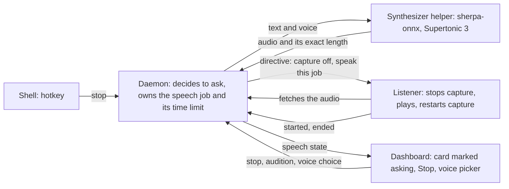
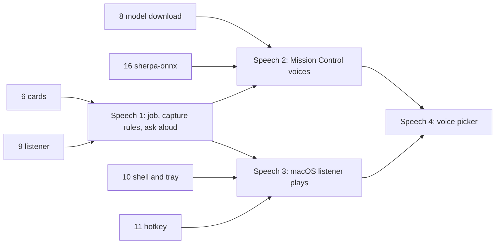

# Spoken responses for voice

Status: decisions adopted from the operator's review of 2026-11-23; phased in `phased-plan.md`.
This task delivers the plan and its phases. It changes no product code.

## Goal

Mission Control speaks back in the voice feature (1) on Linux as well as macOS and (2) with a
better voice the operator can choose, in place of only the macOS system voice. This plan compares
the ways to do that, recommends one, and records the decisions the operator made.

## Where things stand

Checked against `main` at `f34b14043` on 2026-11-23. Phase 1 merged as pull request #1671 while
this plan was being written; the measurements and the first review used `3b362a751`.

| Fact | Evidence | Status |
| --- | --- | --- |
| Speech is planned for one thing: Phase 12 step 5 has the Electron shell say "<name> or <name>?" with the macOS system voice when `whenUnsure` is `ask` | `docs/plans/voice-addressing-for-agents/phase-12-floating-surfaces-and-ask-aloud.md`, steps 5 and 6 | Document only; Phase 12 is in the backlog |
| The app plays one sound today, a Web Audio chime in the dashboard | `src/web/lib/chime.ts:51`, used by `src/web/useNotifier.ts` | On `main` |
| The only voice product code on `main` is Phase 1's: the flag, the config, the state and Voice settings | `src/shared/voice.ts`, `src/server/voice/` at `f34b14043` | On `main` |
| Contracts A and B are code. `speech-output` is a capability id and `whenUnsure` is `show` or `ask` | `src/shared/voice.ts`, merged as #1671 | On `main` |
| Contract A has no field for a voice, and its text says later phases "add none" | `phased-plan.md` contract A; the same sentence in `src/shared/voice.ts` | On `main` |
| The daemon already keeps one capability as its own reading and drops a shell's claim about it: `listener` | `src/server/voice/state.ts:69-75` | On `main` |
| Contract H (model manifest and download) is being written. Its manifest accepts only a Hugging Face URL pinned to a 40-character commit, with a size and a SHA-256 | Phase 8's working tree, not pushed | In progress, may change |
| Contract I (listener protocol) and the listener itself do not exist yet | Phase 9 is in the backlog | Document only |
| Linux has no desktop shell | `plan.md` finding 23 | On `main` |
| Phase 12 and "Voice Addressing on Linux Phased Plan" both wait on this plan | Their task dependencies | Backlog |
| The repository is Apache-2.0 | `LICENSE`, `package.json` | On `main` |

## Decisions from the interview

The operator answered these on 2026-11-23, before any investigation. They are requirements here.

| Question | Answer |
| --- | --- |
| What is spoken | Ask aloud only, on an engine that can say any short sentence later |
| Which goal wins | A natural-sounding voice |
| One voice or many | One voice now, stored so per-agent voices can be added later |
| Linux arrangements | Desktop Linux with the daemon and the browser on the same machine |
| Linux listening check | None available. Rely on CI and say plainly what is unverified |
| Talking over speech | Not required. The hotkey or a click must cut speech off |
| Measurement | Download candidate models to scratch, synthesize silently, leave sample clips |
| Languages | English only |

Reports stay unread (V31). Nothing in this plan reads a report aloud.

## The finding that reshapes the comparison

Ask aloud says agent names. Four of the six local neural model families drop a word they do not
know, with no fallback, so they can drop the name itself.

- sherpa-onnx removed espeak-ng in version 2.0.0. The shipped library says so: "espeak-ng is no
  longer used. Language is determined by the lexicon files you provide." (measured: the string is
  in `libsherpa-onnx-c-api.dylib` 2.0.3, and the `dataDir` option is documented as ignored).
- Piper, Matcha, KittenTTS and Kokoro now turn text into sounds by looking each word up in a
  lexicon file. A word that is missing is logged as "OOV word skipped" and left out (measured).
- With Kokoro's own lexicon, "Zarvox or Quinn?" came out as 0.6 seconds of audio that a
  recognizer heard as "Or...". "Quinn" is one of the ten roster names the spike used (measured).
- The shared English lexicon that Piper, Matcha and KittenTTS need has no entry for "or", so
  "Steve or Stephen?" loses its middle word as published (measured). That lexicon and Matcha's
  vocoder exist only as GitHub release files that are replaced in place, so they cannot be pinned
  to a commit, which contract H requires (read).
- Supertonic 3 and Pocket TTS carry their own text front end and need no lexicon. Both produced
  audio for every word of every test sentence (measured). The macOS system voices did too.

So the local neural choice narrows to Supertonic 3 or Pocket TTS, unless Mission Control ships
its own way to turn a name into sounds, which is a project of its own.

## How the options were measured

Status words used below:

- **measured**: run on this machine for this plan, or read directly in the installed files.
- **read**: read in the vendor's or project's own published source on 2026-11-23, not reproduced.
- **inferred**: follows from measured or read facts, not observed.
- **unverified**: not checked. Treat as a guess.

Conditions: Apple M4 Pro, macOS 26.6.2, Node 26.7.0, `sherpa-onnx-node` 2.0.3 on the CPU with two
threads. Other sessions were building on this Mac throughout (load average 7 to 31 on 12 cores),
so the times are upper bounds and the order between engines is what holds. No Linux machine and
no x64 processor was measured. Nothing was played aloud. Models were fetched from Hugging Face at
a pinned commit, and each file's SHA-256 matched the digest Hugging Face records for it.

Voice quality cannot be measured by a program. Each clip was transcribed by a small recognizer
(Whisper tiny.en) to catch dropped or garbled words. That is a completeness check, not a
judgement of how natural a voice sounds. The clips are in
`.tmp/voice-response-samples/index.html` in this task's checkout, which Git ignores, so the
operator can listen.

## Options: engines

Times are for synthesizing "Steve or Stephen?", about 1.0 to 1.7 seconds of speech, with the model
already loaded (lowest and middle of six runs).

| Engine | Time to synthesize | Download | Memory while loaded | Voices | Words kept |
| --- | --- | --- | --- | --- | --- |
| macOS system voice, standard tier | 520 to 900 ms for a whole `say` call to a file | None | Not measured (system process) | 184 listed, none Enhanced or Premium on this Mac | All (measured) |
| macOS Enhanced and Premium voices | Unverified, none installed here | Per voice, in System Settings. Apple publishes no sizes | Not measured | Whatever the person installed | Unverified |
| Supertonic 3 int8 (sherpa-onnx) | 245 to 260 ms at lighter load, 390 to 475 ms at heavy load | 145.3 MB | 516 to 539 MB | 10 built in | All (measured) |
| Pocket TTS int8 (sherpa-onnx) | 108 to 150 ms | 198 MB, plus 0.5 MB per voice clip | 791 to 798 MB | Any reference clip. A catalog holds 228 donated voices | All sounds produced, but short prompts garbled (below) |
| Kokoro 1.0 (sherpa-onnx) | 600 to 705 ms. The int8 build took 2.5 to 3.7 s | 360 MB | 847 to 872 MB | 54 | Drops unknown names (measured) |
| KittenTTS nano 0.8 (sherpa-onnx) | 254 to 506 ms | 27 MB plus a 6.3 MB lexicon | 350 to 357 MB | 8 | Drops unknown words (measured) |
| Piper medium (sherpa-onnx) | 31 to 46 ms | 63 MB plus the lexicon | 386 MB | 1 per model | Drops unknown words (measured) |
| Matcha LJSpeech (sherpa-onnx) | 21 to 40 ms | 74 MB, 54 MB vocoder, lexicon | 414 MB | 1 | Drops unknown words (measured) |
| Linux system speech (speech-dispatcher with espeak-ng) | Unverified | None where installed | Unverified | espeak-ng's formant voices | Unverified, expected all |
| Web Speech API in the dashboard | Unverified | None | Browser's | Depends on the browser, see below | Unverified |
| Hosted service | 43 to 590 ms to first audio in a third-party benchmark (read), plus the network | None | None | Many | All (inferred) |

What the round trip heard, per engine (measured):

- **macOS standard voices** (Samantha, Daniel, Karen, Moira): every word spoken. The recognizer
  misheard some of the accented voices.
- **Supertonic 3**: "Steve or Stephen?" correct for 10 of 10 voices (one spelled Steven).
  "Zarvox or Quinn?" exact for 5 of 10 and close for the rest. The voice at index 3 in the
  model, F4 (`supertonic-v3` in the clips), was the only one with all three sentences exact.
- **Pocket TTS**: "Steve or Stephen?" was never heard exactly across seven voices. Two came back
  as "Dave or Stephen?" and the other five were wrong or garbled. Longer sentences fared better.
  Pocket TTS looks unstable on two- and three-word prompts, which is all ask aloud says.
- **Kokoro**: known words clear. Unknown names missing.

| Engine | Licence and attribution | Privacy | Packaging fit | Linux | Completion signal |
| --- | --- | --- | --- | --- | --- |
| macOS system voices | Apple's software licence allows system voices "while running the Apple Software" and forbids recording or redistributing them in a commercial or public context (read). Live speech fits. Caching the audio does not | Local | No download, no addon. No entitlement exists for audio output under the hardened runtime (read), so none is needed (inferred). An app cannot start an Enhanced or Premium download, the person does it in System Settings (read) | No | `AVSpeechSynthesizer` reports start, finish and cancel (read). The spike used the exit of `say` and saw 0 leaks in 6 trials (S9). Apple forum reports describe releases where finish never fired or speech was silent (read), so a time limit is still needed |
| Supertonic 3 | Weights under OpenRAIL-M, which adds use restrictions that must be passed on. Code MIT. Pinned Hugging Face commit `cca5a0e6c96e1d2c720986bf7e75fcc81dee3ae4` with SHA-256 per file (measured) | Local | Same addon as the recognizer: one `require` gave both the recognizer and the speech classes (measured). 33 MB on disk for macOS arm64. Prebuilt for Linux x64 and arm64 (read). Signing and notarizing the addon is Phase 16's work (inferred) | Synthesis expected to work, unverified | Synthesis returns samples and a rate, so the exact length is known before playback. The signal comes from whatever plays it |
| Pocket TTS | Weights CC-BY-4.0. Donated voices CC0, VCTK voices CC-BY-4.0 (read). It can imitate any voice from a clip, and its authors gate their own copy of the weights behind an agreement (read) | Local | Same addon | Same | Same |
| Kokoro | Apache-2.0 (read) | Local | Same addon | Same | Same |
| KittenTTS, Piper, Matcha | Mixed. Several Piper voices forbid commercial use (read). The shared lexicon's licence is unstated and it is built from a list named after espeak-ng's GPL dictionary (inferred) | Local | Same addon, but the lexicon and vocoder cannot be commit-pinned (read) | Same | Same |
| Linux system speech | espeak-ng is GPL-3. Running an installed program is not linking (inferred, not legal advice) | Local | Nothing to ship. Present on Ubuntu desktop 24.04 and 26.04 (read). Fedora unverified | Yes | `spd-say --wait` returns after the message is spoken, and the protocol has begin and end events (read) |
| Web Speech API | None | Chrome on Linux offers only Google voices, which send the text to Google's servers (read in Chromium's source). Chromium offers none without a start-up flag. Firefox uses speech-dispatcher | Nothing to ship | Depends on the browser | Start and end events are unreliable: speech needs a prior click, and Google voices stop after about 15 seconds with no end event (read) |
| Hosted service | Per vendor. OpenAI and Microsoft require telling the listener the voice is artificial (read) | Agent names leave the machine. Retention and training defaults differ by vendor (read) | A key to store and a network path | Yes | Audio comes back as a file or stream, so the signal comes from whatever plays it |

One hosted fact matters on its own. OpenAI's speech models are deprecated and shut down on
2027-01-06, and the named replacement works only through the Realtime API, which treats the text
as a prompt and may answer it instead of reading it (read). The key a person may already have for
the decision model (Phase 4) would work there, but nothing guarantees "Steve or Stephen?" is
spoken word for word.

## Options: where the sound is played

Whatever engine is chosen, something must play the sound and tell the daemon when it starts and
ends, because capture has to stop first and restart after (S9).

| Place | Start and end signal | Several open tabs | A different output device | Linux | Verdict |
| --- | --- | --- | --- | --- | --- |
| The shell (Phase 12 as written) | Exit of `say` | Not involved | System default | No shell on Linux | macOS only. Fails goal 1 |
| The daemon runs a player program | Exit of the program. `afplay` returned 851 to 906 ms after the clip's own length in 10 of 10 runs (measured), so it is reliable and slow | Not involved | System default, or a flag per player | `pw-play`, `paplay` or `aplay`, unverified | Works with no tab open. Adds most of a second |
| The listener plays it | The audio API's own callbacks, in the process that owns capture | Not involved | System default. A device change mid-speech ends the job as failed and capture resumes | The Linux listener plays it, unverified | Adopted |
| A dashboard tab plays it | Web Audio's `ended` event (read). Blocked until the tab has had a click. Firefox holds sound in a background tab until it is shown (read) | Every tab would play. One must be chosen and the others told to stay quiet | The browser's default. Choosing a device works in Chrome only for this API (read) | Yes | Needed only when the daemon is on another machine, which the operator ruled out |

The listener is the right place for three reasons. It already owns the microphone, so stopping
capture, playing, and restarting capture happen in one process in the order S9 measured, with no
network hop between them. It exists on both platforms: the shell starts it on macOS and the
daemon will start it on Linux. And it removes the tab questions entirely: no tab plays, so there
is nothing to arbitrate and no click is needed first.

## Adopted design

1. **Speech moves from the shell to the listener, under the daemon's control.** The daemon
   decides to speak, prepares the audio, and tells the listener through the directive it already
   polls. The listener stops capture, plays, reports start and end, and restarts capture.
2. **Two engines, one voice setting.** Supertonic 3 through sherpa-onnx is the Mission Control
   voice on both platforms. The macOS system voices stay available on a Mac as a choice that
   needs no download, including any Enhanced or Premium voice the person has installed.
3. **Synthesis runs in a small helper the daemon starts**, not in the daemon and not in the
   shell, so it is the same on Linux. It loads the same sherpa-onnx addon the recognizer uses.
4. **The Supertonic model is downloaded on demand** through Phase 8's manager, 145.3 MB. The
   download starts when the operator chooses a Mission Control voice in the picker, or presses
   Download in the same group. Nothing is fetched when voice is switched on, when Ask aloud is
   chosen, or by Automatic on its own.
5. **No hosted option, no Linux system-speech floor, no Web Speech.** The on-screen card is the
   floor everywhere. The stored voice has an `engine` field, so another engine can be added
   without changing what is stored.
6. **Ask aloud leaves Phase 12.** Phase 12 keeps its floating surfaces. Four new phases build
   speech.

Why Supertonic 3 over the others: it is the only local neural family here that says every name,
fits a 150 MB budget, loads in a third of a second, and is published with every file on a pinned
commit. Its cost is the licence, which the operator accepted (see "Adopted decisions").

## Design

### Flow



Before this plan the shell both decided and spoke, with `say`. After it, the daemon decides, a
helper synthesizes, and the listener plays.

### One spoken sentence, step by step

1. A card becomes `unsure`, `whenUnsure` is `ask`, the mode is `listening`, and the
   `speech-output` capability is available. The daemon opens a speech job for the sentence
   "<name> or <name>?" (three candidates: "<a>, <b> or <c>?").
2. For a Mission Control voice the daemon asks the synthesizer helper for the audio and receives
   the samples and their exact length. For a system voice there is nothing to prepare.
3. The daemon's directive to the listener changes: `capture` is false and `speak` names the job.
4. The listener stops capture, plays the audio (or speaks the text with the system voice),
   and posts `started` and then `ended` with how it ended: finished, stopped or failed.
5. On `ended`, and only then, the daemon clears `speak`, and `capture` returns to what the mode
   says. The listener restarts capture with a fresh segment and replays nothing it buffered, as
   S9 chose.
6. The card stays on screen throughout, marked as asking. The answer is a candidate's name by
   voice once speech has ended, or a click at any time.

### Rules that keep capture correct

- **Capture stays off until the listener confirms playback has stopped.** The daemon never
  resumes capture on its own clock. The only thing that ends a job the listener has been given
  is the listener's `ended` report, or that listener process being replaced.
- **A time limit turns into a stop request, not into capture.** With no `started` within
  2 seconds of the job being ready, or no `ended` after `started` within the audio's length plus
  1.5 seconds (10 seconds for a system voice, whose length is unknown), the daemon stops asking
  on screen and tells the listener, through the directive, to stop that job. The listener stops
  playback if it is playing, does not start if it has not started, and reports `ended` either
  way, even for a job it never received. Capture stays off until that report. A `started` that
  arrives after the limit changes nothing: the job is still being stopped.
- **A listener that does not confirm is treated as gone.** With no `ended` within 5 seconds of
  a stop request, voice reads as not listening, with the reason that the listener did not
  confirm speech had stopped, and capture stays off. It returns when that listener confirms
  late, or when a new listener process says hello, because the old process and any sound it was
  making are gone. On a Mac the shell restarts the listener when this happens. The failure
  mode is not listening with the reason shown, never capture during playback.
- **An utterance captured during speech is discarded.** The utterance route ignores one
  captured while a job was live, and Recently heard lists the reason. This is a second guard
  behind the listener's own pause.
- **One job at a time**, in the order they opened. A job whose card is settled before it starts
  is dropped.
- **Asking only while listening.** An ask starts only in the mode `listening`: not while
  muted, and not during a call, where the other people would hear it. A sample the operator
  asks for in Voice settings may play in any mode.
- **One ask per card.** It is not repeated.

### Stopping speech

A click on the card's Stop control, on a candidate row or on Cancel stops the job. So does
muting. A tap of the mute hotkey while a job is live stops the speech and does not toggle mute;
with no job live the tap toggles mute as Phase 11 defines. A stop reaches the listener through
the directive as a stop request, and the listener reports `ended` as stopped. The card stops
showing that it is asking at once. Capture stays off until that report arrives, by the same
rule as a time limit.

### When nothing can speak

The chosen voice is never swapped for another one silently. If the chosen voice is not installed
or not downloaded, the listener is not running, or the listener cannot play, `speech-output` is
unavailable and carries the reason, which Voice settings shows beside the picker. In those
cases, and while muted or during a call, the card appears exactly as it does with `whenUnsure`
set to `show`, and nothing is spoken.

### The synthesizer helper

A standalone Node program the daemon starts as a child, on either platform. It starts when a
sentence is first needed, and warms up when a card enters `resolving` with ask aloud on, so
synthesis hides behind the model step. It exits after 10 minutes without work, which returns its
memory (516 to 539 MB measured). It keeps the audio of recent sentences in memory and writes
none to disk. It is not started for a system voice. It touches no database.

### What the listener gains

- The directive (contract I) gains `speak`: null, an audio job, a system-voice job, or a
  request to stop a job.
- The hello (contract B) gains an optional `speech` part: whether the listener can play audio,
  on macOS the installed English system voices with their quality tier, and an instance id that
  changes each time the listener process starts.
- The listener never opens the microphone while it is playing or holds a job it has not ended,
  whatever the directive's `capture` says. This is a second guard, in the process that owns
  both the microphone and the playback.
- The macOS helper plays audio with `AVAudioPlayerNode` and speaks system voices with
  `AVSpeechSynthesizer`. Both are in the operating system, so the helper gains no dependency.
- The sherpa-onnx listener (Phase 16) gains nothing in this plan. The Linux follow-on adds its
  playback.

## Voice picker

In Voice settings, a "Spoken replies" group directly under "When routing is unsure".

```text
Spoken replies
  Voice   [ Automatic: Mission Control voice F4         v ]   [ Play sample ]
            Automatic
            Mission Control voices      (145 MB, one download)
              F1 ... F5, M1 ... M5
            This Mac's voices           (macOS only, no download)
              Ava (Premium), Zoe (Enhanced), Samantha, ...

  Mission Control voices are not downloaded.   [ Download 145 MB ]
  Licence: OpenRAIL-M. What it restricts: <link>

  Better Apple voices are installed in System Settings >
  Accessibility > Read & Speak. Mission Control cannot download them.
```

- **Where voices are chosen.** One select, grouped by engine. "This Mac's voices" appears only
  when the listener's hello lists system voices, so it is absent on Linux.
- **Audition.** Play sample speaks "<name> or <name>?" with the first two roster names, or
  "Steve or Stephen?" when the roster has fewer than two, through the same speech job as a real
  ask. Capture is paused
  for it, so the recognizer never hears the sample and routes it. With no listener able to play,
  the button is disabled and says why.
- **Defaults.** The stored choice is null, shown as Automatic. Automatic resolves to the default
  Mission Control voice when its model is downloaded; otherwise, on a Mac, to the best installed
  English system voice (Premium, then Enhanced, then standard); otherwise to nothing, and the
  card is used. With no voice ready the Ask aloud choice is disabled, and getting the Mission
  Control voices, as the Download item below describes, is the fix. Linux has no second step:
  until the download, the card is used.
- **Storage.** A new field on the voice config: `speech: { voice }`, where `voice` is null or
  `{ engine, id }` with `engine` `neural` or `system`. Speech 1 adds it. Contract A's
  sentence "later phases add none" is amended to allow this one field. The config is tolerant on
  read, so no migration is owed. A later per-agent voice is the same `{ engine, id }` value on a
  resident profile or a task, read before this one.
- **A missing voice.** A chosen Mission Control voice that is not downloaded (its download is
  still running, was cancelled or failed), or a chosen system voice that is not installed on
  this Mac (after a restore on another machine, for instance), speaks nothing. The picker shows the choice as unavailable with the fix: Download, or the
  System Settings path. Only Automatic picks among the voices that are ready.
- **Download.** Choosing a Mission Control voice while the model is absent saves the choice and
  starts the download. The Download button on the row starts the same download for someone who
  stays on Automatic. The row shows progress and Cancel, and then the voice is ready. A
  cancelled or failed download leaves the choice in place, shown as not downloaded, with
  Download or Retry. The speech model is a second entry in Phase 8's manifest and manager:
  pinned commit, size and SHA-256 per file, hashed again before it reads ready, stored under
  `<state home>/voice/models/speech/`. Attribution and the licence go in `NOTICE` and
  `docs/voice.md`.

## How it fits the existing task graph

- **Phase 12.** Step 5, the ask-aloud half of step 6, the `voice-ask-aloud.test.ts` test, the
  ask-aloud line of the manual check and the exit sentence "Ask aloud speaks once per unsure
  card and does not hear itself" move to the new phases. Phase 12 keeps the pill, the popover,
  the placement rule, the Recently heard popover, the link and the docs. It no longer needs a
  speaker in the shell.
- **The speech-output capability.** `speech-output` becomes the daemon's own reading, as
  `listener` already is: available when a live listener says it can play and the chosen voice
  resolves to a ready one, otherwise unavailable with the reason. A shell's claim about it is
  dropped. The id does not change.
- **The "When routing is unsure" setting.** `whenUnsure` keeps its two values and its storage.
  Ask aloud is enabled when `speech-output` is available, as Phase 12 step 6 said. In a browser
  with no shell it now works whenever a listener that can play is running.
- **The shell report.** No new field. The shell stops reporting `speech-output`. The shell
  gains two duties: to call the stop route on a hotkey tap while a job is live, and to restart
  a listener that the daemon reports did not confirm speech had stopped.
- **Contracts.** A gains `speech`. B gains the hello's `speech` part and the speech state. H
  gains a speech model entry. I gains `speak`. A new contract L fixes the speech job, its
  states and its routes. A and B are merged and the others are not. Each change is an addition
  with a default, made by the phase that needs it, so nothing shipped breaks.
- **The Linux follow-on inherits** the speech job contract, the synthesizer helper (which needs
  no shell), the picker and the capability rule, all unchanged. It owns one thing: the Linux
  listener plays an audio job and reports start and end, verified on a Linux desktop. That is
  the whole of its "speech output for ask-aloud" item, and it should not plan engines, voices or
  a picker.
- **How the existing documents are treated.** The earlier plan's files are pinned revisions of
  another managed plan. As with the spike's first-word decision, they are not rewritten. This
  plan records what it supersedes, and the Phase 12 task and the Linux plan task are updated to
  say so.

### Ordering



- Phases 1, 2 and 8 are running and are not changed. Speech 2 extends what Phase 8 builds after
  it merges.
- Phase 9 is not changed. Speech 1 adds `speak` to its directive after it merges.
- Phase 12 gets smaller and no longer waits on any speech work. It runs beside Speech 1 to 3.
- Phase 16 supplies the packaged sherpa-onnx addon, so Mission Control voices follow it. Ask
  aloud with a system voice on a Mac needs only Speech 1 and 3 and can ship first.
- The Linux follow-on is a plan task. It needs this plan merged, which it already waits on, and
  no speech code.

## Phases

The work is phased in `phased-plan.md`, with one file per phase beside it.

| Phase | Delivers | Depends on |
| --- | --- | --- |
| Speech 1 | Contract L, the `speech` config field, the speech job, its time limits and the stop handshake, the capture rules, the audio, events, stop and audition routes, the `speak` directive, ask aloud on an `unsure` card, a fake listener that plays for tests, the card's asking mark | 6, 9 |
| Speech 2 | The speech model entry and its download routes, the synthesizer helper, attribution, a Linux CI synthesis test | 8, 16, Speech 1 |
| Speech 3 | The macOS listener plays audio and system voices, confirms every stop, lists system voices in its hello, and the hotkey tap stops speech. The shell restarts a listener that does not confirm. A leak check on a Mac with the new playback path | 10, 11, Speech 1 |
| Speech 4 | The picker, the Play sample button, the download row, the unavailable states, docs | Speech 2, Speech 3 |

## Adopted decisions

The operator decided these on 2026-11-23, on the review of this plan's first revision.

| Decision | Adopted | Set aside |
| --- | --- | --- |
| Local neural voice family | Supertonic 3, accepting its OpenRAIL-M licence. The licence and what it restricts are shown beside the download and recorded in `NOTICE` | Pocket TTS, Kokoro, holding neural voices for a licence review, no neural voice |
| Default voice | Automatic: the Mission Control voice once downloaded, the Mac's best system voice until then | Neural only; system voice first |
| Which Mission Control voice is the default | F4, chosen by the operator after hearing all ten voices, each announcing its own name (model index 3) | The other nine stay in the picker |
| Download budget | 150 MB, one family, fetched only when a Mission Control voice is chosen: by choosing one in the picker, or with the Download button in the same group for someone who stays on Automatic | 400 MB; zero |
| A hosted option | Not offered. The stored `engine` field leaves room for one later | OpenAI through the Realtime API; another vendor; closing the door |
| Where ask aloud is built | Moved out of Phase 12 into the speech phases. The listener plays | Phase 12's shell speech first |
| A Linux system-speech floor | Not built. The on-screen card is the floor | A speech-dispatcher path |
| CI | Speech 2 may extend the dedicated recognizer job Phase 16 creates with a cached speech model and a synthesis test. No other CI change | No CI change |
| After this plan | Phase and schedule the work | Stop after the plan |

Defaults adopted without a question: the helper's 10 minute idle exit; the 2 second and
1.5 second limits and the 5 second wait for a listener to confirm a stop; a hotkey tap stops
speech without muting; system-voice audio is never cached
or written to a file, which Apple's licence forbids.

## Unknowns

| Unknown | Why it matters | What settles it |
| --- | --- | --- |
| Whether the new playback path leaks into the recognizer. S9 measured `say`, and says a different completion callback needs another check | The hard constraint | Speech 3's manual check on a Mac: capture left running, then paused, three trials each. If paused capture leaks, add S9's 250 ms delay. If it still leaks, the listener reports that it cannot play, ask aloud stays unavailable, and the operator is told |
| How natural Supertonic 3 sounds | The operator's first priority | The operator's ears, on the sample clips |
| Supertonic 3 on Linux and on x64 | Goal 1 | Speech 2's CI test proves synthesis. Audible playback on Linux stays unverified until the Linux follow-on, by the operator's decision |
| Whether the sherpa-onnx addon loads in the signed, notarized app | Packaging | Phase 16 proves it for the recognizer, before Speech 2 |
| Enhanced and Premium Apple voices: speed, and whether every release reports finish | The system engine's best case | Speech 3's manual check with one installed. The time limit covers a missing finish |
| Which built-in Supertonic voice is which | Picker labels | Settled for this model revision: indexes 0 to 4 are F1 to F5 and 5 to 9 are M1 to M5. The voice file is built from the upstream style files in name order (read), and measured pitch agrees: 180 to 249 Hz for the first five, 85 to 159 Hz for the last five (measured) |
| Memory and speed on a small Mac or a slow Linux machine | Whether 250 ms holds | Not measured. The helper's warm-up hides most of it behind the model step |

## Verification

This task: the measurements above, reproducible from the commands in the evidence registered
with the review. No product code changed, so no build or test run applies.

The phases, when built: unit tests for the job's states and time limits, the capture rules and
the sentence builder; a Playwright spec per UI change (the asking mark and Stop, the picker,
audition, the download row), driven by a fake listener that plays, with no microphone and no
model; a synthesis test on Linux CI; and the manual leak check on a Mac in Speech 3.
