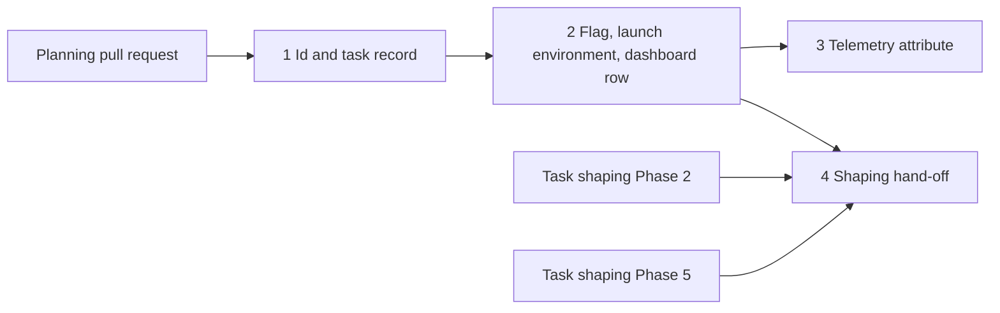

# Work unit id: phased implementation plan

Source plan: `docs/plans/work-unit-id/plan.md`. Its requirements R1 to R5 and adopted
decisions D1 to D5 are requirements here. This file is the implementation index. Each phase
file stands on its own for an agent that arrives with only its path.

## Decisions incorporated

| # | Choice (Jordan, plan review, 2026-11-20) | Owned by |
|---|---|---|
| D1 | A task created by a plan task's session inherits. Others get a new unit unless they pass `workUnit: "inherit"`. | Phase 1 |
| D2 | Mission Control sets `WORK_UNIT_ID`; the config owner references it. No header injection. | Phase 2 |
| D3 | No inference for existing tasks. A new id at the next dispatch. | Phase 1 |
| D4 | Every lane that exports traces carries the unhashed id. | Phase 3 |
| D5 | Phase the plan and schedule its tasks. | This file |
| D6 | A resident run gets no work unit. Jordan chose this in the plan validation repair, over covering pinned residents with a fifth phase. It narrows R3 and R5. | Phase 1 (no id), Phase 2 (the resident catalog) |

## What the repository showed

- **One creator.** `TaskManager.create` (`src/server/tasks.ts`) is the only function that
  makes a task row, and `upsertTask` (`src/server/db.ts`) is the only SQL writer. Internal
  callers pass a second argument, `InternalCreateOptions`, so that an HTTP body cannot choose
  an id. The work unit source belongs there for the same reason.
- **The caller is known in one place.** Only MCP `create_task` (`createMcpTask` in
  `src/server/routes.ts`) can see the calling session, and today it resolves it only for
  plan inputs or `dependsOnCurrentSession`. Phase 1 resolves it on every call.
- **No parent pointer exists.** `tasks.origin_surface`, `origin_repo` and
  `origin_session_id` (schema 36) belong to headless mode and nothing reads or writes them.
  This plan does not use them.
- **Kind behaviour is a registry.** `TASK_KIND_BEHAVIOR` in `src/shared/task.ts` holds what
  a kind does. D1's rule is one field there, not a comparison with `"plan"` in a route.
- **Schema version.** `CURRENT_DATABASE_SCHEMA_VERSION` is 36 on `main`. Phase 1 takes the
  next free number when it merges. If another branch took it first, Phase 1 renumbers.
- **Launch paths.** `withAgentTraceContext` has two production users, the Claude and Codex
  SDK adapters. Terminal launches, Pi and resume carry no trace context today, so the work
  unit helper is new on those paths. `agentSubprocessEnv` applies a launch's `extraEnv`
  before its scrub, and the scrub removes only state-home and token names.
- **One shared MCP file.** Terminal Claude launches read one `ask-channel/mcp.json`. A
  per-task value must never be written there, which supports D2.
- **Residents.** A pinned resident does not load the operator's MCP config.
  `parseClaudeServer` and `parseCodexServer` (`src/server/residents/mcp-catalog.ts`)
  snapshot it. The first expands `${WORK_UNIT_ID:-}` to an empty header value, and the
  second refuses a server that uses `env_http_headers`. So the config lines this plan
  recommends would mislabel or break pinned residents unless the catalog learns the
  reference. Phase 2 owns that.
- **Telemetry.** `Collector.span` hashes every ref, and a fact is exported with a `mission.`
  prefix. Neither yields the plain attribute `work_unit_id`, so Phase 3 adds a named list of
  unscoped refs. `TELEMETRY_LIMITS.maxRefs` is 64 and the workflow events declare 19 refs,
  so one more fits. Session capture already has `host.getTask`.
- **Shaping.** No shaping code is on `main` yet. The shaping core (pull request 1558)
  defines `trace` on the run input and on each transport's context. Phase 4 follows the
  names that have merged by then.

## Differences from the source plan's first proposal

1. Five proposed phases became four. The dashboard row is about fifty lines and shares the
   flag with the launch environment, so it is part of Phase 2.
2. The MCP `create_task` tool posts to three daemon routes. The `workUnit` parameter goes on
   the schema all three share.
3. The end-to-end check of inheritance moved to in-process route tests in Phase 1. The
   browser spec in Phase 2 covers what a person sees: the launch value and the row.
4. Plan validation, round 1: a resident run gets no work unit (D6). Phase 1 gives it none,
   and Phase 2 teaches the resident catalog to accept the reference and drop it.
5. Plan validation, round 1: `codex app-server` was checked against a local fixture, and
   Phase 2's browser spec names an embedded Codex launch.
6. Plan validation, round 2: a real embedded Codex turn was run, and its `tools/call`
   carried the header. Phase 2's statements about the flag being off now name the one change
   that does not depend on the flag. D6 is recorded as Jordan's choice.

## Sizing

Gross non-test production lines, added or materially changed.

| Phase | Estimate | Main cost |
|---|---|---|
| 1 | 270 to 330 | Creation rules across six creating paths, the migration, MCP schemas and serializers |
| 2 | 180 to 230 | Eight launch paths over three harnesses and two runtimes, the flag, the row, the resident catalog |
| 3 | 130 to 170 | Catalog entries for about twelve events, the lint, the projection exception |
| 4 | 20 to 40 | One input field and one call site |
| Total | 600 to 770 | |

Assumptions: no new dependency, no new table, documentation not counted.

Why more than one phase:

- **1 apart from 2 and 3.** Phase 1 is durable storage and the rules every consumer reads.
  With the launch paths and telemetry it would be one change of about 600 lines across the
  database, task creation, three harness adapters and the export pipeline.
- **2 apart from 3.** They share only the flag. Phase 2 changes what every launched agent
  receives. Phase 3 changes the telemetry privacy contract, which deserves a pull request a
  reviewer can read for that alone.
- **4 on its own.** It is small, but it cannot start until two task-shaping phases have
  merged. Folding it into Phase 2 or 3 would hold those behind work this plan does not own.

## Phases

| Phase | File | Delivers | Direct prerequisites |
|---|---|---|---|
| 1. Id and task record | `phase-1-id-and-task-record.md` | The id helper, `tasks.work_unit_id`, creation and inheritance rules, the read field and filter | The planning pull request |
| 2. Flag, launch environment and dashboard row | `phase-2-flag-launch-environment-and-dashboard.md` | The `work-unit-id` preview flag, `WORK_UNIT_ID` on every launch path, the "Work unit" row, the config guide, the resident catalog's handling of the reference | Phase 1 |
| 3. Telemetry attribute | `phase-3-telemetry-attribute.md` | The unhashed span attribute, its capture, lint and privacy contract | Phase 2 |
| 4. Shaping hand-off | `phase-4-shaping-hand-off.md` | `workUnitId` on the shaping run, filled at dispatch | Phase 2, "Task shaping - Phase 2: Dispatch seam and visibility", "Task shaping - Phase 5: Remote transports" |

## Dependency graph

- Merge order: 1, then 2, then 3 and 4 in either order.
- Phases 3 and 4 can run at the same time. They share no file except
  `docs/work-units.md`, where each adds its own section in a different place.

## Cross-phase contracts

- **Names.** `src/shared/work-unit.ts` (Phase 1) owns the pattern, `isWorkUnitId` and the
  four carrier names: `WORK_UNIT_ID`, `x-work-unit-id`, `work_unit_id` for `_meta`, and
  `work_unit_id` for the span attribute. No later phase spells them.
- **The record.** `Task.workUnitId` is `string | null`. It is null for a resident run (D6),
  and for a row that predates the column and has not been dispatched since. Only
  `TaskManager` mints or copies. Later phases read.
- **The gate.** Phase 2 adds the flag id `work-unit-id` and one function,
  `activeWorkUnitId(task)`, which returns the task's id when the flag is on and the id is
  well formed, and null otherwise. Phases 2, 3 and 4 all emit through it, so there is one
  gate.
- **What is not gated.** Phase 1's behaviour (minting, inheritance, reads) and Phase 2's
  resident catalog rule are the same with the flag on or off. Everything Mission Control
  emits is gated.
- **Docs.** Phase 1 creates `docs/work-units.md`. Phase 2 adds the launch and MCP sections.
  Phase 3 adds a "Telemetry" section directly after "Reading a work unit". Phase 4 adds a
  "Task shaping" section at the end of the file.

## Requirement ownership

| Requirement | Phase |
|---|---|
| R1 one id for a plan and its phases, the format | 1 |
| R2 the four names | 1 defines them; 2, 3 and 4 use them |
| R3 unhashed on every session span | 3 |
| R4 explicit fields, no baggage | 2 (environment), 4 (header and `_meta` to shapers) |
| R5 the worker's own MCP calls | 2 |
| D6 a resident run has no work unit | 1 (the record), 2 (the catalog) |
| Plan section 8, the Agent Platform handoff | Not scheduled. Phase 1 keeps the supplied-id option it needs. |

## Final verification

After all four phases, with the flag on:

- A plan task and a phase task it creates have the same `workUnitId`. A standalone task has
  a different one.
- An agent launched for each records that value as `WORK_UNIT_ID`, on the embedded and the
  terminal runtime.
- An exported span for each session carries `work_unit_id` with that value in every lane,
  and no `mission.ref.work_unit_id`.
- A fixture `get_guidance` shaper receives the header and `_meta` value.
- A resident run's task has no `workUnitId`, its launch has no variable and its spans have
  no attribute. For a pinned resident the reference neither gets a server refused nor sends
  an empty header.
- With the flag off, emission stops: no launch has the variable, no span has the attribute,
  no shaper call carries the id and the dashboard shows no row. Task ids do not depend on
  the flag: tasks still get them, and a plan task and its phase tasks still share one. The
  resident catalog rule does not depend on the flag either.
- `npm run typecheck`, `npm run lint`, `npm test`, `npm run build`, `npm run smoke` and
  `npm run test:e2e` pass.

## Cross-phase audit

- After Phase 1 was written: its handoff names `Task.workUnitId` and the shared constants.
  Nothing in it is gated, which Phase 2 relies on.
- After Phase 2: the gate function lives in `src/server/work-unit.ts`, the file Phase 1
  creates. Phase 1 exports only `mintWorkUnitId` from it, so Phase 2 adds without changing.
- After Phase 3: it reads the id through `activeWorkUnitId` and touches no launch path.
  Phase 2 touches no telemetry file. They can merge in either order once Phase 2 is in.
- After Phase 4: it changes only shaping files and the dispatch seam. Phase 3 does not
  touch either. The complete set covers R1 to R5 and D1 to D4 once each.
- Plan validation repair, round 1: D6 touches Phase 1 (no id for a resident run), Phase 2
  (no variable follows from that, plus the resident catalog) and Phase 3 (no attribute
  follows from that). Phase 4 is unchanged: it emits through the same gate, which returns
  nothing for a task with no id. The flag-off statement under "Final verification" and
  Phase 1's exit criterion were reworded to agree with the rules they summarize.
- Plan validation repair, round 2: D6 is recorded as Jordan's choice and as the one
  exception to "every task has a work unit". Phase 2's outcome, compatibility notes and
  exit criteria now agree about the flag being off. The embedded Codex `tools/call` was
  observed. Phases 3 and 4 are unchanged.
