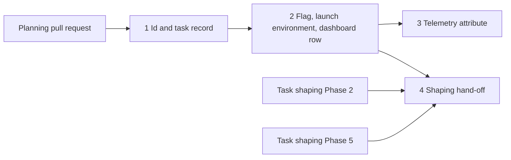

# Work unit id: phased implementation plan

Source plan: `docs/plans/work-unit-id/plan.md`. Its requirements R1 to R5 and adopted
decisions D1 to D8 are requirements here. This file is the implementation index. Each phase
file stands on its own for an agent that arrives with only its path.

## Decisions incorporated

| # | Choice (Jordan, plan review, 2026-11-20) | Owned by |
|---|---|---|
| D1 | A task created by a plan task's session inherits. Others get a new unit unless they pass `workUnit: "inherit"`. | Phase 1 |
| D2 | Mission Control sets `WORK_UNIT_ID`; the config owner references it. No header injection. | Phase 2 |
| D3 | No inference for existing tasks. A new id at the next dispatch. | Phase 1 |
| D4 | Every lane that exports traces carries the unhashed id. | Phase 3 |
| D5 | Phase the plan and schedule its tasks. | This file |
| D6 | A resident run gets no work unit. Jordan chose this in the plan validation repair, over covering pinned residents with a fifth phase. It narrows R3 and R5. | Phase 1 (no id), Phase 2 (the resident catalog) |
| D7 | An agent that was started with one work unit is not handed a task of another. Jordan chose this after the Inspector's review of the plan's pull request, over restarting the agent. | Phase 2 (the launch record and the reuse guard), Phase 3 (capture follows the record) |
| D8 | Phase 2 starts with a check against a local OAuth fixture, and the config guide follows it. Jordan chose this after the Inspector's review, over documenting the limit only. | Phase 2 |

## What the repository showed

- **One creator.** `TaskManager.create` (`src/server/tasks.ts`) is the only function that
  makes a task row, and `upsertTask` (`src/server/db.ts`) is the only SQL writer. Internal
  callers pass a second argument, `InternalCreateOptions`, so that an HTTP body cannot choose
  an id. The work unit source belongs there for the same reason.
- **The caller is known in one place.** Only MCP `create_task` (`createMcpTask` in
  `src/server/routes.ts`) can see the calling session, and today it resolves it only for
  plan inputs or `dependsOnCurrentSession`. Phase 1 resolves it on every call.
- **No parent pointer exists.** `tasks.origin_surface`, `origin_repo` and
  `origin_session_id` (schema 36) belong to headless mode and nothing reads or writes them.
  This plan does not use them.
- **Kind behaviour is a registry.** `TASK_KIND_BEHAVIOR` in `src/shared/task.ts` holds what
  a kind does. D1's rule is one field there, not a comparison with `"plan"` in a route.
- **Schema version.** `CURRENT_DATABASE_SCHEMA_VERSION` is 36 on `main`. Phase 1 takes the
  next free number when it merges. If another branch took it first, Phase 1 renumbers.
- **Launch paths.** `withAgentTraceContext` has two production users, the Claude and Codex
  SDK adapters. Terminal launches, Pi and resume carry no trace context today, so the work
  unit helper is new on those paths. `agentSubprocessEnv` applies a launch's `extraEnv`
  before its scrub, and the scrub removes only state-home and token names.
- **One shared MCP file.** Terminal Claude launches read one `ask-channel/mcp.json`. A
  per-task value must never be written there, which supports D2.
- **Residents.** A pinned resident does not load the operator's MCP config.
  `parseClaudeServer` and `parseCodexServer` (`src/server/residents/mcp-catalog.ts`)
  snapshot it. The first expands `${WORK_UNIT_ID:-}` to an empty header value, which the
  run's private copy then keeps. The second finds a server that uses `env_http_headers`
  unusable, and `resolveResidentMcpSet` (`src/server/residents/mcp-launch.ts`) refuses a
  launch whose set includes one. So the config lines this plan recommends would mislabel or
  block pinned residents unless the catalog learns the reference, and a run launched earlier
  needs the empty header left out when it starts. Phase 2 owns both.
- **Reused agents.** `TaskManager.assign` (`src/server/tasks.ts`) hands a backlog task to an
  agent that is already running, after a reset, and `agentIsFree` is the same choice when
  the backlog makes it. No process starts, so the agent keeps the environment of its launch.
  A variable set for one task would be sent on the MCP calls of the next.
- **What a launch delivered.** `Registry.recordStandingInstructions`
  (`src/server/registry.ts`) records, per session, something a launch installed on the
  process, and `moveStandingInstructionsKey` carries that row across every note-key
  rotation, because a `/clear` does not end the process. The work unit an agent was started
  with needs the same lifetime, so Phase 2 records it the same way.
- **Flags are live.** `docs/feature-flags.md` has `featureEnabled(id)` checked for each new
  operation, and asks each feature to document what it does with work already in flight. An
  agent's environment cannot follow a live flag, so the flag is read once, when an agent is
  started.
- **Claude Code and OAuth.** Read in Claude Code 2.1.329's program text, not run: a server's
  sign-in is stored under its name and a hash of its type, URL and headers, with header
  references already filled in. The comment in `parseClaudeServer` says the same. Phase 2
  checks it against a fixture first.
- **Telemetry.** `Collector.span` hashes every ref, and a fact is exported with a `mission.`
  prefix. Neither yields the plain attribute `work_unit_id`, so Phase 3 adds a named list of
  unscoped refs. `TELEMETRY_LIMITS.maxRefs` is 64 and the workflow events declare 19 refs,
  so one more fits. Session capture already has `host.getTask`.
- **Shaping.** No shaping code is on `main` yet. The shaping core (pull request 1558)
  defines `trace` on the run input and on each transport's context. Phase 4 follows the
  names that have merged by then.

## Differences from the source plan's first proposal

1. Five proposed phases became four. The dashboard row is about fifty lines and shares the
   flag with the launch environment, so it is part of Phase 2.
2. The MCP `create_task` tool posts to three daemon routes. The `workUnit` parameter goes on
   the schema all three share.
3. The end-to-end check of inheritance moved to in-process route tests in Phase 1. The
   browser spec in Phase 2 covers what a person sees: the launch value and the row.
4. Plan validation, round 1: a resident run gets no work unit (D6). Phase 1 gives it none,
   and Phase 2 teaches the resident catalog to accept the reference and drop it.
5. Plan validation, round 1: `codex app-server` was checked against a local fixture, and
   Phase 2's browser spec names an embedded Codex launch.
6. Plan validation, round 2: a real embedded Codex turn was run, and its `tools/call`
   carried the header. Phase 2's statements about the flag being off now name the one change
   that does not depend on the flag. D6 is recorded as Jordan's choice.
7. Plan validation, round 3: Phase 2 covers a resident run launched before it, and Phase 4
   names the carrier of each transport.
8. Plan validation, round 4: the resident header rule is about the reference. Phase 2 says what
   it covers once, and every statement of it uses the same two facts.
9. The Inspector's review of the plan's pull request: everything Mission Control emits
   follows a record of what each agent was started with, so a switch of the flag or a reused
   agent cannot split spans from MCP calls (D7). The resident sign-in decision is made on
   the headers that remain. Phase 2 starts with an OAuth check (D8).

## Sizing

Gross non-test production lines, added or materially changed.

| Phase | Estimate | Main cost |
|---|---|---|
| 1 | 270 to 330 | Creation rules across six creating paths, the migration, MCP schemas and serializers |
| 2 | 270 to 350 | Eight launch paths over three harnesses and two runtimes, the flag, the launch record and its rotation, the reuse guard, the row, the resident catalog |
| 3 | 130 to 170 | Catalog entries for about twelve events, the lint, the projection exception |
| 4 | 20 to 40 | One input field and one call site |
| Total | 690 to 890 | |

Assumptions: no new dependency, one new table (the launch record in Phase 2), documentation
not counted. The OAuth check in Phase 2 is fixture and test work, so it is not in these
numbers.

Why more than one phase:

- **1 apart from 2 and 3.** Phase 1 is durable storage and the rules every consumer reads.
  With the launch paths and telemetry it would be one change of about 600 lines across the
  database, task creation, three harness adapters and the export pipeline.
- **2 apart from 3.** Phase 3 reads what Phase 2 records and writes none of it. Phase 2
  changes what every launched agent receives and when an agent may be reused. Phase 3
  changes the telemetry privacy contract, which deserves a pull request a reviewer can read
  for that alone.
- **4 on its own.** It is small, but it cannot start until two task-shaping phases have
  merged. Folding it into Phase 2 or 3 would hold those behind work this plan does not own.

## Phases

| Phase | File | Delivers | Direct prerequisites |
|---|---|---|---|
| 1. Id and task record | `phase-1-id-and-task-record.md` | The id helper, `tasks.work_unit_id`, creation and inheritance rules, the read field and filter | The planning pull request |
| 2. Flag, launch environment and dashboard row | `phase-2-flag-launch-environment-and-dashboard.md` | The OAuth check, the `work-unit-id` preview flag, `WORK_UNIT_ID` on every launch path, the launch record and the reuse guard, the "Work unit" row, the config guide, the resident catalog's handling of the reference | Phase 1 |
| 3. Telemetry attribute | `phase-3-telemetry-attribute.md` | The unhashed span attribute, its capture, lint and privacy contract | Phase 2 |
| 4. Shaping hand-off | `phase-4-shaping-hand-off.md` | `workUnitId` on the shaping run, filled at dispatch | Phase 2, "Task shaping - Phase 2: Dispatch seam and visibility", "Task shaping - Phase 5: Remote transports" |

## Dependency graph

- Merge order: 1, then 2, then 3 and 4 in either order.
- Phases 3 and 4 can run at the same time. They share no file except
  `docs/work-units.md`, where each adds its own section in a different place.

## Cross-phase contracts

- **Names.** `src/shared/work-unit.ts` (Phase 1) owns the pattern, `isWorkUnitId` and the
  four carrier names: `WORK_UNIT_ID`, `x-work-unit-id`, `work_unit_id` for `_meta`, and
  `work_unit_id` for the span attribute. No later phase spells them.
- **The record.** `Task.workUnitId` is `string | null`. It is null for a resident run (D6),
  and for a row that predates the column and has not been dispatched since. Only
  `TaskManager` mints or copies. Later phases read.
- **The gate.** Phase 2 adds the flag id `work-unit-id` and reads it in one place:
  `launchWorkUnitId(task)`, called once per launch, when the launch begins. It returns the
  task's id when the flag is on and the id is well formed, and null otherwise. That one
  value goes to the shaping run, the agent's environment and the launch record, and no later
  phase calls the function again.
- **The launch record.** Phase 2 records, per session, the work unit its agent was started
  with, and adds `sessionWorkUnitId(session, task)`: the recorded id while the task has that
  same id, and null otherwise. The record is installed before a launched session's first
  event is published, and it changes only when a launch succeeds, so it always describes the
  agent that is running. Phases 2, 3 and 4 emit only through these two functions and never
  read the flag themselves. So a switch of the flag, or a reused agent, cannot make spans,
  shaper calls and the agent's own MCP calls disagree.
- **A launch attempt.** What Mission Control sends for a launch before an agent runs, which
  is the shaper calls and the dispatch-finished span, carries that launch's one decision,
  whether or not the agent then starts. Everything a session emits afterwards follows the
  launch record.
- **What is not gated.** Phase 1's behaviour (minting, inheritance, reads), Phase 2's resident
  catalog rule and Phase 2's reuse guard are the same with the flag on or off. Everything
  Mission Control emits follows the decision made when the agent was started.
- **Docs.** Phase 1 creates `docs/work-units.md`. Phase 2 adds the launch and MCP sections.
  Phase 3 adds a "Telemetry" section directly after "Reading a work unit". Phase 4 adds a
  "Task shaping" section at the end of the file.

## Requirement ownership

| Requirement | Phase |
|---|---|
| R1 one id for a plan and its phases, the format | 1 |
| R2 the four names | 1 defines them; 2, 3 and 4 use them |
| R3 unhashed on every session span | 3 |
| R4 explicit fields, no baggage | 2 (environment), 4 (header and `_meta` to shapers) |
| R5 the worker's own MCP calls | 2. Not yet for a server Claude Code signs in to with OAuth: the check in Phase 2 decides (D8). |
| D6 a resident run has no work unit | 1 (the record), 2 (the catalog) |
| D7 a reused agent is not handed another work unit's task | 2 (the record and the guard), 3 (capture) |
| D8 the OAuth check | 2 |
| Plan section 8, the Agent Platform handoff | Not scheduled. Phase 1 keeps the supplied-id option it needs. |

## Final verification

After all four phases, with the flag on:

- A plan task and a phase task it creates have the same `workUnitId`. A standalone task has
  a different one.
- An agent launched for each records that value as `WORK_UNIT_ID`, on the embedded and the
  terminal runtime.
- An exported span for each session carries `work_unit_id` with that value in every lane,
  and no `mission.ref.work_unit_id`.
- A fixture `get_guidance` shaper on an `mcp` server over streamable HTTP receives the
  header and the `_meta` value. An `http` shaper receives the header only.
- A resident run's task has no `workUnitId`, its launch has no variable and its spans have no
  attribute. For a pinned resident the reference gets no launch refused and no header in a
  new snapshot. A run launched before Phase 2 stops sending the empty header at its next
  start. A non-empty value an operator wrote themselves is still sent as configured. A server whose only header was the reference is handed to the
  harness headerless, as before the reference was added.
- The OAuth check's answers are recorded in `docs/work-units.md`, and the config guide follows
  them. No answer blocks Phase 2.
- With the flag off from the start, nothing is emitted: no launch has the variable, no span
  has the attribute, no shaper call carries the id and the dashboard shows no row. Task ids
  do not depend on the flag: tasks still get them, and a plan task and its phase tasks still
  share one. The resident catalog rule and the reuse guard do not depend on the flag either.
- A switch of the flag while agents run: an agent started with it on keeps the variable, the
  span attribute and the shaper carrier until its next start, and one started with it off
  gains none until then. At no moment do an agent's spans carry an id that its environment
  does not.
- A reused agent: assign refuses an agent that was started for another work unit, and a task
  on an agent started with none emits nothing.
- A launch that fails leaves the record of the agent that is still running unchanged.
- The session-start span of a dispatched session carries the id its agent was started with.
- When shaping succeeds and the agent then fails to start, the shaper call keeps the task's
  work unit and no launch record is written.
- `npm run typecheck`, `npm run lint`, `npm test`, `npm run build`, `npm run smoke` and
  `npm run test:e2e` pass.

## Cross-phase audit

- After Phase 1 was written: its handoff names `Task.workUnitId` and the shared constants.
  Nothing in it is gated, which Phase 2 relies on.
- After Phase 2: the gate function lives in `src/server/work-unit.ts`, the file Phase 1
  creates. Phase 1 exports only `mintWorkUnitId` from it, so Phase 2 adds without changing.
- After Phase 3: it reads the launch record, through `sessionWorkUnitId` and, for the start
  span, directly. It changes nothing a launch does. Phase 2 touches no telemetry file.
  Phases 3 and 4 can merge in either order once Phase 2 is in.
- After Phase 4: it changes only shaping files and the dispatch seam. Phase 3 does not
  touch either. The complete set covers R1 to R5 and D1 to D4 once each.
- Plan validation repair, round 1: D6 touches Phase 1 (no id for a resident run), Phase 2
  (no variable follows from that, plus the resident catalog) and Phase 3 (no attribute
  follows from that). Phase 4 is unchanged: it emits through the same gate, which returns
  nothing for a task with no id. The flag-off statement under "Final verification" and
  Phase 1's exit criterion were reworded to agree with the rules they summarize.
- Plan validation repair, round 2: D6 is recorded as Jordan's choice and as the one
  exception to "every task has a work unit". Phase 2's outcome, compatibility notes and
  exit criteria now agree about the flag being off. The embedded Codex `tools/call` was
  observed. Phases 3 and 4 are unchanged.
- Plan validation repair, round 3: Phase 2 states what happens to a resident run launched
  before it and tests that path. Phase 4's outcome, steps, compatibility notes and exit
  criteria name the same carrier for each transport. Phases 1 and 3 are unchanged.
- Plan validation repair, round 4: Phase 2's resident catalog step states what the resident
  header rule covers, and its outcome, tests and exit criterion state the same two facts.
  The root plan and this index follow. No behaviour changed. Phases 1, 3 and 4 are
  unchanged.
- Inspector review of the plan's pull request: Phase 2 gains the OAuth check, the launch
  record and the reuse guard, and its resident sign-in rule changes. Phase 3 captures from
  the launch record. Phase 4 takes its value from the same two functions. Phase 1 gives an
  older row its id at assign as well as at dispatch. Every statement about the flag being
  off now says whether it means off when an agent is started, or switched off while one
  runs.
- Inspector review, round 2: the launch record changes only when a launch succeeds (Phase 2).
  Phase 4's exit criteria follow the agent's launch record and not the flag at dispatch.
  Phase 1's explicit `"inherit"` gives an eligible older parent its id first. Phase 3 is
  unchanged.
- Inspector review, round 3: one launch has one decision, which Phase 2 computes once and
  Phase 4 takes without calling the function again. A local shaper process never inherits
  the daemon's own variable (Phase 4). No answer of the OAuth check blocks Phase 2, and its
  resident criterion names the routing it controls. Phases 1 and 3 are unchanged.
- Inspector review, round 4: the registry installs the launch record before a launched
  session's first event (Phase 2). The start span carries the id the agent was started with
  (Phase 3). A shaper call belongs to the launch it was made for, also when the agent then
  fails to start (Phase 4). Phase 1 is unchanged.
- Inspector review, round 5: the start span reads the launch record itself, for every kind
  of launch that announces a session, with Phase 2 installing the record first (Phases 2 and
  3). An older row gets its id before the launch decision reads it (Phases 1 and 2). The
  OAuth check's guidance is decided for Claude Code and for Codex separately (Phase 2).
  Phase 4 is unchanged.
