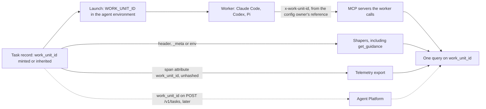

# Work unit id: mint, inherit and carry across sessions and MCP calls

Status: decisions adopted in the plan review on 2026-11-20, phased the same day, and repaired
after plan validation rounds 1 to 4 (decision D6 on residents, the `codex app-server`
checks, the flag-off wording, resident runs that already exist, shaper carriers by
transport, what the resident header rule covers). Revised after the GitHub Inspector
reviewed the plan's pull request (decisions D7 and D8, the launch record, the resident
sign-in rule). Owner: Jordan. Planning task: "Work unit id - mint, carry and trace across Mission Control sessions
and MCP calls".

## Goal

Mission Control gives every piece of work one id, `work_unit_id`. It carries that id to every
span it exports for the work's sessions and to every MCP call the work makes. One Datadog
query on `work_unit_id` then finds every trace and MCP call for the piece of work, across
sessions, harnesses and services.

Today there is no such id. Mission Control makes one trace per session, so a plan with five
phases is at least six unrelated traces.

## Requirements (decided by Jordan, 2026-11-20)

| # | Requirement |
|---|---|
| R1 | One `work_unit_id` covers a plan task plus all its phase tasks. Format `wu_<ULID>`, Crockford base32, matching Agent Platform's check `^wu_[0-9A-HJKMNP-TV-Z]{26}$`. |
| R2 | One plain name everywhere: span attribute `work_unit_id`, HTTP header `x-work-unit-id`, MCP `params._meta.work_unit_id`, environment variable `WORK_UNIT_ID`. Mission Control core stays generic, with no company names. |
| R3 | Mission Control exports it unhashed on its own telemetry, as a documented exception to `scopedRef` hashing. Every session span of the work unit carries it. |
| R4 | It travels as explicit fields, not W3C baggage. Agent Platform's control plane strips baggage. |
| R5 | The worker's own in-session MCP calls carry it too. |

**Narrowed by a later human decision.** In the plan validation repair Jordan decided that a
resident run has no work unit (D6, below). R1 to R5 therefore apply to every task that has a
work unit, which is every task except a resident run's. R3 and R5 do not reach a resident's
spans or its MCP calls.

**Two limits found after the Inspector review.** An agent's environment is fixed when it
starts and outlives a single task, so a session emits only the work unit its agent was
started with (section 4, D7). And on Claude Code a server that signs in with OAuth is not
known to keep its sign-in once the header is added, so until Phase 2 has checked it, R5 does
not reach such a server (section 5, D8).

## Adopted decisions (Jordan, plan review, 2026-11-20)

| # | Decision | Choice |
|---|---|---|
| D1 | Which tasks inherit by default | A task created by a plan task's session inherits that plan task's work unit. Any other session gets a new unit unless it passes `workUnit: "inherit"`. |
| D2 | How the worker's own MCP calls get the header | Mission Control sets `WORK_UNIT_ID`. The owner of an MCP server's config references it. Mission Control injects no header. |
| D3 | Tasks that exist before this ships | No inference. Such a task gets a new id at its next dispatch. |
| D4 | Which telemetry lanes export the unhashed id | Every lane that exports traces. |
| D5 | After the plan | Create the phased implementation plan and schedule its tasks. |
| D6 | Residents. Asked of Jordan in the plan validation repair on 2026-11-20, with two options: cover pinned residents by filling the same reference at launch (a fifth phase), or leave residents out of work units | **Leave residents out of work units.** A resident run is a standing agent, not a piece of work. It gets no work unit: no id on its task, no launch variable, no span attribute, so its spans and MCP calls cannot be found by work unit. Tasks a resident schedules get their own. This narrows R3 and R5, and it is the one exception to "every task has a work unit". |
| D7 | A reused agent. `assign` hands a running agent a new task, and the agent keeps the environment it was started with. Asked of Jordan on 2026-11-20, after the Inspector review, with two options: do not hand the task over, or restart the agent with the new id | **Do not hand it over.** An agent that was started with one work unit is not handed a task of another. Assign refuses that agent with a sentence, and the backlog's own selection does not offer it. |
| D8 | Servers that Claude Code signs in to with OAuth. Asked of Jordan on 2026-11-20, after the Inspector review, with two options: document the limit, or check it against an OAuth fixture in Phase 2 first | **Add an OAuth check to Phase 2 first.** Phase 2 starts with a check against a local OAuth fixture and writes the config guide from its result. Until then the plan treats such a server as one that carries no work unit. |

D1 to D5 were chosen by Jordan in the first review. D6 was chosen by Jordan in the Mission
Control dashboard during the plan validation repair. It is a human decision, not a planner's
repair. D7 and D8 were chosen by Jordan in the dashboard after the GitHub Inspector reviewed
the plan's pull request.

## Step 1: the spike, and what it found

**Question.** Can Claude Code and Codex attach a per-session header, or `_meta`, to the remote
MCP calls a worker makes, from per-launch config or environment interpolation?

**Answer.** A header: yes, on both agents, from both sources. `_meta`: no, on neither.

**Method.** Two local fixture MCP servers on loopback, one streamable HTTP and one stdio,
recorded what each agent sent. Claude Code 2.1.329 (the CLI and Agent SDK 0.3.325) and Codex
CLI 0.170.0 ran under the real home with its normal sign-in. No credential was read, copied or
passed. The fixtures logged header names, and header values only for a fixed list of safe
names.

### Claude Code

| Case | What reached the fixture |
|---|---|
| Per-launch `--mcp-config`, literal header | The header, on every request: discovery, `initialize`, notifications, the event stream, `tools/list` and `tools/call`. |
| Header written `${WORK_UNIT_ID}` or `${WORK_UNIT_ID:-}`, variable set at launch | The variable's value. |
| The same reference in user scope (`~/.claude.json`), in a project `.mcp.json` and in a plugin's `.mcp.json` | The variable's value, in all three. |
| Agent SDK `query()` called as Mission Control calls it (`options.env`, `mcpServers`, setting sources user, project and local) | The literal header, and the interpolated one. |
| Variable unset, header written `${WORK_UNIT_ID}` | The literal text `${WORK_UNIT_ID}`. The server still loads. |
| Variable unset, header written `${WORK_UNIT_ID:-}` | The header, with an empty value. |
| A stdio server | `WORK_UNIT_ID` in its environment, inherited from the agent. |
| `params._meta` on `tools/call` | Only `claudecode/toolUseId` and `progressToken`. No setting adds a key. |
| `traceparent` | Sent on `tools/call` only, with the trace id of the launch's `TRACEPARENT` and a new span id per call. No `tracestate` and no `baggage`. |

### Codex

| Case | What reached the fixture |
|---|---|
| Per-launch `-c mcp_servers.<name>.http_headers={...}`, literal | The header, on every request. |
| Per-launch `-c mcp_servers.<name>.env_http_headers={"x-work-unit-id"="WORK_UNIT_ID"}`, variable set | The variable's value. |
| The same entry written in `~/.codex/config.toml` | The variable's value. |
| The same entry, variable unset | No header at all. |
| `codex app-server`, started as Mission Control starts it (`-c` overrides, the variable in the process environment), thread started, no turn | The variable's value, on every request the server made: `initialize`, `notifications/initialized` and `tools/list`. A literal `http_headers` value arrived the same way. |
| The same `codex app-server` launch, variable unset | No header at all. |
| A `codex app-server` launch with the variable set and one real turn, in which the model called the fixture's tool | The variable's value on that `tools/call`, and on the three startup requests before it. |
| A stdio server, default settings | `WORK_UNIT_ID` is not in its environment. |
| A stdio server with `env_vars = ["WORK_UNIT_ID"]` | It is. |
| `params._meta` on `tools/call` | Codex's own keys (`traceparent`, `threadId`, `sessionId`, `x-codex-turn-metadata` and others). No setting adds a key. |
| `traceparent` | Sent as a header on every request. Startup requests carried the launch's trace id. In `codex exec` each `tools/call` carried a different trace id, not the launch's, and so did the `tools/call` under `codex app-server`. |

### What follows from it

- The environment variable is the per-session carrier. Config that references it turns it
  into a header, in every place an operator, a plugin or IT keeps MCP config. Mission Control
  does not need to know which servers exist.
- `_meta.work_unit_id` can only be sent by a client Mission Control writes itself, which is
  the shaper transports. So a server must accept the header on its own. When Mission Control
  sends both, they carry the same value, so a server may prefer either.
- Trace context alone does not reliably join an MCP call to its session (see Codex above).
  That is one more reason the id is an explicit field.
- One sharp edge. On Claude Code the reference must be written `${WORK_UNIT_ID:-}`. Without
  the `:-`, a session started outside Mission Control sends the literal text. With it, the
  header is present and empty, so a server must treat an empty value as absent.
- Read later in Claude Code 2.1.329's program text, and not run. A server's OAuth sign-in is
  stored under its name and a hash of its type, URL and headers, and a `${...}` reference in
  a header is filled in before that hash. So on a server that signs in with OAuth, a header
  whose value differs per work unit is expected to give each work unit its own, empty
  sign-in. Phase 2 checks this against a local OAuth fixture before it writes the config
  guide (D8).

### Cleanup and limits

- Installed for the test: one user-scope Claude Code server (`wu-spike-user-7f3a91`) and one
  block in `~/.codex/config.toml` (`wu_spike_user_7f3a91`). Both were removed and checked.
  Claude Code: the user-scope server list has the same count (3) and the same content hash
  before and after. Codex: the file has the same size (9044 bytes) and the same SHA-256
  before and after.
- `codex app-server`, Mission Control's embedded Codex runtime, was checked after plan
  validation asked for it, in two runs: one that only started a thread, and one that ran a
  real turn in which the model called the fixture's tool. The header arrived on every
  request of both, the `tools/call` included.
- Not tested: claude.ai cloud connectors, and servers that sign in with OAuth. Phase 2 tests
  the second first (D8). What the program text says about it is the last point under "What
  follows from it".
- Pi has no remote MCP client, so it has no header to send.

## Design

### 1. The id

- `wu_` followed by a ULID: 48 bits of millisecond time and 80 random bits in Crockford
  base32, 26 characters. It always matches Agent Platform's check.
- `src/shared/work-unit.ts` holds the pattern, `isWorkUnitId`, the pure encoder and the four
  carrier names as constants, so no other file spells them. `src/server/work-unit.ts` mints,
  with `node:crypto`. It is about twenty lines and needs no new dependency. The repository
  has no ULID or prefixed-id helper today.
- The id is opaque. It is not a credential and is never redacted. It does embed the time it
  was minted.

### 2. The task record and inheritance

A new column `tasks.work_unit_id`, and `Task.workUnitId`. Every task created after this
ships has one from creation, except a resident run's (D6). It is written once: no later write changes a value that is set.

Minting and inheriting happen in one place, `TaskManager.create` in `src/server/tasks.ts`,
which every task-creating path already goes through. The source is named by an internal
option, next to the reserved id that internal callers already pass, so no HTTP body can
choose a work unit.

| How the task is created | Its work unit |
|---|---|
| MCP `create_task`, called by a session whose own task is a plan task | The plan task's. This is how phase tasks inherit, with no change to the phasing skill (D1). |
| MCP `create_task` with `workUnit: "inherit"`, from any session bound to a task | That task's. A task that only predates the column is given its id first. Refused, with the reason, when the session has no task or its task's kind has no work unit (a resident run). |
| MCP `create_task` with `workUnit: "new"`, or from a session whose task is not a plan task | A new one. |
| A retro follow-up task | The source task's. |
| A failed chat retried as a new task | The source task's. |
| Best-of-N members, their retries and a replacement | One for the whole run. |
| Dashboard dispatch, a schedule occurrence, an imported issue, a pipeline task, a tour, a launch-failure report | A new one. |
| A resident run | None (D6). |
| Requeue, retry, reassign, restore, runtime transfer (the same row) | Unchanged. |

- **A standalone task** gets its own id: a work unit of one. Its sessions are therefore
  tagged the same way as a plan's. A resident run is the one exception (D6, two bullets
  down).
- **A plan created by a plan** inherits, and so do its phases, because a copied id is the
  same id.
- **A session with no task** (a discovered session, a home session) has no work unit, and
  nothing is sent for it.
- **A resident run** has no work unit either (D6). A resident is a standing agent, not a
  piece of work. A task a resident's session creates gets a new unit, and asking to inherit
  from it is refused.
- **A task that predates the column** has no id until its next dispatch or assign, which mints one and saves it before anything else reads it (D3). Nothing is inferred from its plan inputs or dependencies. When a new task inherits
  from such a task, the parent is given its id first and the child copies it.
- The value is copied, not derived through a parent pointer. A copy survives the parent
  being deleted and needs no tree walk at launch or capture.
- Why the default follows the task kind: a resident or a chat schedules many unrelated
  pieces of work, so "inherit from whoever called" would merge them into one unit. R1 names
  the plan task as the root.

### 3. Reading it

- `workUnitId` is in every task read: `GET /api/tasks`, and the MCP tools `get_task`,
  `list_tasks` and the `create_task` result.
- `list_tasks` gains a `workUnitId` filter, so an agent or a person can list the tasks of
  one work unit.
- The dashboard shows, in the session detail (`ConsoleDetail`), the work unit that session
  emits (section 4), as a "Work unit" row with a copy control. Mission Control links to no
  observability vendor.

### 4. The launch environment

Every agent process Mission Control starts for a task that has a work unit gets
`WORK_UNIT_ID`, when the preview is on at that start. A resident launch has none (D6).

- One pure helper, beside `withAgentTraceContext`: remove any inherited `WORK_UNIT_ID`, then
  set the task's. The daemon may itself have been started from a worker's shell, and a
  session must never carry another unit's id.
- Paths: Claude Agent SDK launch, restore and in-session relaunch; Codex app-server; Pi's
  tool environment; terminal dispatch (the wrapper script's exports); the two pipeline
  hosts; managed terminal resume and runtime transfer.
- It is set whether or not telemetry is on. Unlike `TRACEPARENT`, it identifies the work,
  and other services record it.
- One-shot model calls (Foreman, Inspector, Persona reviews) and workflow check commands are
  not sessions and load no MCP servers. They get no id, and an inherited one is removed.

An agent's environment is fixed when it starts, and it outlives a single task:
`TaskManager.assign` hands a running agent a new task after a reset. So one rule ties
everything Mission Control emits to the process. **A session emits only the work unit its
agent was started with.**

- The decision is made once per launch, when the launch begins: the launch carries the task's
  id when the preview is on and the id is well formed, and none otherwise. That one value
  goes to everything the launch does: the shaping run, the agent's environment and the
  launch record. It is the only place the flag is read, so a switch while a launch is in
  flight cannot give its parts different answers.
- Mission Control records the decision with the session, the way it already records the
  standing instructions a launch delivered: keyed by the session's note key, replaced when a
  launch succeeds, and moved whenever the key changes. A `/clear` or an assign starts a new
  conversation and not a new process, so the record survives both. A successful launch that
  carries none removes it. A launch that fails changes nothing, so the record always
  describes the agent that is running. It is installed before a launched session's first
  event is published.
- Every later reader uses the record and never the flag. A session emits its recorded id
  while its task has that same id. Spans (section 6), the dashboard row (section 3) and
  shaping (section 7) read it.
- A launch is a new dispatch, an embedded restore, a managed resume or a runtime transfer,
  and each decides again. So a switch of the preview takes effect at an agent's next start.
  Until then a running agent keeps its variable and its spans keep the attribute, or it has
  neither. The spans and the MCP calls of one agent cannot disagree.
- A reused agent (D7). An agent that was started with one work unit is not handed a task of
  another, because its MCP calls would carry the first. `TaskManager.assign` refuses that
  agent with a sentence, and the backlog's own selection does not offer it. The guard does
  not read the flag: it protects against an environment that is already set. An agent
  started with no work unit takes any task, and that task emits nothing until the agent's
  next start.
- A session that was running before this ships has no record, so it emits nothing until its
  next start.

### 5. The worker's own MCP calls

Mission Control sets the variable. The owner of an MCP server's config references it.
Mission Control writes no per-task value into any MCP config (D2).

| Agent and server type | What the config owner writes |
|---|---|
| Claude Code, remote server | `"headers": { "x-work-unit-id": "${WORK_UNIT_ID:-}" }` |
| Codex, remote server | `env_http_headers = { "x-work-unit-id" = "WORK_UNIT_ID" }` |
| Codex, stdio server | `env_vars = ["WORK_UNIT_ID"]` |
| Claude Code, stdio server | Nothing. The server inherits the variable. |

Why Mission Control does not inject the header itself:

- It would have to know server names, which is company configuration.
- On the terminal runtime Claude Code reads one shared `ask-channel/mcp.json` for every
  launch, so a per-task value in it would race between dispatches.
- A per-launch entry cannot add one header to a server the operator defined elsewhere. It
  would have to restate the whole server.

Limits: cloud connectors and Pi, as above, and one for Claude Code. A server that signs in
with OAuth is not known to keep its sign-in once the header is added: the sign-in is stored
under a key that includes the server's headers after `${...}` is filled in, so a value that
differs per work unit is expected to give every work unit its own key. That is read in
Claude Code's program text and not run. Phase 2 checks it against a local OAuth fixture
before it writes the guide (D8). Until then the guide tells an owner not to add the reference to such a server, and a worker's calls to it carry no work unit. The check asks the same of Codex, and the guide answers for each agent on its own.

Residents (D6). A resident run has no work unit, so Mission Control has no value to send
for it. The resident
catalog still has to learn the reference, because of what a pinned resident does today with
the two remote-server lines above. It snapshots the Claude Code line as an empty header and
sends that on every call. It finds a Codex server with that line unusable ("it uses
env_http_headers, which residents cannot carry"), and a launch whose set includes an
unusable server is refused. The catalog will accept exactly this reference and drop it, so
a launch is not refused for it and a new snapshot holds no header for it.

Runs that already exist. A pinned run keeps the private copy it took at launch, and that
does not change. A Claude Code run launched earlier may hold `x-work-unit-id` with an empty
value in its copy. So Mission Control will leave out an empty `x-work-unit-id` each time
it hands a server's headers to a start, and the run stops sending it at its next start or
resume, with no new snapshot. No Codex run can hold the refused state, because that launch
never started: launching the profile again succeeds.

What the rule covers. Both parts are about the reference. A header named
`x-work-unit-id` with a non-empty value that an operator wrote themselves is left alone.
Such a literal is kept in a new snapshot and sent, as any configured header is. A
non-empty value that an earlier snapshot holds is sent as stored until the resident is
launched again. An empty value is left out whoever wrote it: it carries nothing. Mission
Control does not treat an operator's value as a work unit: a resident run has none (D6),
so no task, launch or span carries it.

Sign-in. On Claude Code a pinned resident reaches a server that has a header through Mission
Control's launcher, which presents no harness sign-in, and it hands a headerless server to
the harness as configured, so that the harness uses its own. That decision is made on the
headers that remain after the reference is dropped. So a server whose only header was the
reference stays headerless for a resident, and the harness is handed the entry it had before
the reference was added. By Claude Code's program text it then finds the sign-in it had
before. The OAuth check in Phase 2 confirms or corrects that, and it does not gate the
phase: the launcher presents no sign-in at all, so this route cannot be worse. A server with
another header stays on the launcher, as today. A run launched before the change keeps its
pinned route until the resident is launched again.

A resident that loads all native sources reads the operator's config with the variable
unset, like any session outside a work unit.

### 6. Telemetry: the unhashed attribute

- `work_unit_id` becomes a declared ref on every event that has a span and declares
  `session_id` or `task_id`: session start, restore, dispatch, segment, effort select,
  operation, turn, end, kill, task outcome, PR observed, and the workflow events.
- It is exported as the span attribute `work_unit_id`, verbatim, in every lane that exports
  traces (D4). It is never also exported as `mission.ref.work_unit_id`.
- The exception is one named list, `UNSCOPED_REF_KEYS = ["work_unit_id"]`. `Collector.span`
  in `src/server/telemetry/projection.ts` is the one place refs are hashed. It exports a key
  on that list as it is, and only when the value is a well-formed `wu_` id. Anything else is
  dropped, so nothing else can leave through that door.
- The catalog lint enforces three rules. Only a listed key may be exported unscoped. Every
  span-bearing event that declares `session_id` or `task_id` also declares `work_unit_id`,
  so a new event cannot forget it. And `work_unit_id` is a forbidden metric dimension.
- The value is the work unit the session emits (section 4), read at capture through one
  helper: the id the session's agent was started with, while its task has that id. The start span reads the launch record itself, because a session is announced before its task is bound, and the record is installed before that first event for every kind of launch. A span that reports a launch attempt, dispatch finished, carries
  that launch's decision whether or not an agent started. A session with no task gets none,
  and neither does a resident's, nor a session whose agent was started without the variable.
  A task event with no session in scope, such as a task outcome, reads the record of the
  session the task points to, and carries none when it points to no session.
- Only `mission.session.start` is in the session's trace today. Every other session span is
  the root of its own trace. That is why the attribute goes on each span, and why a query on
  it returns all of them.
- What changes in the privacy contract. `docs/observability.md` says every exported id is a
  per-destination hash. It will say that `work_unit_id` is the one exception: a random id,
  the same in every lane and in other services, so two destinations that both receive it
  can join on it. That is its purpose.

### 7. Shaping

- The queued task "Task shaping - Phase 5: Remote transports" already carries an addendum.
  Its transports send the work unit when the shaping run has one, each in the carrier it
  has: `http` in the `x-work-unit-id` header; `mcp` over streamable HTTP in that header and
  in `params._meta.work_unit_id` on each `tools/call`; `mcp` over a local process in
  `WORK_UNIT_ID` and in `_meta` on each `tools/call`; `command` in `WORK_UNIT_ID`. An `http`
  shaper gets no `_meta`: it is not an MCP call. The transports remove a configured header
  or variable of that name first, keep a shaper process from inheriting the daemon's own
  `WORK_UNIT_ID`, and never redact the value.
- This plan supplies the value. The shaping run's input gains `workUnitId`, beside the `trace`
  field the shaping core already defines. The dispatch seam fills it with the id the task's
  agent carries (section 4): the launch's decision for a new agent, and the session's
  recorded id when the task goes to an agent that is already running. The header and `_meta`
  always carry that one value. A shaper call belongs to the launch it was made for: when the
  agent then fails to start, the call keeps the task's work unit, and no launch record is
  written.
- A dry run from Settings has no task, so it sends none. A built-in shaper runs in the
  daemon and needs no carrier. The shaper request body (protocol 1) does not change.
- Shaper spec 544e584d, section 5, gains a "Work unit" paragraph beside "Trace context".
  Its text goes on the Common Room thread with this plan.

### 8. The Agent Platform handoff (later)

Nothing is built now: Mission Control does not call Agent Platform yet. The contract is
fixed here so the later work has no choice left to make.

- `POST /v1/tasks` sends `work_unit_id` equal to the task's `workUnitId`, and the same value
  on a retry.
- Mission Control always supplies it. If a reply names a different work unit, that is an
  error, not a new id to adopt.
- Work that starts in Agent Platform and continues in Mission Control keeps its id: the
  internal create option accepts a supplied, validated id.
- Reported on the Common Room thread on 2026-11-20 by the Agent Platform API owner's agent:
  the API's own MCP endpoint accepts the same header and `_meta` key, and ignores a value
  that is not a well-formed id. Mission Control only ever sends a well-formed one.

### 9. Feature flag

A preview flag, `work-unit-id`, as the repository requires for a new user-facing feature.

- Off (the default): no launch carries the variable, and the dashboard shows no row. With the
  preview never switched on, nothing is emitted: no span carries the attribute and no shaper
  call carries the id.
- On: an agent started from then on carries the variable, its session's spans carry the
  attribute, shaping for it receives the id and the dashboard shows it.
- Work in flight. The flag is read when an agent is started and nowhere else (section 4). A
  switch changes nothing for an agent that is already running. One that was started with the
  variable keeps it, and its spans keep the attribute, until its next start. One that was
  started without it gains neither until then.
- Not gated, so the same with the flag on or off:
  - Minting, inheritance and the task read field. They are data, so a plan and its phases
    are already one unit when the flag is switched on.
  - The resident catalog's handling of the reference (section 5). An MCP config is usually
    shared by many people, and it must not break a pinned resident on a machine where the
    preview is off. With the flag on or off, a pinned resident's launch is no longer refused
    for a Codex server that carries the reference, a new snapshot holds no header for the
    reference, and a run launched earlier stops sending the empty header it holds.
  - The reuse guard (D7, section 4). It protects against an environment that is already set,
    so it has to hold after the flag is switched off too. With the flag never switched on it
    never refuses.

## The flow

## Out of scope

- Agent Platform and context MCP server changes. Other owners have them, and they record the
  id they receive.
- A Mission Control span for the shaping run, and trace context for terminal sessions. Both
  are gaps that exist today.
- Tagging the agents' own spans. Claude Code and Codex emit their own telemetry, and Mission
  Control does not produce those spans. For embedded sessions they sit in the trace whose
  root span carries the attribute. For terminal sessions they are not linked. A later spike
  can test `OTEL_RESOURCE_ATTRIBUTES`.
- Work units for resident runs (D6).
- Restarting a reused agent so that it can take a task of another work unit (D7).
- Inferring a work unit for tasks that already exist, and joining a task to another unit
  after creation (D3).

## Verification

- Unit tests, including the task routes in process: the id format against Agent Platform's
  pattern and a known ULID vector; every row of the inheritance table; write-once; the
  environment helper; the projection (the attribute is present and equal in two lanes, is
  never hashed, and a malformed value is dropped); the catalog lint rules.
- End to end, with the fake agents and no model tokens: an embedded Claude, an embedded Codex
  and a terminal launch each record their task's `WORK_UNIT_ID`; two standalone tasks record
  different ones; with the flag off a launch has none; the dashboard row shows and copies
  the id.
- A switch in flight, in process: an agent started with the preview on keeps the variable and
  the span attribute after it is switched off, and loses both at its next start; one started
  with it off gains neither when it is switched on, until its next start. A switch while a
  launch is in flight changes nothing for that launch: its shaping run, its agent and its
  record hold one value.
- A reused agent: assign refuses an agent that was started for another work unit, with the
  preview on and with it off; an agent started with none takes the task, and the task then
  emits nothing.
- A launch that fails: the record of the agent that is still running is unchanged, so the
  reuse guard and the span attribute still follow that agent.
- The first event of a launched session: the launch record is already there, and the
  session-start span carries the id the agent was started with.
- Shaping succeeds and the agent then fails to start: the shaper call carried the task's id,
  and no launch record is written.
- The OAuth check at the start of Phase 2 records what a local OAuth fixture received, and
  the config guide follows it.
- Residents: a resident run's task has no id and its launch has no variable; for a pinned
  resident the reference gets no launch refused and no header in a new snapshot; a server
  whose only header was the reference is handed to the harness headerless, as before the
  reference was added; a run launched before the
  change stops sending the empty header at its next start; a non-empty value an operator
  wrote themselves is still sent as configured.
- The local telemetry stack test asserts the attribute on an exported span.
- `npm run typecheck`, `npm run lint`, `npm test`, `npm run build`, `npm run smoke` and
  `npm run test:e2e`.

## Phases

`phased-plan.md` is the implementation index, and each phase has its own file beside this
plan. Investigation merged the dashboard row into the flag phase, so there are four.

| Phase | File | Delivers | Direct prerequisites |
|---|---|---|---|
| 1. Id and task record | `phase-1-id-and-task-record.md` | The helper, the column, the creation rules and inheritance, the read field and filter | This plan |
| 2. Flag, launch environment and dashboard row | `phase-2-flag-launch-environment-and-dashboard.md` | The OAuth check, the preview flag, `WORK_UNIT_ID` on every launch path, the launch record and the reuse guard, the "Work unit" row, the config guide, the resident catalog's handling of the reference | 1 |
| 3. Telemetry attribute | `phase-3-telemetry-attribute.md` | The unscoped ref, capture, lint, the privacy contract | 2 |
| 4. Shaping hand-off | `phase-4-shaping-hand-off.md` | `workUnitId` on the shaping run, filled at dispatch | 2, and task-shaping phases 2 and 5 |

Phases 3 and 4 can run at the same time.
